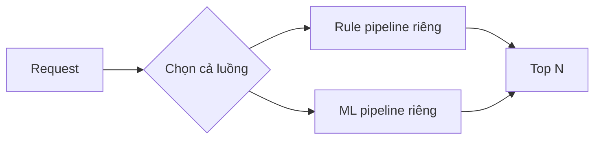
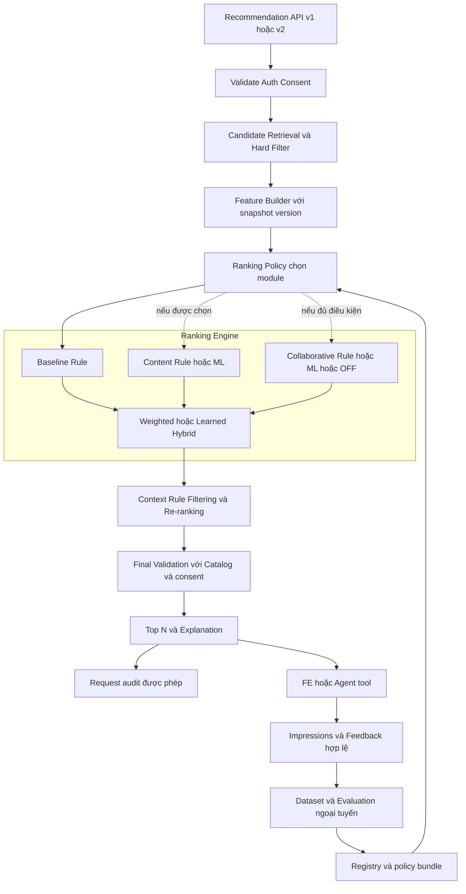
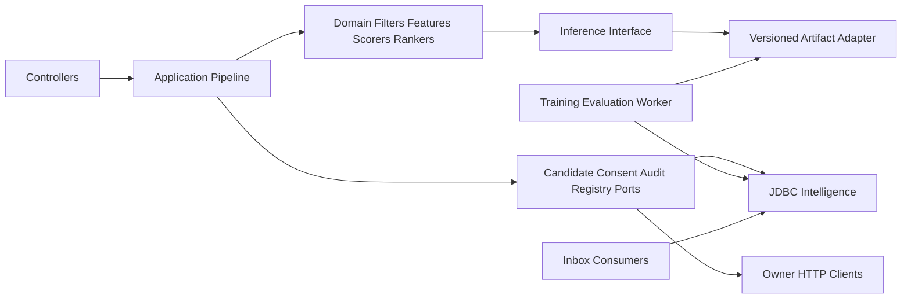

# Kiến trúc Unified Modular Recommendation

Ngày thiết kế: 29/10/2026. Đây là thiết kế đích, không phải xác nhận chức năng đã triển khai. [Mục lục](00-readme.md) · [Nguồn và hiện trạng](01-current-state.md) · [Tiến độ duy nhất](../../progress_be.md).

## 1. Quyết định và phạm vi

**Một pipeline, nhiều implementation cho từng module.** Quyết định này do người dùng chốt trong yêu cầu ngày 29/10/2026. Intelligence vẫn là service owner; N2 phụ trách, N1 review chéo theo [phân công](../../plan/06-work-assignment.md). Không tạo Recommendation Service, Model Service hay Feature Store Service mới. Training worker là tiến trình thuộc Intelligence, dùng database và credential của Intelligence; deployment riêng của worker không biến nó thành một domain service mới.

MVP gồm recommendation bằng công thức, contract tương thích, consent, hard constraints, explanation, logging tối thiểu và fallback. ML là nâng cấp từng module sau quality gate. Tích hợp Agent là phạm vi thiết kế mới: [kế hoạch gốc](../../plan/README.md) loại chatbot/RAG và tối ưu tuyến sâu khỏi scope; tài liệu này không tự mở scope chatbot hoặc tự động ghi Trip trong đợt triển khai MVP.

## 2. Khác biệt với cách chọn toàn bộ Rule/ML

| Khía cạnh | Hai luồng độc lập trong phương án cũ được mô tả trong yêu cầu | Source hiện tại | Thiết kế đích |
|---|---|---|---|
| Điểm vào | Rule API và AI API/pipeline riêng | Một controller gọi `ModelService.recommend`, chọn toàn request Basic hoặc Model | Một application pipeline, v1/v2 là adapter contract vào cùng pipeline |
| Filter và consent | Dễ có hai bản logic | Có lọc/final validation dùng chung qua Basic | Một bộ invariant không scorer nào được vượt qua |
| Thành phần ranking | Chuyển cả hệ thống | Model active toàn use case; chưa modular scorer | Chọn Content ML + Collaborative Rule + Weighted Hybrid trong cùng request |
| Khi ML lỗi | Chuyển cả luồng | Trở Basic khi model lỗi | Fallback module lỗi, giữ module còn hợp lệ; kiểm lại hybrid compatibility |
| Nâng cấp/rollback | Thay pipeline | Đổi active model chung | Đổi policy bundle tham chiếu version từng module; request đang chạy giữ bundle cũ |

Không gán nhầm cho repository rằng đã có hai microservice hoặc hai API độc lập. Source đang có **global strategy switch**, cũng cần migration để đạt kiến trúc chính thức mới.



Sơ đồ trên chỉ minh họa phương án cũ cần tránh. Thiết kế mới:



Ví dụ: policy yêu cầu `baseline.rule@1`, `content.ml@c7`, `collaborative.rule@2`, `hybrid.weighted@1`, `context.rule@1`. Content ML timeout thì dùng `content.rule@1`; CF Rule vẫn chạy nếu đủ consent và neighbors. Nếu Learned Hybrid đòi Content ML c7, việc fallback Content Rule làm thay đổi input signature: chuyển riêng Hybrid sang Weighted, không đưa input khác phân phối vào model cũ. Chi tiết [policy](08-ranking-policy-fallback.md), phép tính [ví dụ 5](10-examples.md).

## 3. Luồng đồng bộ và ranh giới dữ liệu

| Nguồn canonical | Đường truyền đích | Dữ liệu Intelligence được lưu | Điều kiện dùng |
|---|---|---|---|
| Catalog | RabbitMQ place/destination/category; snapshot HTTP có watermark; final batch validation | `place_features`, taxonomy projection, tombstone | PUBLISHED, version từng stream, hard fields đủ tin cậy |
| Community | RabbitMQ rating summary/favorite/review; HTTP snapshot khi rebuild | Aggregate rating, implicit events; không copy nội dung review/PII | Review approved mới là tín hiệu chất lượng; event hiện thiếu explicit rating |
| Identity | RabbitMQ preferences/status/deletion; HTTP consent kiểm lại | Preference projection + consent version, deletion fence | Consent chưa rõ = không cá nhân hóa; event cũ không phục hồi revoke |
| Trip | `trip.item.added.v1` + snapshot HTTP | Một implicit add với attribution | Dedup theo event, không coi ý định thêm Trip là đã thực sự đến thăm |
| Ingestion | Source-policy event + HTTP policy check | Source lineage, allow-training snapshot + version | Quyền hiện tại vẫn hợp lệ tại build/train/activate |
| Client | Interactions v1, feedback v2 đề xuất | SEARCH/PLACE_VIEW; impressions/clicks có token riêng | Auth, analytics consent và idempotency; không nhận favorite/review/trip giả |

Chỉ adapter gọi HTTP; không repository nào đọc DB service khác. RabbitMQ là transport thực tế, HTTP JSON là giao tiếp nội bộ; không thêm gRPC/Kafka vì tên công nghệ trong tài liệu tham khảo. Projection là bản sao có thể rebuild, không phải nguồn canonical. Consent Identity, review Community, place Catalog vẫn do owner đó thay đổi.

## 4. Cấu trúc code dự kiến

Gốc Java dưới `backend/services/intelligence-service/src/main/java/vn/smarttravel/intelligence/`. Danh sách dưới là **đề xuất**, không tạo class trong nhiệm vụ này.

```text
recommendations/
  controller/RecommendationV2Controller.java
  application/RecommendationPipeline.java
  application/LegacyRecommendationAdapter.java
  domain/RecommendationContext.java
  domain/FeatureBundle.java
  domain/ScoreBatch.java
  domain/RankingResult.java
  domain/ReasonCode.java
  candidates/CandidateProvider.java
  candidates/ProjectionCandidateProvider.java
  candidates/HardConstraintFilter.java
  features/FeatureBuilder.java
  ranking/Scorer.java
  ranking/Ranker.java
  ranking/StrategyRegistry.java
  ranking/RankingPolicy.java
  ranking/baseline/BaselineRuleScorer.java
  ranking/content/ContentRuleScorer.java
  ranking/content/ContentMLScorer.java
  ranking/collaborative/CollaborativeRuleScorer.java
  ranking/collaborative/CollaborativeMLScorer.java
  ranking/hybrid/WeightedHybridRanker.java
  ranking/hybrid/LearnedHybridRanker.java
  context/ContextReranker.java
  validation/FinalValidator.java
  explanation/ExplanationBuilder.java
  repository/RecommendationAuditRepository.java
feedback/
  controller/FeedbackController.java
  service/FeedbackCollector.java
  repository/FeedbackRepository.java
models/
  inference/ModelInferenceAdapter.java
  registry/ModelRegistry.java
  evaluation/EvaluationPipeline.java
  training/TrainingWorker.java
```

Giữ và tách dần `BasicRepository`, `BasicService`, `ModelService`, `ModelRepository`, `ProjectionRepository`, `DependencyClient`, `ArtifactStore`, `ModelWorker` hiện có; không xóa toàn bộ để viết lại. Scorer/ranker thuần tính toán dùng immutable input, không tiêm JDBC, HTTP client hay JWT. `StrategyRegistry` ban đầu là map implementation qua Spring injection; không reflection từ tên class do admin nhập, không plugin loader, không DSL tổng quát. Các lớp DTO domain chỉ xuất hiện khi ranh giới test cần, không tạo base class cho mọi phép cộng.

| Nhóm | Tính nghiệp vụ | DB | HTTP/broker | Model/artifact | Background |
|---|---|---|---|---|---|
| Pipeline/Policy/Filters/Features | Có | Qua port | Qua port | Qua adapter | Không |
| Rule scorers/Weighted/Context | Có, thuần | Không | Không | Không | Không |
| ML scorers/Learned ranker | Kết hợp adapter + kiểm score | Không | Không trực tiếp | Inference adapter | Không |
| Projection/Candidate/Audit/Registry repository | Mapping và query bounded | DB Intelligence | Không | Metadata | Không |
| DependencyClient và event listener | Validate wire contract | Qua repository | Có, scope tối thiểu | Không | Inbox processing |
| ArtifactStore | Key/checksum/atomic write | Metadata qua registry | Object storage khi có | Binary private | Cleanup |
| Evaluation/Training worker | Snapshot/train/eval | DB Intelligence | Job claim; không DB khác | Read/write artifact | Có |



Mũi tên từ domain tới `Inference Interface` là phụ thuộc contract, không phụ thuộc runtime Python hay storage SDK. Training và serving dùng cùng feature specification/version; evaluation không gọi API live để xây nhãn quá khứ.

## 5. Contract nội bộ tối thiểu

Pseudocode biểu diễn interface, không phải mã triển khai:

```text
CandidateProvider.retrieve(scope, cursor, deadline) -> CandidatePage
HardConstraintFilter.apply(candidates, constraints, evidence) -> EligibleCandidates
FeatureBuilder.build(candidates, requestCriteria, permittedUser, snapshot) -> FeatureBundle
Scorer.score(features, moduleVersion, deadline) -> ScoreBatch
Ranker.rank(features, scoreBatches, policyVersion, deadline) -> RankingResult
ContextReranker.apply(ranked, hardConstraints, context) -> RankedCandidates
FinalValidator.check(candidates, sourceVersions, consentFence, deadline) -> ValidatedCandidates
ModelInferenceAdapter.infer(modelHandle, featureMatrix, deadline) -> RawScores
FeedbackCollector.accept(principal, consent, signedToken, event) -> Receipt
```

`ScoreBatch`: module/implementation/version, `feature_schema_version`, `score_schema_version`, calibration version, model ID nullable, snapshot ID, map place→{score,available,confidence,reasons}, elapsed, fallback reason. Missing không tương đương score 0; 0 là giá trị hợp lệ. Không scorer nào được thêm candidate ngoài tập eligible. NaN/Infinity, ID lạ, duplicate hoặc score sai miền làm module fail, không tự ép về 0 để che lỗi.

`RankingResult` giữ provenance cho từng module thực dùng và input signature. `Candidate` gồm place_id, Catalog/rating/source version, destination membership, hard-field evidence, features. Không đưa user ID hay raw query vào feature vector trừ khi có thiết kế consent/ML cụ thể. `snapshot` là bộ version dữ liệu, không phải lời hứa snapshot transaction xuyên service.

## 6. Orchestration, deadline và tính nhất quán

```text
recommend(principal, request):
  validated = validateRequestAndScope(request)
  consent = resolveCurrentConsentOrDisablePersonalization(principal)
  bundle = policyRegistry.pinImmutableActiveBundle()
  deadline = nowMonotonic() + configuredRequestBudget
  eligible = retrieveAndHardFilter(validated, deadline)
  features = buildFeatures(eligible, validated, consent)
  plan = policy.selectEligibleModules(bundle, features, consent)
  scores = runOnlySelectedScorersWithBoundedFallbacks(plan, features, deadline)
  ranked = rankWithCompatibleRankerOrWeighted(scores, features, plan)
  ranked = contextRerankWithinEligibleSet(ranked, validated)
  final = validateCatalogVersionsAndConsent(ranked, deadline)
  final = refillFromAlreadyEligibleReserveIfBudgetAllows(final)
  final = rerunDeterministicDiversityOnValidatedReserve(final, bundle)
  top = takeFirstNInFinalOrder(final, request.topN)
  recordPermittedAuditOrFailFeedbackTokenIssuance(top, consent, bundle)
  return buildExplanationAndVersionedResponse(top)
```

Đề xuất service budget 1.500 ms để còn margin dưới Gateway 2 s hiện tại; SLO p95 800 ms cần benchmark, chưa phải kết quả đo. Model mỗi module tối đa 100 ms, tổng ML tối đa 200 ms; reserve ít nhất 300 ms cho final validation và serialization. DB/query/HTTP phải cùng deadline; timeout thread không dừng compute thì không được giữ worker/thread vô hạn. Không retry POST recommendation qua Gateway; request là tính toán nhưng còn side effect audit. Đề xuất cancel inference và bounded executor/circuit breaker, không loop fallback vô hạn. SLO P00 ≤1 s và P03 <800 ms đang lệch (F-19); owner chốt lại trước gate.

Mỗi request pin policy bundle và calibration. Thay model giữa chừng không đổi request đang chạy. Final validation kiểm batch place hiện PUBLISHED và version khớp feature dùng; mismatch loại candidate hoặc hydrate/recompute một lần trong budget, không dùng điểm trên nội dung cũ gắn vào nội dung mới. Catalog không xác nhận được thì fail closed 503, kể cả fallback phổ biến. Trả ít hơn N khi chỉ có ít place hợp lệ; không mở rộng destination/budget để lấp đầy. Một lần kiểm tra không tạo bảo đảm tuyến tính rằng place không thể bị ẩn ngay sau response; lưu `validated_at`, FE refresh trước hành động ghi.

Top-N lấy thứ tự của context/diversity, không sort lại score làm mất MMR. Khi final filtering loại item hoặc refill, chạy lại deterministic MMR trên reserve đã validate bằng scores cũ còn đúng version; không dùng item vừa bị loại làm penalty cho item còn lại. Nếu không đủ deadline thì trả ít item hợp lệ hoặc503 khi final dependency lỗi, không bỏ hard validation.

## 7. Thứ tự migration

1. Khóa golden behavior v1, consent và final validation bằng test; đo source limit 1.000 và scale trước khi tách.
2. Tách filter, features, Baseline/Content Rule và audit khỏi repository; giữ compatibility adapter v1. Không ép formula mới thành v1 cũ mà không đổi algorithm version.
3. Tạo v2 contract và pipeline dùng cùng module, thêm projection fields có version; legacy v1 vẫn chỉ nhận/trả schema cũ.
4. Thêm CF Rule có điều kiện dữ liệu; Weighted Hybrid; chứng minh MVP không model vẫn đủ chức năng.
5. Dựng evaluation rồi thêm ML adapter từng module. Legacy model fixture không tự ánh xạ thành Content ML hay Hybrid ML đạt gate.
6. Hoàn thiện policy control plane và tích hợp Agent sau API ổn định. Không bật AI mặc định trong công việc soạn kế hoạch.

[Module và công thức](03-module-design.md) · [Dữ liệu](04-data-design.md) · [Roadmap](06-implementation-roadmap.md).
