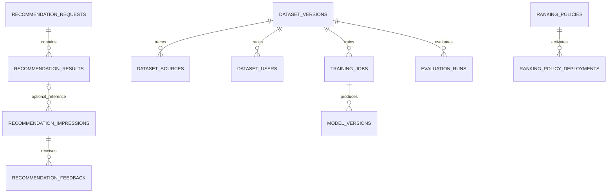

# Thiết kế dữ liệu và quyền sở hữu

[Mục lục](00-readme.md) · [Hiện trạng](01-current-state.md) · [API](05-api-contracts.md) · [ML](07-ml-training-evaluation.md). Đây là đặc tả thay đổi tương lai; không có migration/database nào được áp dụng khi lập kế hoạch.

## 1. Nguyên tắc và nguồn canonical

Mỗi service một database/credential; không FK hoặc SQL JOIN xuyên database. UUID bên ngoài chỉ là external reference. Intelligence không tự cập nhật `identity.user_preferences`, place Catalog, rating Community hoặc Trip. Local FK chỉ giữa bảng trong Intelligence. Trạng thái runtime và evidence chỉ theo [progress BE](../../progress_be.md), không theo số bảng có trong thiết kế.

| Dữ liệu | Owner canonical | Bản sao được phép ở Intelligence | Đồng bộ |
|---|---|---|---|
| Sở thích, personalization và consent version | Identity `user_preferences`, `user_category_preferences`, preference options | `user_feature_profiles` với purpose/epoch, không email/name | preferences changed event + snapshot/current consent API có quyền |
| Place/location/category/destination/hours/price/status | Catalog | `place_features`, stream versions/tombstones; hard fields có evidence | place/taxonomy events + versioned snapshot, không đọc DB Catalog |
| Rating/review/favorite | Community MongoDB | Aggregate rating; derived implicit state | summary/review/favorite events + owner snapshot; explicit rating cần contract mới |
| Trip/day/item | Trip PostgreSQL | Implicit add event và attribution tối thiểu | trip item event/snapshot, không copy toàn trip/ghi chú |
| License/source policy/raw import | Ingestion PostgreSQL | `source_policies`, per-feature lineage | event + current policy HTTP check |
| Recommendation/feedback/dataset/model/policy | Intelligence | Canonical trong Intelligence | API/controller/worker có quyền, outbox cho thông báo |

## 2. Schema hiện có cần tái sử dụng

Nguồn thực tế: [V2](../../backend/services/intelligence-service/src/main/resources/db/migration/V2__domain_baseline.sql), [V4](../../backend/services/intelligence-service/src/main/resources/db/migration/V4__projection_safety.sql), [V6](../../backend/services/intelligence-service/src/main/resources/db/migration/V6__feature_embeddings.sql), [V7](../../backend/services/intelligence-service/src/main/resources/db/migration/V7__mutation_versions.sql), [V9](../../backend/services/intelligence-service/src/main/resources/db/migration/V9__actor_privacy_purge.sql), [V10](../../backend/services/intelligence-service/src/main/resources/db/migration/V10__history_purge_cutoff.sql). Cột ở phần “bổ sung” là đề xuất, không khẳng định đang tồn tại.

| Bảng hiện có / mục đích | PK, fields chính và refs | Index hiện có hoặc đề xuất bổ sung | Thay đổi cần thiết |
|---|---|---|---|
| `user_feature_profiles`: preference/consent projection | PK user_id external Identity; preferences JSON, personalization_enabled, consent_version, source_version, feature_version, as_of, history_purged_before | PK; bổ sung index as_of để reconcile bounded | Purpose grants analytics/training nếu Identity chốt; consent_epoch/current_checked_at; không coi as_of=permission hiện hành |
| `place_features`: projection item | PK place_id external Catalog; catalog_version/rating_version riêng, status, features JSON, content_hash, as_of, embedding vector(3) legacy | status/place_id; HNSW vector3 hiện có; đề xuất destination/status/place_id, GIN category khi đo cần | destination IDs, lat/lon, currency, cost/hours/timezone/evidence/source refs có version; timestamps riêng từng stream |
| `interactions`: behavior canonical derived | PK identity bigint; UNIQUE event_id; user/place/destination refs external; event_type,session_id,consent_version,context,occurred_at,received_at | user/time,place/time,BRIN occurred_at; thêm producer/type/time nếu query cần | producer, schema/purpose/consent epoch, attribution/request ID, received-cutoff fence; raw query không mặc định lưu |
| `recommendation_requests`: decision audit | PK request_id; user external nullable,session_id,mode,algorithm_version,model_version_id local FK,criteria,top_n,latency_ms,fallback_reason,created_at | history user/time; thêm policy/time bounded | policy_id/version/hash, feature snapshot, consent epoch, actual module trace JSON, attempted trace, request hash; sanitize criteria |
| `recommendation_results`: returned candidates, chưa phải impression | PK(request_id,place_id); FK request cascade; UNIQUE(request_id,rank); score,explanation,catalog_version | Các key đủ lookup; bổ sung result_id UUID UNIQUE cho nullable feedback reference, expiry qua parent | ranking utility/context utility riêng trong audit, rating/source versions, final_validated_at, reason codes; không lấy tồn tại row làm nhãn đã nhìn thấy |
| `dataset_versions`: immutable snapshot metadata | PK dataset_version_id; name,criteria,feature_schema_version,row_count,artifact_object_key,checksum,status,created_by external | PK; đề xuất created_at + status | dataset_definition_id/version pin module/unit/label horizon, verified data_kind (SYNTHETIC/PUBLIC_UNLABELED/PUBLIC_JUDGED/REAL_CONSENTED), split manifest, cutoff/event+receive watermarks, candidate/scorer/calibrator versions, content hash và run hash riêng |
| `dataset_sources`: source lineage | PK(dataset_version_id,source_id); FK dataset; source external, source_version,license_version,allow_training_snapshot | source_id,dataset_version_id | field/content scope, policy epoch/check timestamp; allow_training_snapshot=true không thay current check |
| `dataset_users`: personal lineage | PK(dataset_version_id,user_id); FK dataset, user external, consent_version | Bổ sung user_id,dataset_version_id để revoke theo user | purpose/consent epoch, lineage role (feature/label), purge/revoke timestamp; không xuất danh sách user công khai |
| `training_jobs`: job management | PK training_job_id; FK dataset; algorithm,params,code_revision,random_seed,status,logs key,started/ended/created | dataset/time; đề xuất status,available_at cho claim | job_kind TRAIN/PREPARE_PRETRAINED,module_key,lease_owner,lease_until,heartbeat,attempt,cancel_requested_at,resource budget,failure code,environment hash |
| `model_versions`: artifact registry | PK model_version_id; FK training_job; model_name,version_no,artifact key/checksum,metrics,feature schema,status | UNIQUE(name,version); training_job | module_key,origin_kind LOCAL_TRAINED/PRETRAINED_PREPARED,pinned pretrained revision manifest,score/calibrator/input signatures,compatibility/evaluation/governance status,eval ref,synthetic_only,library versions |
| `model_deployments`: legacy activation history | PK deployment_id; FK model; use_case,activated_by external nullable,activated/deactivated,reason | UNIQUE(use_case) WHERE active; model/time | Giữ legacy; không dùng row này làm active pointer thứ hai cho modular serving; v2 facade đổi policy bundle atomic |
| `source_policies`: license projection | PK source_id external; source_version,policy JSON từ V4 | PK; thêm as_of nếu reconcile | Current-policy proof/freshness và lineage invalidation epoch |
| `projection_versions`: dedup/version streams | PK(stream,aggregate_id); version,payload | PK | Không lưu raw event PII vô hạn; payload chỉ phục vụ projection có retention/phân quyền |
| `user_tombstones`: deletion fence | PK user_id external; deleted_at | PK | Epoch/cutoff cần để event cũ không hồi sinh dữ liệu; retention theo threat/replay horizon |
| `interaction_rate_limits`: anti abuse | PK actor_key; window_start,count | PK; expiry/window index nếu sweep | Actor key hash ngắn hạn, không credential; purge theo window |
| `outbox_events`, `inbox_events` | Event UUID; inbox PK(consumer,event); outbox aggregate/version/type/payload | pending available_at; inbox dedup keys | Giữ transactional publish/confirm/retry; dedup retention phải ≥ replay horizon |
| `audit_logs`, `idempotency_records` | Audit UUID và actor/entity/action/correlation; idempotency PK(scope,actor,key),hash,status/body,expiry | audit entity/time; idempotency expiry | Redact payload/actor theo deletion; không cache response chứa personal data sau revoke |

### 2.1. Mode và version khi migration

Legacy `mode` CHECK chỉ BASIC/MODEL/FALLBACK; không thể ghi “HYBRID” hay “MODULAR” ngay vào source hiện tại. Đề xuất giữ cột compatibility: FALLBACK nếu execution có degraded fallback, MODEL nếu có ML thực dùng mà không fallback, BASIC nếu chỉ rule. **Không dùng mode để tái hiện execution**; nguồn chính là `actual_module_trace` + policy snapshot. `model_version_id` legacy có thể null khi nhiều module, không chọn tùy ý một ID làm “model chung”; per-module refs nằm trong trace/registry. Khi v1 admin không ánh xạ được module, trả lỗi compatibility đã công bố trong [API](05-api-contracts.md).

Scorer version là code+config+feature contract hash. `algorithm_version` là pipeline behavior version, không thay thế policy version/model version. Public metadata ẩn internal artifact key/checksum; admin audit mới thấy detailed manifest có quyền.

## 3. Bảng bổ sung đề xuất

Tất cả bảng mới dưới thuộc schema/database Intelligence. Chỉ tạo khi phase cần; không tạo tất cả registry/evaluation tables trong MVP nếu immutable config/JSON audit đã đáp ứng. Mỗi bảng ghi rõ retention mục tiêu để owner duyệt, không phải chính sách pháp lý đã được chấp thuận.

| Bảng, mục đích và phase | Fields chính | PK/FK/external reference | Index/constraint | Rủi ro và đồng bộ |
|---|---|---|---|---|
| `recommendation_impressions` G3: exposure được client xác nhận | impression_id,request_id,place_id,user_id,session_hash,token_hash,consent_epoch,rendered_at,received_at,position,surface,expires_at,attribution_snapshot,result_ref | PK impression_id; result_ref local nullable FK tới result surrogate key đề xuất, ON DELETE SET NULL; request_id/place_id là immutable copied refs, user external | UNIQUE token nonce; UNIQUE(request,place,session_hash,surface); user/time,request/rank; position>0 | Token cấp khi recommend chưa là impression. Snapshot tối thiểu policy/rank/item versions được xác thực lúc admission; không composite FK nullable làm null luôn copied refs; không raw JWT |
| `recommendation_feedback` G3: click/dismiss sau exposure | event_id,impression_id,user_id,type,occurred_at,received_at,consent_epoch,body_hash | PK event_id; local FK impression nếu cần; external user | UNIQUE(impression,type) cho loại one-shot; user/time; event hash chống replay khác payload | Không nhận favorite/review/trip ở endpoint này; không tự coi dismiss là rating1; khi purge phải xử cả linked rows |
| `strategy_versions` G5: đăng ký implementation code manifests | strategy_id,version,module,code_revision,config_hash,input/output schema,artifact_required,status | PK(strategy_id,version); không remote class URI | module/status; immutable insert; deactivate không mutate history | Ban đầu code registry đủ; admin không upload script qua DB; app image phải có implementation tương ứng |
| `ranking_policies` tối thiểu G3-07, nâng cao G5: immutable bundle definitions | policy_id UUID mỗi bundle,policy_version unique string,name/lineage alias,version lifecycle CAS,definition_json,content_hash,feature_schema,required_input_signature,evaluation_id nullable,created_by,reason,created_at | PK policy_id; nullable FK evaluation sau evaluation; refs model UUID/strategy manifest validated khi save | UNIQUE policy_version; created_at; refs metadata normalized khi cần | G1 rule config có stable UUID/hash; G3 import/persist exact manifest và create/get DRAFT cho evaluator, chưa activate. DRAFT content immutable, chỉnh tạo UUID/label mới. G5 thêm slots/rollout, không tạo lại identity |
| `ranking_policy_deployments` G5: deployment history | deployment_id,use_case,cohort_slot,policy_id,activated/deactivated,actor,reason,review_ref,active_generation | PK deployment_id; FK policy_id; actor external | UNIQUE(use_case,cohort_slot) WHERE deactivated_at IS NULL; policy/time; generation không tính từ policy version | Một transaction khóa slot + policy valid + audit + outbox; model facade và policy activation cùng đường đi |
| `ranking_policy_slots` G5: serving pointer và CAS counter bền vững | use_case,cohort_slot CONTROL/CANARY,active_policy_id nullable,active_generation integer monotonic | PK(use_case,cohort_slot); local FK active_policy_id | PK đủ lock/CAS; generation≥0 tăng qua cả deactivate/reactivate | GET active trả đúng counter; update cùng deployment/audit/outbox, không derive từ target policy lifecycle; SHADOW không đổi production slot |
| `evaluation_runs` G3: job và immutable metrics | evaluation_id,dataset_id,baseline_bundle,candidate_bundle,split_hash,seed,status,metrics_json,slice_counts,confidence_json,artifact_key,code_revision,synthetic_only,gate_outcome,created_at | PK evaluation_id; FK dataset; policy refs/hash | dataset/time,status/time; immutable terminal result | Không sửa metrics bằng tay qua API; retry tạo attempt/ref mới; same config+snapshot tái hiện được trong tolerance |
| `admin_operations` G3-08 cho validate, mở rộng G5-05 cho deploy/rollback: durable control operations | operation_id,kind,target_id,actor_id,request_hash,idempotency_scope,key,status,expected_resource_version,expected_active_generation,approval_ref,result_json,error_code,lease_owner,lease_until,heartbeat,attempt,created/started/ended/expires_at | PK operation_id; refs model/policy validated theo kind; actor external; UNIQUE(actor,scope,key) hoặc liên kết idempotency_records | status/available_at để claim; lease_until; expires_at; terminal result immutable | Kind chỉ allowlist MODEL_VALIDATE/MODEL_DEPLOY/MODEL_ROLLBACK/POLICY_VALIDATE/POLICY_ACTIVATE/POLICY_ROLLBACK; 202 sau durable enqueue, replay trả cùng ID; worker shared queue code với training nhưng không nhét control kind vào job TRAIN/PREPARE |
| `place_feature_history` G3: point-in-time materialization | history_id UUID,event_id/source occurrence,place_id,catalog_version,rating_version,source_epoch,valid_from,recorded_at,payload_hash,features,consent_free flag | PK history_id; external place; UNIQUE(stream,event_id) khi một event tạo một row | place_id,recorded_at DESC; cutoff/BRIN; source sequence không bỏ occurrence có content lặp | A→B→A phải giữ đủ 3 lần; content_hash dedup blob chứ không dedup lịch sử; bitemporal valid vs received chống late-event leakage |
| `place_embeddings` G4: semantic vectors độc lập legacy | place_id,model_id,feature_hash,dimension,embedding,normalized,created_at,source_epoch | PK(place_id,model_id,feature_hash); model FK nếu cùng registry; external place | model/feature_hash; vector index theo dimension/model khi thật cần | Không trộn chiều/model trong cùng vector index; exact search trước ANN khi nhỏ; source revoke purge/recompute |

Không tạo `recommendation_user_preferences` canonical thứ hai. Không tạo bảng `scorer_scores` cho mọi item của mọi request mặc định: chi phí/PII lớn; audit Top N + sampled candidate trace có consent và retention ngắn là đủ để debug, full replay dùng controlled dataset snapshot. Nếu strict full replay cần whole feature snapshot, bật ở evaluation/admin sampling, không lưu GPS/history tất cả users mặc định.

## 4. Retention, consent và xóa dữ liệu cho từng nhóm

Các duration dưới là **mục tiêu đề xuất cần N1/N2 và người dùng chốt**. Source hiện đã có retention tương tác 90 ngày, artifact orphan GC và tombstone; không suy là có policy hoàn chỉnh cho mọi bảng.

| Dữ liệu/bảng | Retention dự kiến | Consent/quyền | Xóa/revoke và điểm cần bảo vệ |
|---|---|---|---|
| Identity preferences canonical | Trong vòng đời account, owner Identity quyết định | Preference dùng trong chức năng profile; personalization grant riêng | Intelligence chỉ nhận thay đổi/purge projection, không xóa canonical |
| `user_feature_profiles` | Đến revoke/delete; snapshot event có freshness limit | Personalization; analytics/training không suy từ một boolean | Revoke trước phục vụ; purge history/factors khi purpose bị rút; fence monotonic |
| `place_features`,taxonomy,`source_policies` | Khi active; tombstone giữ qua replay horizon | Public/licensed data; không cần user consent | Source policy revoke ảnh hưởng derivative; archive place không để stale event phục hồi |
| `interactions` | 90 ngày rolling mục tiêu; không tự kéo dài cho ML | Analytics và personalization/training theo purpose được chốt | User purge cutoff và deletion tombstone chặn late events; SEARCH text redact/hash theo nhu cầu |
| `recommendation_requests/results` | 30 ngày với analytics consent; 24 giờ tối đa cho record kỹ thuật không định danh nếu cần attribution | Không consent: không user_id, không session liên kết, không criteria/GPS/history; có thể không persist row | Session_id hiện NOT NULL: nếu record tối thiểu dùng random/request, không analytics session; purge linkage/results và trace PII |
| `recommendation_impressions/feedback` | 90 ngày mục tiêu; token 15 phút; rate-limit window ngắn | User authenticated + analytics purpose hiện hành; MVP bảo thủ: request personalization OFF không token/telemetry định danh dù có grant khác | No analytics: không token, không row; request/results purge30 ngày chỉ null result_ref, attribution snapshot permitted vẫn90 ngày; delete/revoke invalidate token và purge cả linked feedback |
| `dataset_versions`,artifacts | 180 ngày hoặc 3 release gần nhất mục tiêu, trừ revoked purge sớm | Current training grant + source allow_training; feature/label lineage | Revoke status ngay, cancel job, stop affected model; physical purge object/backups theo policy được duyệt |
| `dataset_sources/dataset_users` | Bằng lifetime dataset/model derivative | Restricted admin/worker; user lineage là dữ liệu cá nhân | Không xóa lineage sớm khiến không truy được ảnh hưởng; khi purge giữ evidence không PII về lý do revoke |
| `training_jobs/log artifacts` | Metadata 180 ngày, raw log redacted 30 ngày | Admin/worker only, không raw dataset logs | Cancel không lập tức thành CANCELLED trước worker ack; lease guard trước publish |
| `model_versions`,artifacts/`place_embeddings` | Active + 2 validated rollback versions, tối đa 180 ngày mục tiêu | Artifact private; weights/embedding có thể encode user data | Retain rollback chỉ nếu current license/consent còn hợp lệ; revoked không giữ để phục vụ |
| `evaluation_runs` | 180 ngày metadata aggregate; detailed per-user report ngắn 30 ngày | Same purposes như dataset; public chỉ aggregate đủ an toàn | Re-eval sau purge nếu dataset invalid; không công bố sample cá nhân |
| `admin_operations` | Terminal metadata 180 ngày mục tiêu; idempotency receipt 24 giờ; audit actor redacted theo policy | Admin only, approval ref xác minh; không raw dataset/credential trong result | Short transaction claim/lease, recovery idempotent theo active_generation và operation_id; không lặp deployment sau worker crash; expected generation/revocation recheck trước publish |
| `strategy_versions`,policies/deployments/slots | Code/config history 1 năm; slot counter tồn tại theo use case | Admin scope; approval/audit quyền riêng | User deletion anonymize actor nếu cần; giữ generation monotonic và release technical evidence không PII |
| `place_feature_history` | 180 ngày licensed public snapshot, theo evaluation horizon | Source storage/training grant theo field | Policy revoke xóa artifact derived hoặc disable usage ngay; không giả quá khứ trước lúc bắt đầu thu thập |
| `outbox/inbox/projection_versions` | Theo retry/replay horizon được đo; đề xuất tối thiểu90 ngày đối với rebuild cần90 ngày | Payload minimized, internal scope | Không purge outbox trước khả năng snapshot Trip phụ thuộc nó; durable archive/snapshot thay thế nếu giảm |
| `audit_logs/idempotency_records` | Audit1năm mục tiêu, idempotency24h; không giữ response PII quá consent | Admin/security purpose giới hạn | Anonymize actor, sanitize old/new JSON, purge response body; idempotence không hồi sinh dữ liệu deleted |
| `user_tombstones/rate limits` | Tombstone≥replay/backup horizon; rate key≤24h | Chỉ retention fence mục đích bảo vệ, không profiling | User UUID trong fence restricted; không dùng tombstone để suy recommendation/history |

Purpose matrix là quyết định cần xác nhận: canonical hiện có `personalization_enabled` và consent_version; chưa tự chứng minh ba grant analytics/training/personalization độc lập. Foundation phải chốt Identity contract. Trước khi chốt: không dùng client `analytics_consent:true` làm quyền cao hơn owner; không train personal data bằng suy diễn. Có thể chạy public/request-only recommendation và test fixture kỹ thuật.

Không mở analytics độc lập cho request OFF trong MVP. Nếu muốn hỗ trợ purpose độc lập sau này phải đổi consent contract/UI, data policy và tests cùng revision; đây không phải hành vi mặc định của v2 đề xuất.

Bootstrap evaluation không chờ control plane G5: G1-10 cấp UUID/hash cố định cho rule bundle; G3-07 tạo minimal `ranking_policies` và create/get DRAFT APIs để đăng ký manifest cùng nội dung, evaluation nhận policy UUID đã resolve. `evaluation_id` nullable trước run; sau run gắn kết quả bằng lifecycle mutation có CAS, không sửa definition. G3 ban đầu đánh giá rule bundles, model references được kiểm nâng cao khi G3-08 registry sẵn; G4 candidate model được đăng ký CANDIDATE trước evaluation, không cần VALIDATED/ACTIVE để đánh giá. G5 chỉ bổ sung active slots/approval/rollout, không là prerequisite ngầm của evaluator.

Pretrained Content encoder đi qua job `PREPARE_PRETRAINED`: verify admin-allowlisted pinned origin/license/checksum/tokenizer/dimension, chuyển artifact an toàn và chuẩn bị vectors trên public licensed dataset snapshot. Không train weights, không ghi epochs giả. Job preparation vẫn là provenance FK `training_job_id` legacy; `origin_kind=PRETRAINED_PREPARED` phân biệt với LOCAL_TRAINED. Không bỏ FK hoặc tự tạo một training thành công giả để lách registry.

## 5. Projection contracts và hard-field evidence

| Stream | Contract hiện hữu | Extension đề xuất cần owner review | Quy tắc áp dụng |
|---|---|---|---|
| Place Catalog | upsert/visibility, features-snapshot internal ngoài registry | description licensed,timezone,hours exceptions,destination memberships,cost basis/estimate,accessibility/evidence,per-field source/version | Event schema mới hoặc snapshot v2; v1 consumer không nhận payload trái strict schema |
| Rating Community | Aggregate count/sum/version | Không cần explicit review text; nếu explicit CF cần user-rating snapshot có consent/scope | Rating version độc lập Catalog version, không cộng hai snapshot vào nhau |
| Identity preference/consent | Event + internal snapshot | Current consent purpose/fence endpoint, revocation freshness proof | Version mới thắng; delete/revoke fence ưu tiên hơn delayed opt-in |
| Community implicit | favorite/review changes | Moderation-aware labels và producer sequence; snapshot terminal state | Review created chưa approved không thành positive quality label |
| Trip | item added + interactions snapshot | Attribution/request validation/read token nếu cần thêm | Dedup event ID; snapshot overlap inbox vẫn đúng, never synthetic user joins |
| Source policy | source-policy changed + internal current check | Per-field/derivative eligibility khi nhiều nguồn | allow_storage không suy allow_training; manual/UGC vẫn có policy owner |

Đề xuất final validation contract tại [API](05-api-contracts.md) phải xác nhận đủ hard fields hiện hành. Endpoint `/internal/v1/places/validate` hiện chỉ xác nhận public/version, chưa tự chứng minh budget/hours mới. Có hai đường hợp lệ: version match toàn payload hard fields đã kiểm, hoặc đọc current batch/hard-field validation v2 có scope. Không dùng version check của subset payload để tuyên bố đã kiểm holiday/accessibility chưa có trên wire.

`as_of` response là conservative min timestamp các nguồn **thực dùng trong kết quả cuối**, kèm per-stream freshness chi tiết trong audit; không lấy max(candidate.as_of) như legacy. Unknown timestamp phải có flag, không điền now. Snapshot không bao gồm transaction atomic toàn sáu service: final revalidation và version fences xử lý consistency tại ranh giới.

## 6. Rebuild và ingestion idempotent

```text
rebuild(stream):
  checkpoint = owner.beginSnapshotWithWatermark()
  for page in owner.snapshot(checkpoint):
    validateSchemaAndProducer(page)
    applyOnlyIfSourceVersionNewerAndNoTombstone(page)
  replayOrReconcileChangesAfter(checkpoint.watermark)
  compareCountsAndHashesWithoutPII()
  publishProjectionReadyCheckpoint()
```

Ghi checkpoint và page application trong local transactions; restart tiếp từ cursor, không clear projection trước rebuild khi vẫn đang serving. TTL stale cho feature soft khác hard. Event chưa biết schema vào DLQ/cảnh báo, không silently ack bỏ. Acknowledge deletion chỉ sau purge/revoke durable và audit, không trước async work chưa hoàn thành. Không cache denied permission thành allowed khi rebuild.

## 7. Index và resource trade-off

MVP push down status/destination/category/currency và stable place_id keyset; DB Intelligence hiện chưa có PostGIS, nên dùng bounding box scalar + Haversine exact trong eligible batch để không tự thêm extension. Nếu quy mô/bộ lọc phức tạp cần owner Catalog candidate API hoặc thêm PostGIS Intelligence, phải benchmark và ADR trước, không mặc định. Partial status index cho PUBLISHED, composite destination/status/place_id; JSON GIN chỉ khi query plan chứng minh. Candidate cap và reserve phải đo recall/cost, không `limit1000` trước scope.

pgvector đã có nhưng index vector3 không phục vụ semantic dimension mới. Với catalog nhỏ exact vector scan có model filter dễ kiểm; ANN chỉ thêm khi latency/recall benchmark cần. Projection/evaluation artifact nên nén và checksum; không thêm feature store/cloud registry sản phẩm ngoài khi local DB+private volume đã đủ đồ án. Object storage thật và tracing là dependency vận hành F-06, không phải bằng chứng đã có.

## 8. Sơ đồ quan hệ local



Không vẽ FK tới DB Identity/Catalog/Community/Trip vì chúng chỉ là external references. Policy JSON có validated model references; nếu cần enforce FK mạnh, normalize module refs trong migration được review, không giả JSON reference đã được DB bảo vệ.

[Backlog G1/G3/G5](11-implementation-backlog.md) phân rã migration, projection, privacy và registry; migration tương lai dùng số kế tiếp sau `V10` tại lúc thực hiện, không chốt tên V11 khi main có thể đã thêm migration khác.
