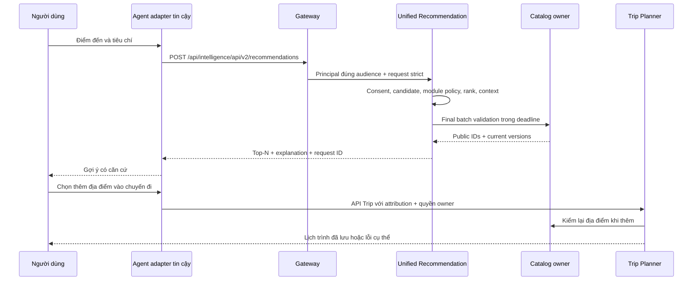

# Thiết kế API và contract Modular Recommendation

Tài liệu thiết kế cho revision nguồn `89eb8cb0e2d39889bb903cf01e9f31467ae78d23`, ngày 29/10/2026. Toàn bộ `/api/v2/**` dưới đây là **đề xuất cho lần nâng contract kế tiếp**, chưa có trong source và chưa được triển khai. Trạng thái thực hiện và kết nối BE ↔ FE chỉ theo [progress_be.md](../../progress_be.md) và [progress_fe.md](../../progress_fe.md).

[Mục lục](00-readme.md) · [Kiến trúc](02-architecture.md) · [Dữ liệu](04-data-design.md) · [Policy/fallback](08-ranking-policy-fallback.md) · [Kiểm thử](09-test-strategy.md) · [Backlog](11-implementation-backlog.md).

## 1. Các contract hiện có và giới hạn tương thích

Nguồn thực thi là [Intelligence OpenAPI](../../backend/contracts/openapi/intelligence.yaml), [IntelligenceController](../../backend/services/intelligence-service/src/main/java/vn/smarttravel/intelligence/recommendations/controller/IntelligenceController.java), [ModelController](../../backend/services/intelligence-service/src/main/java/vn/smarttravel/intelligence/models/controller/ModelController.java) và [ContractRequestAdvice](../../backend/services/intelligence-service/src/main/java/vn/smarttravel/intelligence/shared/web/ContractRequestAdvice.java). OpenAPI hiện mang version `1.0.0-candidate`; request/response áp dụng `additionalProperties: false`. Extension được thêm vào JSON v1 sẽ làm consumer/provider contract test không tương thích.

### 1.1. Recommendation và interaction v1

| API upstream hiện có | Request hiện có | Response thành công hiện có |
|---|---|---|
| `POST /api/v1/recommendations` | Bắt buộc `topN: integer 1..50`, `currency: "VND"`; tùy chọn `category_ids: UUID[0..100]`, `budget: number >=0`, `latitude: number -90..90`, `longitude: number -180..180`, `radius_m: number 1..100000` | `200 {request_id: UUID, version: string, data_as_of: datetime, fallback: boolean, items: [{place_id: UUID, score: number, explanation: string}]}`; tối đa 50 item |
| `POST /api/v1/interactions/batch` | `items[1..100]`, `analytics_consent: true`, `consent_version: integer >=1`. Mỗi item bắt buộc `event_id`, `session_id`, `type: SEARCH\|PLACE_VIEW`, `place_id: UUID\|null`, `query: string\|null` tối đa 512 ký tự, `occurred_at` | `202 {accepted_ids: UUID[], errors: [{event_id: UUID, code: string}]}` |
| `GET /api/v1/me/interactions` | `limit=20`, tối đa 100; `cursor` tùy chọn | `200 {items, next_cursor: string\|null, as_of, watermark: integer>=1}` |
| `DELETE /api/v1/me/interactions` | `Idempotency-Key` bắt buộc; không body | `202 {request_id, status: ACCEPTED\|PENDING\|COMPLETED, version: integer>=1}` |

Ví dụ v1 hợp lệ, được compatibility adapter tiếp tục hỗ trợ:

```json
{
  "topN": 2,
  "currency": "VND",
  "category_ids": ["10000000-0000-4000-8000-000000000001"],
  "budget": 200000,
  "latitude": 16.0678,
  "longitude": 108.2208,
  "radius_m": 10000
}
```

```json
{
  "request_id": "20000000-0000-4000-8000-000000000001",
  "version": "basic-v1",
  "data_as_of": "2026-10-29T01:00:00Z",
  "fallback": false,
  "items": [
    {
      "place_id": "30000000-0000-4000-8000-000000000001",
      "score": 0.71,
      "explanation": "Phù hợp tiêu chí địa điểm đã chọn"
    }
  ]
}
```

Không coi ví dụ là dữ liệu du lịch thật hoặc bằng chứng chất lượng. `explanation` v1 là string; code hiện lưu JSON breakdown được stringify vào trường đó. Compatibility adapter có thể giữ dạng string đó; không đổi âm thầm thành object.

**Lệch cần xử lý ở task contract:** OpenAPI interaction v1 khai báo `security: []`, nhưng [SecurityConfiguration](../../backend/services/intelligence-service/src/main/java/vn/smarttravel/intelligence/security/config/SecurityConfiguration.java) yêu cầu `SCOPE_intelligence:write`; `BasicRepository` còn kiểm profile/consent hiện hành. Thiết kế mới không dựa vào việc guest có thể ghi interaction. Phải sửa tài liệu contract và test theo quyết định owner trước khi freeze; không giảm kiểm quyền để khớp một khai báo công khai sai.

### 1.2. Admin v1

Các API dưới đây đã có controller/contract. Tất cả yêu cầu JWT với `intelligence:admin`; phần lớn mutation đi qua `MutationService` để idempotence/version. Chúng chứng minh có cơ chế quản lý, không chứng minh model đã đạt quality gate trên người dùng thật.

| API upstream hiện có | Body / precondition | Thành công |
|---|---|---|
| `POST /api/v1/admin/datasets` | `source_ids: UUID[]`, `feature_schema_version: integer`, `criteria: {start, end}`; `Idempotency-Key` | `202 DatasetV1` |
| `GET /api/v1/admin/datasets/{dataset_id}` | UUID | `200 DatasetV1` |
| `POST /api/v1/admin/training-jobs` | `dataset_id`, `seed: integer>=0`, `code_revision: string`; `Idempotency-Key` | `202 TrainingJobV1` |
| `GET /api/v1/admin/training-jobs/{job_id}` | UUID | `200 TrainingJobV1` |
| `POST /api/v1/admin/training-jobs/{job_id}/cancel` | `If-Match`; không body | `202 TrainingJobV1` |
| `GET /api/v1/admin/models` | `limit`, `cursor` | `200 {items: ModelV1[], next_cursor, as_of, watermark}` |
| `GET /api/v1/admin/models/{model_id}/metrics` | UUID | `200 {precision_at_10, ndcg_at_10}` |
| `POST /api/v1/admin/models/{model_id}/validate` | `{reason: string}`; `If-Match`, `Idempotency-Key` | `202 {request_id, status, version}` |
| `POST /api/v1/admin/models/{model_id}/deploy` | Như validate | `202 {request_id, status, version}` |
| `POST /api/v1/admin/models/{model_id}/rollback` | Như validate | `202 {request_id, status, version}` |

`DatasetV1 = {dataset_id, version, checksum, feature_schema_version, source_ids, status}`; status `BUILDING|READY|REVOKED|FAILED`. `TrainingJobV1 = {job_id, dataset_id, status, seed, code_revision, version}`. `ModelV1 = {model_id, model_version_id, status, metrics:{precision_at_10,ndcg_at_10}, version}`, status `TRAINED|VALIDATED|ACTIVE|REVOKED`.

Không tái sử dụng `PLACE_RECOMMENDATION` trong event v1 thành tên module. [intelligence.model.deployed.v1](../../backend/contracts/events/intelligence.model.deployed.v1.schema.json) hiện chỉ cho `use_case: "PLACE_RECOMMENDATION"`; storage hiện dùng key `recommendations`. Bổ sung module deployment cần schema event mới hoặc giữ event v1 tổng hợp và lưu chi tiết local, do owner quyết định trong task contract. Không phát payload trái enum hiện có.

### 1.3. Quy tắc migration

1. Giữ 14 operation v1 và error envelope. Adapter v1 ánh xạ input cũ vào cùng pipeline; scope legacy v1 vẫn đúng hành vi cũ, không tự buộc client cũ gửi `destination_id` mới.
2. Bổ sung `/api/v2/**`, OpenAPI/fixtures/checksum, request validator và consumer tests trong một PR contract có review N1/N2. Chưa chọn version số của registry trước review.
3. Public v2 buộc scope địa lý rõ. Chuyển FE/Agent sang v2 từng caller; không bật model chỉ vì caller dùng v2.
4. Admin v1 deploy/rollback không được bypass policy v2. Khi modular policy được bật, adapter admin v1 chỉ tác động bundle legacy tương thích hoặc trả `409 LEGACY_DEPLOYMENT_DISABLED`; không chọn ngầm module. Công bố compatibility window trước khi đổi hành vi này.
5. Không dùng `mode: BASIC|MODEL` để suy ra tất cả scorer cùng implementation. v2 dùng actual strategy metadata; cột legacy nếu giữ phải ánh xạ theo quy tắc ở [dữ liệu](04-data-design.md).

## 2. Routing, authentication và quy ước dùng chung

### 2.1. URL thật

[GatewayRoutes](../../backend/platform/api-gateway/src/main/java/vn/smarttravel/platform/gateway/config/GatewayRoutes.java) dùng `stripPrefix(countSegments(pathPrefix))`. [application.yml](../../backend/platform/api-gateway/src/main/resources/application.yml) cấu hình Intelligence prefix `/api/intelligence`, tức strip hai segment. Không có rewrite rút gọn `/api/v2`.

| Caller | URL |
|---|---|
| FE/Agent qua Gateway v1 | `/api/intelligence/api/v1/recommendations` |
| FE/Agent qua Gateway v2 đề xuất | `/api/intelligence/api/v2/recommendations` |
| Upstream Intelligence v2 đề xuất | `/api/v2/recommendations` |
| HTTP nội bộ hiện có | `/internal/v1/**`, chỉ workload hợp lệ; không qua public Gateway |

[ApiClient](../../frontend/src/api/client.ts) ghép base `/api`, service `intelligence` và domain path `/api/v2/recommendations` để được URL trên. Không đổi cả Gateway convention trong phạm vi Recommendation.

Gateway hiện chặn toàn bộ `/api/intelligence/**` bằng `503 FEATURE_DEFERRED` khi `AI_ENABLED=false`, kể cả rule recommendation. FE còn có `VITE_AI_ENABLED`. Việc soạn API v2 không thay đổi hai cờ và không mở lại phạm vi triển khai đang hoãn. Khi triển khai, thêm matcher public cho v2 chính xác; mặc định catch-all của Gateway hiện yêu cầu JWT, nên v2 guest sẽ chưa hoạt động chỉ bằng việc thêm controller.

### 2.2. Headers, lỗi và deadline

| Quy tắc | Thiết kế v2 |
|---|---|
| JSON | UTF-8; `additionalProperties:false` ở mọi object; UUID string; timestamp ISO-8601 có offset. Không chấp nhận NaN/Infinity |
| Money | `budget` số nguyên VND `0..10^12`, là trần chi phí một địa điểm. Số này nằm trong miền integer an toàn JavaScript; không dùng float cho tính tiền hoặc cộng tổng chuyến đi |
| `X-Correlation-ID` | UUID optional, server tạo nếu thiếu; không tin chuỗi tùy ý để đưa vào log |
| `Authorization` | Guest recommendation không cần; có header sai/hết hạn phải trả 401, không hạ âm thầm thành guest |
| JWT | Kiểm issuer/audience/signature/exp/iat/sub và phiên còn sống. Gateway exchange token đúng đích; user chỉ từ principal |
| `If-Match` | Bắt buộc các mutation tài nguyên có version, giá trị quoted integer `"3"`; thiếu → 428; lệch → 409 `VERSION_CONFLICT` |
| `Idempotency-Key` | UUID hoặc chuỗi 1..128 ký tự cho POST tạo job, feedback batch, validate/activate/deploy/rollback/cancel. Scope theo actor+method+path+key; payload khác cùng key → 409; cùng payload đã được nhận thành công trả cùng receipt/operation ID. Transient precondition `IMPRESSION_NOT_RECORDED` chưa hoàn tất admission, không cache thành successful receipt |
| Retry | Client không retry POST tự động khi chưa có cùng idempotency key. Retry GET bounded trong tổng deadline. Không nhân timeout theo số scorer |
| Request size | Giữ trần hạ tầng 1 MiB; route recommendation/feedback đề xuất tối đa 64 KiB, admin 256 KiB; log không chứa raw body |
| Recommendation deadline | Mục tiêu thiết kế: 1.500 ms tại service, 2.000 ms Gateway; inference mỗi ML module tối đa 100 ms và bị chặn bởi budget còn lại. Chưa phải số đo hay SLA đạt được |
| Final Catalog validation | Reserve deadline cho batch owner validation; timeout/không xác minh được → 503; không fallback trả projection chưa xác minh |
| Admin/read | Control request 2 giây tại Gateway; train/evaluate/rebuild chạy async. Worker có timeout tài nguyên riêng; HTTP 202 không có nghĩa job thành công |
| Pagination | `limit=20`, `1..100`; cursor opaque ký số chứa filter/sort/snapshot; cursor khác filter hoặc hết hạn → 400 `INVALID_CURSOR` |

Error duy nhất, giữ convention repository:

```json
{
  "code": "HARD_CONSTRAINT_UNKNOWN",
  "message": "Chưa đủ dữ liệu giờ mở cửa để bảo đảm điều kiện bắt buộc",
  "traceId": "40000000-0000-4000-8000-000000000001",
  "fieldErrors": [
    {"field": "visit", "message": "Cần giờ mở cửa có độ tin cậy đủ cho khoảng ghé thăm"}
  ]
}
```

| HTTP | Code v2 và cách dùng |
|---|---|
| 400 | `CONTRACT_INVALID`, `INVALID_CURSOR`, `INVALID_CONTEXT`; lỗi kiểu/field/offset, location thiếu một trường |
| 401 | `UNAUTHORIZED`; JWT invalid hoặc yêu cầu đăng nhập |
| 403 | `FORBIDDEN`, `CONSENT_REQUIRED`, `CURRENT_CONSENT_REQUIRED`, `IMPRESSION_SUBJECT_MISMATCH`, `REVIEW_APPROVAL_REQUIRED` |
| 404 | `NOT_FOUND`; không tồn tại hoặc không có quyền biết tài nguyên |
| 409 | `VERSION_CONFLICT`, `IDEMPOTENCY_CONFLICT`, `IMPRESSION_NOT_RECORDED`, `MODEL_NOT_ELIGIBLE`, `POLICY_INCOMPATIBLE`, `JOB_NOT_CANCELLABLE`, `DATASET_REVOKED` |
| 410 | `IMPRESSION_TOKEN_EXPIRED`; token analytics hết hạn, không retry bằng token cũ |
| 413 | `PAYLOAD_TOO_LARGE` |
| 422 | `UNSUPPORTED_CURRENCY`, `INVALID_TIME_RANGE`, `QUALITY_GATE_FAILED`, `HARD_CONSTRAINT_UNSUPPORTED`; body hợp lệ nhưng nghiệp vụ không đáp ứng |
| 428 | `PRECONDITION_REQUIRED` |
| 429 | `RATE_LIMITED`; `Retry-After` theo limiter; không sleep vô hạn trong request |
| 503 | `FEATURE_DEFERRED`, `CATALOG_UNAVAILABLE`, `IDENTITY_UNAVAILABLE`, `POLICY_UNAVAILABLE`; không có đường đi an toàn |

Không có ứng viên hợp lệ là `200 items:[]`, có `empty_reason` và vẫn ghi đúng hard constraints. Không dùng 422 cho tập kết quả rỗng thông thường. Dữ liệu thiếu giờ mở cửa của một item khiến item đó bị loại khi người dùng yêu cầu open hard; toàn hệ thống chưa hỗ trợ kiểm opening/time thì trả 422 thay vì giả vờ lọc. `HARD_CONSTRAINT_UNKNOWN` có thể là reason loại candidate trong audit; chỉ dùng làm error tổng khi request không thể xác minh toàn bộ điều kiện.

## 3. Recommendation API v2 đề xuất

### 3.1. `POST /api/v2/recommendations`

**Auth:** guest hoặc user hợp lệ. User scope `intelligence:read`; khi `personalization:OFF`, vẫn không bỏ qua kiểm token nếu có token. **Idempotence:** request đọc/rank không yêu cầu key; mỗi lần có `request_id` mới; feedback dedup riêng. **Timeout:** tổng 1.500 ms; rule fallback dùng budget còn lại; final Catalog check bắt buộc.

| Field | Schema và ý nghĩa |
|---|---|
| `topN` | Bắt buộc integer `1..50` |
| `currency` | Bắt buộc literal `VND` |
| `destination_id` | Bắt buộc UUID, destination canonical active. Không dùng tên thành phố tự do để ngầm chọn scope |
| `category_ids` | Optional unique UUID array, tối đa 100, mặc định `[]`; filter category cứng nếu có |
| `budget` | Optional integer VND `0..10^12`; hard per-place. Giá thiếu hoặc currency khác không vượt filter; `0` chỉ chấp nhận địa điểm xác nhận miễn phí |
| `location` | Optional object, khi có bắt buộc đủ `lat:-90..90`, `lon:-180..180`, `radius_m:1..100000`; radius là hard scope bổ sung trong destination |
| `visit` | Optional `{start_at: datetime có offset, duration_minutes: integer 1..720}`; phải kiểm toàn khoảng ghé, gồm ca qua đêm và exception |
| `open_now` | Optional boolean, mặc định false; khi true dùng clock server pin tại request. `visit` đồng thời có thì trả 400 để tránh hai khoảng thời gian mâu thuẫn |
| `party` | Optional `{adults:1..30, children:0..30, mobility_required:boolean}`; đủ ba trường nếu có; tổng tối đa 30; `mobility_required:true` là hard accessibility đã xác minh |
| `personalization` | Optional `AUTO\|OFF`, mặc định AUTO. AUTO chỉ là yêu cầu thử dùng quyền hiện hành, không cấp consent |

Không có `user_id`, `strategy`, `model_id`, `allow_hidden`, `ignore_constraints` hoặc analytics consent tự khai trong body. Preference từ request là tiêu chí phiên; không tự ghi vào Identity. Thay preference lâu dài tiếp tục đi qua API Identity hiện có.

```json
{
  "topN": 2,
  "currency": "VND",
  "destination_id": "50000000-0000-4000-8000-000000000001",
  "category_ids": ["10000000-0000-4000-8000-000000000001"],
  "budget": 200000,
  "location": {"lat": 16.0678, "lon": 108.2208, "radius_m": 10000},
  "visit": {"start_at": "2026-11-02T09:00:00+07:00", "duration_minutes": 90},
  "open_now": false,
  "party": {"adults": 2, "children": 1, "mobility_required": false},
  "personalization": "AUTO"
}
```

Response schema:

| Field | Schema |
|---|---|
| `request_id`, `version` | UUID và pipeline algorithm version string |
| `data_as_of` | Timestamp conservative của dữ liệu thực dùng; không lấy `now()` che projection lag |
| `fallback`, `fallback_reason` | boolean và nullable allowlisted code; true khi một strategy đã chọn phải thay thế do lỗi/không đủ điều kiện theo policy; bình thường chọn baseline cho cold-start không bắt buộc coi là lỗi |
| `items` | `0..topN` item unique theo `place_id`, rank liên tục từ 1 |
| Item | `{place_id: UUID, rank: integer, score: finite number [0,1], explanation:{reason_codes:string[],text:string}, evidence:{catalog_validated:boolean,opening_verified:boolean,price_known:boolean,context_confidence:HIGH\|MEDIUM\|LOW}, impression_token:string\|null}` |
| `metadata` | `{policy_version:string, strategies:{baseline:string,content:string\|null,collaborative:string\|null,hybrid:string,context:string}, personalized:boolean, analytics_allowed:boolean, empty_reason:string\|null}` |

Không expose raw score breakdown, cohort ID, neighbor user, user embedding, training row, internal URL hoặc artifact key. Strategy ID là public allowlisted name, không là tên class/đường dẫn máy. Model ID/checksum/score components nằm trong audit admin. Public score chỉ để giải thích thứ tự trong cùng request, không phải xác suất hài lòng hay điểm sao.

```json
{
  "request_id": "20000000-0000-4000-8000-000000000002",
  "version": "unified-v1",
  "data_as_of": "2026-10-29T01:00:00Z",
  "fallback": true,
  "fallback_reason": "CONTENT_MODEL_TIMEOUT",
  "items": [
    {
      "place_id": "30000000-0000-4000-8000-000000000001",
      "rank": 1,
      "score": 0.71,
      "explanation": {"reason_codes": ["CATEGORY_MATCH", "WITHIN_BUDGET"], "text": "Phù hợp loại địa điểm và ngân sách bạn đã chọn"},
      "evidence": {"catalog_validated": true, "opening_verified": true, "price_known": true, "context_confidence": "HIGH"},
      "impression_token": null
    }
  ],
  "metadata": {
    "policy_version": "rule-policy-v1",
    "strategies": {"baseline": "baseline-rule-v1", "content": "content-rule-v1", "collaborative": null, "hybrid": "weighted-v1", "context": "context-rule-v1"},
    "personalized": false,
    "analytics_allowed": false,
    "empty_reason": null
  }
}
```

Đây là ví dụ không cho phép analytics: token là null. Metadata ghi strategy **thực chạy**, nên khi Content ML timeout phải ghi `content-rule-v1`, đồng thời audit có cả requested/attempted/actual và lý do. Không đưa ML vào metadata chỉ vì config yêu cầu ML.

Lỗi cụ thể: destination không tồn tại/không public → 404; destination không active → 422; trái budget/radius → loại item; final Catalog không sẵn sàng → 503; Identity không xác minh consent → không dùng profile/history, chạy request-only nếu vẫn kiểm được phiên principal, hoặc 503 nếu session authorization không xác minh được. Model timeout riêng không buộc cả API 503 nếu rule path còn budget và Catalog xác minh được.

## 4. Feedback API v2 đề xuất

### 4.1. `POST /api/v2/feedback/batch`

**Auth:** user JWT `intelligence:write`, current consent có hiệu lực. **Idempotence:** `Idempotency-Key` bắt buộc; từng item `event_id` dedup độc lập. **Timeout:** 1 giây xử lý, vẫn dưới deadline Gateway 2 giây. Trả 202 khi đã ghi transaction vào collector/outbox, không khi chỉ nhận vào RAM.

Schema request `{items: FeedbackItem[1..100]}`. Mỗi item strict gồm `event_id:UUID`, `type:IMPRESSION|CLICK|DISMISS`, `impression_token:string 1..4096`, `occurred_at:datetime`. Không cho client override request/place/rank/user. Event thời gian tương lai quá 5 phút hoặc cũ quá 24 giờ bị từ chối; các ngưỡng là đề xuất cần benchmark và rà retention. Ví dụ CLICK dưới giả định impression cùng token đã được ghi durable trước đó.

```json
{
  "items": [
    {
      "event_id": "60000000-0000-4000-8000-000000000001",
      "type": "CLICK",
      "impression_token": "fixture-signed-impression-token",
      "occurred_at": "2026-10-29T01:05:00Z"
    }
  ]
}
```

```json
{
  "accepted_ids": ["60000000-0000-4000-8000-000000000001"],
  "duplicate_ids": [],
  "errors": []
}
```

Response strict `{accepted_ids:UUID[], duplicate_ids:UUID[], errors:[{event_id:UUID,code:string}]}`, tổng bằng số item duy nhất. Batch malformed → 400; unauthenticated → 401; current consent absent → 403 và không ghi lịch sử; lỗi token từng record → item error, không nhận phần sai. Duplicate cùng ID+payload trả duplicate; cùng ID nhưng payload khác → `EVENT_CONFLICT`. Không tạo event mới cho retry.

CLICK/DISMISS chỉ được admission khi IMPRESSION cùng token đã được ghi durable. Trong một batch, server xử lý các IMPRESSION hợp lệ trước CLICK/DISMISS bất kể thứ tự array; không tạo exposure từ click. Nếu một click/dismiss chưa có impression sau bước này, trả **409 `IMPRESSION_NOT_RECORDED` cho cả batch**, rollback các insert của batch, không hoàn tất/cache successful idempotency receipt. Client chờ acknowledgement exposure từ batch trước rồi retry cùng event ID, payload và key; không tạo click ID mới. Payload hash/key fence vẫn ngăn dùng key cũ cho nội dung khác. Các lỗi token tĩnh vẫn trả `202 errors[]` như trên. Quy tắc riêng cho precondition tạm thời này tránh replay mãi một receipt lỗi đã cache và tránh tính click không có mẫu số exposure.

### 4.2. Token và attribution

- Server phát opaque signed token theo result, TTL đề xuất 15 phút; chứa/bind `jti`, chủ thể principal pseudonym, `request_id`, `place_id`, rank, analytics session UUID, consent version, policy version, issued/expiry. Không chứa PII rõ và không dùng JWT auth session `sid` làm analytics session.
- Secret ký không vào LLM, browser log hoặc response audit. Có key ID để rotate; key cũ chỉ validate trong TTL. Token ví dụ ở trên là fixture, không là token hợp lệ hoặc secret.
- Khi request không đủ analytics consent hoặc `personalization:OFF` theo chính sách bảo thủ của MVP, không phát token, không lưu recommendation/impression có định danh để phục vụ training. Có thể giữ aggregate operational counter không link user/session lâu dài.
- Token một result có thể dùng cho tối đa một IMPRESSION, một CLICK, một DISMISS; unique `(token_jti,type)` chặn flood đổi `event_id`; `event_id` vẫn chặn replay. IMPRESSION chỉ gửi khi card thật hiển thị; tạo recommendation không được tự tính impression.
- Session analytics lấy từ header `X-Analytics-Session: UUID` đã allowlist hoặc server sinh; không tin session để xác thực user. Token đã bind session thì client không sửa được. Không yêu cầu header này khi không analytics.
- CLICK/DISMISS không tự biến thành FAVORITE/REVIEW/TRIP_ITEM_ADDED. Các hành động ấy chỉ lấy từ event owner backend để tránh double counting.
- **Điểm cần xác nhận:** Identity hiện chỉ có `personalization_enabled` và version; không suy ra đây là consent cho mọi analytics/training mục đích khác. Trước mở feedback v2 thật, N1/N2 phải chốt mapping mục đích consent. Mặc định không thu cho mục đích chưa được xác nhận; không chỉ tin `analytics_consent:true` từ client.
- Với user đổi consent/revoke sau khi token phát, collector kiểm lại current version và từ chối token cũ. Giữ aggregate dedup không được kéo dài định danh đã phải purge.

## 5. API quản trị v2 đề xuất: quy tắc chung

Tất cả `/api/v2/admin/**` yêu cầu `intelligence:admin`, kiểm phiên, rate limit và audit actor. Actor lấy từ token, không từ body. Người owner triển khai theo [phân công](../../plan/06-work-assignment.md) là N2; activation production phải có phê duyệt chéo N1 trên đúng dataset/model/policy revision. Agent không tự tạo approval hoặc ký thay N1/N2. Approval là artifact review do hệ thống xác minh, không là chuỗi tên reviewer do client tự khai.

Đây là quyền thay đổi nghiệp vụ, không phải yêu cầu xin phép cho việc tạo tài liệu hiện tại. Fixture activation test dùng approval fixture đánh dấu môi trường test; không chấp nhận artifact test ở production.

### 5.1. Schema dùng chung

| Schema | Fields strict |
|---|---|
| `Operation` | `operation_id:UUID`, `kind:string`, `status:QUEUED\|RUNNING\|SUCCEEDED\|FAILED\|CANCELLED`, `resource_id:UUID\|null`, `version:integer>=1`, `error_code:string\|null`, `created_at:datetime`, `completed_at:datetime\|null` |
| `Dataset` | `dataset_id:UUID`, `dataset_definition_id:string`, `data_kind:SYNTHETIC\|PUBLIC_UNLABELED\|PUBLIC_JUDGED\|REAL_CONSENTED`, `status:BUILDING\|READY\|REVOKED\|FAILED`, `feature_schema_version:string`, `split_version:string`, `row_count:integer>=0`, `checksum:string\|null`, `source_ids:UUID[]`, `personal_data:boolean`, `created_at:datetime`, `version:integer>=1` |
| `TrainingJob` | `job_id:UUID`, `dataset_id:UUID`, `job_kind:TRAIN\|PREPARE_PRETRAINED`, `module:CONTENT\|COLLABORATIVE\|HYBRID\|CONTEXT`, `algorithm_id:string`, `status:QUEUED\|RUNNING\|SUCCEEDED\|FAILED\|CANCELLED`, `model_version_id:UUID\|null`, `seed:integer>=0`, `code_revision:string`, `version:integer>=1`, `error_code:string\|null` |
| `Evaluation` | `evaluation_id:UUID`, `dataset_id:UUID`, `candidate_policy_id:UUID`, `baseline_policy_id:UUID`, `status:QUEUED\|RUNNING\|SUCCEEDED\|FAILED`, `metrics:object\|null`, `gate:NOT_EVALUATED\|PASSED\|FAILED\|QUALITY_PENDING`, `sample_size:integer>=0`, `version:integer>=1`, `error_code:string\|null` |
| `Model` | `model_version_id:UUID`, `module:CONTENT\|COLLABORATIVE\|HYBRID\|CONTEXT`, `algorithm_id:string`, `origin_kind:LOCAL_TRAINED\|PRETRAINED_PREPARED`, `pretrained_revision:string\|null`, `status:CANDIDATE\|VALIDATED\|REJECTED\|REVOKED`, `dataset_id:UUID`, `training_job_id:UUID`, `feature_schema_version:string`, `score_schema_version:string`, `checksum:string`, `evaluation_id:UUID\|null`, `version:integer>=1` |
| `Policy` | `policy_id:UUID` riêng cho từng immutable bundle, `policy_version:string` unique label, `version:integer>=1` là lifecycle CAS revision, `status:DRAFT\|VALIDATED\|ACTIVE\|RETIRED\|REVOKED`, `modules:object`, `weights:object`, `fallback_chains:object`, `feature_schema_version:string`, `evaluation_id:UUID\|null`, `approval_ref:string\|null` |
| `Page<T>` | `items:T[]`, `next_cursor:string\|null`, `as_of:datetime`, `watermark:integer>=1` |

`Operation.kind` enum cho revision đầu: `MODEL_VALIDATE`, `MODEL_DEPLOY`, `MODEL_ROLLBACK`, `POLICY_VALIDATE`, `POLICY_ACTIVATE`, `POLICY_ROLLBACK`. Hình thức map `metrics`, `modules`, `weights`, `fallback_chains` phải được expand thành schema strict trong OpenAPI PR; các key hợp lệ được định nghĩa ngay trong các phần dưới, không dùng JSON arbitrary. Không trả object key artifact hoặc signed dataset download URL trong response public/admin mặc định.

### 5.2. Theo dõi operation: `GET /api/v2/admin/operations/{operation_id}`

Input UUID; `intelligence:admin`; 2 giây; GET idempotent, không cần key. Trả `200 Operation`, 404 nếu không có. Ví dụ:

```json
{
  "operation_id": "70000000-0000-4000-8000-000000000001",
  "kind": "POLICY_ACTIVATE",
  "status": "SUCCEEDED",
  "resource_id": "80000000-0000-4000-8000-000000000001",
  "version": 2,
  "error_code": null,
  "created_at": "2026-10-29T01:00:00Z",
  "completed_at": "2026-10-29T01:00:01Z"
}
```

Các POST validate/deploy/rollback/activate trả `202 Operation` kèm `Location` dẫn tới operation này; dataset và training/evaluation job trả resource riêng như phần 6–7. Không dùng `COMPLETED` v1 và `SUCCEEDED` v2 lẫn nhau. HTTP 202 chỉ nói đã xếp việc; caller poll với backoff hoặc refresh chủ động.

Operation được lưu durable trong `admin_operations` theo [data design](04-data-design.md), có lease/heartbeat/attempt/recovery và idempotency linkage. G3-08 triển khai validate/polling, G5-05 mở rộng deployment kinds; không giữ operation chỉ trong RAM hoặc trộn kinds này vào training job TRAIN/PREPARE_PRETRAINED. Deployment recovery kiểm operation_id và active_generation để không kích hoạt hai lần sau crash.

## 6. Dataset và Training Job APIs v2 đề xuất

### 6.1. `POST /api/v2/admin/datasets`

Body strict: `name:string 1..120`, `dataset_definition_id:string`, `source_ids:unique UUID[1..100]`, `feature_schema_version:string`, `cutoff_at:datetime`, `window:{start_at,end_at}`, `split:{train_end_at,validation_end_at,test_end_at}`, `purpose:PUBLIC_CONTENT|PERSONALIZED_RANKING`, `code_revision:string`. Các boundary tăng nghiêm ngặt, `start < train_end < validation_end < test_end <= cutoff`, `window.end_at=test_end_at`. Snapshot point-in-time; policy source/consent được server xác minh, không nhận `allow_training:true` từ caller thay cho owner.

`dataset_definition_id` chọn definition bất biến trong server allowlist, pin module, unit-of-observation, label_version/horizon, cleaning/sampling/split rules. Client không gửi SQL, label expression hoặc tự khai data_kind. Danh mục đề xuất ban đầu:

| Definition | Module / mục đích | Label và horizon | Data kind server xác minh |
|---|---|---|---|
| `public-content-features-v1` | CONTENT / PUBLIC_CONTENT, chuẩn bị encoder/vectors | NONE, horizon0; không có ground-truth relevance | PUBLIC_UNLABELED hoặc SYNTHETIC theo provenance; không đủ quality evaluation |
| `content-judged-v1` | CONTENT / PUBLIC_CONTENT, relevance corpus được reviewer gán nhãn | judged-relevance-v1, horizon0; group query/request không qua hai split | PUBLIC_JUDGED khi nhãn/nguồn thật được kiểm; fixture vẫn SYNTHETIC |
| `implicit-cf-v1` | COLLABORATIVE / PERSONALIZED_RANKING | implicit-action-v1, horizon7ngày dự kiến; features trước prediction time | REAL_CONSENTED nếu hành vi/quyền hợp lệ; fixture SYNTHETIC |
| `exposure-ltr-v1` | HYBRID / PERSONALIZED_RANKING | exposure-action-v1, horizon7ngày dự kiến; returned không bằng exposed | REAL_CONSENTED nếu exposures thật/consent hợp lệ; fixture SYNTHETIC |

Horizon7ngày là default definition để benchmark, không chuẩn nghiệp vụ đã được duyệt; thay horizon/label phải có definition ID/version mới. Definition sai purpose/schema →422 `DATASET_DEFINITION_INCOMPATIBLE`; unknown ID →400. PUBLIC_UNLABELED dùng preparation được nhưng quality gate trả QUALITY_PENDING nếu thiếu tập đánh giá độc lập; không tự tạo nhãn Bayesian từ current rating rồi gọi PUBLIC_JUDGED. Context dataset definition chưa bật, chỉ thêm sau RC-G4-08 scope review. Manifest/response ghi definition ID/version và verified data_kind để job/evaluator không tự đoán module hay labels.

`Idempotency-Key` bắt buộc; không If-Match khi tạo. Trong 2 giây trả `202 Dataset` status BUILDING, Location dataset resource. Build async; lỗi nguồn revoke/policy unavailable làm FAILED hoặc reject 409/503 trước enqueue. Không block Gateway đến khi export xong.

```json
{
  "name": "recommendation-window-2026-10",
  "dataset_definition_id": "public-content-features-v1",
  "source_ids": ["90000000-0000-4000-8000-000000000001"],
  "feature_schema_version": "rec-features-v1",
  "cutoff_at": "2026-10-29T00:00:00Z",
  "window": {"start_at": "2026-09-01T00:00:00Z", "end_at": "2026-10-28T00:00:00Z"},
  "split": {"train_end_at": "2026-10-01T00:00:00Z", "validation_end_at": "2026-10-15T00:00:00Z", "test_end_at": "2026-10-28T00:00:00Z"},
  "purpose": "PUBLIC_CONTENT",
  "code_revision": "89eb8cb0e2d39889bb903cf01e9f31467ae78d23"
}
```

```json
{
  "dataset_id": "a0000000-0000-4000-8000-000000000002",
  "status": "BUILDING",
  "dataset_definition_id": "public-content-features-v1",
  "data_kind": "PUBLIC_UNLABELED",
  "feature_schema_version": "rec-features-v1",
  "split_version": "temporal-v1",
  "row_count": 0,
  "checksum": null,
  "source_ids": ["90000000-0000-4000-8000-000000000001"],
  "personal_data": false,
  "created_at": "2026-10-29T01:00:00Z",
  "version": 1
}
```

### 6.2. `GET /api/v2/admin/datasets/{dataset_id}`

UUID, admin, 2 giây, GET idempotent. `200 Dataset` cùng shape 6.1; khi READY, checksum 64 lowercase hex và row_count thực; khi FAILED không giả checksum. 404 unknown, 403 scope. Metadata lineage chi tiết nằm audit/registry trong [dữ liệu](04-data-design.md); không cung cấp file raw bằng URL public.

### 6.3. `POST /api/v2/admin/training-jobs`

Input strict `{dataset_id, job_kind?, module, algorithm_id, params, seed, code_revision, max_runtime_seconds}`; `job_kind:TRAIN|PREPARE_PRETRAINED` mặc định TRAIN. `algorithm_id` chỉ từ strategy/trainer allowlist; params schema phụ thuộc cả algorithm và job kind. Version đầu đề xuất:

| Algorithm | Module / job kind | `params` strict |
|---|---|---|
| `content-embedding-v1` | CONTENT / PREPARE_PRETRAINED | `{pretrained_ref_id:string, revision:string, checksum:string, license_id:string, pooling:MEAN, normalize:true}`; checksum SHA-256 64 lowercase hex; reference/revision/license phải khớp approved allowlist của server |
| `implicit-als-v1` | COLLABORATIVE / TRAIN | `{factors:16..128, regularization:number>0, iterations:1..100, alpha:number>0}` |
| `pairwise-linear-v1` | HYBRID / TRAIN | `{learning_rate:number>0, regularization:number>=0, epochs:1..1000}` |

PREPARE_PRETRAINED chỉ hỗ trợ CONTENT. Worker lấy pretrained artifact từ registry/mirror đã phê duyệt theo reference bất biến, kiểm source checksum/license, verify/convert runtime và precompute vectors cho public content snapshot `dataset_id` đã READY. **Đây là preparation, không tuyên bố huấn luyện/fine-tune encoder tại dự án.** Không nhận arbitrary URL, đường dẫn máy, pickle, shell command hoặc executable artifact từ client. `license_id` do caller gửi chỉ là reference để so khớp policy server, không tự cấp quyền sử dụng. Dataset public licensed vẫn bắt buộc cho construction/evaluation và source lineage; không tạo model không có dataset/job provenance.

Candidate được tạo với `origin_kind:PRETRAINED_PREPARED`; manifest pin `pretrained_ref_id`, `pretrained_revision`, source checksum/license, tokenizer/pooling/normalization, conversion/precompute code revision và output artifact checksum riêng. `training_job_id` **giữ tên FK legacy nhưng tham chiếu preparation job thật** trong cùng jobs table, không nullable và không tạo training job giả. TRAIN tạo `origin_kind:LOCAL_TRAINED`, `pretrained_revision:null` cho các thuật toán nội bộ trong allowlist trên. Nếu sau này fine-tune Content, phải bổ sung algorithm/params schema được review; không đổi PREPARE thành TRAIN âm thầm. Cả hai job kinds vẫn phải qua evaluation/validation/policy activation, không tự serving khi preparation thành công.

CONTEXT trainer chưa nằm MVP; server trả 422 `ALGORITHM_NOT_ENABLED` tới khi có decision/quality gate. Registry có thể mở thuật toán khác trong contract release có schema tương ứng. `seed` integer `0..2^31-1`; `max_runtime_seconds:60..7200` là hạn mức đề xuất, owner phải đo tài nguyên trước chốt. `code_revision` phải là revision được worker image xác nhận, không tin chuỗi client để chứng minh reproducibility.

Admin + Idempotency-Key; 2 giây enqueue; `202 TrainingJob`; 409 dataset not READY/revoked; 422 algorithm/schema sai; không tự tạo/sử dụng GPU hay dependency trong task tài liệu này.

Các UUID dưới là fixture minh họa quan hệ, không phải bản ghi đã tồn tại. Dataset kết thúc `...0002` ở ví dụ tạo phía trên phải chuyển READY trước PREPARE_PRETRAINED, definition `public-content-features-v1`/PUBLIC_UNLABELED chỉ dành CONTENT. Dataset `a0000000-0000-4000-8000-000000000001` trong ví dụ ALS/evaluation/model dưới là **một snapshot riêng**, giả định READY, definition `implicit-cf-v1`, purpose PERSONALIZED_RANKING, data_kind REAL_CONSENTED đã được owner kiểm quyền. Đây là giả định của schema example, không là evidence dự án đã có dữ liệu thật. Dùng dataset public chưa nhãn cho ALS hoặc quality evaluation phải bị reject, không tự đổi definition theo algorithm.

```json
{
  "dataset_id": "a0000000-0000-4000-8000-000000000001",
  "job_kind": "TRAIN",
  "module": "COLLABORATIVE",
  "algorithm_id": "implicit-als-v1",
  "params": {"factors": 32, "regularization": 0.1, "iterations": 20, "alpha": 20},
  "seed": 42,
  "code_revision": "89eb8cb0e2d39889bb903cf01e9f31467ae78d23",
  "max_runtime_seconds": 1800
}
```

```json
{
  "job_id": "b0000000-0000-4000-8000-000000000001",
  "dataset_id": "a0000000-0000-4000-8000-000000000001",
  "job_kind": "TRAIN",
  "module": "COLLABORATIVE",
  "algorithm_id": "implicit-als-v1",
  "status": "QUEUED",
  "model_version_id": null,
  "seed": 42,
  "code_revision": "89eb8cb0e2d39889bb903cf01e9f31467ae78d23",
  "version": 1,
  "error_code": null
}
```

Ví dụ request chuẩn bị pretrained Content encoder; ID/checksum dưới là fixture allowlist, không là model đã được duyệt hoặc tải trong phiên này:

```json
{
  "dataset_id": "a0000000-0000-4000-8000-000000000002",
  "job_kind": "PREPARE_PRETRAINED",
  "module": "CONTENT",
  "algorithm_id": "content-embedding-v1",
  "params": {
    "pretrained_ref_id": "approved-content-encoder-fixture",
    "revision": "encoder-fixture-revision-1",
    "checksum": "0123456789abcdef0123456789abcdef0123456789abcdef0123456789abcdef",
    "license_id": "approved-license-fixture-1",
    "pooling": "MEAN",
    "normalize": true
  },
  "seed": 0,
  "code_revision": "89eb8cb0e2d39889bb903cf01e9f31467ae78d23",
  "max_runtime_seconds": 1800
}
```

```json
{
  "job_id": "b0000000-0000-4000-8000-000000000002",
  "dataset_id": "a0000000-0000-4000-8000-000000000002",
  "job_kind": "PREPARE_PRETRAINED",
  "module": "CONTENT",
  "algorithm_id": "content-embedding-v1",
  "status": "QUEUED",
  "model_version_id": null,
  "seed": 0,
  "code_revision": "89eb8cb0e2d39889bb903cf01e9f31467ae78d23",
  "version": 1,
  "error_code": null
}
```

### 6.4. `GET /api/v2/admin/training-jobs/{job_id}`

Admin, UUID, 2 giây, GET idempotent; `200 TrainingJob` shape 6.3, 404 unknown. Khi SUCCEEDED phải có model_version_id và artifact kiểm checksum; success không tự nâng model VALIDATED hoặc policy ACTIVE.

### 6.5. `POST /api/v2/admin/training-jobs/{job_id}/cancel`

Admin, If-Match và Idempotency-Key bắt buộc, body `{reason:string 1..1024}`. 2 giây control; `202 TrainingJob` với status CANCELLED chỉ khi đã fencing worker/không thể commit artifact. Revision đầu chọn **cancellation flag + poll job**: nếu chỉ gửi cancellation signal thì giữ RUNNING, không trả CANCELLED trước khi worker xác nhận. `202 TrainingJob` có thể RUNNING. 409 `JOB_NOT_CANCELLABLE` với terminal SUCCEEDED/FAILED; retry key cũ trả cùng acknowledgement, không lật terminal state.

```json
{"reason": "Dừng job để áp dụng dataset đã sửa lineage"}
```

Response dùng đúng `TrainingJob` ở 6.3, `job_id` giữ nguyên, version tăng khi cancellation state ghi durable. Hủy không xóa audit và không làm dataset biến mất.

## 7. Admin Evaluation APIs v2 đề xuất

### 7.1. `POST /api/v2/admin/evaluations`

Admin, Idempotency-Key, 2 giây enqueue, `202 Evaluation`. Body strict gồm `dataset_id`, `candidate_policy_id`, `baseline_policy_id`, `k:integer 1..50`, `split:VALIDATION|TEST`, `cohorts:unique array`, `code_revision:string`. Cohort allowlist `ALL|COLD_USER|WARM_USER|COLD_ITEM|NO_PERSONALIZATION`. Không nhận metric tự khai hoặc nhãn relevance từ request. Không dùng TEST lặp để tuning; mỗi evaluation audit mục đích và snapshot.

Policy UUID được resolve qua minimal immutable manifest registry/create-get DRAFT APIs triển khai trong RC-G3-07, nhập G1 rule bundle có stable UUID/hash. Không cần active deployment/slot ở G5 để evaluation. Candidate policy/model được CANDIDATE/DRAFT và compatible là đủ để chạy evaluation; yêu cầu VALIDATED/approval chỉ áp cho activation. Definition không được sửa sau khi evaluator pin hash, `evaluation_id` ban đầu nullable để tránh vòng validate cần chính evaluation chưa tạo.

```json
{
  "dataset_id": "a0000000-0000-4000-8000-000000000001",
  "candidate_policy_id": "80000000-0000-4000-8000-000000000002",
  "baseline_policy_id": "80000000-0000-4000-8000-000000000001",
  "k": 10,
  "split": "VALIDATION",
  "cohorts": ["ALL", "COLD_USER", "NO_PERSONALIZATION"],
  "code_revision": "89eb8cb0e2d39889bb903cf01e9f31467ae78d23"
}
```

```json
{
  "evaluation_id": "c0000000-0000-4000-8000-000000000001",
  "dataset_id": "a0000000-0000-4000-8000-000000000001",
  "candidate_policy_id": "80000000-0000-4000-8000-000000000002",
  "baseline_policy_id": "80000000-0000-4000-8000-000000000001",
  "status": "QUEUED",
  "metrics": null,
  "gate": "NOT_EVALUATED",
  "sample_size": 0,
  "version": 1,
  "error_code": null
}
```

409 dataset/policy incompatible/revoked; 422 invalid K/cohort; 503 worker queue unavailable không nhận job vào bộ nhớ rồi báo 202.

### 7.2. `GET /api/v2/admin/evaluations/{evaluation_id}`

Admin, UUID, 2 giây, GET idempotent. `200 Evaluation`; metrics khi hoàn thành là strict object `{k,precision_at_k,recall_at_k,ndcg_at_k,hit_rate_at_k,coverage,diversity,inference_p95_ms,fallback_rate,by_cohort}`. Base ranking/coverage/diversity/rate metrics thuộc [0,1]; K/count/latency là số không âm theo đơn vị. `delta_ndcg_at_k` và hai đầu confidence interval thuộc **[-1,1]**, có thể âm khi candidate kém hơn champion; bắt buộc low<=high. Denominator không xác định thì metric là null, không tự đổi 0/1. `by_cohort` array `{cohort,sample_size,ndcg_at_k,delta_ndcg_at_k,confidence_interval:{low,high}|null}`. Dataset synthetic phải gate `QUALITY_PENDING` cho production dù metric đẹp; raw user-level rows không trả.

Ví dụ phần metrics hợp lệ:

```json
{
  "k": 10,
  "precision_at_k": 0.2,
  "recall_at_k": 0.4,
  "ndcg_at_k": 0.35,
  "hit_rate_at_k": 0.6,
  "coverage": 0.42,
  "diversity": 0.7,
  "inference_p95_ms": 75,
  "fallback_rate": 0.01,
  "by_cohort": [
    {"cohort": "ALL", "sample_size": 500, "ndcg_at_k": 0.35, "delta_ndcg_at_k": 0.02, "confidence_interval": {"low": 0.005, "high": 0.035}}
  ]
}
```

Số trên chỉ minh họa schema, không là kết quả đo. Quality gate phải xét cả pipeline, hard-constraint violations, dữ liệu thật, latency/fallback và guardrail cohort theo [07](07-ml-training-evaluation.md), không chỉ `ndcg_at_k`.

## 8. Model Registry APIs v2 đề xuất

Không có API upload arbitrary executable model. Worker TRAIN hoặc PREPARE_PRETRAINED tạo candidate trong registry, kiểm checksum và private artifact store. Registry phân biệt model tự huấn luyện và pretrained được chuẩn bị bằng `origin_kind`, không dùng tên FK `training_job_id` để suy rằng mọi artifact đã được dự án huấn luyện. Model registry là metadata/lifecycle trong Intelligence; không tạo microservice mới.

### 8.1. `GET /api/v2/admin/models`

Admin, query optional `module`, `status`, `limit`, `cursor`; GET idempotent, 2 giây. `200 Page<Model>`; filter bound vào cursor, 400 invalid cursor. Ví dụ:

```json
{
  "items": [
    {
      "model_version_id": "d0000000-0000-4000-8000-000000000001",
      "module": "COLLABORATIVE",
      "algorithm_id": "implicit-als-v1",
      "origin_kind": "LOCAL_TRAINED",
      "pretrained_revision": null,
      "status": "CANDIDATE",
      "dataset_id": "a0000000-0000-4000-8000-000000000001",
      "training_job_id": "b0000000-0000-4000-8000-000000000001",
      "feature_schema_version": "rec-features-v1",
      "score_schema_version": "score-01-v1",
      "checksum": "0123456789abcdef0123456789abcdef0123456789abcdef0123456789abcdef",
      "evaluation_id": null,
      "version": 1
    }
  ],
  "next_cursor": null,
  "as_of": "2026-10-29T01:00:00Z",
  "watermark": 1
}
```

### 8.2. `GET /api/v2/admin/models/{model_version_id}`

Admin, UUID, GET idempotent, 2 giây; `200 Model` đúng item schema 8.1. 404 unknown. Status ACTIVE không gắn vào model global: một model VALIDATED có thể được nhiều policy tham chiếu; policy binding quyết định serving. Dùng current active policy để suy deployment, không thêm boolean active dễ lệch.

### 8.3. `POST /api/v2/admin/models/{model_version_id}/validate`

Admin, If-Match+Idempotency-Key, body `{evaluation_id:UUID,reason:string}`. 2 giây enqueue → `202 Operation(kind=MODEL_VALIDATE)`; runner kiểm artifact/checksum/feature/score schema/license/current consent lineage, evaluation đúng model+policy+dataset revision và quality gate. Synthetic evaluation chỉ cho test sandbox, không production VALIDATED. 409 mismatch/revoked, 422 gate fail. Model không được client gán status.

```json
{"evaluation_id": "c0000000-0000-4000-8000-000000000001", "reason": "Kiểm compatibility và chất lượng candidate trên holdout cố định"}
```

### 8.4. `POST /api/v2/admin/models/{model_version_id}/deploy`

Admin, If-Match cho model revision, Idempotency-Key; body strict `{module,policy_id,expected_active_generation,cohort_slot?,approval_ref,reason}`. `cohort_slot:CONTROL|CANARY` mặc định CONTROL; current generation lấy từ GET active ở phần 9.3. `policy_id` trỏ immutable policy đã pin model này cho đúng module, đã VALIDATED và có cross-review. Không cho đổi module trong policy tại thời điểm deploy.

2 giây enqueue → `202 Operation(kind=MODEL_DEPLOY)`. Operation thực hiện cùng transaction CAS active policy pointer và audit; không có active model pointer độc lập làm policy dùng sai tổ hợp. Facade chỉ thay binding trong slot đã cấu hình rollout; muốn mở CANARY slot mới/đổi percentage phải dùng policy activate, không để model deploy tạo routing ngầm. Recheck gate/lineage/approval ở lúc commit, không chỉ lúc enqueue. 409 stale active policy/model incompatibility; 403 thiếu review; 422 không đạt gate. Định nghĩa pointer/generation thống nhất ở [08](08-ranking-policy-fallback.md).

```json
{
  "module": "COLLABORATIVE",
  "policy_id": "80000000-0000-4000-8000-000000000002",
  "expected_active_generation": 3,
  "approval_ref": "review-model-policy-2026-10-29-001",
  "reason": "Kích hoạt policy đã duyệt với Collaborative ML, giữ Content Rule"
}
```

### 8.5. `POST /api/v2/admin/models/{model_version_id}/rollback`

Admin, If-Match+Idempotency-Key; body cùng shape deploy, gồm `expected_active_generation` và optional `cohort_slot` mặc định CONTROL. `policy_id` là previous compatible policy từng active, target model là version cũ vẫn hợp lệ. `202 Operation(kind=MODEL_ROLLBACK)`. Không rollback consent/source policy, không tự chọn model “cũ nhất” hoặc “gần nhất” chưa check schema. Emergency rollback có thể về rule-only policy được phê duyệt trước khi incident; reference standing approval cụ thể, không bỏ review audit.

```json
{
  "module": "COLLABORATIVE",
  "policy_id": "80000000-0000-4000-8000-000000000003",
  "expected_active_generation": 4,
  "approval_ref": "review-collaborative-recovery-v1",
  "reason": "Khôi phục policy với Collaborative model cũ còn hợp lệ, giữ Content Rule"
}
```

Ví dụ rollback dùng URL target model `d0000000-0000-4000-8000-000000000003`; fixture giả định policy `80000000-0000-4000-8000-000000000003` từng active và pin đúng Collaborative model này, còn đủ governance/quality/approval. Nó khác policy `...0001` hoàn toàn Rule, vốn không có model ID để model facade rollback. Muốn rollback về rule-only thì dùng policy rollback phần 9.7, không truyền model ID giả. Response các validate/deploy/rollback theo Operation ở 5.2, có operation ID riêng, status QUEUED lúc enqueue. Các snapshot JSON minh họa các thời điểm lifecycle khác nhau: DRAFT ban đầu chỉ được activate sau evaluation/validate/approval, không đồng thời DRAFT và serving.

## 9. Ranking Policy APIs v2 đề xuất

### 9.1. `POST /api/v2/admin/ranking-policies`

Admin, Idempotency-Key, không If-Match khi tạo; 2 giây → `201 Policy` status DRAFT. Body strict `{policy_version,modules,weights,fallback_chains,feature_schema_version,reason}`. Server cấp **policy_id UUID mới cho mỗi immutable definition**; `policy_version` label unique, `version` lifecycle CAS riêng. Không dùng composite identity `(policy_id,version)` để chọn nội dung; optional lineage name/alias sau này là field khác, không serving pointer mutable.

`modules` có key đúng `baseline,content,collaborative,hybrid,context`; mỗi binding `{strategy_id:string,model_version_id:UUID|null}`. Rule không có model ID; ML phải có model ID đúng module. `weights` đúng key baseline/content/collaborative, finite >=0, tổng >0. `fallback_chains` có 5 key tương ứng, value strategy ID array unique **0..4**, chỉ chứa **phương án thay thế sau strategy chính**, không lặp strategy hiện tại, không cycle. Terminal strategy dùng `[]`; Content/CF có thể cuối chuỗi là `disabled`. Versioned public aliases ánh xạ implementation+config/version qua [registry](08-ranking-policy-fallback.md), không tùy tiện lấy tên class.

```json
{
  "policy_version": "mixed-policy-v2",
  "modules": {
    "baseline": {"strategy_id": "baseline-rule-v1", "model_version_id": null},
    "content": {"strategy_id": "content-rule-v1", "model_version_id": null},
    "collaborative": {"strategy_id": "collaborative-ml-v1", "model_version_id": "d0000000-0000-4000-8000-000000000001"},
    "hybrid": {"strategy_id": "weighted-v1", "model_version_id": null},
    "context": {"strategy_id": "context-rule-v1", "model_version_id": null}
  },
  "weights": {"baseline": 0.2, "content": 0.5, "collaborative": 0.3},
  "fallback_chains": {
    "baseline": [],
    "content": ["disabled"],
    "collaborative": ["collaborative-rule-v2", "disabled"],
    "hybrid": [],
    "context": []
  },
  "feature_schema_version": "rec-features-v1",
  "reason": "Đánh giá nâng Collaborative riêng trên pipeline hiện có"
}
```

`disabled` chỉ hợp lệ content/collaborative; không cho disable final validator, hard filtering hoặc consent. Policy missing scorer phải có reweighting và matching learned-ranker compatibility; client không tự cấu hình missing feature thành số 0. 409 duplicate policy_version; 422 unknown strategy/feature mismatch. Body không cho executable code, URL artifact, SQL query hoặc dynamic expression.

### 9.2. `GET /api/v2/admin/ranking-policies`

Admin, optional `status`, `limit`, `cursor`; 2 giây, GET idempotent; `200 Page<Policy>` như Page ở 5.1. Ví dụ response tối thiểu khi chưa có policy:

```json
{"items": [], "next_cursor": null, "as_of": "2026-10-29T01:00:00Z", "watermark": 1}
```

### 9.3. `GET /api/v2/admin/ranking-policies/active`

Admin, query `use_case` mặc định và hiện chỉ hỗ trợ `PLACE_RECOMMENDATION`; `cohort_slot:CONTROL|CANARY` mặc định CONTROL. GET idempotent, 2 giây; `200 {use_case,cohort_slot,active_policy_id:UUID|null,active_generation:integer>=0}`. Slot hợp lệ chưa có deployment trả null/0; unknown use case/slot →400. `active_generation` tăng monotonic theo thay pointer slot, **khác** Policy.version lifecycle. Response cung cấp token CAS để admin không đoán số; không có write side effect. Route literal `/active` được map trước `/{policy_id}` để không parse thành UUID.

```json
{
  "use_case": "PLACE_RECOMMENDATION",
  "cohort_slot": "CONTROL",
  "active_policy_id": "80000000-0000-4000-8000-000000000001",
  "active_generation": 3
}
```

Model deploy/rollback dùng slot body mặc định CONTROL. Policy activate FULL tác động CONTROL; CANARY tác động CANARY và kiểm control policy hiện hành làm champion. SHADOW không đổi production serving pointer/generation, chỉ pin control generation làm điều kiện snapshot của thí nghiệm.

### 9.4. `GET /api/v2/admin/ranking-policies/{policy_id}`

Admin, UUID, 2 giây, GET idempotent; `200 Policy`; 404 unknown. DRAFT policy là immutable content: chỉnh config bằng tạo policy_version khác, không PATCH một policy đang được đánh giá/active. `version` là lifecycle/CAS revision, không thay thế policy_version nội dung.

Response mẫu với rule policy hoàn chỉnh:

```json
{
  "policy_id": "80000000-0000-4000-8000-000000000001",
  "policy_version": "rule-policy-v1",
  "version": 1,
  "status": "DRAFT",
  "modules": {
    "baseline": {"strategy_id": "baseline-rule-v1", "model_version_id": null},
    "content": {"strategy_id": "content-rule-v1", "model_version_id": null},
    "collaborative": {"strategy_id": "collaborative-rule-v2", "model_version_id": null},
    "hybrid": {"strategy_id": "weighted-v1", "model_version_id": null},
    "context": {"strategy_id": "context-rule-v1", "model_version_id": null}
  },
  "weights": {"baseline": 0.2, "content": 0.5, "collaborative": 0.3},
  "fallback_chains": {
    "baseline": [],
    "content": ["disabled"],
    "collaborative": ["disabled"],
    "hybrid": [],
    "context": []
  },
  "feature_schema_version": "rec-features-v1",
  "evaluation_id": null,
  "approval_ref": null
}
```

### 9.5. `POST /api/v2/admin/ranking-policies/{policy_id}/validate`

Admin, If-Match+Idempotency-Key, body `{evaluation_id:UUID,reason:string}`. 2 giây → `202 Operation(kind=POLICY_VALIDATE)`. Evaluation phải pin đúng toàn bộ bindings/calibrators/candidate retrieval/context version, không chỉ model độc lập. Rule-only policy cũng cần golden/security/performance gate phù hợp; không yêu cầu learned accuracy khi không có ML. 409 stale/incompatible; 422 gate fail.

```json
{"evaluation_id": "c0000000-0000-4000-8000-000000000001", "reason": "Xác minh toàn pipeline trước activation"}
```

### 9.6. `POST /api/v2/admin/ranking-policies/{policy_id}/activate`

Admin, If-Match cho target policy lifecycle revision, Idempotency-Key; body `{expected_active_generation:integer>=0,approval_ref:string,rollout:{mode:SHADOW|CANARY|FULL,percentage:integer 0..100},reason:string}`. `SHADOW` percentage 0 phục vụ user, kết quả chỉ đo; CANARY 1..99; FULL 100. Canary assignment ổn định theo pseudonymous subject **chỉ khi consent purpose phù hợp**. Guest và user không consent dùng control policy request-only/public được duyệt, không bucket bằng request ID, không covert tracking. Eligibility vẫn tắt CF/personalized LTR dù policy có model refs.

```json
{
  "expected_active_generation": 0,
  "approval_ref": "review-policy-2026-10-29-001",
  "rollout": {"mode": "CANARY", "percentage": 5},
  "reason": "Canary policy đủ gate trên tập đã chốt"
}
```

2 giây → `202 Operation(kind=POLICY_ACTIVATE)`; với FULL/CANARY, target slot active generation CAS tăng đúng một lần. `expected_active_generation` trong ví dụ canary là generation của CANARY slot đang trống, không là lifecycle version target hoặc generation CONTROL. Duy trì stable control policy trong canary; chỉ pin một resolved policy/request. SHADOW không tăng generation serving; lưu experiment binding/audit riêng và vẫn chặn nếu control snapshot đã đổi trước khi admit run. 403 missing approval; 409 active generation changed; 422 model không validated/gate fail. Shadow không được gửi exposure giả hoặc gọi tool Trip ghi dữ liệu.

### 9.7. `POST /api/v2/admin/ranking-policies/{policy_id}/rollback`

Admin, If-Match+Idempotency-Key, body `{expected_active_generation,cohort_slot?,approval_ref,reason}`; `cohort_slot:CONTROL|CANARY` mặc định CONTROL, dùng generation đúng slot đọc từ GET active. Target policy từng active và còn compatible/licensed/consent-safe; rule recovery policy có standing review được phép. 2 giây → `202 Operation(kind=POLICY_ROLLBACK)`. Lỗi 409 nếu target chưa từng active, bị revoke hoặc schema không compatible; không tự chạy migration ngược.

```json
{
  "expected_active_generation": 4,
  "approval_ref": "standing-approval-rule-recovery-v1",
  "reason": "Khôi phục rule policy khi latency canary vượt guardrail"
}
```

Policy rollback thay serving pointer, không sửa immutable history, không rollback canonical consent, không biến artifact revoked thành hợp lệ. Trước commit phải revalidate current source-policy epoch và consent epoch/lineage thay vì tin snapshot quyền tại lần deployment trước. In-flight request vẫn recheck revocation trước response.

## 10. Tool Calling cho AI Agent và tích hợp Trip Planner

Tool được đề xuất là adapter trong boundary Intelligence/ứng dụng Agent được phê duyệt, không là chatbot service mới mặc định. Agent chỉ gọi `recommend_places`; server adapter gọi API v2 với principal thực và deadline. LLM chỉ thấy schema/response được redacted, không thấy token hoặc direct DB connection. Agent không chọn Rule/ML, không gửi model ID, không nhận danh sách người dùng tương tự.

Tool definition dùng cùng JSON Schema `RecommendationRequestV2`, không copy schema khác để drift:

```json
{
  "name": "recommend_places",
  "description": "Gợi ý địa điểm hợp lệ trong một điểm đến theo tiêu chí người dùng",
  "input_schema_ref": "RecommendationRequestV2",
  "output_schema_ref": "RecommendationResponseV2",
  "timeout_ms": 1800,
  "side_effects": "NONE"
}
```

Đây là contract trung lập provider; `input_schema_ref` phải được adapter resolve thành JSON Schema đầy đủ trước đăng ký tool với provider, không gửi literal reference này như API provider chưa kiểm chứng. Destination name từ hội thoại cần resolve qua Catalog destination search; nếu nhiều match, Agent hỏi user trước ranking, không tự bỏ destination scope.

Luồng bảo mật và thời gian:

1. Trusted application xác minh user/session; chỉ cung cấp credentials cho HTTP adapter ngoài prompt. Agent runtime không tự ký JWT. Existing exchange chỉ hỗ trợ audience whitelist và user session ở [SessionExchangeController](../../backend/services/identity-service/src/main/java/vn/smarttravel/identity/security/controller/SessionExchangeController.java); chưa có generic delegated-agent/OBO flow.
2. Khi cùng trusted web backend giữ user bearer hợp lệ, adapter gọi Gateway theo phiên user, Gateway exchange như FE. Nếu runtime Agent ở workload riêng cần delegated claims/scopes, thiết kế và kiểm thử Identity delegation trước; workload token không có user authority không được giả làm user bằng `user_id` trong tool args.
3. Recommendation xác minh consent từ Identity/projection theo freshness policy; Agent nói “hãy cá nhân hóa” không thay thế consent. No consent vẫn dùng destination/category/budget request-only, licensed public-content model có thể dùng khi policy cho phép; không CF/history/LTR cá nhân hóa.
4. API trả Top-N đã final-validate, explanation và request ID. Agent có thể diễn đạt lại explanation nhưng không thêm địa điểm khác, đổi budget/giờ mở cửa, hoặc xóa evidence thiếu tin cậy. Không phát impression chỉ vì LLM đọc candidates.
5. Trip Planner nhận candidate IDs, estimated duration/cost đã có evidence và recommendation request ID; xây lịch trình là bước khác: phân ngày, quãng đường, slot giờ, tổng ngân sách. Recommendation không hứa Top-N ghép thành tuyến khả thi.
6. Thêm vào Trip là thao tác ghi riêng có sự chủ động của user, dùng API Trip hiện có với `recommendation_request_id`, `If-Match`, Idempotency-Key theo contract. Trip kiểm ownership/current Catalog độc lập; Agent không ghi DB Trip.
7. Recommendation 503: Agent báo không lấy được gợi ý; có thể cho user dùng Catalog search có cùng scope/hard filters nếu adapter đã được cấp quyền và test. Không bịa candidate từ bộ nhớ LLM, không lấy global list rồi gọi đó là kết quả recommendation. Timeout không retry vô hạn; rule fallback thuộc bên trong pipeline.



## 11. Contract của các nguồn dữ liệu và final validation

| Contract hiện có | Điều phải giữ / phần mở rộng cần đề xuất |
|---|---|
| `identity.preferences.changed.v1` | Canonical ở Identity; full snapshot category/travel/food/budget/personalization/consent version. Không đổi version semantics; stale event không phục hồi revoke |
| `catalog.place.upserted.v1` | Full public fields category/tag/amenity/geo/destination/price/opening hours. Hiện opening hours không đủ exception/timezone/confidence cho mọi hard-visit case; thêm typed contract version trước khi hứa bảo đảm |
| `catalog.place.visibility-changed.v1` | Tombstone khẩn cấp độc lập; không mất vì chỉ consume upsert |
| `community.rating-summary.changed.v1` | count/sum/version/as_of full snapshot; rating version tách catalog version |
| `community.review.changed.v1` | CREATED/UPDATED/MODERATED/DELETED; không tạo review interaction cho mọi moderation |
| `community.favorite.changed.v1`, `trip.item.added.v1` | Event ID dedup, backend producer là authority; Trip giữ attribution request ID |
| `ingestion.source-policy.changed.v1` | Current source/license policy authoritative; event cũ không cho phép lại training |
| `/internal/v1/places/validate` hiện có | Chỉ trả public/version, chưa chứng minh destination/budget/opening/accessibility hiện hành. Muốn final-check toàn hard constraints phải bổ sung typed internal validation contract hoặc batch current fields rồi tự validate deterministic; không suy public=true có nghĩa mọi điều kiện đều đạt |
| Snapshot hiện có | Catalog features, Community ratings, Trip interactions, Identity preferences có watermark; endpoint ngoài contract phải bổ sung vào registry theo vấn đề F-02, không khai như đã frozen |

Final-check **mặc định được chọn cho triển khai v2** dùng POST `/internal/v2/places/validate-recommendation`, workload scope Catalog phù hợp. Đây là endpoint đề xuất chưa tồn tại, cần owner Catalog review cùng hard-field contract. Request strict `{ids:UUID[1..100], constraints:RecommendationHardConstraints, observed_versions:[{place_id,catalog_version}], evaluated_at:datetime}`. Response `{items:[{place_id,public,version,constraints_satisfied,rejection_codes:string[]}],as_of:datetime}`. `constraints` gồm destination/category/budget/currency/location/visit/party hard. Catalog không ranking, không đọc user profile và không đánh giá quality ML. Timeout trong budget đã reserve; lỗi 401/403/400/503 theo convention. Không tự triển khai hoặc thay endpoint v1 trong nhiệm vụ này.

Ví dụ nội bộ tối thiểu với hard destination và budget:

```json
{
  "ids": ["30000000-0000-4000-8000-000000000001"],
  "constraints": {"destination_id": "50000000-0000-4000-8000-000000000001", "category_ids": [], "budget": 200000, "currency": "VND"},
  "observed_versions": [{"place_id": "30000000-0000-4000-8000-000000000001", "catalog_version": 7}],
  "evaluated_at": "2026-10-29T01:00:00Z"
}
```

```json
{
  "items": [{"place_id": "30000000-0000-4000-8000-000000000001", "public": true, "version": 8, "constraints_satisfied": true, "rejection_codes": []}],
  "as_of": "2026-10-29T01:00:00Z"
}
```

Response ví dụ có version7 đã score nhưng current version8: dù `constraints_satisfied:true`, pipeline **không giữ điểm cũ gắn với version8**. Mặc định loại candidate version mismatch; nếu còn budget, được hydrate current full feature/hard-field payload rồi recompute theo bundle đã pin tối đa một pass, sau đó final-check lại. Không tự đổi observed_version thành8 để lách recompute. Mismatch/lỗi lần nữa thì loại item, refill từ reserve đã eligible và được xác minh; không đủ Top-N thì trả ít hơn.

Optimization dùng endpoint validate public/version v1 chỉ hợp lệ sau khi projection chứa **toàn bộ** hard fields trong đúng Catalog version và mọi field đã kiểm, exact version match tại owner. Đây là optimization kiểm chứng sau foundation, không là đường mặc định hoặc lý do sử dụng payload thiếu exception/accessibility. Không triển khai đồng thời hai đường mặc định; không nới constraints để bù.

## 12. Điều kiện hoàn tất phần API khi triển khai

- OpenAPI v1 regression không đổi strict shape; v2 có request/response/error fixtures cho từng operation, registry/checksum cập nhật và negative additionalProperties tests.
- Gateway exact URL tests cho v1/v2, guest+auth, AI off/on, internal denied; service security matcher không để v2 admin rơi vào authenticated-only quá rộng.
- Contract tests cho timeout fallback, actual strategy metadata, no-consent no-token/no-history, token subject/expiry/replay/version, không duplicate client/server action.
- Admin idempotence + CAS chạy concurrent đúng một active policy generation; model facade và policy activation không tạo hai pointer khác nhau. Job 202 và terminal state được test tách biệt.
- E2E FE/Agent qua Gateway thật, Catalog thật, không fake success; Trip attribution chỉ sau write thành công. Lưu bằng chứng ngắn vào hai file progress theo AGENTS.md, không tạo báo cáo trạng thái riêng tại đây.
- N1/N2 chốt compatibility window v1, consent purpose, delegated-agent authorization, final Catalog contract và release version trước bật v2 public. Các điểm chưa chốt không được ghi thành chức năng đã có.
