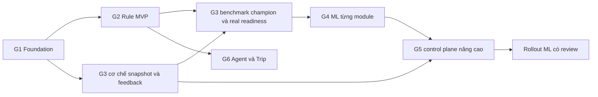
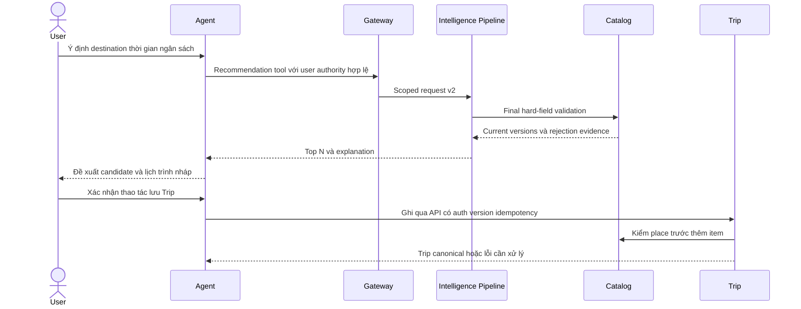

# Lộ trình triển khai sáu giai đoạn

[Mục lục](00-readme.md) · [Backlog60 task](11-implementation-backlog.md) · [Gate/test](09-test-strategy.md). Đây là thứ tự yêu cầu tương lai; trạng thái thực hiện chỉ ở [progress BE](../../progress_be.md) và [progress FE](../../progress_fe.md). Không bật lại phần AI đang hoãn chỉ vì kế hoạch đã được viết.

## 1. Kết quả cần đạt và cách chia công việc

MVP là một hệ Recommendation chạy hoàn chỉnh bằng Rule, có hard filters/consent/explanation/fallback/FE qua Gateway. CF Rule có code và test nhưng phục vụ thật chỉ khi đủ support/chất lượng; Baseline+Content+Weighted không phụ thuộc CF để dùng được. ML nâng từng module khi có real evaluation. G6 Agent có thể đi sau Rule API ổn định, không phải chờ mọi model ML.

| Giai đoạn | Task | Sản phẩm | Dependency quyết định |
|---|---:|---|---|
| G1 Foundation & Data Readiness | RC-G1-01..12 | Contract/seams/projection/consent/candidates/features/basic policy/audit/tests | N1/N2 xác nhận owner contracts/purpose, có inventory nguồn licensed |
| G2 Rule-based Recommendation | RC-G2-01..10 | Baseline/Content/CF-gated/Weighted/Context, v2 FE, Rule-only E2E | G1 interface/schema/privacy ổn; real catalog cho demo hữu ích |
| G3 Evaluation & Data Pipeline | RC-G3-01..10 | Exposure/feedback, PIT snapshot/splits, evaluator/registry/jobs và readiness benchmark | Logging/consent G1, Rule champion G2; cần thời gian thu thập hành vi thật |
| G4 Modular ML Integration | RC-G4-01..10 | Content/CF/Hybrid ML theo gate; Context ML chỉ feasibility có điều kiện | G3 immutable datasets/eval; đủ data từng module, không all-or-nothing |
| G5 Policy, Selection & Rollback nâng cao | RC-G5-01..10 | Admin policy versions/CAS, per-module eligibility, atomic activate/rollback, shadow/optional A/B | Basic registry/fallback đã có G1/G2, Model manifests G3; không chờ G5 mới modular |
| G6 Agent & Trip Planner | RC-G6-01..08 | Tool contract/delegation, candidates→validated itinerary, safe failure/E2E | G2 API & hard rules ổn, Trip authorization sẵn; owner duyệt scope Agent mới |

Mũi tên G4→G5 chỉ yêu cầu ML thực để diễn tập activation model thật; config persistence/CAS/rule rollback ở G5 có thể làm sớm sau G3 registry. G6 không là blocker cho vận hành Rule API hoặc cho offline ML. Việc thu thập real data kéo dài theo người dùng thật, không đổi thành estimate số ngày coding.

## 2. G1 — Foundation & Data Readiness

**Input:** main baseline89eb8cb, source/contract audit, owner services, purpose decision. **Output:** bộ contract v1/v2 reviewed và pipeline seams testable; chưa activation ML.

Thứ tự triển khai:

1. RC-G1-01 đọc lại main tại lúc bắt đầu, xác nhận report gốc nếu được cung cấp, inventory dữ liệu/licensing và các sai lệch F trong progress. Không dùng plan “chưa triển khai” để bỏ code hiện hữu.
2. RC-G1-02 chốt API v2/event extensions và compatibility v1; sửa auth mismatch interaction trong contract, không giảm security cho khớp. N1/N2 review owner APIs, fixtures/checksum/stubs và consumer versioning cùng revision.
3. RC-G1-03 khóa golden v1 và tách pure interfaces/DTOs từ BasicRepository; RC-G1-04 Catalog hard fields/lineage và RC-G1-05 Identity purpose/current-consent fence có thể chạy song song do owner khác nhưng phải giao contract trước.
4. RC-G1-06 client/server interaction dedup/state; RC-G1-07 projection versions/rebuild/historical seam. Source→transport→local destination rõ tại [data](04-data-design.md); không query DB xuyên owner.
5. RC-G1-08 pushdown scope/pagination/hard filters; RC-G1-09 feature dictionary/masks; RC-G1-10 basic strategy registry/policy/fallback. Có thể code Rule fixtures khi source runtime mới chưa connected, nhưng chưa đóng connected gate.
6. RC-G1-11 audit/explanation/no-consent minimal retention; RC-G1-12 CI/test infra/handoff. Không dùng long transaction bao CPU/job làm serving blocked.

**Files chủ yếu:** Intelligence recommendation/projection/client/security packages, owner Catalog/Identity wire adapters, `backend/contracts`, Gateway public matchers, new migrations **sau V10 ở thời điểm code**. Không sửa legacy monolith POM để có thư viện ML cho microservice.

**Test/gate:** v1 schema unchanged; T01–T11,T21–T24,T35–T36; current-consent purpose rõ, hardfield unknown xử đúng, retrieval không limit sai trước scope. Catalog/Identity HTTP stub chỉ chứng minh contract isolate; connected proof cần service thật. Nếu owner purpose chưa chốt, làm public/request-only và fixture mechanics, giữ personalization/training disabled.

## 3. G2 — Rule-based Recommendation

**Input:** features/candidates/consent/basic registry stable. **Output:** chạy end-to-end không model artifact, không training worker vẫn trả Top N an toàn.

RC-G2-01 Baseline và RC-G2-02 Content có thể làm song song vì cùng `Scorer` contract. RC-G2-03 CF Rule độc lập sau implicit-state contract nhưng gated support. RC-G2-04 Weighted chỉ tích hợp sau score schemas/calibrators thống nhất, không đợi CF real data mới demo B+C. RC-G2-05 Context+Final Validation và RC-G2-06 explanation/TopN dùng cùng hard semantics. RC-G2-07 deadline/fallback thống nhất service1500/Gateway2000/permodel100/tổng 200/reserve300 ms, số đo vẫn cần benchmark.

RC-G2-08 FE v2 sau contract ổn: dùng đúng URL `/api/intelligence/api/v2/recommendations`; error/empty/degraded và preference consent rõ. Không tạo UI control chọn AI/Rule cho user để né central policy; metadata chỉ diễn giải actual strategy cần thiết. RC-G2-09 chạy numeric/golden/security/real connected/load; RC-G2-10 chuẩn bị package review. Agent không tự cấp chữ ký hoặc gọi package review là ACCEPTED.

**Công thức/weights/tests:** xem [03](03-module-design.md), không copy một công thức khác trong code task. **Rủi ro:** thiếu description/hours/cost evidence thì filter có thể empty; phải sửa data readiness, không mở hard rules. CF nếu real support thấp vẫn OFF và minh bạch, không gắn nhãn CF recommendation thật bằng synthetic neighbors.

**Gate:** v1 compatibility, v2 Rule-only functional correctness, actual FE→Gateway→Intelligence→Catalog/Identity proof, no consent storage leaks; p95/quality catalog benchmark có số liệu; CI đúng final revision + review tương ứng khi xin gate dự án. MVP không yêu cầu ML quality đạt trước.

## 4. G3 — Evaluation & Data Pipeline

**Input:** Rule champion đã version, consent purpose approved, exposure collection hợp lệ. **Output:** snapshot/evaluator/registry/job lifecycle tái lập được và đánh giá data sufficiency riêng từng use case.

1. RC-G3-01 ký impression tokens, client viewport thật và CLICK sau exposure; server actions vẫn qua owner events. RC-G3-02 purge/revocation/retention chạy cùng collector, không chờ có model mới thêm privacy.
2. RC-G3-03 lưu PIT feature snapshots/occurrences từ thời điểm bắt đầu; không backfill historical features bằng current rows. RC-G3-04 cleaning/labels/support và RC-G3-05 temporal split/embargo không chia request group qua split.
3. RC-G3-06 metrics/cohorts+champion evaluation trên full eligible catalog hoặc declared sampled pool; RC-G3-07 evaluation async API. RC-G3-08 manifest/registry/artifact compatibility và RC-G3-09 worker lease/resource/cancel làm song song sau data contract.
4. RC-G3-10 benchmark real readiness: sample counts/density/head-tail/cold support/CI. Real sparse→QUALITY_PENDING; không đổi sang synthetic holdout rồi báo quality verified.

Training job có TRAIN và PREPARE_PRETRAINED để giữ provenance imported encoder an toàn. Dataset snapshot public content vẫn cần source/license; không cần giả optimization train khi chỉ chuẩn bị pretrained vector. Source storage allow không suy training allow.

**Files:** dataset/model/worker/evaluation packages hiện hữu mở rộng; feedback package mới; dataset/model metadata migration bổ sung; historical snapshot/feedback tables theo [04](04-data-design.md). Private volume dùng để demo mechanics; object storage vận hành thật cần F-06 xử lý trước release retention/backup claim.

**Gate:** metric math exact, snapshot checksums/splits tái lập, lease/cancel/revoke thật, quality categories explicit. Offline quality không phải causal business uplift. Không block Rule service chỉ vì data ML chưa đủ.

## 5. G4 — Modular ML Integration

**Input:** real datasets/evaluator/manifest, inference interface và rule fallback đã test. **Output:** chỉ những module có lợi ích/chi phí chấp nhận được mới được đề xuất activate.

| Nhánh | Thứ tự | Khi nên dùng | Khi không activate |
|---|---|---|---|
| Content | RC-G4-01 lựa chọn/benchmark →02 adapter | Rule category/tag bỏ lỡ semantic intent có relevance eval; có description licensed | Text thiếu/quá nghèo, latency/cost cao, không hơn Rule trong full policy |
| Collaborative | RC-G4-03 ALS dataset/model →04 adapter/OOV | Real consenting interactions có temporal support | Sparse/OOV/cold quá nhiều hoặc quality CI không đủ |
| Hybrid | RC-G4-05 labels/groups LTR →06 learned ranker | Có exposure/feedback và scorer masks đúng signature | Chưa impressions thật, pseudo-label từ Rule, signature không tương thích |
| Toàn cấu hình | RC-G4-07 ablation/calibration | Đo candidate generator+scorers+context thực dùng | Chỉ scorer metric tăng nhưng full policy/guardrail giảm |
| Context | RC-G4-08 feasibility review | Soft context error đo được, có labels/provider | Mặc định chưa cần; không làm hard-constraint learner |
| Governance/handoff | RC-G4-09 revoke/rollback tests →10 review | Source/consent/compat/perf/quality đều đủ | Một điều kiện fail: giữ Rule, không “ML cho có AI” |

Nhánh Content/CF có thể nghiên cứu song song nhưng không cùng sửa base interfaces. Thêm model/runtime dependency chỉ khi benchmark được reviewer duyệt; pin version/license và SBOM theo project, không cài toàn hệ thống training platform. Không yêu cầu GPU, Kubernetes, external inference microservice để đạt mục tiêu đồ án.

**Gate activate riêng module:** cần module relevance + full-policy paired eval/CI/ablations, latency/resources, artifact hash/signatures, consent/license hiện hành, fallback/rollback test và owner/reviewer written approval. Context ML/A-B không bắt buộc nếu chưa data/traffic. Nếu release cuối vẫn yêu cầu “có ML” theo P00, một Content model thực đạt gate có thể đáp ứng phần được owner xác nhận; không tự hạ yêu cầu release hay tự tuyên bố mọi ML task xong.

## 6. G5 — Policy, Selection & Rollback nâng cao

**Input:** basic registry G1, fallback G2, model manifests/eval G3. **Output:** control plane có quyền và audit, thay từng module bằng immutable bundle, safe rollout/rollback.

RC-G5-01 code manifests và RC-G5-02 policy/slot persistence xác định UUIDbundle, unique policy_version label, lifecycle version và active_generation riêng. RC-G5-03 selector/RC-G5-04 compatibility chain hoàn thiện eligibility. RC-G5-05 atomic deployment/model facade và RC-G5-06 rollback/kill switch chung transaction; không tạo active model pointer độc lập với policy serving pointer.

RC-G5-07 admin audit/UI sau schema ổn; RC-G5-08 shadow tách CPU và không double exposure; RC-G5-09 canary/A-B có điều kiện traffic/consent stable assignment. Guest/OFF ở control public policy, không bucket theo random request. RC-G5-10 resilience/load/ops handoff kiểm đồng thời deploy/revoke/worker restart. New event schema/consumer review cần N1 vì Identity hiện còn F-01, không giả notification đã nhận.

**Gate:** rollback ref hiện tại còn hợp lệ, atomic CAS chỉ một winner, in-flight request pin bundle và recheck privacy, rejected/fixture models không serving, actual-used trace đủ. Shadow/A-B chưa có statistical power thì chỉ ghi cơ chế test, không ghi business uplift.

## 7. G6 — AI Agent & Trip Planner Integration

**Input:** v2 Recommendation API và Trip APIs thật, G2 Rule đủ dùng. **Output:** Agent dùng tool có quyền, trả candidate hợp lệ cho Trip workflow, không sở hữu ranking/route canonical.

Tool adapter không cần biết Content Rule hay ML; nó chỉ cần schema criteria/result, deadline, lỗi, consent và actual public explanation. Destination name mơ hồ phải resolve qua Catalog và hỏi người dùng khi cần, không tự nới scope. Recommendation xếp hạng **địa điểm**, không giải bài toán lịch trình khả thi theo travel time, thứ tự, giờ mở, tổng ngân sách cả chuyến. Trip owner/validator kiểm mỗi leg/day, routing estimate, duration, timezone và total cost trước ghi; place TopN không đồng nghĩa có thể ghé tất cả trong một ngày.

RC-G6-01 chốt phạm vi tool/provider/trusted backend; RC-G6-02 delegation auth (nếu cùng web backend có user bearer thì tái dùng flow Gateway, không tạo delegation framework trước nhu cầu); RC-G6-03 tool adapter; RC-G6-04 draft schedule validation; RC-G6-05 attribution+confirmation trước write. Client `recommendation_request_id` là provenance, không là capability bỏ ownership. RC-G6-06 timeout/fallback; RC-G6-07 adversarial E2E+FE; RC-G6-08 runbook/handoff, không deploy production trong task tài liệu này.

Nếu Recommendation503, tool báo không lấy được gợi ý. Catalog search fallback chỉ khi adapter có quyền và giữ cùng hard scope; không LLM fabricate place hoặc gọi DB trực tiếp. Nếu Trip write timeout, query kết quả/idempotency rồi mới retry, không double-save. Agent không chuyển user consent từ false sang true, không gửi internal admin scope để “làm cho chạy”.

## 8. Phân công và chạy song song

| Trách nhiệm | Owner đề xuất theo phân công hiện có | Reviewer | Quyền sửa file khi code |
|---|---|---|---|
| Intelligence/domain/ML/feedback/policy | N2 | N1 | Java Intelligence, migrations, tests do một task owner tại một thời điểm |
| Catalog/Identity/Ingestion hard fields/purpose/policy | N1 | N2 | Owner tự sửa canonical/wire producer, N2 sửa consumer sau freeze |
| Gateway/infra/CI/security exchange | N1 | N2 | Contract và route matcher phải cùng caller tests |
| FE recommendation/admin và Trip | N2; N1 hỗ trợ theo task owner | N1 hoặc reviewer chéo phù hợp | Không để nhiều task sửa client types/progress đồng thời |
| Agent provider/tool | Chưa có module/runtime, N1/N2 cần chốt owner khi mở scope | Người còn lại | Trước mắt spec; folder thực xác định lúc nhận G6-01 |

Song song an toàn: contract producer Catalog và Identity; Baseline và Content scorers; worker và evaluation sau schema; G6 và ML sau G2. Không song song sửa cùng registry DTO/migration số/progress table; chỉ định coordinator. Freeze interface trước chia việc, rebase main và giữ lower progress status khi conflict theo AGENTS. Backlog chỉ dependency yêu cầu, không tạo task session từ nó trong nhiệm vụ này.

## 9. Ước lượng và điểm bắt đầu

Backlog chi tiết có tổng **115 ngày-người, 690 giờ hữu ích** dự kiến cho toàn bộ 60 task, kể cả ML options/Context feasibility/A-B và handoff; bảng effort ở [11](11-implementation-backlog.md) là nguồn số chính. Đây không phải lịch cam kết: tính theo6 giờ/ngày, cần hiệu chỉnh sau G1 spikes, không bao gồm thời gian chờ người dùng thật/nguồn/license/reviewer.

G1+G2 dự kiến40,5 ngày-người trước contingency; hai dev không đơn giản chia đôi vì owner dependencies/review. Lập kế hoạch từng iteration2tuần sau khi task được ước lượng lại; chưa gán ngày hoàn tất. Bắt đầu **RC-G1-01→02**, song song khảo sát licensed catalog và consent purposes. Sai hardfield/consent contract kéo sai mọi scorer và dataset; sửa chúng trước sẽ giảm rewrite nhất. Không bắt đầu bằng ALS/LTR hoặc thêm training server khi data readiness chưa rõ.

## 10. Quan hệ với kế hoạch cũ

P07/P08 là mã nghiệp vụ legacy ánh xạ vào P01-IN, không sáu giai đoạn dự án nối tiếp P04. G1/G2 đáp ứng/rework Basic P07; G3/G4/G5 đáp ứng ML lifecycle P08; connected behavior thuộc P02; system quality thuộc P03; deployment thuộc P04. G6 mở rộng scope Agent có điều kiện, không tự thay các yêu cầu F09/F10 hay tự nhận UC09/UC10 khi chưa có báo cáo gốc. Chỉ sửa dòng Trạng thái ở file plan liên quan cho khớp progress, không tích checkbox plan.
