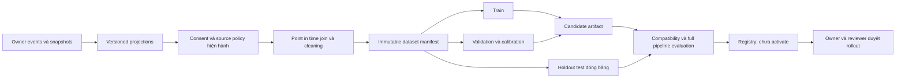

# ML, training và evaluation cho Unified Modular Recommendation

Tài liệu thiết kế để triển khai sau này; mọi dataset, model và ngưỡng trong phần đề xuất chưa phải kết quả đã đạt. Trạng thái triển khai và bằng chứng kiểm thử chỉ theo [progress_be.md](../../progress_be.md) và [progress_fe.md](../../progress_fe.md).

Đọc cùng [kiến trúc](02-architecture.md), [module và thuật toán](03-module-design.md), [dữ liệu](04-data-design.md), [API](05-api-contracts.md), [roadmap](06-implementation-roadmap.md), [policy/fallback](08-ranking-policy-fallback.md) và [kiểm thử](09-test-strategy.md). Không xây pipeline ML thứ hai: ML chỉ thay implementation của một module trong pipeline chung.

## 1. Điểm xuất phát và phần tái sử dụng

| Thành phần nguồn | Có thể tái sử dụng | Giới hạn phải xử lý trước quality gate thật |
|---|---|---|
| `models/service/ModelWorker.java` | Scheduler, claim job, thất bại có trạng thái; một worker của Intelligence | Training hiện chạy transaction dài; cần lease/heartbeat, deadline, kiểm cancel giữa bước và giới hạn tài nguyên |
| `models/repository/ModelRepository.java` | Dataset metadata, lineage nguồn, code revision, seed, checksum, vòng đời job/model/deployment | Dataset hiện là public snapshot; label là Bayesian rating suy từ chính feature rating; không chứng minh sở thích thực tế |
| `models/artifacts/ArtifactStore.java` | Artifact bất biến theo SHA-256, kiểm checksum, khóa object không lấy từ user, cleanup | Adapter hiện là filesystem local; chưa có private object storage/backup đồng bộ giữa nhiều instance |
| `projections/repository/ProjectionRepository.java` | Inbox dedup, version riêng Catalog/rating, source revoke, consent purge, tombstone, lineage `dataset_users` | Consent mới nhất đến qua event có độ trễ; chưa đủ làm xác nhận consent hiện hành cho training cá nhân hóa |
| `place_features.embedding` | Chứng minh pgvector và index có thể hoạt động | `vector(3)` hiện là `[1, normalized_rating, normalized_popularity]` tự tính; không phải semantic embedding và không được dùng lại cho vector D chiều của model mới |
| `ModelService.recommend` | Executor có queue giới hạn, timeout, fallback Basic, kiểm deployment sau inference | Hiện chọn một model cho toàn request; cần selection/fallback và metadata từng module |
| `BasicDatabaseTests` | Checksum/schema rejection, concurrent deployment, timeout, source revocation, rollback và provider contract fixtures | Test hiện dùng public/synthetic fixtures; không thay đánh giá chất lượng người dùng thật |

Đường dẫn tương đối trong bảng tính từ `backend/services/intelligence-service/src/main/java/vn/smarttravel/intelligence/`, trừ migration/test. Implementation hiện fit `linear-sgd-v1`, 300 epoch, learning rate `0.05`, regularization `0.001`, temporal split theo hàng `60/20/20`; tối thiểu 15 hàng và fixture gate `test_rows >= 3`, `mse < 0.1`, `ndcg_at_10 >= 0.5`. Đây là mô tả code, **không phải ngưỡng đề xuất cho recommendation thực**. `synthetic_quality_only=true`, audit `gate=fixture-only`, deployment mặc định bị chặn bởi `intelligence.model-deployment-enabled=false`.

Không ghi đè model/feature schema cũ bằng dữ liệu mới. Giữ adapter v1 cho regression, tạo version module mới qua migration bổ sung khi được giao triển khai. Các endpoint v1 strict giữ nguyên; contract mở rộng được đề xuất ở [API v2](05-api-contracts.md).

## 2. Tách ba loại bằng chứng

| Loại dữ liệu/kiểm thử | Được kết luận | Không được kết luận |
|---|---|---|
| Synthetic fixture có seed | Fit/infer chạy được; split, checksum, cancel, fallback và replay đúng | ML hiểu người dùng, tăng conversion, đủ activate |
| Bộ golden do reviewer gán nhãn từ dữ liệu công khai có provenance | Độ phù hợp nội dung/ngữ nghĩa trên phạm vi bộ nhãn; lỗi constraint | Hiệu quả cá nhân hóa hay CF thực trên toàn bộ người dùng |
| Holdout hành vi thật, consent hợp lệ, đủ quan sát và có khoảng tin cậy | Ước lượng chất lượng offline của cohort, thời gian và candidate universe đã công bố | Tác động nhân quả hoặc business uplift online |
| Shadow trên request thật | Độ trễ, lỗi, độ tương thích và khác biệt thứ hạng; không tác động kết quả đã phục vụ | Business uplift của model shadow |
| A/B có phân nhóm ổn định và kế hoạch thống kê | Chênh lệch online trong điều kiện thí nghiệm | Generalize vô điều kiện sang điểm đến/cohort khác |

Không trộn synthetic với holdout thật để làm đẹp sample size. Dataset manifest có `data_kind` tách `SYNTHETIC`, `PUBLIC_JUDGED`, `REAL_CONSENTED`; dữ liệu public chưa có nhãn phục vụ preparation mang `PUBLIC_UNLABELED`, không là bằng chứng chất lượng. Server xác minh loại theo provenance, không tin caller tự gắn nhãn “real”. Nếu dữ liệu thật chưa đủ, module ML ở chế độ chưa được phép activate; Rule pipeline vẫn chạy hoàn chỉnh.

## 3. Định nghĩa feedback và nhãn trước khi train

### 3.1. Nguồn và độ tin cậy

| Tín hiệu | Nguồn canonical và đường truyền | Cách sử dụng đề xuất |
|---|---|---|
| Category, tag, mô tả, destination, tọa độ, giá, trạng thái | Catalog → event/snapshot → `place_features` | Nội dung và hard filtering; giữ version/provenance/observed time |
| Preference và personalization consent | Identity → event/snapshot; current check qua owner API được đề xuất | User vector chỉ khi consent hợp lệ; không tin consent hay user ID do client tự gửi |
| Public rating summary | Community → `community.rating-summary.changed.v1` | Baseline; không suy thành rating riêng của user |
| Favorite add/remove | Community event | Tín hiệu chủ động; remove đảo trạng thái favorite, không mặc định là dislike mạnh |
| Review created/moderated | Community event; cần contract riêng nếu lấy explicit rating đã được phép dùng | Hiện event `REVIEW_CREATED` không tự cung cấp đầy đủ nhãn 1–5; không dựng rating giả từ việc có review |
| Trip item added | Trip event có recommendation attribution | Tín hiệu ý định; chưa phải xác nhận ghé thăm hoặc booking |
| Search/place view | Client batch có auth/consent, dedup/rate-limit ở Intelligence | Tín hiệu yếu; không lưu search text thô chứa PII; hạn chế lặp view cùng session |
| Recommendation returned | Intelligence ghi result | Chỉ chứng minh server đã trả item |
| Impression thực sự hiển thị/click | FE gửi telemetry có request/item ID và dedup; API mới được đề xuất | Chỉ dùng impression đã đo khi tính exposure, CTR và nhãn không click |

Feedback client không được giả server favorite/review/trip event. Attribution phải kiểm item thuộc recommendation request của đúng actor/session và ở trong cửa sổ cho phép; request ID đơn thuần không phải quyền đọc lịch sử của người khác.

### 3.2. Nhãn và cửa sổ

Đóng băng `label_definition_version` trước build. Gợi ý ban đầu: favorite còn hiệu lực hoặc trip-add hợp lệ là positive chủ động; place view là implicit confidence yếu; SEARCH không có place ID không biến thành user–item positive. Các trọng số hành vi và decay được kiểm trong [module design](03-module-design.md), không tune trên test.

Với learning-to-rank, mỗi group là một recommendation request; có thể dùng nhãn thứ bậc `0 = impression đo được, không có action trong horizon`, `1 = click/view có attribution`, `2 = favorite`, `3 = trip-add`. Đây là **quy ước cần benchmark**, không phải thang hài lòng phổ quát. Chỉ gán 0 sau khi hết horizon và đủ retention; item không hiển thị, request bị lỗi và user bị mất telemetry có nhãn unknown. Không coi mọi địa điểm chưa tương tác là negative chắc chắn.

Horizon ban đầu để thảo luận là 7 ngày cho favorite/trip-add; phải đo phân bố độ trễ hành vi trước chốt. Remove favorite trong horizon được xử lý theo net state; lặp click không làm tăng số positive vô hạn. Các action sau horizon không được âm thầm kéo vào label version cũ. Bot/admin/test account được loại bằng marker kỹ thuật, không chép danh tính thật vào báo cáo.

## 4. Dataset pipeline và immutable snapshot



### 4.1. Build definition

API build nhận `dataset_definition_id` của server allowlist theo [05](05-api-contracts.md#61-post-apiv2admindatasets); definition pin module, label_version/horizon, unit-of-observation, cleaning/sampling/split rules. Kèm thời gian cutoff, feature schema, nguồn và code revision; server chốt event/owner watermarks và verified data_kind, không suy labels từ tên dataset hoặc purpose. Builder chỉ đọc DB Intelligence và API owner được cấp quyền; không JOIN sang database dịch vụ khác. Chọn `event_time` cho hành vi và `observed_at/received_at` cho khả năng feature đã có lúc dự đoán. Giữ cả hai; event tới trễ không được thay đổi snapshot đã đóng băng.

Manifest tối thiểu:

| Nhóm | Trường bắt buộc |
|---|---|
| Identity | `dataset_version_id`, `module`, `data_kind`, `definition_version`, `created_at`, `code_revision` |
| Time | `train_end`, `validation_end`, `test_end`, `label_horizon`, `late_event_cutoff`, snapshot watermarks theo từng stream |
| Features | Schema hash/version, vocabulary/category map version, normalization/calibration version, null policy, timezone/geo rule version |
| Lineage | Source ID/version/license/checksum, consent version theo user trong bảng lineage riêng, projection snapshot hashes |
| Sampling | Cohort definition, eligible users/items, exclusions kèm counts, negative sampling seed và method, candidate generator version |
| Artifacts | Khóa object private, checksum, row counts từng split, byte size, parent snapshot và lineage hash |

Danh sách user trong lineage là dữ liệu hạn chế truy cập; chỉ DB/worker được cấp quyền đọc, admin UI xem số lượng và trạng thái. Không xuất user IDs thật vào Markdown, console hoặc model card công khai. Khóa content-addressed không thay authorization của storage.

### 4.2. Cleaning và kiểm tra chất lượng

1. Dedup theo `event_id`; enforce actor/source, event type và thời gian hợp lệ.
2. Loại actor tombstoned, consent không hợp lệ, source bị cấm training và item không có provenance. Kiểm current policy cả trước build và trước publish snapshot.
3. Chốt inventory hợp lệ theo thời điểm; không đưa item tạo sau cutoff vào candidate universe của quá khứ. Label tương lai chỉ xét item đã eligible tại request.
4. Không lấy current rating/category/price của hôm nay gán ngược cho request quá khứ. Cần historical snapshot/version log hoặc bắt đầu thu thập từ lúc foundation triển khai; không backfill bằng cách giả lịch sử.
5. Báo missing/freshness/invalid geo/price/currency/rating, event lag, action distribution, users/items có support và mức concentration. `density = observed user–item pairs / (eligible users × eligible items)` phải ghi denominator và khoảng thời gian.
6. Kiểm train–test overlap request ID, event ID, duplicate place record và label horizon. User có thể xuất hiện ở nhiều temporal split cho warm cohort; điều đó không cho phép feature của tương lai vào train.
7. Hash manifest và content sau canonical serialization đã quy định; ghi seed, thứ tự UUID ổn định, thư viện/runtime. Không kỳ vọng checksum tái lập khi manifest tự chứa `created_at` hiện tại: tách logical content hash và run metadata hash.
8. Publish metadata + artifact refs chỉ sau kiểm checksum và mọi policy. Khi thất bại, snapshot không được READY; object mồ côi được cleanup sau grace period, không xóa ngay file còn tham chiếu.

## 5. Temporal split và chống leakage

### 5.1. Quy trình đề xuất

Chọn bốn mốc bất biến `T0 < T1 < T2 < T3`. Train dùng request trong `[T0,T1)`, validation `[T1,T2)`, test `[T2,T3)`; chỉ đóng nhãn cho request có đủ label horizon. Với horizon H, request cuối một split phải có label end trước boundary được quy định hoặc purge khoảng H giữa các split. Chốt một cách và ghi vào manifest; không cho action ở validation làm feature train qua một phép aggregate chung.

Ví dụ thiết kế, không phải số liệu dự án: train request 01–14/10, chờ nhãn đến 21/10; validation request 22–24/10, chờ đến 31/10; test request 01–03/11, chờ đến 10/11. Feature của request ngày 22/10 chỉ dùng thông tin đã biết trước request đó. Các ngày này minh họa horizon 7 ngày và embargo; không phải lịch cam kết triển khai.

| Thành phần phải fit | Chỉ được fit trên |
|---|---|
| Vocabulary, IDF, scaler, category vocabulary thống kê | Train snapshot |
| User/item factors, embeddings fine-tune | Train và nguồn pretrained đã khai báo |
| Hyperparameter, hybrid weights, missing strategy | Validation |
| Calibrator score → score scale chung | Phần calibration của validation; tách khỏi tập chọn hyperparameter khi đủ dữ liệu |
| Quyết định báo quality cuối | Test một lần sau khóa candidate/policy/model; test lại sau thay đổi tạo evaluation revision mới |

Temporal holdout chính có warm users; thêm cold-user holdout không có history trước cutoff, cold-item holdout chưa có interaction train, cohort theo destination/category và no-consent public mode. Không lấy user cold-start synthetic thế chỗ user mới thực. Với user nhỏ, báo macro-average theo user và số query/user để tránh power user chi phối.

Nếu chưa có historical features, thực hiện prospective collection trước; benchmark trên current public golden chỉ được gọi content evaluation. Split theo `place_features.as_of` của snapshot hiện tại không đủ chứng minh một replay recommendation lịch sử đúng point-in-time.

### 5.2. Exposure và feedback loop

Logged policy quyết định cái user thấy. Dữ liệu click sau policy cũ có popularity/position bias. Báo cả exposure distribution và metrics theo head/tail; dùng challenger cùng candidate universe. Chỉ sử dụng inverse propensity scoring khi đã ghi propensity hợp lệ và có overlap; không tự đặt propensity bằng `1/rank`. Nếu chưa có exploration được đồng ý, không tuyên bố causal uplift từ replay. A/B sau này có stable assignment, consent, guardrails và sample-size plan riêng.

## 6. Lựa chọn Content ML

| Câu hỏi | Thiết kế đề xuất và lý do |
|---|---|
| Có nên ML? | Bắt đầu taxonomy cosine trong ContentRuleScorer. Thử TF-IDF khi mô tả đủ sạch; thử pretrained multilingual embeddings khi taxonomy bỏ sót đồng nghĩa/ngữ nghĩa. Không cần user interaction để fit IDF công khai, nhưng vẫn cần nhãn độc lập để đánh giá lợi ích. |
| Vấn đề công thức chưa giải tốt | Hai địa điểm tương đồng ngữ nghĩa nhưng khác tag; mô tả tiếng Việt phong phú. Không dùng embedding để suy mở cửa, giá hay cho phép vượt scope. |
| Dữ liệu | Name/description/category/tag đã có license, canonical IDs; profile sở thích có consent. Không gửi private user history hoặc review thô chưa có quyền đến API embedding bên ngoài. |
| Model | Candidate A: TF-IDF word/character n-gram + cosine, lưu vocabulary/IDF. Candidate B: sentence encoder đa ngôn ngữ, pin model revision/checksum/license và test tiếng Việt; fine-tune chỉ khi có cặp nhãn đủ. TF-IDF là statistical content implementation, không được quảng bá như đã huấn luyện semantic network. |
| Training | Fit vocabulary/IDF train-only; mô tả thiếu fallback taxonomy. Encoder pretrained: không tự train lại; precompute public place vectors theo content hash, model ID và dimension. Fine-tune dùng positive/negative pairs độc lập, tránh duplicate place qua split. |
| Inference | `ContentMLScorer` lấy vector đã pin và dựng user/request vector theo cùng encoder; cosine hữu hạn, zero norm → unavailable. Candidate đã hard-filter trước; không nhất thiết dùng ANN khi catalog nhỏ. |
| So sánh | Cùng candidate set, profile và context; benchmark semantic golden + real holdout khi có. Ablation thay duy nhất content; sau đó đo full pipeline. Không đánh giá chỉ cosine đẹp. |
| Activate | Schema/model/license hợp lệ, golden không làm giảm hard guarantees; real/independent-label quality và latency đạt gate có xác nhận owner/reviewer. Content pretrained tốt trên public labels chỉ activate trong phạm vi đã được duyệt, không suy CF quality. |
| Fallback | Missing vector, revision mismatch, zero norm, timeout → ContentRuleScorer; không có preference/request content → bỏ content và reweight. |
| Rollback | Drift, semantic failures theo destination, latency/error tăng → pin content model/version cũ còn hợp lệ hoặc Rule. Không rollback consent/source policy. |
| Infrastructure | Java 21 xử lý TF-IDF/cosine và JSON artifact được; chọn thư viện lúc triển khai sau review. Encoder có thể do offline Python worker thuộc Intelligence xuất vector; CPU trước, không bắt buộc GPU/remote inference. |
| Tác động | Cần feature set D chiều riêng, vector schema và calibrator riêng; không thay `embedding vector(3)`. Content vector không được tính lại mỗi request; giải thích dùng matched taxonomy/semantic reason có căn cứ, không bịa tên user khác. |

TF-IDF và cosine là các công cụ phù hợp cho biểu diễn văn bản; lựa chọn n-gram, normalization và hiệu quả tiếng Việt ở đây là giả thuyết cần benchmark theo dự án. Tham khảo [scikit-learn feature extraction](https://scikit-learn.org/stable/modules/feature_extraction.html). Semantic encoder tạo vector rồi tính similarity; đây không phải bằng chứng model cụ thể phù hợp dữ liệu Việt Nam. Tham khảo [Sentence Transformers STS](https://sbert.net/docs/sentence_transformer/usage/semantic_textual_similarity.html).

## 7. Lựa chọn Collaborative ML

| Câu hỏi | Thiết kế đề xuất và lý do |
|---|---|
| Có nên ML? | Chỉ sau khi item–item similarity Rule có baseline trên hành vi thật; tắt serving CF nếu overlap/support không đủ. Một số lượng event cố định không bảo đảm learnable signal. |
| Vấn đề | Rule neighborhood có thể bỏ lỡ yếu tố tiềm ẩn khi ma trận đủ overlap; factorization chia sẻ thông tin giữa users/items. ML không chữa được graph gần như rời rạc hoặc dữ liệu giả. |
| Dữ liệu | User–item implicit matrix từ consented view/favorite/trip; support distinct user, recency, net favorite, dedup, dataset_users lineage. Explicit rating chỉ dùng khi contract/consent cho biết rating thật; không suy từ public aggregate. |
| Model | Ưu tiên implicit ALS CPU với regularization; BPR là thí nghiệm thay thế nếu negative sampling hợp lệ. Không dùng deep collaborative model ở MVP. |
| Training | Với strength `r_ui >= 0`, thử `p_ui = 1[r_ui > 0]`, confidence `c_ui = 1 + alpha × log(1+r_ui)`, tối ưu `Σ c_ui(p_ui−x_u·y_i)^2 + lambda(Σ\|\|x_u\|\|²+Σ\|\|y_i\|\|²)`. Alpha, factor dimension, regularization, iterations tune trên validation; đây là formulation đề xuất, không phải code đã có. |
| Inference | Pin factors và user/item mapping checksum. Score chỉ cho surviving candidate IDs; dot product qua calibrator thành `[0,1]`, không gọi raw latent score là probability. Unknown user/item → unavailable riêng item hoặc toàn module theo contract support; không suy factor ngẫu nhiên. |
| So sánh | Item–item Rule, public baseline, content-only và weighted hybrid trên cùng temporal queries/candidate universe. Đo recall/NDCG theo user-support bins, head/tail và cold cohorts. |
| Activate | Có đủ eligible users/items/positive queries để confidence interval hữu ích, overlap graph, prospective holdout và no-leak tests; vượt quality gate cả full pipeline. Support floors là tham số benchmark, không chứng nhận chất lượng. |
| Fallback | User chưa đủ hành vi, item chưa có factor, model stale/revoked, timeout → CollaborativeRuleScorer nếu đủ support; nếu không thì unavailable và hybrid reweight. |
| Rollback | Chất lượng warm cohort giảm, skew/popularity tăng, model/feature drift hoặc source/consent revoke → model cũ còn hợp lệ; nếu không có thì Rule/off. |
| Infrastructure | Training Python batch worker thuộc Intelligence có thể xuất factor arrays và mapping private; Java inference dot product CPU. Worker dùng queue DB hiện có, artifact store chung; chưa cần service ML, GPU hay feature store riêng. |
| Tác động | Personal factors/lineage là dữ liệu cá nhân; revoke user làm dataset và model liên quan không còn eligible theo governance. Catalog item mới cần content/baseline; không chờ retrain để recommendation hoạt động. |

[Implicit ALS documentation](https://benfred.github.io/implicit/api/models/cpu/als.html) mô tả factor matrix, confidence từ sparse user–item input và khả năng giới hạn item cần score. Missing entry là giả định trong objective; không đồng nghĩa người dùng đã thấy và từ chối địa điểm đó. Chính sách labels, confidence và eligibility ở bảng trên do dự án phải đo kiểm.

## 8. Lựa chọn Hybrid ML / Learning-to-Rank

| Câu hỏi | Thiết kế đề xuất và lý do |
|---|---|
| Có nên ML? | Sau khi calibrated WeightedHybridRanker ổn định và có measured impressions/action attribution. Nếu chưa có exposure đáng tin, giữ weights Rule. |
| Vấn đề | Trọng số cố định không bắt được tương tác giữa mức support/content relevance/recency; learned ranker có thể điều chỉnh theo feature availability. Không dùng ranker để nhân đôi rating/popularity trong nhiều input mà không ablation. |
| Dữ liệu | Query groups theo request, candidate set, scorer scores/version/availability, public/context features known-at-request, measured exposure và delayed outcomes. Không dùng final clicked/rank của tương lai làm input serving. |
| Model | Bắt đầu learned linear weights có regularization và missing masks; sau đó thử LambdaMART CPU khi group labels đủ biến thiên. Không cần LLM rank toàn danh sách. |
| Training | Dựng out-of-fold hoặc historical frozen scorer outputs; không lấy score fit trên cùng label row làm training feature. Group không bị tách qua split; calibration train/validation riêng; lưu full upstream model bundle. |
| Inference | `LearnedHybridRanker` nhận normalized score matrix, missing masks và context hợp lệ. Artifact khai báo `required_scorers`, schema/calibration IDs; policy chỉ cho đúng bundle đã đánh giá. |
| So sánh | Weighted champion với cùng scorer versions/candidates/context; ablation removal của rating/popularity, CF, content; full pipeline sau diversity/final validation. MSE thấp không đủ cho task ranking. |
| Activate | Holdout query groups đủ nhãn phân biệt, offline gates đạt, bundle compatibility và missing-scorer tests pass; owner/reviewer duyệt canary. Hybrid ML chưa đạt → vẫn WeightedHybrid, kể cả content ML đã tốt. |
| Fallback | Một required upstream ML fallback sang Rule làm bundle khác training: chỉ dùng learned ranker nếu bundle substitution đó đã được đánh giá; mặc định chuyển WeightedHybridRanker và reweight. NaN/timeout → weighted. |
| Rollback | Giảm NDCG/CTR/trip-add hoặc lỗi calibration/availability sau rollout → rollback nguyên policy bundle tương thích, không đổi lẻ upstream làm ranker nhận distribution lạ. |
| Infrastructure | Linear ranker Java thuần; LambdaMART training worker và adapter inference được chọn sau compatibility/latency test. Không mở endpoint model tùy ý cho client. |
| Tác động | Model card phải pin content/CF/calibration schemas và candidate generator; model score không tự là explanation. Reason codes dựa feature thực tế; không công khai tên/rating của neighbor. |

LightGBM có objective `lambdarank` và nhãn relevance dạng số nguyên; đây là một lựa chọn ứng viên, không phải dependency được quyết định cài trong nhiệm vụ này. Tham khảo [LightGBM Parameters](https://lightgbm.readthedocs.io/en/stable/Parameters.html). Phiên bản package và model artifact sẽ được pin sau benchmark, không dùng nhãn `latest`.

## 9. Context ML là nâng cấp có điều kiện

| Câu hỏi | Thiết kế đề xuất và lý do |
|---|---|
| Có nên ML? | Mặc định chưa cần; Context Rule xử lý geography, giờ mở cửa, budget và confidence dễ kiểm. Chỉ xem xét khi có lỗi preference/context đo được mà rule chưa giải tốt. |
| Vấn đề | Soft preference thay đổi theo weather/time/group; có thể học độ ưu tiên indoor/outdoor. Không học lại luật hidden/destination/budget tối đa. |
| Dữ liệu | Context tại request có timestamp/provider/confidence, outcome có exposure; weather bản dự báo đã biết lúc đó, không dùng thời tiết thực tế tương lai; group data tối thiểu, không thu danh tính người đi cùng. |
| Model | Bounded adjustment model hoặc contextual ranker nhỏ; mọi hard constraints giữ trong deterministic filter và final validator. |
| Training | Train-only context transforms, temporal split và cohort theo mùa/điểm đến; kiểm mùa hiếm/out-of-distribution. Không gán synthetic weather outcomes làm bằng chứng quality thật. |
| Inference | Chỉ reorder surviving candidates và soft score; clamp adjustment trong mức versioned policy cho phép. Chạy trước final validator, không sinh place ID mới. |
| So sánh | Context Rule cùng upstream scorer bundle và inventory; full-pipeline utility/diversity và latency; kiểm unknown/stale weather/opening-hours riêng. |
| Activate | Cải thiện được chứng minh, provider reliability đủ, guardrails 0 hard violation và owner/reviewer chấp nhận chi phí. Không đủ bằng chứng → tiếp tục Rule. |
| Fallback | Provider timeout, context thiếu/cũ, model OOD, incompatible schema → Context Rule; điều kiện hard bắt buộc nhưng unknown → loại item hoặc trả không đủ kết quả theo contract. |
| Rollback | Drift theo mùa/địa lý, fairness/utility giảm, latency/error tăng → context Rule hoặc model cũ hợp lệ; hard rules vẫn giữ nguyên. |
| Infrastructure | Ưu tiên cùng Java process; optional offline worker. Không thêm weather service/microservice hoặc GPU chỉ để đạt tên AI. |
| Tác động | Cần ghi context snapshot và freshness trong evaluation; thay soft adjustment không làm thay quyền sở hữu canonical data. Agent/LLM không được ghi đè kết quả final hard validation. |

## 10. Model registry và training job contract

### 10.1. Artifact và model card

Registry thuộc Intelligence. Khóa model phải có module, algorithm, model revision và feature-schema version; model `content` không được activate vào slot `collaborative`. Model card private bao gồm:

- Bài toán, intended cohort/destination, dữ liệu không được dùng, limitations và loại `data_kind`.
- Dataset checksum/definition, source/license versions, consent lineage status và time cutoffs.
- Training code revision, runtime Java/Python/package lock, hardware, seeds, hyperparameters, deterministic settings và thời gian train.
- Input/output schema hash, vector dimension/vocabulary/mapping checksum, calibrator ID và required scorer bundle.
- Offline metrics/cohort/sample sizes/CI, champion policy ID, candidate generator/context versions, full-pipeline result và failure cases.
- Resource/latency benchmark, compatibility tests, fallback target, activation eligibility và approver references.

**Đường chuẩn bị pretrained phải có provenance job thật.** Schema hiện tại bắt buộc `model_versions.training_job_id NOT NULL`, và `training_jobs.dataset_version_id NOT NULL`. Thiết kế giữ các FK này: thêm discriminator đề xuất `job_kind = TRAIN | PREPARE_PRETRAINED` vào job record; tên cột legacy `training_job_id` tham chiếu execution record của một trong hai loại. Không tạo model registry row ngoài lifecycle, không tạo job training giả để lấp FK và không gọi model pretrained là model đã được train tại SmartTravel.

| Loại job | Dataset và provenance | Kết quả và cách mô tả |
|---|---|---|
| `TRAIN` | Dataset immutable dùng để fit; code/runtime/seed/params và nguồn/consent lineage hợp lệ | Artifact do optimization của job tạo ra; model card có objective, epochs/iterations thực chạy và metrics |
| `PREPARE_PRETRAINED` | `dataset_id` là public content snapshot bất biến dùng dựng place features/vectors và evaluation, không giả là corpus pretraining của model; record có upstream model/revision/license/tokenizer/checksums và preparation code revision | Artifact đã kiểm và chuyển sang format được runtime cho phép, kèm vector manifest; không optimization, không fake epochs; model card ghi `origin_kind=PRETRAINED_PREPARED`, job kind và upstream provenance |

Với preparation, provenance của corpus pretraining chỉ ghi điều upstream model card công bố và các giới hạn chưa biết; public snapshot của dự án không thay thế thông tin đó. `random_seed` của schema legacy có thể lưu giá trị trung tính `0` với metadata `seed_applicability=NOT_APPLICABLE` khi bước chuẩn bị hoàn toàn xác định; không tuyên bố đã train với seed đó. Nếu preparation có sampling benchmark hoặc phép biến đổi ngẫu nhiên thật, ghi seed đúng bước tương ứng. Chỉ validate/activate khi toàn bộ source/model licenses phù hợp phạm vi sử dụng và quality gate đã đạt; prepare thành công không chứng minh quality.

Metadata `VALIDATED` cũ từ fixture không được tự nâng thành production eligible. Cần tách `compatibility_status`, `evaluation_status`, `governance_status` và `rollout_status` trong thiết kế mới; đề xuất chi tiết tại [data design](04-data-design.md). Một artifact checksum đúng vẫn có thể không đủ consent/quality.

### 10.2. Worker

Giữ DB-backed queue/lifecycle hiện có. Một worker job triển khai đầu tiên chạy cùng owner Intelligence; process có thể tách sau để tránh training tranh CPU của API, không phát sinh microservice domain mới.

`PREPARE_PRETRAINED` chỉ nhận `pretrained_ref_id` trong allowlist do admin duyệt, không nhận URL tùy ý hoặc lệnh tải từ user. Worker resolve revision đã pin, kiểm model license và quyền dùng public content, kiểm checksum mọi file model/tokenizer/config; validate tokenizer revision, input normalization và output dimension. Chỉ chuyển sang artifact format/runtime adapter được phép, từ chối arbitrary code/deserialization không an toàn; sau đó precompute place vectors của public content snapshot theo model/content hash và ghi vector manifest riêng. Việc tải, kiểm, chuyển format, dựng vector và evaluation có progress/cancel/lease thật nhưng không chạy bước fit hoặc khai báo epochs không tồn tại.

| Thuộc tính | Yêu cầu thiết kế |
|---|---|
| Claim | Claim ngắn với `FOR UPDATE SKIP LOCKED`; lease owner/expiry và heartbeat; không giữ transaction mở suốt CPU training |
| Dispatch | `TRAIN` đi qua fit theo algorithm allowlist; `PREPARE_PRETRAINED` đi qua kiểm provenance, chuyển format an toàn và precompute vectors; cả hai dùng cùng claim/lease/audit/publish lifecycle |
| Idempotency | Enqueue theo request hash/actor/key; retry job tạo attempt mới truy được parent, không ghi đè artifact cũ |
| Resource | CPU threads, memory, max rows/bytes và max duration cấu hình theo job; benchmark trên máy mục tiêu; không đọc dataset vô hạn vào RAM |
| Cancel | Poll cancel/lease giữa epochs/chunks; worker mất lease không được publish model; cancellation không chỉ đổi DB status |
| Retry | Chỉ lỗi tạm thời storage/dependency có backoff giới hạn; schema/consent/license/quality failure không retry vô hạn |
| Publish | Kiểm checksum, model schema, consent/source eligibility hiện hành và job lease ngay trước commit metadata; model tạo ở candidate, chưa serving |
| Isolation | Python worker chỉ nhận artifact IDs/metadata có quyền, không arbitrary shell command hay URL/model pickle do user gửi |
| Recovery | Job RUNNING hết lease được đánh dấu failed/retry có audit; artifact mồ côi GC sau grace period, giữ reference từ deployment/evaluation |

Pseudocode thiết kế:

```text
claim_job_with_lease()
assert_dataset_ready_and_current_governance()
load_and_verify_manifest_and_checksums()
if job_kind == TRAIN:
    for training_chunk in bounded_training_schedule:
        assert_lease_and_not_cancelled()
        renew_heartbeat()
        train_chunk_with_fixed_seed()
else if job_kind == PREPARE_PRETRAINED:
    resolve_admin_allowlisted_pinned_source()
    verify_upstream_license_checksums_tokenizer_and_dimension()
    convert_to_allowlisted_safe_artifact_format()
    for content_chunk in immutable_public_content_snapshot:
        assert_lease_and_not_cancelled()
        renew_heartbeat()
        precompute_vectors_with_pinned_encoder()
    write_immutable_vector_manifest()
else:
    fail_job_with_unsupported_job_kind()
evaluate_on_frozen_validation_and_test()
write_immutable_artifact_and_model_card()
assert_current_governance_and_lease_again()
publish_candidate_metadata_atomically()
```

Worker không tự activate model khi train hoặc preparation thành công. Cả hai loại publish candidate có FK về job và dataset; API/admin UI phải hiển thị đúng `job_kind`/origin và tách training metrics với preparation/evaluation metrics. Admin API mới và mở rộng job/model metadata được đặc tả như đề xuất tại [API contracts](05-api-contracts.md).

## 11. Metric definitions và evaluation protocol

### 11.1. Ranking metrics

Chốt `K = 5, 10` trong evaluation definition; production request có thể `topN` khác. Với mỗi query q: `C_q` là tập candidate hợp lệ tại request, `G_q` là positives holdout thuộc `C_q`, `L_q` là danh sách phục vụ sau toàn pipeline, tối đa K. Không tính duplicate và không xóa query khó để tăng điểm.

| Metric | Công thức/denominator đề xuất |
|---|---|
| Precision@K | `\|L_q ∩ G_q\| / K`; short list vẫn chia K, đồng thời báo fill rate. `K` cố định để không được lợi khi trả ít item |
| Recall@K | `\|L_q ∩ G_q\| / \|G_q\|`; query `\|G_q\|=0` ghi undefined và exclusion count, không tự cho 1 |
| DCG@K | `Σ(rank=1..K) (2^relevance(rank)−1) / log2(rank+1)`; relevance versioned, pad missing rank bằng 0 |
| NDCG@K | `DCG@K / IDCG@K`, ideal xếp positives hợp lệ tốt nhất trong cùng `C_q`; nếu IDCG=0 thì undefined và báo count |
| HitRate@K | `1[\|L_q ∩ G_q\|>0]`, macro-average trên queries có positive; không đồng nhất Recall khi mỗi query có nhiều positive |
| Item coverage | `distinct items returned / distinct eligible items` trong cohort/time window; báo coverage trên inventory có labels và toàn inventory riêng |
| User coverage | `eligible users nhận đủ module score / eligible users`; không bỏ cold users khỏi denominator mà không công bố |
| Intra-list diversity | Trung bình `1−taxonomy_cosine(i,j)` trên cặp item trong list; fixed taxonomy representation cho mọi model, list <2 ghi undefined |
| Cold-start performance | NDCG/Recall/HitRate và fill rate riêng cold-user/cold-item/no-history; định nghĩa cohort trước chạy |

Đây là metric convention được chọn cho kế hoạch, phải code thành golden tests. Precision/Recall/NDCG là các metric ranking chuẩn; triển khai thư viện có thể khác cách xử lý short list và empty ground truth, vì vậy không so số trực tiếp khi khác convention. Tham khảo [Recommenders evaluation](https://recommenders-team.github.io/recommenders/evaluation.html).

Ngoài ranking: đo candidate recall `|C_q ∩ all_relevant_q| / |all_relevant_q|` để phân biệt lỗi retrieval với ranker. Nếu item relevant bị hard constraint loại đúng, báo số lượng excluded riêng; không tính đó là lỗi quality của ranker. Main comparison dùng **cùng** `C_q`, hard rule, final validation và K. Thí nghiệm đổi candidate retrieval là experiment riêng, không gán toàn cải thiện cho model.

### 11.2. Operational và online

| Nhóm | Định nghĩa |
|---|---|
| Latency | Wall time toàn request p50/p95/p99; thêm retrieval/feature/policy/scorer/context/final validation/logging. Báo cold warmup riêng |
| Model fallback rate | Requests có ít nhất một module thật sự fallback / requests đã thử module ML; thêm rate trên tất cả requests. No-consent/no-history skip không tính model failure |
| Zero-result/fill rate | Requests trả 0/requests hợp lệ; `returned/min(K, hard-eligible-count)` và count hard-eligible không biết. Không giảm constraints để tăng fill |
| Hard violation | Số hidden/wrong-scope/budget/opening hard violations trên inspected results; mục tiêu bắt buộc 0, không lấy trung bình che case lỗi |
| CTR | Click có attribution / measured viewable impressions, dedup cùng request/item/session; không dùng item returned làm impression |
| Trip-add rate | Attributed valid trip-add / measured impressions hoặc eligible requests; khóa denominator trước experiment |
| Other business | Favorite rate, complaint/hide, saved-trip usage nếu instrumentation có; không gọi trip-add là booking/revenue |

Offline NDCG tốt không bảo đảm online CTR hoặc trip utility. CTR tăng có thể chỉ do popularity/position; phải xem cohorts, concentration, diversity và outcome chủ động.

## 12. Thiết kế so sánh, confidence và quality gate

### 12.1. Evaluation run bất biến

Mỗi run pin dataset ID/checksum, evaluated policy bundle, scorer/model/calibrator versions, candidate provider, context config, K, cohorts, metric implementation và hardware. Tái sử dụng cùng request snapshot cho champion/challenger; đánh giá scorer riêng để debug, nhưng quyết định activate theo kết quả **full pipeline** sau hard filtering/context/final validation.

Chạy ablation: baseline-only; baseline+content Rule; thêm CF Rule khi eligible; thay Content ML; thay CF ML; thay Hybrid ML; Context ML chỉ khi được mở phạm vi. Báo module availability và effective weights; không so model trên tập user dễ trong khi Rule bị tính cả cold users.

Bootstrap paired theo user (giữ mọi request của một user cùng cluster) để ước lượng CI 95% cho metric delta; seed và số lần resample versioned, ví dụ khởi đầu 1.000 lượt. Với dataset ít user, CI bootstrap có thể không tin cậy: ghi hạn chế, kéo dài collection hoặc giữ quality pending. Báo số users, queries có positive, positive items, coverage cohort, dependency/network và tỷ lệ exclusions. Không có một con số users/events tối thiểu bảo đảm model tốt; data-readiness review quyết định theo overlap, statistical power và minimum detectable effect đã thống nhất.

### 12.2. Gate đề xuất cần benchmark

Các ngưỡng dưới đây là **mục tiêu khởi đầu**, chưa có số đo để khẳng định đạt hoặc phù hợp hạ tầng. N2 đề xuất, N1 review; điều chỉnh phải versioned trước lần test cuối, không tune ngưỡng theo kết quả test.

| Gate | Điều kiện đề xuất | Nếu không đạt |
|---|---|---|
| G-DATA | 0 event/user/source không có quyền; 0 leakage phát hiện; manifest/checksum/schema đầy đủ; support/cohort và missingness report có owner review | Không READY/không train candidate serving; vẫn làm fixture tests |
| G-COMPAT | 0 NaN/Infinity/duplicate/foreign candidate; schema, dimension, mapping và calibration tương thích; regression strict v1 giữ được | Loại artifact; Rule pipeline |
| G-QUALITY | Full-pipeline NDCG@10 có paired CI 95% lower bound delta >0 so champion; target point uplift ban đầu ≥3% tương đối; Recall@10, cold cohorts, coverage không giảm quá margin đã chốt | Không activate; điều tra support/labels/ablation; có thể giữ Rule tốt hơn |
| G-GUARDRAIL | 0 hard violation và 0 authorization/consent leak; diversity/fill rate không giảm ngoài margin được duyệt trước benchmark | Chặn activate hoặc rollback ngay nếu serving |
| G-PERF | Service deadline đề xuất 1.500 ms; mỗi ML module tối đa 100 ms, tổng ML budget tối đa 200 ms/request và phải giữ reserve final validation; Gateway timeout 2 s; warm p95 mục tiêu ≤500 ms (mục tiêu warm nội bộ, service p95 tổng thể≤800 ms), ML timeout fallback vẫn trong deadline | Giảm batch/model cost hoặc giữ Rule; không tăng timeout tùy ý |
| G-OPS | Fallback/rollback/source revoke/consent purge có test thật, private artifact backup, ownership và runbook; không dùng fixture gate cũ thay quality approval | Không mở serving ML |
| G-REVIEW | Owner N2 và reviewer N1 xác nhận revision/dataset/evaluation/policy; phát hành theo gate chung repo | Không tự đặt ACCEPTED, không tự đóng gate |

Margins chưa có dữ liệu để chốt: Recall@10 non-inferiority, diversity, head/tail coverage, online business guardrails và fallback rate cho expected traffic. Backlog foundation/evaluation phải chốt bằng baseline measurements. CI rộng hoặc cohort thiếu nhãn → chưa đủ bằng chứng, không phải pass. Nếu thử nhiều models/hyperparameter, chọn qua validation và kiểm multiple comparisons khi cần; không chạy test tới khi một cấu hình thắng rồi giấu các lần khác.

Budget đề xuất khác code hiện tại (deadline 3s, SQL statement timeout 2.5s, inference mặc định 100 ms). Khi triển khai cần thay config/tests đồng bộ và benchmark; bản kế hoạch không thay runtime. Reserve budget final Catalog validation và safe persistence; ML hết budget phải bỏ sớm để Rule còn thời gian hoàn tất. Cancellation token/deadline phải truyền tường minh qua executor, không dựa ThreadLocal tự lan sang worker thread.

## 13. Serving, rollout và rollback từng module

Model slot theo module và immutable policy bundle, xem [policy/fallback](08-ranking-policy-fallback.md). Serving lấy một policy snapshot ở đầu request; pin model/scorer/calibrator version. Chỉ score candidates đã qua hard constraints; model không được truy vấn DB owner hoặc bổ sung item khác. Activation là compare-and-swap transaction lên policy revision sau quality/governance check, không mutable alias `latest`.

Thứ tự nâng cấp: thử offline → compatibility/warmup → shadow với strict resource budget → canary theo phân nhóm ổn định nếu đủ traffic → rollout có duyệt. Shadow không ghi impression như kết quả đã hiển thị; không làm request chính chậm hơn và không nhân đôi feedback. A/B cần sample-size/decision window/stop rule trước; traffic đồ án ít có thể không đủ lực thống kê, khi đó dùng offline + reviewer inspection và ghi rõ chưa có online uplift.

Rollback chọn policy bundle trước đó **còn hợp lệ**, kiểm checksum/schema/license/consent hiện hành lần nữa. Source hoặc user revoke làm model cũ không hợp lệ thì rollback sang Rule/public mode, không kích hoạt lại model đó. Sự cố hard constraint/privacy là kill switch ngay; giảm chất lượng thống kê/latency dùng cửa sổ và threshold đã chốt trong runbook, tránh phản ứng theo một request ngẫu nhiên.

| Sự kiện | Xử lý ngay | Xử lý background |
|---|---|---|
| Source cấm training/đổi license không tương thích | Đánh dataset/model liên quan không eligible; deactivate bundle phụ thuộc và fallback | Rebuild/retrain từ nguồn hợp lệ; xóa artifact theo retention và audit |
| User revoke personalization/training consent hoặc deletion | Purge history/profile theo owner policy; fence event cũ; ngừng user factors, revoke lineage-dependent models | Recompute dataset/model không chứa user, physical purge artifacts/backups theo policy |
| Content drift/new item | Missing vector → content Rule/baseline; không chặn item hợp lệ chỉ vì model chưa biết | Re-embed theo content hash và model revision |
| Feature schema/dimension mismatch | Không infer; compatibility fallback | Build feature version đúng, validate lại |
| Model timeout/busy/corrupt | Fallback module; nếu learned hybrid không tương thích bundle mới thì weighted hybrid | Alert, cooldown, điều tra, disable module khi vượt threshold |

Current consent không được chỉ là boolean client. Đề xuất Identity current-consent batch/check nội bộ có auth audience/scope đúng; kiểm trước build, train publish, activate và personal inference/feedback admission theo contract. Nếu owner check không khả dụng, bỏ cá nhân hóa và chỉ public/request criteria; không phỏng đoán opt-in. Cache/event projection giúp hiệu năng nhưng cần version/freshness/revocation fence, không thay owner policy. Đây là thay đổi contract cần N1/N2 xác nhận tại foundation.

## 14. Monitoring và retention cho ML

Metrics aggregate theo module, strategy, model revision, policy ID và cohort code hữu hạn; không lấy user ID/place ID/free text làm metric label. Theo dõi feature missingness/OOD rate, vector norm, score quantiles, item-support distribution, catalog freshness, consent/source rejection, fallback reason, executor saturation, job lease timeout, train resource usage và deployment changes.

Feature drift chỉ là tín hiệu điều tra: thay đổi distribution không tự chứng minh chất lượng giảm. Theo dõi outcome lag, full-pipeline metrics trên rolling windows đủ nhãn và cohort mix. Khi chưa đủ outcome thật, giữ compatibility/operational checks và ghi chưa đo được quality drift. Không tự retrain rồi auto-activate vì drift alert.

Retention và bảng lineage theo [data design](04-data-design.md): private interaction/impression không giữ vô hạn; dataset personal không sống lâu hơn policy đầu vào. Eval aggregate có thể giữ dài hơn nếu không re-identify user, nhưng lineage tối thiểu cần để honor deletion phải còn trong quyền kiểm soát. Immutable nghĩa không sửa nội dung artifact; khi revoke vẫn được đánh metadata revoked và xóa object theo policy. Object storage/backup retention phải có thủ tục xóa và restore không phục hồi model đã revoke.

Không ghi log text mô tả private, user preference thô, token, connection string hoặc model factor của từng user. Evaluation artifacts là dữ liệu private; repository chỉ lưu definition, code và synthetic fixture hợp lệ. Bằng chứng test/CI và tiến độ thực tế đặt trong hai file progress, không tạo báo cáo tiến độ riêng tại đây.

## 15. File dự kiến và điều kiện bàn giao triển khai

| Phạm vi | File/module dự kiến | Bàn giao bắt buộc |
|---|---|---|
| Dataset/evaluation | `models/datasets/`, `models/evaluation/` bên trong package Intelligence; mở rộng `ModelRepository`, `ArtifactStore` theo [code architecture](02-architecture.md) | Immutable manifests, point-in-time join contract, label/metric definitions, data quality tests |
| Worker | `models/service/ModelWorker.java`, job repository; optional `backend/services/intelligence-service/workers/` cho Python được duyệt | Lease/cancel/resource bounds, code/seed/runtime provenance, private artifacts |
| Scorers | Module content/collaborative ML và inference adapters theo [module design](03-module-design.md) | Contract tương thích Rule, calibrated score, unavailable/missing masks, bounded inference |
| Registry/policy | Model metadata, compatibility/evaluation records, module slot và policy bundle | Candidate không tự serving; approval, atomic activation, rollback và audit |
| Tests | Package test Intelligence; `BasicDatabaseTests`, contract fixtures và integration runners được mở rộng khi giao code | Fixtures riêng real evaluation; hard constraints/privacy/fallback/rollback với dependencies thật |

Trước bàn giao một module ML: xác nhận đúng nhiệm vụ backlog, module owner/reviewer; khóa experiment definition; ghi số đo thật gồm exclusions và CI; kiểm thử với Java 21 và DB/broker thật khi liên quan; cập nhật progress theo AGENTS.md. Gate quality chưa đạt phải giữ Rule và ghi thiếu bằng chứng cụ thể. Không yêu cầu làm cả bốn module ML để hoàn thành recommendation MVP.

## 16. Tài liệu nguồn đối chiếu

- Source thực tế: [ModelRepository.java](../../backend/services/intelligence-service/src/main/java/vn/smarttravel/intelligence/models/repository/ModelRepository.java), [ModelService.java](../../backend/services/intelligence-service/src/main/java/vn/smarttravel/intelligence/models/service/ModelService.java), [ModelWorker.java](../../backend/services/intelligence-service/src/main/java/vn/smarttravel/intelligence/models/service/ModelWorker.java), [ArtifactStore.java](../../backend/services/intelligence-service/src/main/java/vn/smarttravel/intelligence/models/artifacts/ArtifactStore.java).
- Projection/governance: [ProjectionRepository.java](../../backend/services/intelligence-service/src/main/java/vn/smarttravel/intelligence/projections/repository/ProjectionRepository.java), [V6 feature embeddings](../../backend/services/intelligence-service/src/main/resources/db/migration/V6__feature_embeddings.sql), [RecommendationDeadline.java](../../backend/services/intelligence-service/src/main/java/vn/smarttravel/intelligence/shared/http/RecommendationDeadline.java).
- Thiết kế trước: [P07 Basic](../../plan/phases/P07-intelligence-basic.md), [P08 ML](../../plan/phases/P08-intelligence-ml.md), [Intelligence data](../../plan/database/intelligence.md). Đây là requirements, không dùng checkbox của plan làm bằng chứng triển khai.
- Regression hiện có: [BasicDatabaseTests.java](../../backend/services/intelligence-service/src/test/java/vn/smarttravel/intelligence/domain/BasicDatabaseTests.java), [test-local.py](../../backend/services/intelligence-service/test-local.py). Việc có tên test không có nghĩa đã chạy trong phiên lập kế hoạch này.

Các link primary bên ngoài giải thích công cụ/công thức ứng viên; kế hoạch không dựa vào số phiên bản trên trang `stable` để tự cài hoặc activate bất kỳ thư viện/model nào.
