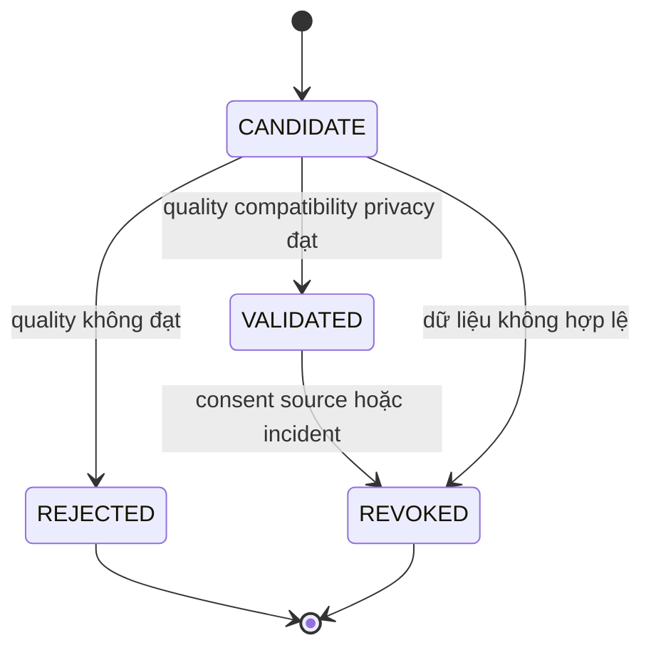

# Ranking Policy, lựa chọn module và rollback

Đây là thiết kế đề xuất. [Kiến trúc](02-architecture.md) · [Evaluation](07-ml-training-evaluation.md) · [Contract](05-api-contracts.md). Trạng thái triển khai chỉ tại [progress BE](../../progress_be.md).

## 1. Registry và policy bundle

`StrategyRegistry` là allowlist code: `baseline.rule`, `content.rule`, `content.ml`, `collaborative.rule`, `collaborative.ml`, `hybrid.weighted`, `hybrid.learned`, `context.rule`. Context ML là extension có điều kiện, không đăng ký runnable khi chưa có gate. Mỗi entry mô tả input/output schema, bounded latency, hỗ trợ request-only hay personalized, dependencies, fallback hợp lệ. OFF là quyết định bỏ module, không phải scorer trả toàn 0.

`ModelRegistry` metadata version bất biến: module key, artifact hash, dataset ID, training job, code revision, feature/score schema, calibrator ID, approved input signature, evaluation ID, consent/source lineage epoch, trạng thái CANDIDATE/VALIDATED/REJECTED/REVOKED. Model không có provenance hoặc fixture-only không được production activate.

`RankingPolicy` content bất biến trỏ tới đúng implementation/model/calibration và weights. Mỗi bundle có `policy_id` UUID riêng, `policy_version` unique label; `version` integer chỉ lifecycle/CAS revision. Active slot có `active_generation` integer monotonic riêng, đọc bằng GET active admin, không tính từ policy version. Active bundle là manifest toàn cấu hình được đánh giá cùng nhau; đổi một module vẫn tạo bundle mới và kiểm compatibility. DRAFT cũng không sửa content; muốn chỉnh tạo bundle UUID/label mới. Có thể rollback riêng Content bằng bundle mới giữ nguyên các module khác. Đây là atomic pointer tới **bundle**, không rollback toàn bộ source hay consent database.

```yaml
policy_name: travel-default
policy_version: mixed-policy-3
feature_schema_version: rec-features-2
baseline:
  implementation: baseline.rule
  version: br-1
content:
  implementation: content.ml
  model_id: content-c7
  fallback: content.rule@cr-1
collaborative:
  implementation: collaborative.rule
  version: cf-2
  minimum_neighbors: 3
hybrid:
  implementation: hybrid.weighted
  version: wh-1
  weights: {baseline: 0.2, content: 0.5, collaborative: 0.3}
context:
  implementation: context.rule
  version: cx-1
request_budget_ms: 1500
```

YAML là cấu hình server minh họa, không phải request JSON API; server cấp policy UUID khi đăng ký. Tên model trong YAML là alias minh họa, API thật dùng UUID. Public aliases ở API ánh xạ rõ: `baseline-rule-v1`=baseline.rule@br-1, `content-rule-v1`=content.rule@cr-1, `collaborative-rule-v2`=collaborative.rule@cf-2, `weighted-v1`=hybrid.weighted@wh-1, `context-rule-v1`=context.rule@cx-1. Không parse tên class từ alias. Config validation reject weight âm/NaN, tổng bằng 0, dependency cycle, fallback tới chính mình, model sai module/feature schema, Learned Hybrid đòi input không cung cấp được. Fallback lists chỉ chứa alternatives, terminal dùng array rỗng. Effective weight sau missing phải audit. Không cho client/LLM gửi policy override; admin shadow evaluation chọn config qua control plane có quyền.

## 2. Thuật toán chọn implementation

```text
select(module, pinnedPolicy, features, consent, remainingBudget):
  if module.personalized and not consent.personalization: return OFF
  if module.requiresHistory and features.historyNotUsable: return OFF
  desired = registry.resolve(pinnedPolicy.moduleRef)
  if desired.isML:
    if not validModelStatusHashLicenseConsentEpoch(desired): return approvedRuleOrOFF(module)
    if not featureAndCalibratorCompatible(desired, features): return approvedRuleOrOFF(module)
    if not coverageAndSupportGate(desired, features): return approvedRuleOrOFF(module)
    if remainingBudget < modelBudget + finalValidationReserve: return approvedRuleOrOFF(module)
  return desired
```

Model eligibility kiểm trạng thái hiện tại không chỉ trạng thái lúc deploy. Nếu registry không sẵn: dùng cache bundle signed/verified còn hạn và tombstone/revocation fence còn xác minh được; khi không thể chứng minh quyền dùng personalized data/model, tắt module đó. Public baseline vẫn cần Catalog final validation. Không dùng stale cached permission để tăng availability.

## 3. Ma trận hành vi bắt buộc

| Tình huống | Content | Collaborative | Hybrid | Kết quả/log |
|---|---|---|---|---|
| Content ML tốt, Collaborative Rule tốt | ML version đã validated | Rule nếu user/cặp đủ support | Weighted hoặc Learned có signature phù hợp | Ghi thực dùng từng version; không chạy CF ML dư thừa |
| Content ML timeout/lỗi/hash sai | Rule trong cùng candidate/features snapshot | Giữ implementation còn hợp lệ | Learned chỉ giữ nếu có certified fallback mask; mặc định Weighted | `CONTENT_MODEL_TIMEOUT`/`MODEL_INVALID`, actual content rule; model attempted khác model used |
| CF ML thiếu data hoặc user/item OOV | Giữ Content | CF Rule nếu đủ neighbor; nếu không OFF | Renormalize weights của modules khả dụng | `CF_INSUFFICIENT_SUPPORT`; không lấy user khác làm user hiện tại |
| Hybrid ML chưa đạt gate | Giữ Content | Giữ CF hợp lệ | Weighted | Không deploy Learned, `HYBRID_QUALITY_PENDING` trong admin audit |
| Model mới activate | Request mới pin bundle mới | Theo bundle | Theo bundle đã eval | Request đang chạy hoàn tất bundle cũ; prewarm trước pointer switch |
| Model mới giảm chất lượng sau deploy | Model/module trong bundle mới bị khóa theo incident | Giữ module khác hợp lệ | Recheck signature, thường Weighted | Rollback bundle tới ref đã hợp lệ hiện tại; ghi actor/reason, không bỏ audit |
| User mới, có consent nhưng chưa history | Rule theo request/preferences nếu có | OFF | Baseline + Content, hoặc Baseline-only | `COLD_START`; score 0 khác unavailable |
| User không consent personalization | Rule request-only hoặc public Content ML licensed, không history | OFF | Weighted request-only, không personalized LTR | Không lưu user criteria/history; không phát feedback token khi analytics không có |
| Consent revoke trong request | Bỏ toàn bộ feature/model cá nhân | OFF | Recompute request-only một lần nếu còn budget | Response không còn personalized, hoặc 503; không trả kết quả vừa tính từ lịch sử |
| Destination không có place hợp lệ | Không chạy scorer | Không chạy | Không chạy | 200 items rỗng + `NO_ELIGIBLE_CANDIDATES`, không đổi địa bàn |
| Catalog final validation unavailable | Không được phát top N từ cache | Không được bỏ validate | Không được fallback bừa | 503 `CATALOG_UNAVAILABLE` |

Fallback là degraded execution do lỗi/không đáp ứng policy mong muốn. Việc policy chủ động chọn OFF cho user mới/no consent là normal eligibility, không làm fallback-rate tăng giả. Public response `fallback=true` khi có thay thế do lỗi/data gate so với execution plan đã chọn; cold-start chỉ là reason nếu là lộ trình bình thường. Log có `selection_reason`, `attempted`, `used`, `failure_reason` riêng để phân biệt.

## 4. Fallback chains có giới hạn

| Module | Chain | Giới hạn |
|---|---|---|
| Content | ML → Rule → OFF | Tối đa một ML attempt, Rule phải dùng cùng features đã kiểm |
| Collaborative | ML → Rule → OFF | Rule chỉ chạy khi support gate đạt; không tái dùng revoked similarity matrix |
| Hybrid | Learned → Weighted → Baseline-only | Baseline-only chỉ nếu Baseline khả dụng và candidate hợp lệ |
| Context | ML (tương lai) → Rule | HardConstraintFilter và FinalValidator luôn chạy, không có OFF cho hard rules |
| Baseline | Rating/popularity/trending → rating prior → deterministic neutral order | Không đủ thông tin public hợp lệ thì empty/503 tùy lỗi, không fabricate score evidence |

Module lỗi không được lấy điểm đã tính một phần nếu không có output contract complete-mask. Deadline reserve hết thì bỏ optional scorer; nếu final validation chưa thực hiện đủ thì không trả phần chưa xác minh. Circuit breaker per model/version, không khóa tất cả Content vì một version hỏng. Bounded queue, request cancellation và warmup tránh thundering herd.

## 5. Missing scorer và calibration

Weighted Hybrid dùng `H_i = Σ(w_m a_mi s_mi) / Σ(w_m a_mi)` với `a_mi` là availability, không tự tăng điểm do thiếu dữ liệu. Per-candidate missing có thể làm độ tin cậy khác nhau; bắt buộc log mask, confidence và kiểm slice. Để công bằng, ưu tiên CF availability theo cả request hoặc coverage cohort, không chỉ giữ CF cho vài item được lợi. Minmax theo batch chỉ được dùng cho thuật toán legacy đã version; thiết kế mới ưu tiên thang điểm cố định/calibrator fit trên train, tránh thêm một candidate làm đổi tất cả score.

Learned ranker không được nhận scalar của scorer khác version mà không kiểm compatibility. Các mask/defaults phải nằm trong training/evaluation signature. Không thể khẳng định Content ML độc lập tăng NDCG thì Learned Hybrid cũ vẫn tốt; cần đánh giá full policy, post-context và final-eligible pool.

## 6. Activation và rollback transaction



ACTIVE là trạng thái deployment reference, không thêm vào model status hiện hữu một cách tùy tiện. Một model VALIDATED có thể được nhiều policy tham chiếu, nhưng chỉ một active bundle/use case/cohort slot. Đề xuất dùng table policy deployments riêng; unique active per slot và optimistic concurrency. Không repurpose `model_deployments.use_case='recommendations'` hiện tại thành tên module rồi publish event v1 sai enum `PLACE_RECOMMENDATION`.

Activation: kiểm admin scope + quyền điều hành; khóa slot; đọc If-Match; xác minh model hash, evaluation trên đúng candidate bundle, feature/calibrator, source/consent epoch; prewarm ngoài lock; transaction CAS active pointer + immutable deployment record + audit/outbox; broadcast event version mới sau commit. Race revoke sau prewarm phải kiểm lại epoch trong transaction/fence. Consumer cũ không hiểu event mới không được silently drop rồi tuyên bố deployed toàn hệ thống.

Rollback: admin chỉ định policy version trước; hệ thống **kiểm lại tính hợp lệ hiện tại** của mọi ref, không mặc định version cũ vẫn dùng được. Nếu ref bị revoke, tạo emergency rule-only bundle hợp lệ. Giữ lịch sử deployment, old model ID, reason và correlation ID. Rollback không phục hồi consent, không rollback xóa dữ liệu, không thay API schema.

## 7. Rollout và đo lường

MVP chỉ một active bundle; local immutable config có stable UUID/hash + registry map đủ dùng. G3 thêm minimal manifest persistence và create/get DRAFT để evaluator resolve policy UUID; G5 mở rộng lifecycle/active slots/approval/activation, shadow và canary. Shadow dùng cùng eligible candidates/feature snapshot nhưng không trả output shadow và không tính shadow impression vào CTR; chỉ chạy khi consent và resource budget cho phép, tách queue để không kéo chậm serving. A/B phân bucket bằng subject pseudonym có consent, không theo từng request ngẫu nhiên; nhóm OFF/no consent ở public baseline, không covert tracking. Chưa đủ traffic thì dùng sequential review/shadow, không kết luận A/B có ý nghĩa từ vài lượt click.

Đề xuất cảnh báo cần benchmark: fallback do lỗi >5%/5 phút, p95 service >800 ms/5 phút, zero eligible tăng gấp đôi baseline trong cùng địa bàn, any hard violation = dừng rollout ngay. Đây là trigger dự kiến; window và minimum requests phải cấu hình để tránh nhiễu. Production quality regress cần nhãn trễ và CI, không tự rollback bởi một click. Metrics labels là module/version/cohort hạn chế cardinality, không user_id/place_id/raw query. Audit chi tiết vào DB có retention, không metrics labels.

## 8. Acceptance Criteria cho policy

Config invalid bị reject trước activation; output model không finite bị fallback; một request chỉ có một immutable bundle; actual strategy/model/calibrator truy được; fallback chain không vòng lặp; model REVOKED không được deploy/rollback; no-consent không gọi CF; learned input mismatch chuyển Weighted; concurrent activation chỉ một winner; kill ML giữ v1/v2 API và hard constraints. Các test tương ứng tại [test strategy](09-test-strategy.md), backlog G1/G5 tại [backlog](11-implementation-backlog.md).
