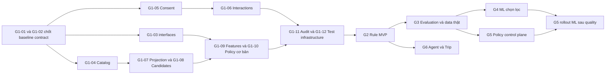

# Master Implementation Backlog

[Mục lục](00-readme.md) · [Roadmap](06-implementation-roadmap.md) · [Kiến trúc](02-architecture.md) · [Module](03-module-design.md) · [Dữ liệu](04-data-design.md) · [API](05-api-contracts.md) · [ML](07-ml-training-evaluation.md) · [Policy](08-ranking-policy-fallback.md) · [Kiểm thử](09-test-strategy.md).

## 1. Quy ước giao việc

Đây là **60 yêu cầu triển khai tương lai**, không phải bảng tiến độ hoặc bằng chứng hoàn thành. Trạng thái task, người nhận/nhánh, test thực chạy, CI run ID và chữ ký chỉ cập nhật tại [progress_be.md](../../progress_be.md), [progress_fe.md](../../progress_fe.md) theo [AGENTS.md](../../AGENTS.md). Không có task nào được hiểu là đã bắt đầu chỉ vì xuất hiện trong backlog.

N2 là owner Intelligence và phần FE liên quan; N1 review chéo, sở hữu Identity/Catalog/Ingestion/Gateway/platform. Task liên service cần cả owner producer và consumer. “Create/Modify” chỉ là file **dự kiến sửa khi triển khai**, không yêu cầu thay source trong nhiệm vụ lập kế hoạch. Khi tên file đề xuất chưa tồn tại, coding agent tạo đúng module đã chốt; khi main đã có class tương đương thì tái sử dụng thay vì tạo bản song song. Migration dùng version kế tiếp sau revision main tại lúc thực hiện; không dành trước số `V11`.

Mỗi heading cung cấp **Task ID và tên task**; các trường Mục tiêu, Mô tả kỹ thuật, Module/service, Input, Output, File dự kiến, Dependencies, Priority, Estimated effort, Acceptance Criteria, Testing requirements, Definition of Done và Rủi ro được ghi riêng cho từng task. `D0` dưới đây là nền DoD bắt buộc, không thay phần DoD riêng.

**D0:** diff tập trung, không secret/PII/debug thừa; contract và caller liên quan cập nhật; tests đúng phạm vi, 0 failure/error; skip không tính pass; integration thật với Java21/DB/broker khi có phụ thuộc; ghi checkout/revision/môi trường và số run/fail/error/skip vào progress đúng nơi; owner yêu cầu review chéo, không tự ký `ACCEPTED`, đóng gate hoặc triển khai. Code và progress cùng PR nhưng commit progress riêng theo AGENTS.md. Test fixture chứng minh cơ chế, không chứng minh ML đạt chất lượng trên người dùng thật.

Nhãn phạm vi: `MVP` là đường recommendation Rule hoàn chỉnh; `ML` là nâng cấp có quality gate; `AGENT` là tích hợp tool sau API ổn định; `TÙY_CHỌN` cần lý do/phê duyệt scope. `DEMO_FIXTURE` cho phép kiểm cơ chế bằng dữ liệu mẫu; `CẦN_DỮ_LIỆU_THẬT` không thể nghiệm thu chất lượng bằng synthetic. Priority `P0` bảo đảm quyền/hard constraints/contract; `P1` chức năng chính; `P2` nâng cấp sau nền; `P3` có thể trì hoãn. Trì hoãn triển khai phải do người dùng quyết định và ghi progress, không suy từ nhãn tùy chọn.

## 2. Chỉ mục và effort

Một ngày-người = **6 giờ làm việc hữu ích**. Đây là rough estimate cho người hiểu Java21 và hệ thống hiện tại, gồm coding/test/review correction ở phạm vi từng task; chưa gồm thời gian đợi dữ liệu thật, quyền provider, review owner hoặc deployment. Các task cùng sửa file không làm song song trong cùng checkout; tổng effort không phải thời gian lịch. Full backlog cố ý gồm các nhánh ML và option có thể không được chọn.

| Giai đoạn | Task IDs | Số task | Effort ngày-người | Vai trò chính | Phạm vi |
|---|---|---:|---:|---|---|
| G1 Foundation & Data Readiness | RC-G1-01 → RC-G1-12 | 12 | 23 | N2 + N1 producer/platform | MVP, prerequisite chung |
| G2 Rule-based Recommendation | RC-G2-01 → RC-G2-10 | 10 | 17.5 | N2, N1 review | MVP hoạt động không model |
| G3 Evaluation & Data Pipeline | RC-G3-01 → RC-G3-10 | 10 | 22.5 | N2 + owner data | Thu thập/evaluation, một phần MVP telemetry |
| G4 Modular ML Integration | RC-G4-01 → RC-G4-10 | 10 | 20.5 | N2, N1 review | ML có điều kiện, không bắt buộc mọi model |
| G5 Policy, Selection & Rollback | RC-G5-01 → RC-G5-10 | 10 | 20 | N2 + N1 platform/security | Control plane nâng cao |
| G6 AI Agent & Trip Integration | RC-G6-01 → RC-G6-08 | 8 | 11.5 | N2 + N1 auth | AGENT sau G2, có thể song song ML |
| **Tổng toàn bộ nhánh** | **60 Task IDs duy nhất** | **60** | **115** | **690 giờ hữu ích** | Không phải cam kết phải xây mọi option |

MVP kỹ thuật cốt lõi là G1+G2 (**40.5 ngày-người**). G3-01/02 thêm exposure/retention nếu MVP demo có telemetry; ML chưa cần để user nhận recommendation. G6 không phải prerequisite hoàn thành Rule pipeline. Không chia tổng 115 cho hai người để cam kết ngày phát hành: N1/N2 còn trách nhiệm ngoài Recommendation và nhiều dependency tuần tự.

## 3. Dependency và công việc song song

- G1-04 Catalog và G1-05 Identity có thể làm song song sau contract, khác ownership; G1-06 event ingestion chạy với producer fixture trước khi nối thật. G1-07/08/09 phải thống nhất FeatureBundle trước khi integration.
- G2-01/02/03 có thể giao các file scorer khác nhau sau G1 interfaces; G2-04 chỉ nối khi ScoreBatch contract ổn định. CF Rule có thể demo fixture đủ support nhưng production phải OFF khi dữ liệu thật chưa đủ.
- G3 collection và privacy triển khai sớm sau G2; snapshot/labels/evaluation cần đủ lịch sử **thu thập thật**, không giả backfill. G4 Content ML có thể đánh giá bằng public judged corpus độc lập nếu license phù hợp; CF/LTR cần dữ liệu hành vi/exposure thật.
- G5-01/02 và admin UI có thể chuẩn bị song song G4; activation ML vẫn phụ thuộc G3/G4 gate đúng bundle. Registry chọn/fallback tối thiểu đã thuộc G1-10, không chờ G5 mới thiết kế modular.
- G6 bắt đầu từ API G2 ổn định; không phụ thuộc Content ML, CF ML hoặc Learned Hybrid. G6-05 ghi Trip cần quyền người dùng và xác nhận thao tác, không cho LLM tự ghi.

## 4. G1 — Foundation & Data Readiness

### RC-G1-01 — Khóa baseline nguồn và đối chiếu báo cáo

- **Mục tiêu:** xác định phạm vi thật trước khi thay recommendation.
- **Mô tả kỹ thuật:** lập mapping source/contract/plan; xác minh bản báo cáo gốc nếu được cung cấp, UC09/UC10 không tự suy từ F09/F10; ghi khác biệt global Basic/Model với modular đích.
- **Module/service:** Intelligence; N2 owner, N1 review.
- **Input:** revision main sạch, báo cáo hiện có, 01-current-state.
- **Output:** baseline revision và decision mapping được review; câu hỏi thiếu nguồn có owner.
- **File dự kiến:** Modify `docs/recommendation/01-current-state.md`, `docs/recommendation/12-risks-and-decisions.md`; chỉ dòng Trạng thái liên quan trong `plan/phases/P07-intelligence-basic.md`, `plan/phases/P08-intelligence-ml.md` khi điều phối đồng bộ.
- **Dependencies:** không có; là điểm bắt đầu. **Priority:** P0. **Estimated effort:** 1 ngày-người. **Nhãn:** MVP, DEMO_FIXTURE.
- **Acceptance Criteria:** mọi fact có path/revision; báo cáo thiếu được ghi thiếu; không gọi vector3 là semantic/CF.
- **Testing requirements:** kiểm link, schema inventory, so static controller/migration; không nâng gate từ đọc source.
- **Definition of Done:** D0 + N1/N2 biết rõ delta, không còn assumption service/protocol chưa xác minh.
- **Rủi ro:** báo cáo ngoài repo thiếu; tiếp tục các task không phụ thuộc bằng nguồn hiện có, không bịa nội dung.

### RC-G1-02 — Chốt contract v1/v2 và owner producer

- **Mục tiêu:** mở rộng API mà không phá caller v1.
- **Mô tả kỹ thuật:** đóng schema strict recommendation v2, errors, deadlines, admin/feedback; sửa discrepancy security interaction v1 theo source có quyền; quyết định event version và internal hard-validation/consent contracts với owner.
- **Module/service:** Intelligence, Catalog, Identity, Gateway; N2/N1 phối hợp.
- **Input:** API design, registry1.0.0-candidate, tất cả caller v1.
- **Output:** OpenAPI/event schemas/fixtures/checksums cùng revision và compatibility window.
- **File dự kiến:** Modify `backend/contracts/openapi/intelligence.yaml`, `backend/contracts/openapi/catalog.yaml`, `backend/contracts/openapi/identity.yaml`, `backend/contracts/registry.json`, `backend/contracts/checksums.json`; Create/Modify fixtures/schema tương ứng trong `backend/contracts/`.
- **Dependencies:** RC-G1-01. **Priority:** P0. **Estimated effort:** 2 ngày-người. **Nhãn:** MVP, DEMO_FIXTURE.
- **Acceptance Criteria:** v1 không thêm field trái strict schema; URL Gateway thật được kiểm; mọi producer/consumer scope được duyệt; không giảm security để khớp khai báo guest sai.
- **Testing requirements:** provider/consumer schema và negative auth contracts; validator/checksum runner có sẵn.
- **Definition of Done:** D0 + owner/reviewer xác nhận contract revision, không agent tự freeze.
- **Rủi ro:** contract đổi nhiều owner; chốt minimal v2 trước, giữ legacy adapter.

### RC-G1-03 — Tạo ranh giới pipeline và bảo vệ v1

- **Mục tiêu:** thay global switch bằng một orchestration có seam kiểm thử.
- **Mô tả kỹ thuật:** tách immutable context/features/ScoreBatch/Ranker; adapters v1/v2 đi vào cùng application pipeline; characterization legacy trước khi chuyển logic, không viết Rule và ML thành hai pipeline.
- **Module/service:** Intelligence recommendations.
- **Input:** contract G1-02, BasicService/BasicRepository/ModelService hiện có.
- **Output:** interfaces/domain DTO và compatibility adapter có golden behavior.
- **File dự kiến:** Create `backend/services/intelligence-service/src/main/java/vn/smarttravel/intelligence/recommendations/application/RecommendationPipeline.java`, `application/LegacyRecommendationAdapter.java`, `domain/ScoreBatch.java`, `ranking/Scorer.java`, `ranking/Ranker.java`; Modify service/controller cũ trong package recommendations/models.
- **Dependencies:** RC-G1-02. **Priority:** P0. **Estimated effort:** 2 ngày-người. **Nhãn:** MVP, DEMO_FIXTURE.
- **Acceptance Criteria:** scorer không JDBC/HTTP/JWT; v1 response giữ string explanation; không thực thi model ngoài policy.
- **Testing requirements:** golden legacy response, common scorer output contract, no duplicate/nonfinite IDs.
- **Definition of Done:** D0 + caller v1 và v2 cùng đi qua invariant chung.
- **Rủi ro:** tách repository lớn đổi hành vi; chia PR nhỏ theo seam, version algorithm khi formula đổi.

### RC-G1-04 — Bổ sung Catalog projection và hard-field lineage

- **Mục tiêu:** có evidence đủ để lọc destination/time/budget/accessibility.
- **Mô tả kỹ thuật:** owner Catalog xuất versioned snapshot/event có destination membership, timezone, hours exceptions, cost basis/estimate, accessibility và source refs; final validation bao phủ đúng fields; không suy giá chắc chắn từ price_min.
- **Module/service:** Catalog canonical, Intelligence projection; N1 producer, N2 consumer.
- **Input:** fields canonical hiện có, contract G1-02, licensed fixtures.
- **Output:** snapshot/validation contract thật và projection mapping có known/unknown.
- **File dự kiến:** Modify `backend/services/catalog-service/src/main/java/vn/smarttravel/catalog/places/repository/CatalogRepository.java`, `shared/web/Representations.java`; Modify `backend/services/intelligence-service/src/main/java/vn/smarttravel/intelligence/projections/repository/ProjectionRepository.java`; Create migration kế tiếp tại resources/db/migration của service liên quan khi cần.
- **Dependencies:** RC-G1-02. **Priority:** P0. **Estimated effort:** 3 ngày-người. **Nhãn:** MVP, DEMO_FIXTURE.
- **Acceptance Criteria:** unknown hard fields không thành true/0/open; độc lập Catalog/rating/source versions; source license được truy vết.
- **Testing requirements:** contract producer/consumer, hours holiday/overnight, currency/unknown cost, hidden/version race.
- **Definition of Done:** D0 + hard fields từ owner tới consumer giữ nguyên semantics.
- **Rủi ro:** canonical thiếu cost/access evidence; loại item hoặc báo unsupported thay bịa dữ liệu.

### RC-G1-05 — Chốt consent theo purpose và current fence

- **Mục tiêu:** không cá nhân hóa/train bằng consent cũ hoặc client tự khai.
- **Mô tả kỹ thuật:** chốt analytics/personalization/training grants với Identity; current-consent check/fence có version; stale opt-in không ghi đè revoke; lookup lỗi chuyển request-only nhưng JWT/session validation vẫn bắt buộc.
- **Module/service:** Identity và Intelligence; N1 owner canonical, N2 consumer.
- **Input:** personalization_enabled/consent_version hiện tại, purpose policy được người dùng chốt.
- **Output:** consent resolver/contract và invalidation fence.
- **File dự kiến:** Modify Identity preferences service/repository trong `backend/services/identity-service/src/main/java/vn/smarttravel/identity/preferences/`; Create `backend/services/intelligence-service/src/main/java/vn/smarttravel/intelligence/recommendations/application/ConsentResolver.java`; Modify `recommendations/client/DependencyClient.java`, projection consumer.
- **Dependencies:** RC-G1-02. **Priority:** P0. **Estimated effort:** 2 ngày-người. **Nhãn:** MVP, DEMO_FIXTURE.
- **Acceptance Criteria:** no-consent không đọc personal features/history; revoke đang request được recheck trước response; user_id chỉ từ principal.
- **Testing requirements:** event out-of-order, Identity down, invalid JWT, revoke race, purpose combinations.
- **Definition of Done:** D0 + consent decision/purpose mapping được owner xác nhận, chưa có grant thì personal training bị chặn.
- **Rủi ro:** current boolean chưa biểu đạt purpose; không tự diễn giải thành mọi quyền.

### RC-G1-06 — Chuẩn hóa interaction ingestion và trạng thái nguồn

- **Mục tiêu:** tín hiệu có nguồn, không đếm đôi và không phục hồi dữ liệu đã xóa.
- **Mô tả kỹ thuật:** client chỉ SEARCH/PLACE_VIEW; server favorite/review/trip từ producer; dedup event ID/body hash, event-time/received-time, rate cap, net favorite, review moderation, purge cutoff; không gán review event thiếu sao thành rating5.
- **Module/service:** Intelligence, Community, Trip.
- **Input:** event contracts/fixtures, consent fence.
- **Output:** canonical derived interactions đủ provenance và producer state.
- **File dự kiến:** Modify `backend/services/intelligence-service/src/main/java/vn/smarttravel/intelligence/recommendations/repository/BasicRepository.java`, `projections/repository/ProjectionRepository.java`, `infrastructure/transport/service/IntelligenceEventListener.java`; Modify request/event fixtures trong `backend/contracts/`.
- **Dependencies:** RC-G1-02, RC-G1-05. **Priority:** P0. **Estimated effort:** 2 ngày-người. **Nhãn:** MVP, DEMO_FIXTURE.
- **Acceptance Criteria:** replay không tăng strength; favorite remove/hidden review không giữ positive cũ; cutoff reject late deleted history.
- **Testing requirements:** broker+DB duplicate/reorder, client/server spoofing, consent revoke, rate limits.
- **Definition of Done:** D0 + mỗi loại hành vi có source-of-truth và dedup key duy nhất.
- **Rủi ro:** snapshot và event chồng lắp; chung version/dedup fence cho cả hai đường.

### RC-G1-07 — Hoàn thiện projection rebuild và seam lịch sử

- **Mục tiêu:** rebuild có thể restart và chuẩn bị dữ liệu point-in-time.
- **Mô tả kỹ thuật:** snapshot watermark/keyset cursor, per-stream version, tombstone và reconciliation; không clear projection đang serving; giữ event_time/recorded_at để G3 thu historical snapshots từ lúc triển khai.
- **Module/service:** Intelligence projection và owner snapshot APIs.
- **Input:** Catalog/Identity/Community/Trip snapshots, event streams.
- **Output:** checkpoint có version và history capture seam, không giả lịch sử trước thời điểm có dữ liệu.
- **File dự kiến:** Modify `backend/services/intelligence-service/src/main/java/vn/smarttravel/intelligence/projections/service/SnapshotRebuild.java`, `projections/repository/ProjectionRepository.java`, `projections/controller/RebuildController.java`; migration kế tiếp Intelligence.
- **Dependencies:** RC-G1-04, RC-G1-05, RC-G1-06. **Priority:** P0. **Estimated effort:** 2 ngày-người. **Nhãn:** MVP, DEMO_FIXTURE.
- **Acceptance Criteria:** crash/restart không mất update hoặc resurrect hidden/deleted; Catalog/rating versions không so chung.
- **Testing requirements:** snapshot/event interleaving, page retry, deletion trong rebuild, broker thật.
- **Definition of Done:** D0 + runbook rebuild bounded và checkpoint phản ánh nguồn thực.
- **Rủi ro:** Trip snapshot phụ thuộc outbox90 ngày; chốt replay retention trước purge.

### RC-G1-08 — Candidate scope, pagination và hard filtering

- **Mục tiêu:** không bỏ sót eligible place vì giới hạn1.000 UUID trước filter.
- **Mô tả kỹ thuật:** query push-down status/destination/category, bounded keyset pagination, geo exact sau bounding box, unknown hard fields exclude; reserve/refill trong deadline, không nới radius/budget để đủ N.
- **Module/service:** Intelligence candidates và Catalog validation.
- **Input:** projection schema G1-04/07, normalized request.
- **Output:** CandidateProvider/HardConstraintFilter với eligible pool và truncation reason.
- **File dự kiến:** Create `backend/services/intelligence-service/src/main/java/vn/smarttravel/intelligence/recommendations/candidates/CandidateProvider.java`, `ProjectionCandidateProvider.java`, `HardConstraintFilter.java`; Modify BasicRepository query; migration/index Intelligence khi plan chứng minh cần.
- **Dependencies:** RC-G1-03, RC-G1-04, RC-G1-07. **Priority:** P0. **Estimated effort:** 2 ngày-người. **Nhãn:** MVP, DEMO_FIXTURE.
- **Acceptance Criteria:** eligible item nằm sau UUID thứ 1.000 vẫn được xét; hidden/sai destination/hard unknown không qua.
- **Testing requirements:** >1.000 fixtures, geo boundary, zero budget/free/null, inactive taxonomy, EXPLAIN query.
- **Definition of Done:** D0 + cap/truncation được đo và audit, không tuyên bố full-catalog ranking khi cap còn áp dụng.
- **Rủi ro:** cap ảnh hưởng recall; benchmark pool size trước tăng tài nguyên.

### RC-G1-09 — Feature schema và dictionary ổn định

- **Mục tiêu:** mọi scorer dùng cùng semantics và missing mask.
- **Mô tả kỹ thuật:** immutable FeatureBundle, category/tag namespace, dictionary ordering/hash, price/hours confidence, normalization version; request preferences ưu tiên, stored profile chỉ khi consent; rating/source stream timestamps riêng.
- **Module/service:** Intelligence features/domain.
- **Input:** eligible candidates, permitted preferences, request criteria, snapshot refs.
- **Output:** feature schema version và FeatureBuilder dùng được cho Rule/evaluation.
- **File dự kiến:** Create `backend/services/intelligence-service/src/main/java/vn/smarttravel/intelligence/recommendations/features/FeatureBuilder.java`, `domain/FeatureBundle.java`, `domain/RecommendationContext.java`; Create feature schema fixture trong `backend/contracts/fixtures/`.
- **Dependencies:** RC-G1-03, RC-G1-05, RC-G1-08. **Priority:** P0. **Estimated effort:** 2 ngày-người. **Nhãn:** MVP, DEMO_FIXTURE.
- **Acceptance Criteria:** null/zero/unavailable khác nhau; OOV không lệch index; cùng snapshot/dictionary tái hiện vector.
- **Testing requirements:** dictionary permutation, zero norm, missing price/timezone, consentOFF, schema mismatch.
- **Definition of Done:** D0 + feature contract versioned và không chứa credential/PII ngoài quyền.
- **Rủi ro:** train-serving skew; dùng chung specification, không copy công thức hai nơi.

### RC-G1-10 — Registry và fallback cơ bản từ đầu

- **Mục tiêu:** modular selection có ngay trong Foundation.
- **Mô tả kỹ thuật:** allowlist Spring map, immutable local policy bundle có stable UUID/content hash, module eligibility/OFF, bounded fallback chains, output contract validation; chưa cần admin CRUD/control plane. Giữ UUID/hash này khi import minimal registry ở G3, không gán lại identity.
- **Module/service:** Intelligence ranking/policy.
- **Input:** interfaces và features, policy config được review.
- **Output:** execution plan pin version, attempted/used provenance và Rule fallback.
- **File dự kiến:** Create `backend/services/intelligence-service/src/main/java/vn/smarttravel/intelligence/recommendations/ranking/StrategyRegistry.java`, `RankingPolicy.java`; Modify `models/service/ModelService.java` để phục vụ qua pipeline.
- **Dependencies:** RC-G1-03, RC-G1-09. **Priority:** P0. **Estimated effort:** 1.5 ngày-người. **Nhãn:** MVP, DEMO_FIXTURE.
- **Acceptance Criteria:** config invalid/cycle/unknown scorer bị reject; không phải mọi scorer chạy mỗi request; no-consent CF OFF.
- **Testing requirements:** eligibility table, fallback cycle, wrong score schema, immutable policy mid-request.
- **Definition of Done:** D0 + adding scorer mới không tạo pipeline độc lập.
- **Rủi ro:** overengineering registry; không plugin loader/remote code/DSL ở MVP.

### RC-G1-11 — Audit, explanation seam và no-consent persistence

- **Mục tiêu:** tái hiện decision trong quyền được phép, không thu history ngầm.
- **Mô tả kỹ thuật:** lưu actual strategy/model/calibrator refs, effective weights, reasons, conservative data_as_of; sanitize body/location; no-analytics không user/session liên kết hoặc feedback token, tối thiểu technical record có retention riêng.
- **Module/service:** Intelligence recommendation audit/explanation.
- **Input:** final candidate/consent/policy trace, retention design.
- **Output:** audit repository và reason-code templates.
- **File dự kiến:** Create `backend/services/intelligence-service/src/main/java/vn/smarttravel/intelligence/recommendations/repository/RecommendationAuditRepository.java`, `explanation/ExplanationBuilder.java`, `domain/ReasonCode.java`; Modify recommendation persist và migration kế tiếp Intelligence.
- **Dependencies:** RC-G1-05, RC-G1-09, RC-G1-10. **Priority:** P0. **Estimated effort:** 2 ngày-người. **Nhãn:** MVP, DEMO_FIXTURE.
- **Acceptance Criteria:** attempted model khác used model được ghi đúng; no-consent không raw criteria/GPS/history; explanation không bịa evidence.
- **Testing requirements:** audit redaction/purge, legacy mode mapping, min-as-of final results, v1 string explanation.
- **Definition of Done:** D0 + audit đủ kiểm decision và quyền truy cập được test.
- **Rủi ro:** debug log thành nguồn PII; allowlist fields và bounded retention.

### RC-G1-12 — Test infrastructure, CI và bàn giao Foundation

- **Mục tiêu:** có môi trường kiểm thật cho Recommendation trước thuật toán.
- **Mô tả kỹ thuật:** mở suite Intelligence chuyên biệt với Java21/Postgres+pgvector/RabbitMQ, owner HTTP stubs cho isolated tests và connected profile riêng; không dùng non-AI package skipTests làm bằng chứng AI.
- **Module/service:** Intelligence/platform/CI; N2 tests, N1 workflow.
- **Input:** contracts/G1 code, existing test-local/check-local và CI runners.
- **Output:** fixture/runner, workflow AI opt-in, handoff instructions link progress.
- **File dự kiến:** Modify `backend/services/intelligence-service/test-local.py`, `check-local.py`, `src/test/java/vn/smarttravel/intelligence/`; Modify `.github/workflows/p01-services.yml`, `.github/workflows/p02-integration.yml` theo scope; Modify docs Recommendation test/run instructions.
- **Dependencies:** RC-G1-06, RC-G1-07, RC-G1-08, RC-G1-09, RC-G1-10, RC-G1-11. **Priority:** P0. **Estimated effort:** 1.5 ngày-người. **Nhãn:** MVP, DEMO_FIXTURE.
- **Acceptance Criteria:** reports tách unit/security/DB/broker/connected, skip hiển thị; AI flags không tự bật default.
- **Testing requirements:** runner dry validation + actual suite khi triển khai; CI đúng revision, không test stub tính thành dependency thật.
- **Definition of Done:** D0 + N1 review environment/contract và N2 biết lệnh chạy riêng.
- **Rủi ro:** env khác Java21 hoặc thiếu Docker; không đóng gate bằng lần chạy lệch.

## 5. G2 — Rule-based Recommendation hoàn chỉnh

### RC-G2-01 — Baseline Rule Bayesian, popularity và trending

- **Mục tiêu:** public/cold-start ranking hữu ích không cần model.
- **Mô tả kỹ thuật:** thực hiện br-1 Bayesian prior, unique-user capped popularity, smoothed disjoint-window trend, missing renormalization; constants/config snapshot versioned; prior-only không giải thích như rating thật.
- **Module/service:** Intelligence baseline scorer.
- **Input:** public aggregate FeatureBundle, snapshot quantiles/windows.
- **Output:** finite ScoreBatch với confidence/reasons.
- **File dự kiến:** Create `backend/services/intelligence-service/src/main/java/vn/smarttravel/intelligence/recommendations/ranking/baseline/BaselineRuleScorer.java`; Create corresponding scorer tests trong Intelligence test package.
- **Dependencies:** RC-G1-09, RC-G1-10, RC-G1-12. **Priority:** P1. **Estimated effort:** 1.5 ngày-người. **Nhãn:** MVP, DEMO_FIXTURE.
- **Acceptance Criteria:** worked example B=0.772 và missing-trend0.715 khớp; no-review prior low confidence; no negative/NaN.
- **Testing requirements:** exact arithmetic, n0/n1/extreme, Q95zero, window boundary, stable ties; public holdout khi có data.
- **Definition of Done:** D0 + baseline version/query provenance truy được, chạy không artifact ML.
- **Rủi ro:** popularity bias/spam; dedup/cap và đo head-tail exposure.

### RC-G2-02 — Content Rule theo preference và category/tag

- **Mục tiêu:** khớp intent bằng features có thể giải thích.
- **Mô tả kỹ thuật:** weighted block cosine, fixed dictionary/IDF policy, request-first preference, zero norm unavailable; không dùng rating làm content feature trùng baseline.
- **Module/service:** Intelligence content scorer.
- **Input:** FeatureBundle/dictionary, permitted request/profile vector.
- **Output:** ContentRule ScoreBatch và evidence category/tag match.
- **File dự kiến:** Create `backend/services/intelligence-service/src/main/java/vn/smarttravel/intelligence/recommendations/ranking/content/ContentRuleScorer.java`; Create content tests/golden fixture.
- **Dependencies:** RC-G1-09, RC-G1-10, RC-G1-12. **Priority:** P1. **Estimated effort:** 1.5 ngày-người. **Nhãn:** MVP, DEMO_FIXTURE.
- **Acceptance Criteria:** cosine0.8/0.316228 khớp ví dụ; hard category không biến thành soft; no-consent chỉ request features.
- **Testing requirements:** zero/OOV/inactive taxonomy, weighted blocks một lần, permutations, request/profile conflict.
- **Definition of Done:** D0 + reason chỉ dựa feature thực dùng và version dictionary được lưu.
- **Rủi ro:** content nghèo/thiếu tags; báo coverage, không bịa preferences.

### RC-G2-03 — Collaborative Rule với support gate

- **Mục tiêu:** khai thác implicit cộng đồng khi đủ dữ liệu hợp lệ.
- **Mô tả kỹ thuật:** item-item cosine/shrinkage, net implicit strength/decay/caps; optional user-user chỉ đối chứng; bounded neighbor snapshot, support floors; sparse/user cold/OOV thành OFF.
- **Module/service:** Intelligence collaborative scorer/background aggregate.
- **Input:** consented interactions G1-06, versioned cutoff/support config.
- **Output:** similarity snapshot và CollaborativeRule ScoreBatch khả dụng có điều kiện.
- **File dự kiến:** Create `backend/services/intelligence-service/src/main/java/vn/smarttravel/intelligence/recommendations/ranking/collaborative/CollaborativeRuleScorer.java`; Create local neighbor aggregation/repository trong cùng module; migration Intelligence nếu snapshot cần persist.
- **Dependencies:** RC-G1-06, RC-G1-09, RC-G1-10, RC-G1-12. **Priority:** P1. **Estimated effort:** 2 ngày-người. **Nhãn:** MVP có OFF hợp lệ, DEMO_FIXTURE; production quality CẦN_DỮ_LIỆU_THẬT.
- **Acceptance Criteria:** sparse fixture không fabricate neighbor; duplicate không tăng support; review event thiếu rating không dùng explicit stars.
- **Testing requirements:** shrinkage/weighted mean, zero norm, support boundary, removal/revoke; real support distribution trước bật.
- **Definition of Done:** D0 + CF disabled an toàn khi không đủ data, không chặn MVP.
- **Rủi ro:** sparsity/PII neighbors; không expose identity và không hạ support để demo như thật.

### RC-G2-04 — Weighted Hybrid và score calibration

- **Mục tiêu:** kết hợp outputs khác module một cách kiểm chứng được.
- **Mô tả kỹ thuật:** weights0.2/0.5/0.3, availability mask, renormalization, stable tie key; validate score domain/calibrator signature; tránh min-max per-request và double counting.
- **Module/service:** Intelligence hybrid ranker.
- **Input:** ScoreBatches và policy config.
- **Output:** RankedCandidates với effective weights/provenance.
- **File dự kiến:** Create `backend/services/intelligence-service/src/main/java/vn/smarttravel/intelligence/recommendations/ranking/hybrid/WeightedHybridRanker.java`; Create common ranker tests.
- **Dependencies:** RC-G2-01, RC-G2-02; RC-G2-03 cung cấp CF hoặc OFF. **Priority:** P1. **Estimated effort:** 1.5 ngày-người. **Nhãn:** MVP, DEMO_FIXTURE.
- **Acceptance Criteria:** H0.66 và missing-CF0.771429 khớp; zero-score không bị bỏ như missing; zero denominator có fallback.
- **Testing requirements:** all masks, raw logits reject, malformed IDs, deterministic tie, arithmetic E2E examples.
- **Definition of Done:** D0 + actual weights và score versions trace được cho mỗi response.
- **Rủi ro:** incompatible scales tạo ranking sai; contract reject/fallback thay silent clamp.

### RC-G2-05 — Context Rule và final owner validation

- **Mục tiêu:** kết quả không vi phạm hard constraints sau reranking.
- **Mô tả kỹ thuật:** destination/geo/budget/time/hours/party evidence; soft distance/weather khi dữ liệu đáng tin; bounded diversity/MMR; final Catalog current/version và consent recheck, reserve refill không nới scope.
- **Module/service:** Intelligence context/validation, Catalog owner.
- **Input:** ranked pool, hard/soft context, owner validation contract.
- **Output:** validated reranked candidates/empty/503 có lý do đúng.
- **File dự kiến:** Create `backend/services/intelligence-service/src/main/java/vn/smarttravel/intelligence/recommendations/context/ContextReranker.java`, `validation/FinalValidator.java`; Modify `recommendations/client/DependencyClient.java`.
- **Dependencies:** RC-G1-04, RC-G1-05, RC-G1-08, RC-G2-04. **Priority:** P0. **Estimated effort:** 2.5 ngày-người. **Nhãn:** MVP, DEMO_FIXTURE.
- **Acceptance Criteria:** hidden/wrong-scope/hard unknown bị loại; final dependency down không trả cache chưa kiểm; MMR chỉ đổi thứ tự eligible.
- **Testing requirements:** holiday/overnight/timezone, accessibility unknown, hide/revoke midflight, second batch fail, insufficient N.
- **Definition of Done:** D0 + cả initial và final invariants có automated tests với owner thật.
- **Rủi ro:** wire chưa đủ hours/cost evidence; không quảng bá constraint chưa kiểm được.

### RC-G2-06 — Top-N và explanation đúng evidence

- **Mục tiêu:** user hiểu gợi ý và degraded behavior.
- **Mô tả kỹ thuật:** topN unique, rank explicit sau context/diversity, utility rounded khi xuất; reason-code templates từ evidence, v1 string/v2 object; empty/fallback/partial rõ, không dùng LLM tạo lý do từ tưởng tượng.
- **Module/service:** Intelligence response/explanation.
- **Input:** final list, actual policy trace và confidence.
- **Output:** v1/v2 response compatible và stored decision đồng nhất.
- **File dự kiến:** Modify `backend/services/intelligence-service/src/main/java/vn/smarttravel/intelligence/recommendations/explanation/ExplanationBuilder.java`, `domain/ReasonCode.java`, v1/v2 controllers và response fixtures.
- **Dependencies:** RC-G1-11, RC-G2-05. **Priority:** P1. **Estimated effort:** 1 ngày-người. **Nhãn:** MVP, DEMO_FIXTURE.
- **Acceptance Criteria:** không “đánh giá tốt” từ prior, không “đang mở” khi chưa verify; no-neighbor IDs; partialN không giả đủ.
- **Testing requirements:** explanation evidence tests, v1/v2 contract, score rounding/ties/rank after MMR.
- **Definition of Done:** D0 + log/audit/response cùng actual versions và final IDs.
- **Rủi ro:** explanation leaking profile; public reasons giới hạn và không raw score breakdown.

### RC-G2-07 — Deadline, fallback và cancellation xuyên pipeline

- **Mục tiêu:** lỗi optional module không phá an toàn response hoặc gây queue vô hạn.
- **Mô tả kỹ thuật:** propagate explicit deadline, bounded executor/circuit breaker, reserve final validation, cancel HTTP/model work; fallback Rule/OFF/Weighted chỉ trong budget, không loop; align service/Gateway budgets đã benchmark.
- **Module/service:** Intelligence pipeline/HTTP/inference seam, Gateway config khi cần.
- **Input:** policy fallback matrix, timing instrumentation.
- **Output:** bounded degraded execution và resource metrics.
- **File dự kiến:** Modify `backend/services/intelligence-service/src/main/java/vn/smarttravel/intelligence/shared/http/RecommendationDeadline.java`, `recommendations/application/RecommendationPipeline.java`, `recommendations/client/DependencyClient.java`; Modify Gateway timeout tests/config nếu chốt thay đổi.
- **Dependencies:** RC-G1-10, RC-G2-05. **Priority:** P0. **Estimated effort:** 2 ngày-người. **Nhãn:** MVP, DEMO_FIXTURE.
- **Acceptance Criteria:** hết budget không bỏ final check; cancellation không giữ transaction/thread vô hạn; Gateway không retry POST ngoài ý muốn.
- **Testing requirements:** timeout từng stage, executor full, client cancel, database lock, stuck inference stub.
- **Definition of Done:** D0 + deadlines/fallback trace đúng và resource bound được đo.
- **Rủi ro:** ThreadLocal không truyền sang executor; deadline/cancel token là argument tường minh.

### RC-G2-08 — Nối frontend với recommendation v2

- **Mục tiêu:** UI dùng Gateway thật và hiển thị trạng thái đúng.
- **Mô tả kỹ thuật:** typed v2 client, destination/criteria form, result/explanation/empty/error/fallback, consent UI đọc Identity; thêm Trip giữ request attribution; không tạo kết quả giả khi API lỗi.
- **Module/service:** Frontend, Gateway, Intelligence/Trip.
- **Input:** stable v2 contract, existing ApiClient, AI feature flags.
- **Output:** user flow Rule recommendation qua Gateway.
- **File dự kiến:** Modify `frontend/src/api/travel.ts`, `frontend/src/api/types.ts`; Create `frontend/src/features/recommendations/RecommendationPanel.tsx`; Modify `frontend/src/app/App.tsx`, `frontend/src/features/trips/TripPlanner.tsx`, browser AI smoke script theo UI thật.
- **Dependencies:** RC-G2-06, RC-G2-07, RC-G1-02. **Priority:** P1. **Estimated effort:** 2 ngày-người. **Nhãn:** MVP, DEMO_FIXTURE.
- **Acceptance Criteria:** URL `/api/intelligence/api/v2/recommendations`; invalid JWT/error không giả guest/success; flagsOFF vẫn đúng 503/ẩn scope.
- **Testing requirements:** mock strict contract + browser qua Gateway thật, keyboard/loading/empty/errors, Trip write failure.
- **Definition of Done:** D0 + progress BE kết nối và progress FE màn được cập nhật cùng PR, chưa tự bật defaultAI.
- **Rủi ro:** FE hiện có form giả success; không tái sử dụng pattern đó.

### RC-G2-09 — Kiểm thuật toán, E2E và performance Rule

- **Mục tiêu:** chứng minh Rule MVP đúng cơ chế với dependency thật.
- **Mô tả kỹ thuật:** golden five examples, hard invariants/property tests, connected consent/catalog/broker, cold-start/no-data slices; load representative candidate scope/data size, đo p50/p95/p99/fallback/fill/DB cost.
- **Module/service:** Intelligence/platform/FE test.
- **Input:** G2 code, fixture/test matrix, benchmark protocol.
- **Output:** reproducible test/benchmark run ghi đúng progress, không ML quality claim.
- **File dự kiến:** Create/Modify `backend/services/intelligence-service/src/test/java/vn/smarttravel/intelligence/`; Modify `backend/infra/` AI test/load runners và `frontend/scripts/browser-smoke.mjs` khi cần.
- **Dependencies:** RC-G2-01 → RC-G2-08. **Priority:** P0. **Estimated effort:** 2.5 ngày-người. **Nhãn:** MVP, DEMO_FIXTURE; production load cần workload được owner chốt.
- **Acceptance Criteria:** 0 hard violation/failure/error; skips/env lệch báo riêng; target latency chỉ gọi đạt khi đo đúng profile.
- **Testing requirements:** full Rule suite một run, connected E2E, load warm/cold/outage có sample size/limits.
- **Definition of Done:** D0 + revision sạch trên PR có CI runID, chưa gate nếu thiếu chữ ký.
- **Rủi ro:** synthetic load khác thực; công bố giới hạn và không suy business relevance.

### RC-G2-10 — Bàn giao MVP và review phạm vi

- **Mục tiêu:** gói Rule pipeline dùng độc lập ML và dễ tiếp tục.
- **Mô tả kỹ thuật:** owner/reviewer rà API, invariants, runbook, fallback/privacy, unresolved data issues; đối chiếu progress/source/plan và xác định backlog nâng cấp; không tự đặt ACCEPTED hoặc đóng gate.
- **Module/service:** Intelligence, N2 owner/N1 review; điều phối progress.
- **Input:** G2-09 runs, contract revision, operating defaults.
- **Output:** review package và danh sách điều kiện còn thiếu tại progress.
- **File dự kiến:** Modify docs Recommendation liên quan, `progress_be.md`, `progress_fe.md`; chỉ dòng Trạng thái plan liên quan khi được điều phối.
- **Dependencies:** RC-G2-09. **Priority:** P1. **Estimated effort:** 1 ngày-người. **Nhãn:** MVP, DEMO_FIXTURE.
- **Acceptance Criteria:** không cần model artifact vẫn recommend hoàn chỉnh; CF OFF không chặn; mọi blocker có owner/next action.
- **Testing requirements:** reviewer chạy smoke trên đúng revision; kiểm links/commands và v1 compatibility.
- **Definition of Done:** D0 + package review được gửi đúng owner; chữ ký do người có thẩm quyền tự ghi.
- **Rủi ro:** nhầm handoff thành accepted/released; dùng đúng status và không deploy trong task này.

## 6. G3 — Evaluation & Data Pipeline

### RC-G3-01 — Thu impression và feedback có token

- **Mục tiêu:** phân biệt item trả về với item thực hiển thị và tương tác.
- **Mô tả kỹ thuật:** signed token bind principal/request/place/session/expiry, viewport impression, CLICK/DISMISS, anti-replay/idempotence; không token khi analytics không được owner cho phép; client không gửi favorite/review/trip lần hai.
- **Module/service:** Intelligence feedback, FE telemetry.
- **Input:** recommendation v2 results, current analytics consent.
- **Output:** measured exposures/receipts và feedback provenance.
- **File dự kiến:** Create `backend/services/intelligence-service/src/main/java/vn/smarttravel/intelligence/feedback/controller/FeedbackController.java`, `service/FeedbackCollector.java`, `repository/FeedbackRepository.java`; migration Intelligence; Create FE recommendation telemetry module.
- **Dependencies:** RC-G1-05, RC-G2-06, RC-G2-08. **Priority:** P0. **Estimated effort:** 2.5 ngày-người. **Nhãn:** ML foundation, DEMO_FIXTURE; exposure quality CẦN_DỮ_LIỆU_THẬT.
- **Acceptance Criteria:** issued token không thành impression row; subject mismatch/expiry/revoke reject; duplicate giữ một event.
- **Testing requirements:** token tamper/replay/cross-user, viewport visibility, offline retry, no-consent browser.
- **Definition of Done:** D0 + exposure denominator được định nghĩa và không lẫn shadow results.
- **Rủi ro:** telemetry vẫn bias/mất data; missing là unknown, không auto negative.

### RC-G3-02 — Retention, purge và lineage theo purpose

- **Mục tiêu:** dữ liệu và derivatives dừng dùng sau revoke/delete.
- **Mô tả kỹ thuật:** retention jobs cho interactions/requests/impressions/feedback; dataset_users/source lineage, outstanding token invalidation, factors/cache cleanup, idempotence response purge; backup/restore không resurrect quyền cũ.
- **Module/service:** Intelligence privacy/worker, Identity deletion ACK.
- **Input:** consent/source epochs, retention policy được owner duyệt.
- **Output:** durable revoke/purge cascade và restricted evidence không PII.
- **File dự kiến:** Modify `backend/services/intelligence-service/src/main/java/vn/smarttravel/intelligence/projections/repository/ProjectionRepository.java`, `recommendations/repository/BasicRepository.java`, feedback repository, models repository; migration và privacy test runner.
- **Dependencies:** RC-G1-05, RC-G1-06, RC-G3-01. **Priority:** P0. **Estimated effort:** 2 ngày-người. **Nhãn:** ML foundation, DEMO_FIXTURE.
- **Acceptance Criteria:** ACK sau durable purge/revoke; delayed events không phục hồi; request audit không giữ rawPII trái purpose.
- **Testing requirements:** delete đồng thời train/feedback/serve, late event, retries, restore with tombstone replay.
- **Definition of Done:** D0 + retention từng bảng có owner và test cleanup thật.
- **Rủi ro:** purge lineage quá sớm mất khả năng tìm model ảnh hưởng; giữ minimal restricted fence đúng horizon.

### RC-G3-03 — Dataset snapshot bất biến và point-in-time

- **Mục tiêu:** features/labels có thể tái hiện mà không gán current state vào quá khứ.
- **Mô tả kỹ thuật:** build immutable manifests từ server-allowlisted dataset_definition_id pin module/unit/label_version/horizon/sampling; server verify data_kind theo provenance. Historical feature snapshots, event/receive cutoff, source/license/consent hashes, content vs run hash; atomic artifact publish; không giả lịch sử trước foundation capture.
- **Module/service:** Intelligence dataset/ArtifactStore.
- **Input:** historical streams G1-07, exposure/events có quyền, criteria snapshot.
- **Output:** dataset version và split-ready artifact với lineage.
- **File dự kiến:** Create `backend/services/intelligence-service/src/main/java/vn/smarttravel/intelligence/models/datasets/DatasetBuilder.java`; Modify `models/repository/ModelRepository.java`, `models/artifacts/ArtifactStore.java`; migration history/dataset metadata.
- **Dependencies:** RC-G1-07, RC-G3-01, RC-G3-02. **Priority:** P0. **Estimated effort:** 3 ngày-người. **Nhãn:** ML, DEMO_FIXTURE; historical relevance CẦN_DỮ_LIỆU_THẬT.
- **Acceptance Criteria:** cùng logical definition/checkpoint cho cùng content hash; late event không mutate READY; revoked data không vào snapshot mới.
- **Testing requirements:** reproducibility, point-in-time joins, publish crash/orphan cleanup, source-policy race.
- **Definition of Done:** D0 + manifest đủ code/schema/cutoff/license/consent provenance.
- **Rủi ro:** thiếu historic fields; bắt đầu collection mới, quality pending trong thời gian chờ.

### RC-G3-04 — Cleaning, labels và support profiling

- **Mục tiêu:** xác định labels đúng nghĩa và biết giới hạn dữ liệu.
- **Mô tả kỹ thuật:** dedup/spam caps, moderation-aware events, net favorites, label horizon, exposure unknown vs negative, graph support/density/head-tail; phân SYNTHETIC/PUBLIC_JUDGED/REAL_CONSENTED.
- **Module/service:** Intelligence dataset/evaluation.
- **Input:** immutable raw snapshot, label definition được khóa.
- **Output:** cleaned records, exclusion counts, support profile và label version.
- **File dự kiến:** Create dataset cleaning/label modules dưới `backend/services/intelligence-service/src/main/java/vn/smarttravel/intelligence/models/datasets/`; Create data quality fixtures/tests.
- **Dependencies:** RC-G3-03, RC-G1-06. **Priority:** P0. **Estimated effort:** 2 ngày-người. **Nhãn:** ML, DEMO_FIXTURE và CẦN_DỮ_LIỆU_THẬT cho support readiness.
- **Acceptance Criteria:** unseen không mặc định dislike; missing telemetry không gán0; explicit stars chỉ từ contract có quyền.
- **Testing requirements:** duplicate/negative/late/invalid counts, label horizon edge, synthetic marker enforcement.
- **Definition of Done:** D0 + mọi exclusion có rule/count và label không suy từ scorer đang đánh giá.
- **Rủi ro:** feedback loops/label leakage; giữ exposure/source provenance và train/test independence.

### RC-G3-05 — Temporal splits và leakage tests

- **Mục tiêu:** holdout phản ánh dự đoán tương lai bằng dữ liệu đã biết lúc đó.
- **Mô tả kỹ thuật:** train/validation/test theo thời gian, label horizon/embargo; group request không chia; cold-user/item slices; dictionary/normalization/negatives fit train-only; test khóa trước tuning.
- **Module/service:** Intelligence evaluation/datasets.
- **Input:** cleaned snapshot và historical feature versions.
- **Output:** immutable split manifests/seed/hash và leakage assertions.
- **File dự kiến:** Create split module dưới `backend/services/intelligence-service/src/main/java/vn/smarttravel/intelligence/models/evaluation/`; Create temporal leakage test fixtures.
- **Dependencies:** RC-G3-03, RC-G3-04. **Priority:** P0. **Estimated effort:** 2 ngày-người. **Nhãn:** ML, DEMO_FIXTURE; prospective quality CẦN_DỮ_LIỆU_THẬT.
- **Acceptance Criteria:** feature observed_at không vượt prediction time; label future không vào features; no request/event overlap trái protocol.
- **Testing requirements:** deliberately leaky fixture must fail, delayed-event embargo, warm/cold cohort denominators.
- **Definition of Done:** D0 + split definition tái hiện được và không tune trên test.
- **Rủi ro:** ít history làm test nhỏ; báo CI/sample limits, không random split để làm số đẹp.

### RC-G3-06 — Evaluation baseline, metrics và cohort

- **Mục tiêu:** so chất lượng full pipeline với Rule một cách công bằng.
- **Mô tả kỹ thuật:** Precision/Recall/NDCG/HitRate@K, coverage/diversity/candidate recall/cold slices; same eligible universe, masks và final constraints; paired bootstrap/user clustering, operational metrics riêng business metrics.
- **Module/service:** Intelligence EvaluationPipeline.
- **Input:** split manifests, frozen Rule policy/candidate generator.
- **Output:** deterministic metric result và comparison protocol.
- **File dự kiến:** Create `backend/services/intelligence-service/src/main/java/vn/smarttravel/intelligence/models/evaluation/EvaluationPipeline.java`, metric calculators và tests; Modify evaluation fixtures.
- **Dependencies:** RC-G3-05, RC-G2-09. **Priority:** P1. **Estimated effort:** 2.5 ngày-người. **Nhãn:** ML, DEMO_FIXTURE; uplift claims CẦN_DỮ_LIỆU_THẬT.
- **Acceptance Criteria:** known ranking metrics khớp exact values; zero-positive queries handled công khai; coverage denominator không bỏ cold user ngầm.
- **Testing requirements:** perfect/reversed/empty/tied ranks, impossible hard items, bootstrap reproducibility, ablation identity.
- **Definition of Done:** D0 + metric definitions/sample sizes/CI truy được và synthetic không pass real gate.
- **Rủi ro:** metric inflation qua sampled negatives; báo universe/sampling và không so khác protocol.

### RC-G3-07 — Evaluation job API và lưu kết quả

- **Mục tiêu:** chạy evaluation async, có audit và không sửa metrics bằng tay.
- **Mô tả kỹ thuật:** admin create/get evaluation, immutable terminal result, idempotency, policy/dataset refs, async job polling; reject revoked/incompatible input. Tạo minimal ranking_policies và create/get DRAFT policy APIs ngay ở G3 để đăng ký G1 rule bundle/manifest; evaluation resolve UUID/hash, không chờ control plane G5. Sau G3-08 có thể đăng ký candidate-model bundle chưa activate để evaluate.
- **Module/service:** Intelligence admin evaluation.
- **Input:** v2 admin schema, EvaluationPipeline, registry/dataset metadata.
- **Output:** evaluation_runs/minimal policy-manifest persistence và authorized async API.
- **File dự kiến:** Create evaluation controller/repository dưới `backend/services/intelligence-service/src/main/java/vn/smarttravel/intelligence/models/evaluation/`, minimal policy repository/create-get controller trong recommendations/ranking; migration evaluation_runs/ranking_policies; Modify contracts/fixtures/request validators.
- **Dependencies:** RC-G1-02, RC-G3-06. **Priority:** P1. **Estimated effort:** 2 ngày-người. **Nhãn:** ML, DEMO_FIXTURE.
- **Acceptance Criteria:** 202 không nghĩa success; cùng key/body cùng job; different body409; không public dataset row/user lineage.
- **Testing requirements:** auth/admin scopes, idempotency race, terminal immutability, worker fail/timeout, schema contract.
- **Definition of Done:** D0 + result links đúng dataset/bundle/code/split revision.
- **Rủi ro:** evaluation request làm nặng serving; queue/resource budget tách biệt.

### RC-G3-08 — Model manifest, registry và artifact compatibility

- **Mục tiêu:** model có identity/lineage/quality rõ trước inference.
- **Mô tả kỹ thuật:** module-scoped registry, artifact checksum/private key, feature/score/calibrator/input signature, evaluation/governance status, model card và ModelInferenceAdapter chung cho mọi module; legacy fixture VALIDATED không thành production eligible. Job PREPARE_PRETRAINED ghi pinned provenance thực, giữ FK job/dataset nhưng không giả training. Thêm admin_operations durable/lease worker cho MODEL_VALIDATE/POLICY_VALIDATE và GET operation polling, không giữ operation trong RAM.
- **Module/service:** Intelligence models registry/ArtifactStore.
- **Input:** dataset/job/evaluation IDs, artifact schema specification.
- **Output:** immutable model metadata, common bounded inference adapter seam và compatibility validation.
- **File dự kiến:** Create `backend/services/intelligence-service/src/main/java/vn/smarttravel/intelligence/models/registry/ModelRegistry.java`, `backend/services/intelligence-service/src/main/java/vn/smarttravel/intelligence/models/inference/ModelInferenceAdapter.java`, admin operations repository/worker/controller trong models; Modify `models/repository/ModelRepository.java`, `models/artifacts/ArtifactStore.java`; migration metadata/admin_operations và admin v2 schemas.
- **Dependencies:** RC-G3-03, RC-G3-07. **Priority:** P0. **Estimated effort:** 2 ngày-người. **Nhãn:** ML, DEMO_FIXTURE.
- **Acceptance Criteria:** wrong module/dim/hash/calibrator rejected; private artifact không expose URL mặc định; vector3 không nhận semantic embedding.
- **Testing requirements:** corruption, incompatible shape, revoked lineage, version collision, orphan GC retaining live refs.
- **Definition of Done:** D0 + mọi serving handle truy được dataset/train/eval/code/checksum.
- **Rủi ro:** deserialize arbitrary model code; chỉ allowlisted safe artifact format/adapters.

### RC-G3-09 — Training lease, tài nguyên và cancel thật

- **Mục tiêu:** worker phục hồi được mà không giữ DB transaction suốt training.
- **Mô tả kỹ thuật:** short claim SKIP LOCKED, lease/heartbeat/attempt, bounded CPU/RAM/time, cooperative cancel, fencing trước artifact publish; crash retry có audit; current governance recheck.
- **Module/service:** Intelligence training worker.
- **Input:** queued training job, eligible dataset/params/seed.
- **Output:** robust job lifecycle và candidate artifact; không tự activate.
- **File dự kiến:** Modify `backend/services/intelligence-service/src/main/java/vn/smarttravel/intelligence/models/service/ModelWorker.java`, `ModelService.java`, `models/repository/ModelRepository.java`; Create `models/training/TrainingWorker.java`; migration lease fields.
- **Dependencies:** RC-G3-08, RC-G3-02. **Priority:** P0. **Estimated effort:** 2.5 ngày-người. **Nhãn:** ML, DEMO_FIXTURE.
- **Acceptance Criteria:** cancel_requested chưa worker ack không báo CANCELLED sớm; lost lease không publish; repeated claim không train concurrently cùng attempt.
- **Testing requirements:** kill/restart, heartbeat expiry, concurrent workers, cancel giữa epochs, source revoke trước publish, disk full.
- **Definition of Done:** D0 + resource limits/lease state và retry classification được runbook hóa.
- **Rủi ro:** uninterruptible library training; process isolation/resource cap khi cần, vẫn cùng Intelligence owner.

### RC-G3-10 — Benchmark data thật và quyết định quality readiness

- **Mục tiêu:** xác định có đủ bằng chứng để thử/activate module ML nào.
- **Mô tả kỹ thuật:** kiểm license/consent, user/item overlap/support, label quality/exposure gaps, slice sample sizes/CI và learning curves; so Rule; chốt targets trước candidate tuning, không dùng số user tùy tiện làm certificate.
- **Module/service:** Intelligence/data owners; N2 owner, N1 reviewer.
- **Input:** prospective REAL_CONSENTED hoặc PUBLIC_JUDGED independent labels phù hợp use case.
- **Output:** readiness decision từng module và benchmark protocol approved, hoặc quality pending có lý do.
- **File dự kiến:** Modify `docs/recommendation/07-ml-training-evaluation.md`, `12-risks-and-decisions.md` khi target được chốt; lưu số liệu ngắn và run refs chỉ trong progress.
- **Dependencies:** RC-G3-04, RC-G3-05, RC-G3-06, RC-G3-07. **Priority:** P1. **Estimated effort:** 2 ngày-người. **Nhãn:** ML, CẦN_DỮ_LIỆU_THẬT.
- **Acceptance Criteria:** synthetic/public/real tách rõ; insufficient support không activate CF/LTR; quality gate target không được khai đã đạt.
- **Testing requirements:** audit random labeled samples có quyền, replay baseline, reproducible statistics và cohort coverage checks.
- **Definition of Done:** D0 + owner/reviewer quyết định readiness có evidence trên đúng snapshot.
- **Rủi ro:** đợi real data lâu hơn effort; Rule vẫn hoạt động, không tạo interaction giả để đóng gate.

## 7. G4 — Modular ML Integration

### RC-G4-01 — Nghiên cứu và benchmark Content ML

- **Mục tiêu:** kiểm semantic representation có giải quyết lỗi content Rule thật.
- **Mô tả kỹ thuật:** chọn ít encoder/TF-IDF candidates có license/tiếng Việt/resource phù hợp; pin revision/tokenizer/dim; independent judged request-place labels, ablation với cr-1 cùng eligible pool; không fine-tune chỉ để có AI.
- **Module/service:** Intelligence offline content evaluation.
- **Input:** licensed place text, public judged labels hoặc consented intent, G3 protocol.
- **Output:** candidate model/config và go/no-go có chất lượng/resource comparison.
- **File dự kiến:** Create content experiment modules trong `backend/services/intelligence-service/src/main/java/vn/smarttravel/intelligence/models/`; worker Python cùng owner chỉ khi thư viện cần và được task scope duyệt; Modify ML design/model cards.
- **Dependencies:** RC-G3-06, RC-G3-08, RC-G3-10. **Priority:** P2. **Estimated effort:** 2 ngày-người. **Nhãn:** ML, CẦN_DỮ_LIỆU_THẬT/PUBLIC_JUDGED độc lập.
- **Acceptance Criteria:** relevance được đo độc lập tags/rule labels; latency/RAM/coverage/licensing đủ; no-go giữ Rule.
- **Testing requirements:** Vietnamese accents/aliases/semantic negatives, cold item, out-of-domain và exact candidate parity.
- **Definition of Done:** D0 + model được pin và đánh giá chưa đồng nghĩa activate.
- **Rủi ro:** source text nghèo; không bù bằng review private/LLM hallucination.

### RC-G4-02 — Content ML inference adapter

- **Mục tiêu:** thay Content implementation mà giữ pipeline/contract chung.
- **Mô tả kỹ thuật:** embed eligible licensed item/query, cached vectors theo model+feature hash, schema/dim/calibrator checks, deadline/cancel và Content Rule fallback; không sửa vector3 legacy tại chỗ.
- **Module/service:** Intelligence ContentMLScorer/ModelInferenceAdapter.
- **Input:** candidate model G4-01, FeatureBundle và registry handle.
- **Output:** ContentML ScoreBatch tương thích và actual version trace.
- **File dự kiến:** Create `backend/services/intelligence-service/src/main/java/vn/smarttravel/intelligence/recommendations/ranking/content/ContentMLScorer.java`; Modify common `backend/services/intelligence-service/src/main/java/vn/smarttravel/intelligence/models/inference/ModelInferenceAdapter.java` và ArtifactStore/config; migration place_embeddings.
- **Dependencies:** RC-G4-01, RC-G3-08, RC-G2-07. **Priority:** P2. **Estimated effort:** 2 ngày-người. **Nhãn:** ML, DEMO_FIXTURE cho cơ chế; quality theo G4-01.
- **Acceptance Criteria:** model fail/hash/dim/timeout tự về Rule trong budget; no-consent chỉ request/public data được cấp phép.
- **Testing requirements:** common scorer contract, zero norm/OOV, corrupt artifact, timeout/resource saturation, source revoke vector invalidation.
- **Definition of Done:** D0 + Content switch không thay candidate/final validation/API.
- **Rủi ro:** cache mixed model versions; key bắt buộc model/feature/schema hash.

### RC-G4-03 — Huấn luyện Collaborative ML có support

- **Mục tiêu:** thử latent factors khi rule similarity không tận dụng đủ graph.
- **Mô tả kỹ thuật:** implicit ALS candidate với confidence/regularization, train-only user/item mapping, temporal validation/learning curves; authorized explicit feedback chỉ nếu contract có; không train label Bayesian từ public rating như CF.
- **Module/service:** Intelligence collaborative training/evaluation.
- **Input:** consented cleaned interaction matrix, eligible splits/source policy.
- **Output:** versioned factors/mapping/calibrator và comparison với CF Rule/full Hybrid.
- **File dự kiến:** Create collaborative training module dưới `backend/services/intelligence-service/src/main/java/vn/smarttravel/intelligence/models/`; optional Python worker cùng domain khi cần; Modify registry artifact schema/tests.
- **Dependencies:** RC-G3-05, RC-G3-08, RC-G3-09, RC-G3-10, RC-G2-03. **Priority:** P2. **Estimated effort:** 3 ngày-người. **Nhãn:** ML, CẦN_DỮ_LIỆU_THẬT.
- **Acceptance Criteria:** distinct user support/coverage được công bố, no leakage, CI quality đủ; sparse no-go không bị ép train/activate.
- **Testing requirements:** reproducible seed/mapping, sparse toy correctness, real warm/cold/tail holdout, source/user revoke.
- **Definition of Done:** D0 + factors private và lineage đủ để revoke derivatives.
- **Rủi ro:** graph quá thưa hoặc popularity amplification; giữ CF Rule/OFF là kết quả hợp lệ.

### RC-G4-04 — Collaborative ML serving và OOV fallback

- **Mục tiêu:** latent scorer hoạt động như một module tùy chọn.
- **Mô tả kỹ thuật:** pin user/item factors và mappings, batch score chỉ eligible IDs, calibrate utility; support/OOV/missing masks; CF Rule nếu đủ neighbors, nếu không OFF; không random factor cho user mới.
- **Module/service:** Intelligence CollaborativeMLScorer/inference.
- **Input:** G4-03 model, permitted user features/history, registry.
- **Output:** bounded CF ML ScoreBatch và fallback trace.
- **File dự kiến:** Create `backend/services/intelligence-service/src/main/java/vn/smarttravel/intelligence/recommendations/ranking/collaborative/CollaborativeMLScorer.java`; Modify inference adapter/RankingPolicy/common scorer tests.
- **Dependencies:** RC-G4-03, RC-G3-08 common adapter seam, RC-G2-03, RC-G2-07. **Priority:** P2. **Estimated effort:** 2 ngày-người. **Nhãn:** ML, DEMO_FIXTURE cho serving; model quality cần G4-03. Không phụ thuộc chọn Content ML.
- **Acceptance Criteria:** no-consent không load user factor; OOV không NaN; new user nhận baseline/content; actual CF model ref ghi đúng.
- **Testing requirements:** unknown user/item, factor mapping mismatch, timeout, revoke midrequest, scorer finite shape contract.
- **Definition of Done:** D0 + CF module có thể OFF độc lập mà API vẫn hoàn chỉnh.
- **Rủi ro:** partial item coverage làm weighted utility unfair; masks/coverage cohort policy được evaluation.

### RC-G4-05 — Dataset exposure và huấn luyện Hybrid LTR

- **Mục tiêu:** học kết hợp score khi weighted formula có hạn chế đo được.
- **Mô tả kỹ thuật:** request-group labels từ measured exposures/action horizon, versioned scorer/calibrator outputs và masks; pairwise/listwise candidate, temporal groups, position-bias limitations; không train output Rule làm ground truth.
- **Module/service:** Intelligence hybrid training/evaluation.
- **Input:** real impressions/feedback đủ horizon, frozen module outputs, G3 splits.
- **Output:** Learned Hybrid candidate với exact input signature và quality comparison.
- **File dự kiến:** Create hybrid training/dataset module dưới `backend/services/intelligence-service/src/main/java/vn/smarttravel/intelligence/models/`; Modify evaluation/registry manifests.
- **Dependencies:** RC-G3-01, RC-G3-05, RC-G3-08, RC-G3-09, RC-G3-10; selected scorer versions cần freeze.
- **Priority:** P2. **Estimated effort:** 3 ngày-người. **Nhãn:** ML, CẦN_DỮ_LIỆU_THẬT.
- **Acceptance Criteria:** labels không nhầm returned=seen; groups không split; same-pool full pipeline beats/chấp nhận guardrails theo predeclared gate.
- **Testing requirements:** group integrity, label horizon, exposure unknown, feature leakage, weighted baseline and redundancy ablations.
- **Definition of Done:** D0 + signature chứa scorer/calibrator/mask contract, chưa activate chỉ vì fit thành công.
- **Rủi ro:** logged-policy bias/ít exposure; giữ Weighted, không claim causal uplift từ replay.

### RC-G4-06 — Learned Hybrid ranker và missing-input compatibility

- **Mục tiêu:** dùng LTR mà không trộn inputs ngoài phân phối đã đánh giá.
- **Mô tả kỹ thuật:** validate exact scorer/calibrator signature, availability masks, model output mapping, bounded inference; Content/CF fallback đổi signature thì Weighted, trừ missing-mask đã train/eval rõ.
- **Module/service:** Intelligence LearnedHybridRanker/Policy.
- **Input:** G4-05 model, ScoreBatches, pinned policy bundle.
- **Output:** learned ranking hoặc compatible Weighted fallback.
- **File dự kiến:** Create `backend/services/intelligence-service/src/main/java/vn/smarttravel/intelligence/recommendations/ranking/hybrid/LearnedHybridRanker.java`; Modify `RankingPolicy.java`, inference adapter và compatibility tests.
- **Dependencies:** RC-G4-05, RC-G3-08 common adapter seam, RC-G2-04, RC-G2-07. **Priority:** P2. **Estimated effort:** 2 ngày-người. **Nhãn:** ML, DEMO_FIXTURE cho cơ chế.
- **Acceptance Criteria:** input mismatch không silently impute0; model raw logits không cộng weighted như cosine; final hard rules luôn chạy.
- **Testing requirements:** content timeout→Rule→HybridWeighted, CF OFF mask, calibration version changed, nonfinite/duplicate output.
- **Definition of Done:** D0 + same API/trace semantics và fallback có arithmetic golden.
- **Rủi ro:** nhiều model tạo combinatorial configs; chỉ certify bundle cần dùng, không mọi tổ hợp.

### RC-G4-07 — Ablation và calibration toàn policy

- **Mục tiêu:** chọn cấu hình tốt trên pipeline cuối, không chỉ từng scorer.
- **Mô tả kỹ thuật:** B/C/CF-only, B+C, B+C+CF, từng ML replacement và learned hybrid; cùng eligible pool/context/final rules; calibrator fit train-only; availability/head-tail/cold slices và CI delta.
- **Module/service:** Intelligence evaluation và module owners.
- **Input:** selected G4 models/bundles, independent holdout đã khóa.
- **Output:** certified comparison theo full policy hash và guardrails.
- **File dự kiến:** Modify `backend/services/intelligence-service/src/main/java/vn/smarttravel/intelligence/models/evaluation/EvaluationPipeline.java`, evaluator config/manifests, metric/calibration tests.
- **Dependencies:** RC-G3-06, RC-G3-10 và ít nhất một serving module được chọn: RC-G4-02 hoặc RC-G4-04 hoặc RC-G4-06. Các nhánh không được chọn không là blocker; review no-go toàn ML vẫn giữ Rule và QUALITY_PENDING.
- **Priority:** P1. **Estimated effort:** 2 ngày-người. **Nhãn:** ML, CẦN_DỮ_LIỆU_THẬT.
- **Acceptance Criteria:** không cherry-pick user dễ; actual fallback/masks vào report; zero hard/privacy violation; bounds quality/performance đã chốt trước.
- **Testing requirements:** paired bootstrap, calibration validity, double-count ablations, final-topN metrics và candidate-recall separation.
- **Definition of Done:** D0 + policy evaluation trên đúng versions, model tốt riêng không tự validate bundle khác.
- **Rủi ro:** test bị tune nhiều lần; tạo evaluation revision và holdout mới khi cần.

### RC-G4-08 — Đánh giá tính cần thiết của Context ML

- **Mục tiêu:** quyết định có bài toán soft-context học được hay tiếp tục Rule.
- **Mô tả kỹ thuật:** phân tích lỗi context đã đo, season/weather/group labels và feature quality; so Context Rule, chi phí/provider/privacy; chỉ đề xuất experiment khi lợi ích kiểm chứng được, không học lại hard constraints.
- **Module/service:** Intelligence context/evaluation.
- **Input:** context Rule outcomes, licensed reliable context data và quality protocol.
- **Output:** go/no-go decision và experiment specification nếu được duyệt; không model bắt buộc.
- **File dự kiến:** Modify `docs/recommendation/07-ml-training-evaluation.md`, `12-risks-and-decisions.md`; experiment config dưới evaluation chỉ nếu scope được mở.
- **Dependencies:** RC-G2-05, RC-G3-10, RC-G4-07. **Priority:** P3. **Estimated effort:** 1 ngày-người. **Nhãn:** ML, TÙY_CHỌN, CẦN_DỮ_LIỆU_THẬT.
- **Acceptance Criteria:** no-go có lý do/giới hạn là output hợp lệ; không gắn Context ML thành release blocker; hard filter bất biến.
- **Testing requirements:** error taxonomy, data support/season slices, counterfactual hard-violation tests trong experiment spec.
- **Definition of Done:** D0 + decision owner/reviewer ghi đúng nơi, chưa tự train/activate option.
- **Rủi ro:** overengineering/weather data giả; ưu tiên Rule và không thêm provider nếu chưa cần.

### RC-G4-09 — Kiểm revoke, fallback và rollback với ML thật

- **Mục tiêu:** bảo đảm model hoạt động có thể bị dừng an toàn khi dữ liệu/quyền đổi.
- **Mô tả kỹ thuật:** user/source revoke invalidates dataset/factors/vectors/learned bundle, kill inference; corrupt/timeout/OOM module fallbacks; rollback target revalidate current governance, không hồi sinh consent.
- **Module/service:** Intelligence privacy/inference/registry.
- **Input:** selected real model artifacts, consent/source test accounts có quyền.
- **Output:** tested revoke/rollback behavior và operational evidence.
- **File dự kiến:** Modify Intelligence security/privacy/inference integration tests, `backend/services/intelligence-service/intelligence-ops.py`, AI resilience runners trong `backend/infra/` khi triển khai.
- **Dependencies:** RC-G3-02, RC-G3-08 và các serving module thực được chọn trong RC-G4-02/04/06; không hard-depend Content. Basic bundle rollback seam RC-G1-10.
- **Priority:** P0. **Estimated effort:** 2 ngày-người. **Nhãn:** ML, DEMO_FIXTURE cho fault injection + artifact thật đã chọn.
- **Acceptance Criteria:** revoked model không serve/deploy/rollback; fallback vẫn kiểm Catalog; outstanding feedback token revoked bị reject.
- **Testing requirements:** concurrent revoke/activation/inference, storage corruption, timeout/stuck worker, restore tombstone, no-personal fallback.
- **Definition of Done:** D0 + model-specific failure không làm user data vượt quyền.
- **Rủi ro:** chỉ test metadata không dừng loaded cache; kiểm actual inference cache invalidation.

### RC-G4-10 — Bàn giao module ML được chọn

- **Mục tiêu:** chỉ chuyển tiếp ML có bằng chứng, giữ Rule cho phần chưa đạt.
- **Mô tả kỹ thuật:** review model card, full-policy evaluation, resources, lineage/privacy, serving compatibility và rollback; xác định selected modules và quality pending rõ, không yêu cầu tất cả 4 module ML.
- **Module/service:** Intelligence; N2 owner/N1 reviewer.
- **Input:** G4-07/09 results, selected model/policy hashes.
- **Output:** review package và eligibility decision trước G5 rollout.
- **File dự kiến:** Modify ML/risks design khi decisions đổi; evidence/run refs chỉ `progress_be.md`; model cards private artifact metadata.
- **Dependencies:** RC-G4-07, RC-G4-09; RC-G4-08 không chặn nếu Context Rule giữ nguyên.
- **Priority:** P1. **Estimated effort:** 1.5 ngày-người. **Nhãn:** ML, CẦN_DỮ_LIỆU_THẬT.
- **Acceptance Criteria:** exact bundle/revision được reviewer xác nhận; fixture gate không production proof; model chưa đạt không activate.
- **Testing requirements:** reviewer replay evaluation/compatibility trên artifact đúng checksum, smoke Rule fallback.
- **Definition of Done:** D0 + readiness được phân biệt với deployment/ACCEPTED; không agent ký thay.
- **Rủi ro:** ép AI vì mục tiêu đồ án; chất lượng không đạt thì giữ Rule và báo thiếu data.

## 8. G5 — Ranking Policy, Model Selection & Rollback nâng cao

### RC-G5-01 — Strategy registry manifests có version

- **Mục tiêu:** vận hành strategy registry vượt cấu hình local MVP mà vẫn allowlist.
- **Mô tả kỹ thuật:** persist code/config/input/output manifests, capability/purpose/fallback metadata; app image mapping với implementation; không cho admin upload class/script hoặc arbitrary artifact URL.
- **Module/service:** Intelligence StrategyRegistry.
- **Input:** G1 registry, selected module implementations/code revisions.
- **Output:** immutable strategy manifests có compatibility metadata.
- **File dự kiến:** Modify `backend/services/intelligence-service/src/main/java/vn/smarttravel/intelligence/recommendations/ranking/StrategyRegistry.java`; Create registry persistence trong Intelligence; migration strategy_versions.
- **Dependencies:** RC-G1-10, RC-G3-08. **Priority:** P2. **Estimated effort:** 1.5 ngày-người. **Nhãn:** ML/control plane, DEMO_FIXTURE.
- **Acceptance Criteria:** unknown implementation/config bị reject; inactive manifests giữ audit; OFF không giả scorer.
- **Testing requirements:** manifest/image mismatch, schema drift, fallback cycle, unauthorized code injection attempt.
- **Definition of Done:** D0 + manifest hash đúng binary/config triển khai.
- **Rủi ro:** DB registry thành plugin loader; giữ code allowlist và read-only metadata.

### RC-G5-02 — Policy persistence, version và CAS

- **Mục tiêu:** một active serving bundle không lệch giữa module pointers.
- **Mô tả kỹ thuật:** mỗi immutable bundle có UUID policy_id/unique policy_version label; version lifecycle target và active_generation của slot tách riêng; draft sửa bằng bundle UUID/label mới. Persist slots/deployment history, active unique constraint và CAS; GET active trả generation đúng để admin dùng.
- **Module/service:** Intelligence policy repository/admin API.
- **Input:** strategy/model manifests, v2 policy schema.
- **Output:** policy CRUD/validate storage và active-pointer transaction seam.
- **File dự kiến:** Extend minimal policy repository/controller và `ranking_policies` từ G3-07; Create `ranking_policy_deployments`, `ranking_policy_slots`; Modify contracts/fixtures/request validation.
- **Dependencies:** RC-G5-01, RC-G1-02. **Priority:** P0. **Estimated effort:** 2 ngày-người. **Nhãn:** Control plane, DEMO_FIXTURE.
- **Acceptance Criteria:** concurrent activation chỉ một active/slot; If-Match thiếu428/lệch409; immutable policy hash không đổi.
- **Testing requirements:** CAS races, duplicate active DB constraint, idempotency payload conflict, admin auth.
- **Definition of Done:** D0 + serving chỉ đọc pinned bundle pointer, không model alias độc lập.
- **Rủi ro:** legacy model_deployments vẫn điều khiển serving; adapter phải đi chung policy path.

### RC-G5-03 — Eligibility selector theo module và current governance

- **Mục tiêu:** chọn đúng implementation ở từng request/cohort.
- **Mô tả kỹ thuật:** module status/hash/feature/calibrator/support/current consent/source epoch/budget checks; safe cache proof TTL; user cold/no-consent/OOV chọn OFF/Rule; policy không mặc định mọi scorer phải chạy.
- **Module/service:** Intelligence RankingPolicy/ModelRegistry.
- **Input:** pinned bundle, FeatureBundle, current permission proof và remaining budget.
- **Output:** deterministic execution plan với selection reasons.
- **File dự kiến:** Modify `backend/services/intelligence-service/src/main/java/vn/smarttravel/intelligence/recommendations/ranking/RankingPolicy.java`, `models/registry/ModelRegistry.java`, consent resolver.
- **Dependencies:** RC-G5-02, RC-G1-05, RC-G3-08; selected ML models nếu thử ML.
- **Priority:** P0. **Estimated effort:** 2 ngày-người. **Nhãn:** Control plane, DEMO_FIXTURE.
- **Acceptance Criteria:** revoked/incompatible/unsupported ML không được chạy; eligibility skip khác fallback failure; invalid JWT không guest fallback.
- **Testing requirements:** toàn bộ tình huống policy matrix, expired permission cache, current check outage, pin midrequest.
- **Definition of Done:** D0 + selection/audit giải thích được desired/eligible/used khác nhau.
- **Rủi ro:** cohort explosion; MVP một default slot, thêm hữu hạn cohort khi có mục tiêu rõ.

### RC-G5-04 — Fallback từng module và Hybrid compatibility

- **Mục tiêu:** lỗi một scorer không kéo toàn request sang hệ thống khác.
- **Mô tả kỹ thuật:** typed failures, bounded chains ContentML→Rule→OFF, CFML→Rule/OFF, Learned→Weighted; same candidates/features, cancellation, signature recheck; no hard-filter OFF.
- **Module/service:** Intelligence pipeline/rankers/inference.
- **Input:** execution plan, actual module errors/time budget.
- **Output:** compatible degraded plan và effective weights/actual trace.
- **File dự kiến:** Modify `RecommendationPipeline.java`, `RankingPolicy.java`, `LearnedHybridRanker.java`, `WeightedHybridRanker.java`, inference adapter trong Intelligence.
- **Dependencies:** RC-G5-03, RC-G2-07; selected RC-G4-02/04/06.
- **Priority:** P0. **Estimated effort:** 2 ngày-người. **Nhãn:** Control plane, DEMO_FIXTURE.
- **Acceptance Criteria:** Content timeout không tắt CF tốt; learned signature sai về Weighted; finite contract failure không silent score0; reserve final check giữ nguyên.
- **Testing requirements:** combinatorial approved bundles/masks, fallback cycle/time exhaustion, slow dependency and executor saturation.
- **Definition of Done:** D0 + actual used versions và failure reason khớp response/audit.
- **Rủi ro:** quá nhiều certified combinations; chỉ test/activate bundle allowlisted được đánh giá.

### RC-G5-05 — Atomic policy activation và facade model deploy

- **Mục tiêu:** kích hoạt/rollback model không tạo active pointer thứ hai.
- **Mô tả kỹ thuật:** v2 model deploy/rollback facade tạo/chọn policy bundle tương thích, prewarm, current quality/governance recheck, lock/CAS active slot+audit+outbox transaction; v1 admin adapter không bypass. Extend admin_operations/lease worker G3-08 cho deployment kinds; operation_id unique trong deployment audit ngăn recovery double-activate, 202 chỉ sau durable enqueue.
- **Module/service:** Intelligence admin policy/model, transport.
- **Input:** eligible model/bundle/evaluation hash, If-Match/reason/approval ref.
- **Output:** async operation và atomic deployment history/event.
- **File dự kiến:** Modify `backend/services/intelligence-service/src/main/java/vn/smarttravel/intelligence/models/controller/ModelController.java`, `models/service/ModelService.java`; Create v2 policy/deployment service/controller; Modify outbox contracts/schema version đã chốt.
- **Dependencies:** RC-G5-02, RC-G5-03, RC-G5-04; ML serving phải có RC-G4-10.
- **Priority:** P0. **Estimated effort:** 2.5 ngày-người. **Nhãn:** Control plane, DEMO_FIXTURE cho atomicity; ML activation CẦN_DỮ_LIỆU_THẬT.
- **Acceptance Criteria:** không activation failed quality; prewarm xong nhưng revoke trước CAS vẫn reject; eventv1 enum không bị đổi trái schema.
- **Testing requirements:** concurrent deploy/revoke/rollback, prewarm fail, transaction/outbox crash, legacy bypass negative.
- **Definition of Done:** D0 + exact evaluated bundle hash và actor/reviewer approval refs đủ.
- **Rủi ro:** readiness approval stale; transaction recheck epochs/current refs trước pointer switch.

### RC-G5-06 — Rollback an toàn và kill switches

- **Mục tiêu:** dừng ML/module lỗi mà không mất API hoặc phục hồi quyền cũ.
- **Mô tả kỹ thuật:** rollback bundle target current-valid, module-level kill, emergency rule-only bundle, pinned inflight behavior, restore operational refs; không rollback consent/source deletion database.
- **Module/service:** Intelligence policy/ops.
- **Input:** deployment history, current governance, approved incident action.
- **Output:** one-step audited rollback/emergency route với Rule fallback.
- **File dự kiến:** Modify policy deployment service/RankingPolicy và `backend/services/intelligence-service/intelligence-ops.py`; Modify runbook instructions trong docs Recommendation.
- **Dependencies:** RC-G5-05, RC-G5-04. **Priority:** P0. **Estimated effort:** 2 ngày-người. **Nhãn:** Control plane, DEMO_FIXTURE.
- **Acceptance Criteria:** old model revoked không rollback lại; request đang pin bundle có permission revoke vẫn bị chặn ở fence; v1/v2 schema không đổi.
- **Testing requirements:** rollback unavailable/corrupt prior model, kill one module, cache invalidation, audit/outbox persistence.
- **Definition of Done:** D0 + operator có bounded rollback path và latest validated còn hợp lệ không bị xóa GC.
- **Rủi ro:** rollback cũ không tương thích feature schema mới; emergency Rule path phải được test trước.

### RC-G5-07 — Admin audit trace, APIs và UI có quyền

- **Mục tiêu:** reviewer/operator thấy model/policy thực dùng mà không lộ user data.
- **Mô tả kỹ thuật:** admin list/detail jobs/models/evaluations/policies/operations, module actual/attempted versions, compatibility/errors, deployment history/reason; scope object và redaction, không raw dataset/neighbor IDs mặc định.
- **Module/service:** Intelligence admin, FE administration.
- **Input:** v2 admin APIs và registry/deployment/evaluation metadata.
- **Output:** operational admin workflow và trace review.
- **File dự kiến:** Create `frontend/src/features/recommendations/RecommendationAdmin.tsx`, typed admin client; Create/Modify v2 controllers dưới Intelligence models/ranking; Modify FE route và admin browser tests.
- **Dependencies:** RC-G3-07, RC-G5-02, RC-G5-05. **Priority:** P2. **Estimated effort:** 2 ngày-người. **Nhãn:** Control plane, DEMO_FIXTURE.
- **Acceptance Criteria:** unknown/revoked quality status rõ; job202 không success toast; only admin, approve action không UI-only authorization.
- **Testing requirements:** scope/role/IDOR, redacted response, stale If-Match409, polling failure, actual Gateway browser.
- **Definition of Done:** D0 + BE↔FE rows cập nhật đúng progress và no fake success fallback.
- **Rủi ro:** admin screen expose artifact/data keys; explicit response allowlist và private storage access riêng.

### RC-G5-08 — Shadow evaluation có giới hạn tài nguyên

- **Mục tiêu:** so challenger trên request thật mà không ảnh hưởng user result.
- **Mô tả kỹ thuật:** sampled eligible consented requests, same snapshot/eligible pool, separate bounded queue/budget, no side effects/feedback impression shadow; paired output/latency diff audit aggregate.
- **Module/service:** Intelligence policy/evaluation/ops.
- **Input:** validated challenger bundle, champion traffic/data consent, resource budget.
- **Output:** shadow observations và operational comparison.
- **File dự kiến:** Create bounded shadow executor trong Intelligence recommendations/evaluation; Modify policy config/metrics và evaluation admin summary.
- **Dependencies:** RC-G5-04, RC-G5-05, RC-G5-07; ML challenger phải RC-G4-10.
- **Priority:** P2. **Estimated effort:** 2 ngày-người. **Nhãn:** ML/control plane, CẦN_DỮ_LIỆU_THẬT.
- **Acceptance Criteria:** response chỉ champion; no shadow impression; queue full drop shadow không chậm serving; consentOFF không covert tracking.
- **Testing requirements:** queue saturation, cancellation/revoke, identical snapshot, duplicate-feedback prevention, serving latency under shadow load.
- **Definition of Done:** D0 + sample/traffic limits và shadow-vs-online distinction rõ.
- **Rủi ro:** shadow compute đắt/không causal; không suy business uplift từ score khác.

### RC-G5-09 — Canary hoặc A/B khi đủ traffic

- **Mục tiêu:** kiểm online business outcomes bằng thiết kế thí nghiệm có lực thống kê.
- **Mô tả kỹ thuật:** stable consented user assignment, champion/challenger policy slots, sample-size/MDE/window/stop rules trước chạy, guardrails latency/privacy/diversity; no-analytics ở public default, không fingerprint.
- **Module/service:** Intelligence policy/evaluation và FE analytics.
- **Input:** shadow-safe bundle, real traffic đủ support, owner-approved experiment protocol.
- **Output:** controlled rollout hoặc quyết định chưa đủ traffic giữ offline/shadow.
- **File dự kiến:** Modify policy cohort routing/experiment config và metrics aggregation trong Intelligence; Modify experiment design docs; không thêm third-party tracker mặc định.
- **Dependencies:** RC-G5-08, RC-G3-01, RC-G3-10, RC-G5-06.
- **Priority:** P3. **Estimated effort:** 2 ngày-người. **Nhãn:** TÙY_CHỌN, CẦN_DỮ_LIỆU_THẬT.
- **Acceptance Criteria:** assignment ổn định, không crossover per-request ngẫu nhiên; không tuyên bố uplift từ vài click; any hard/privacy violation dừng rollout.
- **Testing requirements:** assignment reproducibility/consent, stop-rule simulation, exposure denominators, cluster-aware online analysis.
- **Definition of Done:** D0 + protocol/limits có owner, kết luận phân biệt insufficient power và no improvement.
- **Rủi ro:** đồ án traffic thấp; không bắt buộc A/B để hoàn thành kiến trúc, ghi quality limits trung thực.

### RC-G5-10 — Resilience, load và bàn giao vận hành policy

- **Mục tiêu:** policy/ML có thể vận hành và phục hồi đúng invariant.
- **Mô tả kỹ thuật:** chaos dependencies/registry/storage, load approved model mixes, cold/warm, backup/restore, alerts low-cardinality, rollback drill và owner runbook; không dùng AI gates ký tự động.
- **Module/service:** Intelligence/platform/Gateway; N1 infra review, N2 owner.
- **Input:** selected serving bundle, traffic/resource profile, ops APIs/runbook.
- **Output:** review-ready operational package và remaining risks trong progress.
- **File dự kiến:** Modify `backend/infra/` AI resilience/load/restore tooling; Modify `backend/services/intelligence-service/intelligence-ops.py`, docs Recommendation operating instructions và progress files.
- **Dependencies:** RC-G5-06, RC-G5-07; RC-G5-08 nếu bật shadow, RC-G5-09 chỉ nếu thử nghiệm được chọn.
- **Priority:** P1. **Estimated effort:** 2 ngày-người. **Nhãn:** Control plane, DEMO_FIXTURE cho failures; workload representative cần được chốt.
- **Acceptance Criteria:** zero privacy/hard leak, deadlines/resource limits đạt profile đã công bố, restore không serve revoked model; full test evidence đúng revision.
- **Testing requirements:** DB/broker/owner outage, artifact corrupt, concurrent deploy, queue full, backup restore và browser admin.
- **Definition of Done:** D0 + owner/reviewer tự xác nhận gate theo plan, không tự deploy từ handoff.
- **Rủi ro:** F-06 storage/tracing chưa hoàn chỉnh; ghi dependency rõ và không tuyên bố operational readiness thiếu evidence.

## 9. G6 — AI Agent & Trip Planner Integration

### RC-G6-01 — Chốt phạm vi Agent và tool schema

- **Mục tiêu:** Agent gọi recommendation như công cụ, không thay Ranking Engine.
- **Mô tả kỹ thuật:** scope tool recommend_places với destination/criteria/hard flags và output IDs/reasons; xác định planning vs write; không mở chatbot/RAG sâu ngoài quyết định người dùng; Agent không chọn Rule/ML/model.
- **Module/service:** Agent adapter thuộc application hiện hữu, Intelligence API; N2 owner, N1 auth review.
- **Input:** G2 stable v2 contract, yêu cầu user intent/Trip scope.
- **Output:** tool JSON schema và interaction sequence được owner xác nhận.
- **File dự kiến:** Create `docs/recommendation/agent-tool-contract.md` chỉ nếu cần tách đặc tả lớn khi triển khai; ưu tiên Modify `docs/recommendation/05-api-contracts.md` và `02-architecture.md`; code adapter location chốt theo runtime Agent thực được chọn.
- **Dependencies:** RC-G2-10, RC-G1-02. **Priority:** P1. **Estimated effort:** 1 ngày-người. **Nhãn:** AGENT, DEMO_FIXTURE.
- **Acceptance Criteria:** schema không user_id/strategy/ignore_constraints; recommendation IDs không là schedule tối ưu; quyết định Agent runtime chưa có được ghi rõ.
- **Testing requirements:** schema validation và intent-to-tool golden, injected forbidden fields reject.
- **Definition of Done:** D0 + scope rõ, không microservice mới tự phát và không phụ thuộc G4/G5.
- **Rủi ro:** nhầm thiết kế Agent là code đã tồn tại; inventory runtime trước tạo adapter.

### RC-G6-02 — Delegation authentication và authorization

- **Mục tiêu:** tool chỉ hành động với quyền user/workload đúng mục đích.
- **Mô tả kỹ thuật:** trusted server giữ credential, delegated token/exchange đúng audience/scope/session; LLM không mint JWT/đọc secrets/impersonate user; current consent theo owner, tool timeout/rate limits.
- **Module/service:** Identity/Gateway/Agent adapter/Intelligence.
- **Input:** auth conventions hiện tại, tool schema, user principal.
- **Output:** authenticated tool client và least-privilege delegation contract.
- **File dự kiến:** Modify `backend/platform/api-gateway/` security/exchange policy khi contract cần; Modify Identity internal exchange contract/source theo owner; Create trusted Agent tool HTTP client ở runtime đã chốt G6-01.
- **Dependencies:** RC-G6-01, RC-G1-05. **Priority:** P0. **Estimated effort:** 1.5 ngày-người. **Nhãn:** AGENT, DEMO_FIXTURE.
- **Acceptance Criteria:** prompt không tự cấp scope/user; invalid token 401, unauthorized403; internal workload scope không bị public proxy mở.
- **Testing requirements:** forged subject/audience/scope, session revoked, tool prompt injection, cross-user history/Trip IDOR.
- **Definition of Done:** D0 + security owner review và credential không vào model context/log.
- **Rủi ro:** confused deputy; tool server bind principal độc lập tool arguments.

### RC-G6-03 — Recommendation tool adapter

- **Mục tiêu:** chuyển intent có cấu trúc thành v2 request đúng và trả candidates đáng tin.
- **Mô tả kỹ thuật:** normalize verified destination/geo/time/budget, validate schema trước HTTP, propagate correlation/deadline, parse strict response; Agent không bypass hard rules hoặc đọc DB trực tiếp.
- **Module/service:** Trusted Agent adapter → Gateway → Intelligence.
- **Input:** permitted tool args/principal, v2 API.
- **Output:** bounded list place IDs/rank/reasons/evidence, empty/error typed.
- **File dự kiến:** Create recommend_places adapter/tests trong runtime đã chốt G6-01; Modify tool schema fixture và integration test runner; reuse `frontend/src/api/client.ts` conventions nếu adapter nằm server web tương ứng.
- **Dependencies:** RC-G6-01, RC-G6-02, RC-G2-06, RC-G2-07. **Priority:** P1. **Estimated effort:** 1.5 ngày-người. **Nhãn:** AGENT, DEMO_FIXTURE.
- **Acceptance Criteria:** adapter không truyền strategy override; no invented place; no-consent vẫn request-only; result không bị tool tự chèn ID ngoài API.
- **Testing requirements:** strict request/response, malformed LLM args, wrong destination, partialN, Gateway503/timeout.
- **Definition of Done:** D0 + tool abstraction không lộ Rule/ML implementation tới user flow.
- **Rủi ro:** fuzzy destination resolution sai địa bàn; yêu cầu canonical choice khi ambiguity, không đoán âm thầm.

### RC-G6-04 — Phân biệt candidates và kiểm lịch trình

- **Mục tiêu:** recommendation utility không bị hiểu là route/schedule khả thi.
- **Mô tả kỹ thuật:** Planner nhận place candidates, durations/hours/cost evidence, kiểm visit intervals/travel time/day budget/locked items; dùng Trip/routing APIs đúng owner; LLM chỉ đề xuất, validator deterministic quyết định khả thi.
- **Module/service:** Trip planner adapter, Trip/Catalog; không tối ưu tuyến sâu ngoài scope được duyệt.
- **Input:** recommendation output, existing Trip/day constraints, routing estimates.
- **Output:** draft itinerary có validation reasons hoặc yêu cầu user điều chỉnh.
- **File dự kiến:** Modify `backend/services/trip-service/src/main/java/vn/smarttravel/trip/itinerary/` service/client validators phù hợp source; Create planner adapter tại runtime G6-01; Modify `frontend/src/features/trips/TripPlanner.tsx` nếu UI cần review draft.
- **Dependencies:** RC-G6-03, RC-G2-05, Trip contract hiện hữu. **Priority:** P0. **Estimated effort:** 2 ngày-người. **Nhãn:** AGENT, DEMO_FIXTURE.
- **Acceptance Criteria:** TopN không tự là ordered itinerary; unavailable route/hours không giả khả thi; locked/hard budget giữ nguyên.
- **Testing requirements:** infeasible hours/travel/budget, duplicated place, multiple days/timezones, stale candidate visibility.
- **Definition of Done:** D0 + recommendation vs itinerary validation boundaries rõ trong API/UI.
- **Rủi ro:** route estimate không live traffic; hiển thị confidence/as_of, không hứa tối ưu toàn cục.

### RC-G6-05 — Trip attribution và xác nhận thao tác ghi

- **Mục tiêu:** thêm gợi ý vào Trip có quyền, concurrency và nguồn gốc đúng.
- **Mô tả kỹ thuật:** user review/confirm draft trước write; Trip API giữ ownership/If-Match/idempotency, Catalog validate lại; recommendation_request_id là attribution không phải authorization; producer Trip event phát một lần.
- **Module/service:** Trip, Agent adapter, FE; N2 owner.
- **Input:** user-confirmed candidates/draft và Trip version.
- **Output:** persisted Trip items hoặc conflict/error rõ, source attribution hợp lệ.
- **File dự kiến:** Modify `backend/services/trip-service/src/main/java/vn/smarttravel/trip/itinerary/` controller/service/repository theo source; Modify `frontend/src/features/trips/TripPlanner.tsx`, Agent write tool adapter/schema.
- **Dependencies:** RC-G6-02, RC-G6-04, RC-G1-06. **Priority:** P0. **Estimated effort:** 1.5 ngày-người. **Nhãn:** AGENT, DEMO_FIXTURE.
- **Acceptance Criteria:** không write chỉ vì LLM nói đã xác nhận; stale version409; no fake success; replay không duplicate item/event.
- **Testing requirements:** cross-user Trip, expired confirmation/session, hidden place after recommendation, duplicate retry and attribution emitted once.
- **Definition of Done:** D0 + actual Trip state/UI/event khớp và không coi request_id bằng chứng quyền.
- **Rủi ro:** partial multi-item writes; draft/commit boundary và recovery phải hiện rõ, không hứa transaction xuyên service.

### RC-G6-06 — Tool timeout và fallback khi Recommendation lỗi

- **Mục tiêu:** Agent phản hồi đúng khi không có gợi ý an toàn.
- **Mô tả kỹ thuật:** bounded tool deadlines/circuit breaker; rule fallback thuộc Intelligence, Agent không tự chạy scorers khác; API unavailable có thể đưa lựa chọn tìm Catalog public đúng scope nếu user chấp nhận, đánh nhãn search result không personalized recommendation.
- **Module/service:** Agent adapter, Intelligence/Catalog callers.
- **Input:** typed503/timeout/empty/partial API result và user criteria.
- **Output:** transparent degraded/empty response hoặc explicit next action, không bịa TopN.
- **File dự kiến:** Modify recommendation tool adapter/error mapping và UI tool-state components ở runtime G6-01; Modify tool integration fixtures/tests.
- **Dependencies:** RC-G6-03, RC-G2-07. **Priority:** P1. **Estimated effort:** 1 ngày-người. **Nhãn:** AGENT, DEMO_FIXTURE.
- **Acceptance Criteria:** không broaden destination/budget khi API rỗng; Catalog unavailable không fabricate places; no unbounded retry chain.
- **Testing requirements:** 503AI-off/owner-down/model-timeout, malformed response, cancellation và partial final validation failure.
- **Definition of Done:** D0 + user biết giới hạn và mọi candidate fallback vẫn owner-validated.
- **Rủi ro:** Agent biến fallback thành hệ recommendation thứ hai; chỉ map service error/search, không duplicate ranking logic.

### RC-G6-07 — Adversarial E2E cho Agent và FE

- **Mục tiêu:** kiểm tool chain thực tế giữ quyền/hard constraints qua cả hội thoại.
- **Mô tả kỹ thuật:** user→Agent→Gateway→Intelligence→draft→confirmed Trip; injected instructions trong place text/tool args không đổi permissions; mixed consent, auth expiry, concurrency, unknown context và actual UI errors.
- **Module/service:** Agent/FE/Gateway/Intelligence/Trip security testing.
- **Input:** stable tool adapter, connected services, controlled accounts/fixtures.
- **Output:** reproducible E2E/adversarial suite và failures có owner.
- **File dự kiến:** Create Agent tool E2E/security fixtures trong runtime G6-01; Modify `frontend/scripts/browser-smoke.mjs`, AI connected runners trong `backend/infra/`, security tests service liên quan.
- **Dependencies:** RC-G6-04, RC-G6-05, RC-G6-06. **Priority:** P0. **Estimated effort:** 2 ngày-người. **Nhãn:** AGENT, DEMO_FIXTURE.
- **Acceptance Criteria:** 0 unauthorized write/hard violation/data leak; forced ignore_constraints/user spoof rejected; false success không tồn tại.
- **Testing requirements:** real Gateway/dependencies, browser confirmation/keyboard/error, prompt injection, hidden/revoke midchain, retries/concurrency.
- **Definition of Done:** D0 + suite ghi đúng revision/environment và không dùng model-answer text thay DB/API assertion.
- **Rủi ro:** nondeterministic LLM; tool authorization/invariants asserted deterministic, transcript samples không thay coverage.

### RC-G6-08 — Bàn giao tích hợp và runbook tiếp tục

- **Mục tiêu:** người khác triển khai/vận hành tiếp không thiết kế lại từ đầu.
- **Mô tả kỹ thuật:** chốt tool/API/runtime versions, actor scopes, consent/confirmation sequence, rollback/disable tool, Rule-only support và open questions; owner/reviewer review package, không deployment trong task này.
- **Module/service:** N2 Agent/Intelligence/Trip, N1 security/platform reviewer.
- **Input:** G6-07 evidence, deployed-defaults proposal, unresolved issues.
- **Output:** integration handoff/run instructions và next action được giao owner.
- **File dự kiến:** Modify `docs/recommendation/00-readme.md`, `05-api-contracts.md`, `06-implementation-roadmap.md`, `12-risks-and-decisions.md`; evidence/trạng thái chỉ `progress_be.md`, `progress_fe.md`.
- **Dependencies:** RC-G6-07. **Priority:** P1. **Estimated effort:** 1 ngày-người. **Nhãn:** AGENT, DEMO_FIXTURE.
- **Acceptance Criteria:** tool chạy với Rule MVP không ML; scope không tự mở RAG/optimizer; flags/kill path được ghi; signatures do reviewer tự xác nhận.
- **Testing requirements:** handoff smoke theo lệnh ghi trong docs, link/contract consistency, disable tool giữ manual Trip flow.
- **Definition of Done:** D0 + hoàn tất review package, còn deployment/release là nhiệm vụ riêng được người dùng yêu cầu.
- **Rủi ro:** documentation diverges code; reference đúng commit/contract và update progress cùng PR chức năng.

## 10. Cách dùng backlog cho coding agent tiếp theo

Chọn một Task ID hoặc nhóm task có ownership file không chồng lắp, đọc input/design links và prerequisite đã có evidence trong progress. Agent phải kiểm main/working tree theo AGENTS.md, tạo nhánh phù hợp và cập nhật trạng thái bắt đầu đúng progress. Không tự coi dependency “đã có class” là đã đủ acceptance. Trước commit/push chạy tests phù hợp; gate ML cần đúng snapshot/bundle/revision và người có thẩm quyền xác nhận. Khi data chưa đủ, tiếp tục Rule/user flow, worker/contract/fallback tests độc lập; giữ real-quality pending, không sinh synthetic activity để thay bằng chứng người dùng.
