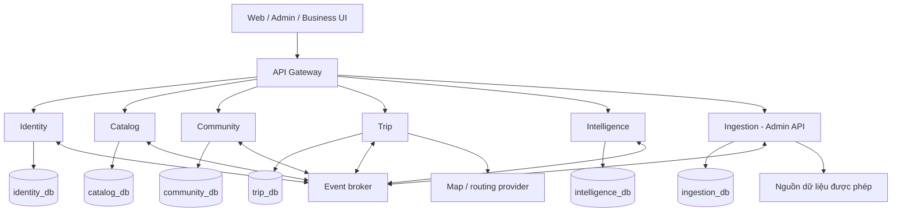

# Kiến trúc và ranh giới SmartTravel VN

## Phân rã nghiệp vụ

| Service | Dữ liệu gốc được sở hữu | Trách nhiệm | Không sở hữu |
|---|---|---|---|
| Identity | Tài khoản, role, session/token, sở thích, đồng ý personalization, hộp thông báo | Auth, hồ sơ, preference, khóa tài khoản, phân phối thông báo | Review, business verification, place, trip |
| Catalog | Geo, destination, place, category/tag/amenity, giờ mở cửa, dịch vụ/sự kiện, business/claim, lịch sử place | Catalog chuẩn, tìm kiếm, quyền quản lý place, duyệt thay đổi dữ liệu canonical | Nội dung review gốc, raw nguồn, training |
| Community | Review, favorite, collection, contribution, báo cáo/kiểm duyệt, rating aggregate | UGC, tương tác xã hội trong phạm vi tài liệu, workflow góp ý | Tự sửa bảng place, tài khoản, dữ liệu huấn luyện |
| Trip | Trip, ngày, điểm đến, itinerary, transfer, snapshot địa điểm, route cache | Lịch trình cá nhân, thứ tự, ghi chú, chi phí, bản đồ/khoảng cách | Dữ liệu place gốc, tối ưu tuyến sâu, booking |
| Intelligence | Interaction, feature projections, recommendation, dataset/training/model | Basic scoring/Top N, personalization, mô hình và rollback | Tự sửa trip/place/user, thu thập raw nguồn |
| Ingestion | Nguồn/license, job, raw/staging, mapping nguồn–place, match candidate, import command | Thu thập, normalize, deduplicate, incremental sync, provenance | Ghi trực tiếp DB Catalog, kích hoạt model |

Business ở Catalog vì quyền quản lý Place và cập nhật dữ liệu địa điểm cần một owner. Role BUSINESS ở Identity chỉ cho phép vào giao diện business; không đủ để sửa bất kỳ place nào. Catalog luôn kiểm tra membership cùng claim APPROVED của đúng place. Admin UI gọi từng service qua Gateway, không có Admin Service riêng.

Notification inbox đặt trong Identity để có chủ thể user và trạng thái đọc thống nhất; nội dung nghiệp vụ được phát qua event từ service nguồn. Email worker là tiến trình của Identity. Audit có ở từng service; log lỗi tập trung ở hạ tầng, không tạo một database ops cho tất cả service cùng ghi.

## Sơ đồ

## Quyết định triển khai

- Một monorepo, sáu application có build/image/migration/deploy độc lập. Gateway là application hạ tầng nếu cần, không chứa domain logic. Chỉ chia sẻ thư viện log/tracing/security và schema contract; không chia sẻ JPA entity/repository/domain model.
- Khởi đầu dùng Spring Boot theo nền tảng repository. Intelligence có thể dùng worker Python trong luồng ML của P01-IN (checklist P08) nếu thư viện ML yêu cầu; worker thuộc Intelligence, chỉ truy cập DB của Intelligence. Không bắt buộc đa ngôn ngữ từ đầu.
- Database đa công nghệ theo quyết định P00: Catalog dùng PostgreSQL + PostGIS; Community dùng MongoDB; Identity/Trip/Ingestion dùng PostgreSQL; Intelligence dùng PostgreSQL lưu metadata và pgvector cho semantic vector index. Chi tiết và blocker tại [P00-DECISIONS.md](P00-DECISIONS.md). Mỗi service có DB/credential riêng. Object storage giữ binary; owner service giữ metadata. Redis chỉ là cache tách theo service, không làm vector index hoặc nguồn dữ liệu chuẩn.
- Đề xuất một broker RabbitMQ cho sự kiện và job ở quy mô ban đầu; P00 đánh giá lại nếu cần log sự kiện replay dài hạn/throughput lớn. Consumer replay dài hạn dùng snapshot/backfill API từ owner, không giả định broker giữ toàn bộ lịch sử vĩnh viễn.
- Docker Compose cho phát triển; Kubernetes chỉ thêm khi có nhu cầu vận hành cụ thể. Dùng cấu hình môi trường và DNS của nền tảng trước; không mặc định cần Eureka, Config Server hay service mesh.
- JWT ký bất đối xứng, JWKS/key rotation; mỗi service kiểm tra chữ ký, issuer, audience, expiry và quyền đối tượng. Gateway không phải điểm kiểm tra bảo mật duy nhất. Giao tiếp nội bộ dùng workload identity/client credentials với audience và scope riêng.

## Dữ liệu từ service khác

| Nhu cầu | Cách đọc | Khi nguồn lỗi |
|---|---|---|
| Community xác nhận place còn public trước review/favorite mới | Catalog batch/internal validation; cache ngắn có freshness | Write trả 503 nếu không thể xác nhận, không tạo orphan mới |
| Trip thêm điểm và nhận location/opening hours | Catalog batch API; lưu snapshot có source_version | Existing trip vẫn xem bằng snapshot; thêm điểm mới báo tạm lỗi |
| Catalog lọc/sắp xếp rating | Projection rating summary từ Community | Trả kèm as_of, reconciliation khi lag; không gọi từng review |
| Intelligence chọn ứng viên | Projection public Catalog + preference từ Identity | Có thể fallback phổ biến theo dữ liệu còn hạn; không dùng place đã tombstone |
| Kết quả recommendation trước khi hiển thị | Batch kiểm tra visibility hiện tại ở Catalog | Không trả dữ liệu bị ẩn nếu không xác minh được; trả fallback an toàn hoặc 503 |
| Ingestion upsert place | Command tới Catalog với source link và idempotency | Retry command bền vững; không ghi database thay Catalog |

FK xuyên database bị loại bỏ. `user_id`, `place_id`, `destination_id`, `source_id` ngoài owner là external reference UUID. Tính hợp lệ được kiểm tra khi write, cùng tombstone event và reconciliation. Không tạo transaction ACID kéo qua nhiều service.

## State machine quan trọng

- Place: DRAFT → PUBLISHED ↔ HIDDEN → ARCHIVED. Xóa nghiệp vụ là archive/tombstone, giữ ID ổn định cho trip/audit.
- Review: PENDING → APPROVED / REJECTED; APPROVED → HIDDEN / DELETED; sửa nội dung đã duyệt → PENDING. Rating chỉ tính APPROVED.
- Contribution: PENDING → APPROVED → APPLYING → APPLIED; APPLYING → APPLY_FAILED → APPLYING. REJECTED/WITHDRAWN kết thúc trước apply.
- Business claim: PENDING → APPROVED / REJECTED; APPROVED → REVOKED. Approve không tự đổi owner dữ liệu khác.
- Import job: QUEUED → RUNNING → SUCCEEDED / PARTIAL / FAILED / CANCELLED. Chỉ SUCCEEDED khi mọi command cần thiết được Catalog xác nhận.
- Trip: DRAFT → PLANNED → COMPLETED / CANCELLED; mỗi write kiểm tra version. Xóa trip là tombstone rồi purge theo chính sách.
- Model: training SUCCEEDED → model VALIDATED → deployment ACTIVE; rollback chọn lại model đã validated, giữ lịch sử deployment.

## Nguồn tham khảo kỹ thuật

Các quyết định trên là đề xuất riêng cho SmartTravel. Nguyên tắc mỗi service sở hữu dữ liệu và đồng bộ bằng contract tham khảo [Microsoft Data considerations](https://learn.microsoft.com/en-us/azure/architecture/microservices/design/data-considerations). Cơ chế outbox để tránh lệch giữa commit dữ liệu và publish tham khảo [AWS Transactional outbox](https://docs.aws.amazon.com/en_en/prescriptive-guidance/latest/cloud-design-patterns/transactional-outbox.html).
