# Database Catalog Service

Catalog là nguồn dữ liệu chuẩn của địa điểm, địa lý, taxonomy, dịch vụ/sự kiện và business. Rating trong database này chỉ là projection của Community. Mọi importer, business và contribution đều phải đi qua command/API Catalog.

Database: `catalog_db`; schema nội bộ: `catalog`. Có 24 bảng nghiệp vụ/read model và 4 bảng kỹ thuật local. [DDL đầy đủ](sql/catalog.sql) là đặc tả chi tiết cột, PK, FK, CHECK, UNIQUE, index; chưa chạy trên database. [Quy ước chung](../03-database-conventions.md).

## Sơ đồ khóa ngoại nội bộ

Mũi tên từ bảng con tới bảng được tham chiếu. External UUID không tạo cạnh FK. Các invariant liên hàng vẫn phải kiểm tra trong application như mô tả bên dưới.

```mermaid
flowchart TB
  geographic_units["geographic_units"]
  geographic_aliases["geographic_aliases"]
  destinations["destinations"]
  destination_geo["destination_geo"]
  categories["categories"]
  places["places"]
  place_aliases["place_aliases"]
  place_categories["place_categories"]
  tags["tags"]
  place_tags["place_tags"]
  amenities["amenities"]
  place_amenities["place_amenities"]
  opening_hours["opening_hours"]
  opening_exceptions["opening_exceptions"]
  media_assets["media_assets"]
  place_media["place_media"]
  offerings["offerings"]
  offering_schedules["offering_schedules"]
  businesses["businesses"]
  business_members["business_members"]
  business_place_claims["business_place_claims"]
  change_requests["change_requests"]
  place_versions["place_versions"]
  place_rating_summary["place_rating_summary"]
  geographic_units -->|"parent_id"| geographic_units
  geographic_aliases -->|"geographic_unit_id"| geographic_units
  destination_geo -->|"destination_id"| destinations
  destination_geo -->|"geographic_unit_id"| geographic_units
  categories -->|"parent_id"| categories
  places -->|"geographic_unit_id"| geographic_units
  place_aliases -->|"place_id"| places
  place_categories -->|"place_id"| places
  place_categories -->|"category_id"| categories
  place_tags -->|"place_id"| places
  place_tags -->|"tag_id"| tags
  place_amenities -->|"place_id"| places
  place_amenities -->|"amenity_id"| amenities
  opening_hours -->|"place_id"| places
  opening_exceptions -->|"place_id"| places
  place_media -->|"place_id"| places
  place_media -->|"media_id"| media_assets
  offerings -->|"place_id"| places
  offerings -->|"destination_id"| destinations
  offering_schedules -->|"offering_id"| offerings
  business_members -->|"business_id"| businesses
  business_place_claims -->|"business_id"| businesses
  business_place_claims -->|"place_id"| places
  change_requests -->|"claim_id, place_id"| business_place_claims
  place_versions -->|"place_id"| places
  place_rating_summary -->|"place_id"| places
```

## Quan hệ và invariant nghiệp vụ

1. Geographic unit là hàng theo phiên bản, UUID hàng giữ ổn định; version mới tạo ID mới nếu thay định nghĩa lịch sử. Không ghi đè boundary cũ. parent_id phải hợp lệ tại cùng thời điểm và không có cycle; effective ranges cùng mã không được overlap, service kiểm trong transaction.
2. Destination có nhiều geographic unit. Place chỉ có một geographic_unit_id quản lý chính tại thời điểm hiện tại; truy vấn destination dùng destination_geo cùng closure địa lý qua recursive query, không dựa vào chuỗi tên. Category parent cũng phải chống cycle.
3. Giá là khoảng tham khảo một người/đơn vị dịch vụ được mô tả rõ trong UI; không giả định bằng giá booking. Currency khác nhau không so trực tiếp. Price NULL là chưa biết, 0 là miễn phí; search trả hai trạng thái khác nhau.
4. opening_hours cho phép nhiều ca mỗi ngày. Không có hàng không đồng nghĩa chắc chắn đóng cửa: API trả hours_known theo độ đầy đủ dữ liệu. Ca 24h biểu diễn open=close với end_day_offset=1; app cấm ca dài hơn 24h. Exception theo local_date ưu tiên giờ thường; cả ngày đóng không được cùng tồn tại ca mở ngày đó.
5. Offerings thay services_events: place_id hoặc destination_id phải có ít nhất một. Nếu có cả hai, app kiểm scope nhất quán. EVENT yêu cầu schedule trước publish; dịch vụ thường xuyên có thể dùng giờ của place. Không có booking, payment hay inventory trong bảng này.
6. BUSINESS role chỉ là điều kiện đầu vào. Mutation place cần business VERIFIED + membership active + claim APPROVED tương ứng. owner_user_id phải có member_role OWNER active; chuyển owner cập nhật cả hai cùng transaction. Chỉ một OWNER claim approved/place là policy đề xuất; nhiều MANAGER theo business khác được phép.
7. Change request approve kiểm lại claim, membership và expected_place_version trong cùng transaction; mismatch→CONFLICT, không ghi đè. Admin/ingestion/contribution cũng tăng place.version, ghi full snapshot place_versions và outbox atomically.
8. Field precedence đề xuất: admin khóa trường > business change đã duyệt > contribution đã duyệt > import. P03/P06 cần cấu hình protected fields, ghi provenance từng diff trong snapshot để import không đè thay đổi đã xác nhận.
9. Media upload vào quarantine prefix, kiểm MIME/size/checksum và scan; metadata APPROVED mới gắn public API. Evidence claim ở private storage; không trả URL public dài hạn.
10. Projection rating chỉ nhận summary source_version lớn hơn; zero reviews→rating_avg NULL. Đối với sự kiện đến trước place row, defer/retry sau snapshot Catalog sẵn sàng, không bỏ event vì FK lỗi.

## API và quyền thực thi

- GET /api/v1/places?q=&categoryId=&geographicUnitId=&destinationId=&minPrice=&maxPrice=&minRating=&lat=&lon=&radiusM=&type=&cursor=; GET /places/{id}.
- GET /api/v1/destinations, /categories, /tags, /amenities, /offerings; GET /api/v1/places/{id}/offerings.
- Admin CRUD /api/v1/admin/places, /destinations, /categories, /offerings; mutation status rõ publish/hide/archive; upload media và quản lý giờ mở cửa.
- POST /api/v1/businesses; POST /businesses/{id}/claims; POST /claims/{id}/change-requests; admin review claim/change request.
- POST /internal/v1/places/batch; POST /internal/v1/places/validate; command import/apply-contribution; GET /internal/v1/places/snapshot?cursor= để rebuild.

## Từ điển từng bảng

Ký hiệu: NULL = được bỏ trống; bắt buộc = NOT NULL hoặc PK. Mặc định, FK và CHECK giữ nguyên SQL để tránh diễn giải sai. External UUID xem chú thích DDL và ownership phía trên; không tạo FK tới service khác.

### catalog.geographic_units

Hierarchy hành chính/version và boundary PostGIS.

| Cột | Kiểu | Nullability | Mặc định / khóa / ràng buộc |
|---|---|---|---|
| `geographic_unit_id` | `uuid` | Bắt buộc | `PRIMARY KEY` |
| `parent_id` | `uuid` | NULL | `REFERENCES catalog.geographic_units(geographic_unit_id)` |
| `unit_type` | `varchar(24)` | Bắt buộc | `NOT NULL` |
| `code` | `varchar(64)` | Bắt buộc | `NOT NULL` |
| `name_vi` | `varchar(200)` | Bắt buộc | `NOT NULL` |
| `name_en` | `varchar(200)` | NULL | — |
| `version` | `integer` | Bắt buộc | `NOT NULL CHECK (version > 0)` |
| `valid_from` | `date` | Bắt buộc | `NOT NULL` |
| `valid_to` | `date` | NULL | — |
| `status` | `varchar(16)` | Bắt buộc | `NOT NULL CHECK (status IN ('ACTIVE','RETIRED'))` |
| `boundary` | `geometry(MultiPolygon,4326)` | NULL | — |

Ràng buộc cấp bảng:

- `UNIQUE (unit_type, code, version)`
- `CHECK (parent_id IS NULL OR parent_id <> geographic_unit_id)`
- `CHECK (valid_to IS NULL OR valid_to >= valid_from)`

### catalog.geographic_aliases

Tên cũ/tên viết tắt; normalized_alias do app chuẩn hóa dấu.

| Cột | Kiểu | Nullability | Mặc định / khóa / ràng buộc |
|---|---|---|---|
| `alias_id` | `uuid` | Bắt buộc | `PRIMARY KEY` |
| `geographic_unit_id` | `uuid` | Bắt buộc | `NOT NULL REFERENCES catalog.geographic_units(geographic_unit_id)` |
| `alias` | `varchar(200)` | Bắt buộc | `NOT NULL` |
| `normalized_alias` | `varchar(200)` | Bắt buộc | `NOT NULL` |
| `language` | `varchar(16)` | Bắt buộc | `NOT NULL DEFAULT 'vi'` |
| `valid_from` | `date` | Bắt buộc | `NOT NULL` |
| `valid_to` | `date` | NULL | — |

Ràng buộc cấp bảng:

- `UNIQUE (geographic_unit_id, normalized_alias, language, valid_from)`
- `CHECK (valid_to IS NULL OR valid_to >= valid_from)`

### catalog.destinations

Không đồng nhất destination trải nghiệm với tỉnh/thành.

| Cột | Kiểu | Nullability | Mặc định / khóa / ràng buộc |
|---|---|---|---|
| `destination_id` | `uuid` | Bắt buộc | `PRIMARY KEY` |
| `name_vi` | `varchar(200)` | Bắt buộc | `NOT NULL` |
| `name_en` | `varchar(200)` | NULL | — |
| `destination_type` | `varchar(40)` | Bắt buộc | `NOT NULL` |
| `summary` | `text` | NULL | — |
| `status` | `varchar(16)` | Bắt buộc | `NOT NULL DEFAULT 'DRAFT' CHECK (status IN ('DRAFT','PUBLISHED','HIDDEN','ARCHIVED'))` |
| `version` | `bigint` | Bắt buộc | `NOT NULL DEFAULT 1 CHECK (version > 0)` |
| `created_at` | `timestamptz` | Bắt buộc | `NOT NULL DEFAULT now()` |
| `updated_at` | `timestamptz` | Bắt buộc | `NOT NULL DEFAULT now()` |

### catalog.destination_geo

Quan hệ n–n destination và địa lý.

| Cột | Kiểu | Nullability | Mặc định / khóa / ràng buộc |
|---|---|---|---|
| `destination_id` | `uuid` | Bắt buộc | `NOT NULL REFERENCES catalog.destinations(destination_id) ON DELETE CASCADE` |
| `geographic_unit_id` | `uuid` | Bắt buộc | `NOT NULL REFERENCES catalog.geographic_units(geographic_unit_id)` |

Ràng buộc cấp bảng:

- `PRIMARY KEY (destination_id, geographic_unit_id)`

### catalog.categories

Taxonomy có cha, tên hai ngôn ngữ.

| Cột | Kiểu | Nullability | Mặc định / khóa / ràng buộc |
|---|---|---|---|
| `category_id` | `uuid` | Bắt buộc | `PRIMARY KEY` |
| `parent_id` | `uuid` | NULL | `REFERENCES catalog.categories(category_id)` |
| `code` | `varchar(64)` | Bắt buộc | `NOT NULL UNIQUE` |
| `name_vi` | `varchar(160)` | Bắt buộc | `NOT NULL` |
| `name_en` | `varchar(160)` | NULL | — |
| `active` | `boolean` | Bắt buộc | `NOT NULL DEFAULT true` |

Ràng buộc cấp bảng:

- `CHECK (parent_id IS NULL OR parent_id <> category_id)`

### catalog.places

Canonical place ID, vị trí và dữ liệu public có version.

| Cột | Kiểu | Nullability | Mặc định / khóa / ràng buộc |
|---|---|---|---|
| `place_id` | `uuid` | Bắt buộc | `PRIMARY KEY` |
| `geographic_unit_id` | `uuid` | Bắt buộc | `NOT NULL REFERENCES catalog.geographic_units(geographic_unit_id)` |
| `name_vi` | `varchar(240)` | Bắt buộc | `NOT NULL` |
| `name_en` | `varchar(240)` | NULL | — |
| `description` | `text` | NULL | — |
| `address` | `text` | Bắt buộc | `NOT NULL` |
| `location` | `geography(Point,4326)` | Bắt buộc | `NOT NULL` |
| `timezone` | `varchar(64)` | Bắt buộc | `NOT NULL DEFAULT 'Asia/Ho_Chi_Minh'` |
| `price_min` | `numeric(14,2)` | NULL | — |
| `price_max` | `numeric(14,2)` | NULL | — |
| `currency` | `char(3)` | Bắt buộc | `NOT NULL DEFAULT 'VND' CHECK (currency ~ '^[A-Z]{3}$')` |
| `status` | `varchar(16)` | Bắt buộc | `NOT NULL DEFAULT 'DRAFT' CHECK (status IN ('DRAFT','PUBLISHED','HIDDEN','ARCHIVED'))` |
| `version` | `bigint` | Bắt buộc | `NOT NULL DEFAULT 1 CHECK (version > 0)` |
| `search_document` | `tsvector` | NULL | — |
| `created_by` | `uuid` | NULL | — |
| `created_at` | `timestamptz` | Bắt buộc | `NOT NULL DEFAULT now()` |
| `updated_at` | `timestamptz` | Bắt buộc | `NOT NULL DEFAULT now()` |
| `archived_at` | `timestamptz` | NULL | — |

Ràng buộc cấp bảng:

- `CHECK (price_min IS NULL OR price_min >= 0)`
- `CHECK (price_max IS NULL OR price_max >= 0)`
- `CHECK (price_min IS NULL OR price_max IS NULL OR price_max >= price_min)`
- `CHECK ((status = 'ARCHIVED') = (archived_at IS NOT NULL))`

### catalog.place_aliases

Alias nguồn hoặc thủ công, UNIQUE xử lý source_id NULL.

| Cột | Kiểu | Nullability | Mặc định / khóa / ràng buộc |
|---|---|---|---|
| `alias_id` | `uuid` | Bắt buộc | `PRIMARY KEY` |
| `place_id` | `uuid` | Bắt buộc | `NOT NULL REFERENCES catalog.places(place_id)` |
| `alias` | `varchar(240)` | Bắt buộc | `NOT NULL` |
| `normalized_alias` | `varchar(240)` | Bắt buộc | `NOT NULL` |
| `source_id` | `uuid` | NULL | — |

Ràng buộc cấp bảng:

- `UNIQUE NULLS NOT DISTINCT (place_id, normalized_alias, source_id)`

### catalog.place_categories

Một place nhiều category.

| Cột | Kiểu | Nullability | Mặc định / khóa / ràng buộc |
|---|---|---|---|
| `place_id` | `uuid` | Bắt buộc | `NOT NULL REFERENCES catalog.places(place_id) ON DELETE CASCADE` |
| `category_id` | `uuid` | Bắt buộc | `NOT NULL REFERENCES catalog.categories(category_id)` |

Ràng buộc cấp bảng:

- `PRIMARY KEY (place_id, category_id)`

### catalog.tags

Mã tag duy nhất.

| Cột | Kiểu | Nullability | Mặc định / khóa / ràng buộc |
|---|---|---|---|
| `tag_id` | `uuid` | Bắt buộc | `PRIMARY KEY` |
| `code` | `varchar(64)` | Bắt buộc | `NOT NULL UNIQUE` |
| `name_vi` | `varchar(160)` | Bắt buộc | `NOT NULL` |
| `name_en` | `varchar(160)` | NULL | — |

### catalog.place_tags

Quan hệ tag.

| Cột | Kiểu | Nullability | Mặc định / khóa / ràng buộc |
|---|---|---|---|
| `place_id` | `uuid` | Bắt buộc | `NOT NULL REFERENCES catalog.places(place_id) ON DELETE CASCADE` |
| `tag_id` | `uuid` | Bắt buộc | `NOT NULL REFERENCES catalog.tags(tag_id)` |

Ràng buộc cấp bảng:

- `PRIMARY KEY (place_id, tag_id)`

### catalog.amenities

Danh mục tiện ích cho nhà hàng/khách sạn/homestay.

| Cột | Kiểu | Nullability | Mặc định / khóa / ràng buộc |
|---|---|---|---|
| `amenity_id` | `uuid` | Bắt buộc | `PRIMARY KEY` |
| `code` | `varchar(64)` | Bắt buộc | `NOT NULL UNIQUE` |
| `name_vi` | `varchar(160)` | Bắt buộc | `NOT NULL` |
| `name_en` | `varchar(160)` | NULL | — |

### catalog.place_amenities

Quan hệ tiện ích chuẩn hóa.

| Cột | Kiểu | Nullability | Mặc định / khóa / ràng buộc |
|---|---|---|---|
| `place_id` | `uuid` | Bắt buộc | `NOT NULL REFERENCES catalog.places(place_id) ON DELETE CASCADE` |
| `amenity_id` | `uuid` | Bắt buộc | `NOT NULL REFERENCES catalog.amenities(amenity_id)` |

Ràng buộc cấp bảng:

- `PRIMARY KEY (place_id, amenity_id)`

### catalog.opening_hours

Ca giờ mở cửa tuần theo khoảng hiệu lực.

| Cột | Kiểu | Nullability | Mặc định / khóa / ràng buộc |
|---|---|---|---|
| `opening_hour_id` | `uuid` | Bắt buộc | `PRIMARY KEY` |
| `place_id` | `uuid` | Bắt buộc | `NOT NULL REFERENCES catalog.places(place_id) ON DELETE CASCADE` |
| `day_of_week` | `smallint` | Bắt buộc | `NOT NULL CHECK (day_of_week BETWEEN 0 AND 6)` |
| `open_time` | `time` | Bắt buộc | `NOT NULL` |
| `close_time` | `time` | Bắt buộc | `NOT NULL` |
| `end_day_offset` | `smallint` | Bắt buộc | `NOT NULL DEFAULT 0 CHECK (end_day_offset IN (0,1))` |
| `valid_from` | `date` | Bắt buộc | `NOT NULL` |
| `valid_to` | `date` | NULL | — |

Ràng buộc cấp bảng:

- `CHECK (valid_to IS NULL OR valid_to >= valid_from)`
- `CHECK (end_day_offset = 1 OR close_time > open_time)`
- `UNIQUE (place_id, day_of_week, open_time, valid_from)`

### catalog.opening_exceptions

Ngày lễ/ngoại lệ, có thể nhiều ca.

| Cột | Kiểu | Nullability | Mặc định / khóa / ràng buộc |
|---|---|---|---|
| `exception_id` | `uuid` | Bắt buộc | `PRIMARY KEY` |
| `place_id` | `uuid` | Bắt buộc | `NOT NULL REFERENCES catalog.places(place_id) ON DELETE CASCADE` |
| `local_date` | `date` | Bắt buộc | `NOT NULL` |
| `is_closed` | `boolean` | Bắt buộc | `NOT NULL` |
| `open_time` | `time` | NULL | — |
| `close_time` | `time` | NULL | — |
| `end_day_offset` | `smallint` | Bắt buộc | `NOT NULL DEFAULT 0 CHECK (end_day_offset IN (0,1))` |
| `reason` | `text` | NULL | — |

Ràng buộc cấp bảng:

- `CHECK ((is_closed AND open_time IS NULL AND close_time IS NULL AND end_day_offset = 0) OR (NOT is_closed AND open_time IS NOT NULL AND close_time IS NOT NULL AND (end_day_offset = 1 OR close_time > open_time)))`
- `UNIQUE NULLS NOT DISTINCT (place_id, local_date, open_time)`

### catalog.media_assets

Metadata ảnh official, không chứa binary.

| Cột | Kiểu | Nullability | Mặc định / khóa / ràng buộc |
|---|---|---|---|
| `media_id` | `uuid` | Bắt buộc | `PRIMARY KEY` |
| `object_key` | `text` | Bắt buộc | `NOT NULL UNIQUE` |
| `checksum` | `varchar(64)` | Bắt buộc | `NOT NULL` |
| `mime_type` | `varchar(100)` | Bắt buộc | `NOT NULL` |
| `byte_size` | `bigint` | Bắt buộc | `NOT NULL CHECK (byte_size > 0)` |
| `source_id` | `uuid` | NULL | — |
| `created_by` | `uuid` | NULL | — |
| `moderation_status` | `varchar(16)` | Bắt buộc | `NOT NULL DEFAULT 'PENDING' CHECK (moderation_status IN ('PENDING','APPROVED','REJECTED'))` |
| `created_at` | `timestamptz` | Bắt buộc | `NOT NULL DEFAULT now()` |

### catalog.place_media

Thứ tự/alt ảnh place; số thứ tự unique có thể defer.

| Cột | Kiểu | Nullability | Mặc định / khóa / ràng buộc |
|---|---|---|---|
| `place_id` | `uuid` | Bắt buộc | `NOT NULL REFERENCES catalog.places(place_id) ON DELETE CASCADE` |
| `media_id` | `uuid` | Bắt buộc | `NOT NULL REFERENCES catalog.media_assets(media_id)` |
| `alt_text` | `varchar(300)` | NULL | — |
| `sort_order` | `integer` | Bắt buộc | `NOT NULL CHECK (sort_order >= 0)` |

Ràng buộc cấp bảng:

- `PRIMARY KEY (place_id, media_id)`
- `UNIQUE (place_id, sort_order) DEFERRABLE INITIALLY IMMEDIATE`

### catalog.offerings

Dịch vụ/tour/event/activity/experience có anchor.

| Cột | Kiểu | Nullability | Mặc định / khóa / ràng buộc |
|---|---|---|---|
| `offering_id` | `uuid` | Bắt buộc | `PRIMARY KEY` |
| `place_id` | `uuid` | NULL | `REFERENCES catalog.places(place_id)` |
| `destination_id` | `uuid` | NULL | `REFERENCES catalog.destinations(destination_id)` |
| `item_type` | `varchar(16)` | Bắt buộc | `NOT NULL CHECK (item_type IN ('SERVICE','TOUR','EVENT','ACTIVITY','EXPERIENCE'))` |
| `name_vi` | `varchar(240)` | Bắt buộc | `NOT NULL` |
| `name_en` | `varchar(240)` | NULL | — |
| `description` | `text` | NULL | — |
| `price_min` | `numeric(14,2)` | NULL | — |
| `price_max` | `numeric(14,2)` | NULL | — |
| `currency` | `char(3)` | Bắt buộc | `NOT NULL DEFAULT 'VND' CHECK (currency ~ '^[A-Z]{3}$')` |
| `status` | `varchar(16)` | Bắt buộc | `NOT NULL DEFAULT 'DRAFT' CHECK (status IN ('DRAFT','PUBLISHED','HIDDEN','ARCHIVED'))` |
| `metadata` | `jsonb` | Bắt buộc | `NOT NULL DEFAULT '{}'` |
| `version` | `bigint` | Bắt buộc | `NOT NULL DEFAULT 1 CHECK (version > 0)` |
| `created_at` | `timestamptz` | Bắt buộc | `NOT NULL DEFAULT now()` |
| `updated_at` | `timestamptz` | Bắt buộc | `NOT NULL DEFAULT now()` |

Ràng buộc cấp bảng:

- `CHECK (place_id IS NOT NULL OR destination_id IS NOT NULL)`
- `CHECK (price_min IS NULL OR price_min >= 0)`
- `CHECK (price_max IS NULL OR price_max >= 0)`
- `CHECK (price_min IS NULL OR price_max IS NULL OR price_min <= price_max)`

### catalog.offering_schedules

Lịch cụ thể của một offering.

| Cột | Kiểu | Nullability | Mặc định / khóa / ràng buộc |
|---|---|---|---|
| `schedule_id` | `uuid` | Bắt buộc | `PRIMARY KEY` |
| `offering_id` | `uuid` | Bắt buộc | `NOT NULL REFERENCES catalog.offerings(offering_id) ON DELETE CASCADE` |
| `starts_at` | `timestamptz` | Bắt buộc | `NOT NULL` |
| `ends_at` | `timestamptz` | Bắt buộc | `NOT NULL` |
| `timezone` | `varchar(64)` | Bắt buộc | `NOT NULL DEFAULT 'Asia/Ho_Chi_Minh'` |

Ràng buộc cấp bảng:

- `UNIQUE (offering_id, starts_at)`
- `CHECK (ends_at > starts_at)`

### catalog.businesses

Hồ sơ và trạng thái xác minh business.

| Cột | Kiểu | Nullability | Mặc định / khóa / ràng buộc |
|---|---|---|---|
| `business_id` | `uuid` | Bắt buộc | `PRIMARY KEY` |
| `owner_user_id` | `uuid` | Bắt buộc | `NOT NULL` |
| `legal_name` | `varchar(240)` | NULL | — |
| `display_name` | `varchar(240)` | Bắt buộc | `NOT NULL` |
| `contact_email` | `varchar(320)` | NULL | — |
| `contact_phone` | `varchar(32)` | NULL | — |
| `verification_status` | `varchar(16)` | Bắt buộc | `NOT NULL DEFAULT 'PENDING' CHECK (verification_status IN ('PENDING','VERIFIED','REJECTED','SUSPENDED'))` |
| `version` | `bigint` | Bắt buộc | `NOT NULL DEFAULT 1 CHECK (version > 0)` |
| `created_at` | `timestamptz` | Bắt buộc | `NOT NULL DEFAULT now()` |
| `updated_at` | `timestamptz` | Bắt buộc | `NOT NULL DEFAULT now()` |

### catalog.business_members

Quan hệ user-business và role nội bộ business.

| Cột | Kiểu | Nullability | Mặc định / khóa / ràng buộc |
|---|---|---|---|
| `business_id` | `uuid` | Bắt buộc | `NOT NULL REFERENCES catalog.businesses(business_id) ON DELETE CASCADE` |
| `user_id` | `uuid` | Bắt buộc | `NOT NULL` |
| `member_role` | `varchar(12)` | Bắt buộc | `NOT NULL CHECK (member_role IN ('OWNER','MANAGER','EDITOR'))` |
| `active` | `boolean` | Bắt buộc | `NOT NULL DEFAULT true` |

Ràng buộc cấp bảng:

- `PRIMARY KEY (business_id, user_id)`

### catalog.business_place_claims

Quyền business trên một place, có chứng cứ và reviewer.

| Cột | Kiểu | Nullability | Mặc định / khóa / ràng buộc |
|---|---|---|---|
| `claim_id` | `uuid` | Bắt buộc | `PRIMARY KEY` |
| `business_id` | `uuid` | Bắt buộc | `NOT NULL REFERENCES catalog.businesses(business_id)` |
| `place_id` | `uuid` | Bắt buộc | `NOT NULL REFERENCES catalog.places(place_id)` |
| `claim_role` | `varchar(16)` | Bắt buộc | `NOT NULL CHECK (claim_role IN ('OWNER','MANAGER'))` |
| `status` | `varchar(16)` | Bắt buộc | `NOT NULL DEFAULT 'PENDING' CHECK (status IN ('PENDING','APPROVED','REJECTED','REVOKED'))` |
| `evidence_object_key` | `text` | Bắt buộc | `NOT NULL` |
| `reviewed_by` | `uuid` | NULL | — |
| `reviewed_at` | `timestamptz` | NULL | — |
| `reason` | `text` | NULL | — |
| `created_at` | `timestamptz` | Bắt buộc | `NOT NULL DEFAULT now()` |

Ràng buộc cấp bảng:

- `UNIQUE (claim_id, place_id)`

### catalog.change_requests

Diff field nhạy cảm với expected version.

| Cột | Kiểu | Nullability | Mặc định / khóa / ràng buộc |
|---|---|---|---|
| `request_id` | `uuid` | Bắt buộc | `PRIMARY KEY` |
| `claim_id` | `uuid` | Bắt buộc | `NOT NULL` |
| `place_id` | `uuid` | Bắt buộc | `NOT NULL` |
| `submitted_by` | `uuid` | Bắt buộc | `NOT NULL` |
| `expected_place_version` | `bigint` | Bắt buộc | `NOT NULL CHECK (expected_place_version > 0)` |
| `field_changes` | `jsonb` | Bắt buộc | `NOT NULL` |
| `status` | `varchar(16)` | Bắt buộc | `NOT NULL DEFAULT 'PENDING' CHECK (status IN ('PENDING','APPROVED','REJECTED','CONFLICT'))` |
| `reviewed_by` | `uuid` | NULL | — |
| `reviewed_at` | `timestamptz` | NULL | — |
| `reason` | `text` | NULL | — |
| `created_at` | `timestamptz` | Bắt buộc | `NOT NULL DEFAULT now()` |

Ràng buộc cấp bảng:

- `FOREIGN KEY (claim_id, place_id) REFERENCES catalog.business_place_claims(claim_id, place_id)`

### catalog.place_versions

Snapshot bất biến theo phiên bản, provenance và command dedup.

| Cột | Kiểu | Nullability | Mặc định / khóa / ràng buộc |
|---|---|---|---|
| `place_version_id` | `uuid` | Bắt buộc | `PRIMARY KEY` |
| `place_id` | `uuid` | Bắt buộc | `NOT NULL REFERENCES catalog.places(place_id)` |
| `version_no` | `bigint` | Bắt buộc | `NOT NULL CHECK (version_no > 0)` |
| `snapshot` | `jsonb` | Bắt buộc | `NOT NULL` |
| `reason` | `text` | Bắt buộc | `NOT NULL` |
| `created_by` | `uuid` | NULL | — |
| `source_id` | `uuid` | NULL | — |
| `source_command_id` | `uuid` | NULL | `UNIQUE` |
| `created_at` | `timestamptz` | Bắt buộc | `NOT NULL DEFAULT now()` |

Ràng buộc cấp bảng:

- `UNIQUE (place_id, version_no)`

### catalog.place_rating_summary

Read model được rebuild từ Community, không tự tính từ bảng reviews xuyên DB.

| Cột | Kiểu | Nullability | Mặc định / khóa / ràng buộc |
|---|---|---|---|
| `place_id` | `uuid` | Bắt buộc | `PRIMARY KEY REFERENCES catalog.places(place_id)` |
| `review_count` | `integer` | Bắt buộc | `NOT NULL CHECK (review_count >= 0)` |
| `rating_sum` | `bigint` | Bắt buộc | `NOT NULL CHECK (rating_sum >= 0)` |
| `rating_avg` | `numeric(4,3)` | NULL | `GENERATED ALWAYS AS (CASE WHEN review_count = 0 THEN NULL ELSE rating_sum::numeric / review_count END) STORED` |
| `source_version` | `bigint` | Bắt buộc | `NOT NULL CHECK (source_version > 0)` |
| `as_of` | `timestamptz` | Bắt buộc | `NOT NULL` |

Ràng buộc cấp bảng:

- `CHECK (rating_sum BETWEEN review_count AND review_count::bigint * 5)`

## Index và khóa bổ sung

- `CREATE INDEX geo_parent_idx ON catalog.geographic_units(parent_id);`
- `CREATE INDEX geo_alias_lookup_idx ON catalog.geographic_aliases(normalized_alias);`
- `CREATE INDEX destination_geo_unit_idx ON catalog.destination_geo(geographic_unit_id);`
- `CREATE INDEX category_parent_idx ON catalog.categories(parent_id);`
- `CREATE INDEX places_location_idx ON catalog.places USING gist(location);`
- `CREATE INDEX places_search_idx ON catalog.places USING gin(search_document);`
- `CREATE INDEX places_geo_status_idx ON catalog.places(geographic_unit_id, status, place_id);`
- `CREATE INDEX places_price_idx ON catalog.places(currency, price_min, place_id) WHERE status = 'PUBLISHED';`
- `CREATE INDEX place_alias_lookup_idx ON catalog.place_aliases(normalized_alias);`
- `CREATE INDEX place_category_reverse_idx ON catalog.place_categories(category_id, place_id);`
- `CREATE INDEX place_tag_reverse_idx ON catalog.place_tags(tag_id, place_id);`
- `CREATE INDEX place_amenity_reverse_idx ON catalog.place_amenities(amenity_id, place_id);`
- `CREATE INDEX opening_hours_place_idx ON catalog.opening_hours(place_id, day_of_week, valid_from);`
- `CREATE INDEX offering_place_idx ON catalog.offerings(place_id, status);`
- `CREATE INDEX offering_destination_idx ON catalog.offerings(destination_id, status);`
- `CREATE INDEX offering_schedule_idx ON catalog.offering_schedules(starts_at, offering_id);`
- `CREATE INDEX business_owner_idx ON catalog.businesses(owner_user_id);`
- `CREATE INDEX member_user_idx ON catalog.business_members(user_id, business_id);`
- `CREATE UNIQUE INDEX one_live_claim_idx ON catalog.business_place_claims(business_id, place_id) WHERE status IN ('PENDING','APPROVED');`
- `CREATE UNIQUE INDEX one_place_owner_idx ON catalog.business_place_claims(place_id) WHERE claim_role = 'OWNER' AND status = 'APPROVED';`
- `CREATE INDEX claim_place_idx ON catalog.business_place_claims(place_id, status);`
- `CREATE INDEX change_request_queue_idx ON catalog.change_requests(status, created_at);`
- `CREATE INDEX rating_sort_idx ON catalog.place_rating_summary(rating_avg DESC, review_count DESC);`

## Kiểm nhận dữ liệu

- Migration tạo đủ bảng/index/FK trên database riêng; account runtime không đọc DB service khác.
- Bộ test ở phase của service phải cover ràng buộc trong SQL lẫn invariant liên hàng/phân quyền bên trên.
- Source mapping và reconcile: xem [42 bảng nguồn](../02-source-mapping.md) và [migration](../05-migration-cutover.md).
- Các bảng outbox/inbox/audit/idempotency được định nghĩa trong DDL; dispatch, retention, retry và permission phải được triển khai ở P01 và tích hợp vào từng mutation.
