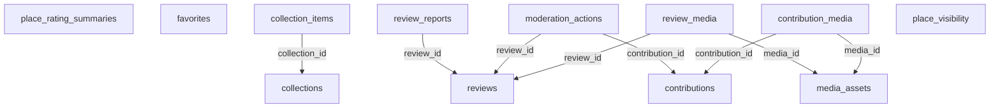

# Database Community Service

Community giữ UGC và là owner rating aggregate. Favorite/collection/review gắn user/place bằng external UUID. Service không sở hữu thông tin tài khoản hoặc dữ liệu địa điểm chuẩn.

Database: `community_db`; schema nội bộ: `community`. Có 12 bảng nghiệp vụ/read model và 4 bảng kỹ thuật local. [DDL đầy đủ](sql/community.sql) là đặc tả chi tiết cột, PK, FK, CHECK, UNIQUE, index; chưa chạy trên database. [Quy ước chung](../03-database-conventions.md).

## Sơ đồ khóa ngoại nội bộ

Mũi tên từ bảng con tới bảng được tham chiếu. External UUID không tạo cạnh FK. Các invariant liên hàng vẫn phải kiểm tra trong application như mô tả bên dưới.

## Quan hệ và invariant nghiệp vụ

1. Một review tồn tại theo user/place; soft-delete giữ khóa unique. Người dùng viết lại thì restore/update cùng review theo policy, không tạo hàng thứ hai. Sửa review APPROVED đưa về PENDING và loại điểm cũ khỏi aggregate tới khi duyệt lại.
2. Review + summary + audit + outbox cùng transaction; summary row được khóa trước khi tính. Chỉ status APPROVED đóng góp count và sum. Rebuild bằng COUNT/SUM từ reviews để reconciliation.
3. PUT favorite tạo nếu chưa có; DELETE absent trả thành công idempotent. Khi không có thay đổi thì không phát thêm favorite-changed event. Collection private chỉ owner/admin có quyền tương ứng; collection public không làm lộ profile private.
4. New write dùng Catalog validate place public; projection place_visibility hỗ trợ read/invalidations. Hidden/archive giữ reference để user biết nội dung không còn khả dụng; không cho tạo tương tác mới với place bị ẩn.
5. Contribution payload cần schema theo type, giới hạn field allowlist; ADD_PLACE target null, SUGGEST_EDIT có target/version. Moderator không tự dùng dữ liệu request chưa validate để gọi Catalog. Apply command phải có principal hệ thống được giới hạn scope.
6. Review report unique theo reporter/review; moderation ghi rõ reason, actor và state trước/sau trong audit. Only ADMIN/moderation scope duyệt; user không tự approve review của mình.
7. Media UGC và official media có owner metadata khác nhau. Chuyển ảnh contribution sang place cần Catalog ingest/copy hoặc grant object reference đúng ownership, không cho Catalog truy cập table Community.

## API và quyền thực thi

- GET /api/v1/places/{placeId}/reviews; POST /places/{placeId}/reviews; PATCH/DELETE /reviews/{id}; POST /reviews/{id}/reports.
- PUT/DELETE /api/v1/me/favorites/{placeId}; GET /api/v1/me/favorites; CRUD /api/v1/me/collections và /collections/{id}/items.
- POST /api/v1/contributions; GET /api/v1/me/contributions; PATCH /contributions/{id} khi còn PENDING; POST withdraw.
- Admin moderation queues /api/v1/admin/reviews, /review-reports, /contributions; explicit decision endpoints.
- GET /internal/v1/ratings/snapshot?cursor=; POST /internal/v1/ratings/batch; snapshot có version và as_of.

## Từ điển từng bảng

Ký hiệu: NULL = được bỏ trống; bắt buộc = NOT NULL hoặc PK. Mặc định, FK và CHECK giữ nguyên SQL để tránh diễn giải sai. External UUID xem chú thích DDL và ownership phía trên; không tạo FK tới service khác.

### community.reviews

Nội dung và điểm gốc, unique user/place.

| Cột | Kiểu | Nullability | Mặc định / khóa / ràng buộc |
|---|---|---|---|
| `review_id` | `uuid` | Bắt buộc | `PRIMARY KEY` |
| `user_id` | `uuid` | Bắt buộc | `NOT NULL` |
| `place_id` | `uuid` | Bắt buộc | `NOT NULL` |
| `rating` | `smallint` | Bắt buộc | `NOT NULL CHECK (rating BETWEEN 1 AND 5)` |
| `content` | `text` | Bắt buộc | `NOT NULL CHECK (char_length(content) BETWEEN 1 AND 10000)` |
| `status` | `varchar(16)` | Bắt buộc | `NOT NULL DEFAULT 'PENDING' CHECK (status IN ('PENDING','APPROVED','REJECTED','HIDDEN','DELETED'))` |
| `version` | `bigint` | Bắt buộc | `NOT NULL DEFAULT 1 CHECK (version > 0)` |
| `created_at` | `timestamptz` | Bắt buộc | `NOT NULL DEFAULT now()` |
| `updated_at` | `timestamptz` | Bắt buộc | `NOT NULL DEFAULT now()` |

Ràng buộc cấp bảng:

- `UNIQUE (user_id, place_id)`

### community.place_rating_summaries

Nguồn aggregate rating duy nhất; avg generated từ count/sum.

| Cột | Kiểu | Nullability | Mặc định / khóa / ràng buộc |
|---|---|---|---|
| `place_id` | `uuid` | Bắt buộc | `PRIMARY KEY` |
| `review_count` | `integer` | Bắt buộc | `NOT NULL DEFAULT 0 CHECK (review_count >= 0)` |
| `rating_sum` | `bigint` | Bắt buộc | `NOT NULL DEFAULT 0 CHECK (rating_sum >= 0)` |
| `rating_avg` | `numeric(4,3)` | NULL | `GENERATED ALWAYS AS (CASE WHEN review_count = 0 THEN NULL ELSE rating_sum::numeric / review_count END) STORED` |
| `version` | `bigint` | Bắt buộc | `NOT NULL DEFAULT 1 CHECK (version > 0)` |
| `updated_at` | `timestamptz` | Bắt buộc | `NOT NULL DEFAULT now()` |

Ràng buộc cấp bảng:

- `CHECK (rating_sum BETWEEN review_count AND review_count::bigint * 5)`

### community.favorites

Quan hệ yêu thích idempotent.

| Cột | Kiểu | Nullability | Mặc định / khóa / ràng buộc |
|---|---|---|---|
| `user_id` | `uuid` | Bắt buộc | `NOT NULL` |
| `place_id` | `uuid` | Bắt buộc | `NOT NULL` |
| `created_at` | `timestamptz` | Bắt buộc | `NOT NULL DEFAULT now()` |

Ràng buộc cấp bảng:

- `PRIMARY KEY (user_id, place_id)`

### community.collections

Bộ sưu tập cá nhân/public.

| Cột | Kiểu | Nullability | Mặc định / khóa / ràng buộc |
|---|---|---|---|
| `collection_id` | `uuid` | Bắt buộc | `PRIMARY KEY` |
| `user_id` | `uuid` | Bắt buộc | `NOT NULL` |
| `name` | `varchar(160)` | Bắt buộc | `NOT NULL` |
| `visibility` | `varchar(12)` | Bắt buộc | `NOT NULL DEFAULT 'PRIVATE' CHECK (visibility IN ('PRIVATE','PUBLIC'))` |
| `version` | `bigint` | Bắt buộc | `NOT NULL DEFAULT 1 CHECK (version > 0)` |
| `created_at` | `timestamptz` | Bắt buộc | `NOT NULL DEFAULT now()` |
| `updated_at` | `timestamptz` | Bắt buộc | `NOT NULL DEFAULT now()` |

### community.collection_items

Place và note theo thứ tự trong collection.

| Cột | Kiểu | Nullability | Mặc định / khóa / ràng buộc |
|---|---|---|---|
| `collection_id` | `uuid` | Bắt buộc | `NOT NULL REFERENCES community.collections(collection_id) ON DELETE CASCADE` |
| `place_id` | `uuid` | Bắt buộc | `NOT NULL` |
| `note` | `text` | NULL | — |
| `sort_order` | `integer` | Bắt buộc | `NOT NULL CHECK (sort_order >= 0)` |
| `created_at` | `timestamptz` | Bắt buộc | `NOT NULL DEFAULT now()` |

Ràng buộc cấp bảng:

- `PRIMARY KEY (collection_id, place_id)`
- `UNIQUE (collection_id, sort_order) DEFERRABLE INITIALLY IMMEDIATE`

### community.contributions

Workflow đề xuất sửa/thêm place đến khi Catalog apply.

| Cột | Kiểu | Nullability | Mặc định / khóa / ràng buộc |
|---|---|---|---|
| `contribution_id` | `uuid` | Bắt buộc | `PRIMARY KEY` |
| `actor_id` | `uuid` | Bắt buộc | `NOT NULL` |
| `actor_type` | `varchar(16)` | Bắt buộc | `NOT NULL CHECK (actor_type IN ('USER','BUSINESS','ADMIN'))` |
| `contribution_type` | `varchar(20)` | Bắt buộc | `NOT NULL CHECK (contribution_type IN ('ADD_PLACE','SUGGEST_EDIT'))` |
| `target_place_id` | `uuid` | NULL | — |
| `expected_place_version` | `bigint` | NULL | — |
| `payload` | `jsonb` | Bắt buộc | `NOT NULL` |
| `status` | `varchar(16)` | Bắt buộc | `NOT NULL DEFAULT 'PENDING' CHECK (status IN ('PENDING','APPROVED','APPLYING','APPLIED','APPLY_FAILED','REJECTED','WITHDRAWN'))` |
| `apply_command_id` | `uuid` | NULL | `UNIQUE` |
| `resulting_place_id` | `uuid` | NULL | — |
| `reason` | `text` | NULL | — |
| `version` | `bigint` | Bắt buộc | `NOT NULL DEFAULT 1 CHECK (version > 0)` |
| `created_at` | `timestamptz` | Bắt buộc | `NOT NULL DEFAULT now()` |
| `updated_at` | `timestamptz` | Bắt buộc | `NOT NULL DEFAULT now()` |

Ràng buộc cấp bảng:

- `CHECK ((contribution_type = 'ADD_PLACE' AND target_place_id IS NULL) OR (contribution_type = 'SUGGEST_EDIT' AND target_place_id IS NOT NULL AND expected_place_version IS NOT NULL AND expected_place_version > 0))`

### community.review_reports

Báo cáo review để kiểm duyệt.

| Cột | Kiểu | Nullability | Mặc định / khóa / ràng buộc |
|---|---|---|---|
| `report_id` | `uuid` | Bắt buộc | `PRIMARY KEY` |
| `review_id` | `uuid` | Bắt buộc | `NOT NULL REFERENCES community.reviews(review_id)` |
| `reporter_user_id` | `uuid` | Bắt buộc | `NOT NULL` |
| `reason_code` | `varchar(40)` | Bắt buộc | `NOT NULL` |
| `detail` | `text` | NULL | — |
| `status` | `varchar(16)` | Bắt buộc | `NOT NULL DEFAULT 'OPEN' CHECK (status IN ('OPEN','RESOLVED','DISMISSED'))` |
| `resolved_by` | `uuid` | NULL | — |
| `resolved_at` | `timestamptz` | NULL | — |
| `created_at` | `timestamptz` | Bắt buộc | `NOT NULL DEFAULT now()` |

Ràng buộc cấp bảng:

- `UNIQUE (review_id, reporter_user_id)`

### community.moderation_actions

FK cụ thể review hoặc contribution, XOR thay owner_type/id tùy ý.

| Cột | Kiểu | Nullability | Mặc định / khóa / ràng buộc |
|---|---|---|---|
| `action_id` | `uuid` | Bắt buộc | `PRIMARY KEY` |
| `review_id` | `uuid` | NULL | `REFERENCES community.reviews(review_id)` |
| `contribution_id` | `uuid` | NULL | `REFERENCES community.contributions(contribution_id)` |
| `moderator_id` | `uuid` | Bắt buộc | `NOT NULL` |
| `decision` | `varchar(20)` | Bắt buộc | `NOT NULL CHECK (decision IN ('APPROVE','REJECT','HIDE','RESTORE'))` |
| `reason` | `text` | Bắt buộc | `NOT NULL` |
| `created_at` | `timestamptz` | Bắt buộc | `NOT NULL DEFAULT now()` |

Ràng buộc cấp bảng:

- `CHECK (num_nonnulls(review_id, contribution_id) = 1)`

### community.media_assets

Ảnh UGC đang chờ kiểm duyệt hoặc đã duyệt.

| Cột | Kiểu | Nullability | Mặc định / khóa / ràng buộc |
|---|---|---|---|
| `media_id` | `uuid` | Bắt buộc | `PRIMARY KEY` |
| `object_key` | `text` | Bắt buộc | `NOT NULL UNIQUE` |
| `checksum` | `varchar(64)` | Bắt buộc | `NOT NULL` |
| `mime_type` | `varchar(100)` | Bắt buộc | `NOT NULL` |
| `byte_size` | `bigint` | Bắt buộc | `NOT NULL CHECK (byte_size > 0)` |
| `created_by` | `uuid` | Bắt buộc | `NOT NULL` |
| `source_id` | `uuid` | NULL | — |
| `moderation_status` | `varchar(16)` | Bắt buộc | `NOT NULL DEFAULT 'PENDING' CHECK (moderation_status IN ('PENDING','APPROVED','REJECTED'))` |
| `created_at` | `timestamptz` | Bắt buộc | `NOT NULL DEFAULT now()` |

### community.review_media

Quan hệ review-media có thứ tự.

| Cột | Kiểu | Nullability | Mặc định / khóa / ràng buộc |
|---|---|---|---|
| `review_id` | `uuid` | Bắt buộc | `NOT NULL REFERENCES community.reviews(review_id) ON DELETE CASCADE` |
| `media_id` | `uuid` | Bắt buộc | `NOT NULL REFERENCES community.media_assets(media_id)` |
| `sort_order` | `integer` | Bắt buộc | `NOT NULL CHECK (sort_order >= 0)` |

Ràng buộc cấp bảng:

- `PRIMARY KEY (review_id, media_id)`
- `UNIQUE (review_id, sort_order) DEFERRABLE INITIALLY IMMEDIATE`

### community.contribution_media

Ảnh chứng minh của contribution.

| Cột | Kiểu | Nullability | Mặc định / khóa / ràng buộc |
|---|---|---|---|
| `contribution_id` | `uuid` | Bắt buộc | `NOT NULL REFERENCES community.contributions(contribution_id) ON DELETE CASCADE` |
| `media_id` | `uuid` | Bắt buộc | `NOT NULL REFERENCES community.media_assets(media_id)` |

Ràng buộc cấp bảng:

- `PRIMARY KEY (contribution_id, media_id)`

### community.place_visibility

Read model public visibility, không giữ toàn bộ place.

| Cột | Kiểu | Nullability | Mặc định / khóa / ràng buộc |
|---|---|---|---|
| `place_id` | `uuid` | Bắt buộc | `PRIMARY KEY` |
| `status` | `varchar(16)` | Bắt buộc | `NOT NULL CHECK (status IN ('DRAFT','PUBLISHED','HIDDEN','ARCHIVED'))` |
| `source_version` | `bigint` | Bắt buộc | `NOT NULL CHECK (source_version > 0)` |
| `as_of` | `timestamptz` | Bắt buộc | `NOT NULL` |

## Index và khóa bổ sung

- `CREATE INDEX review_public_idx ON community.reviews(place_id, created_at DESC, review_id) WHERE status = 'APPROVED';`
- `CREATE INDEX review_moderation_idx ON community.reviews(status, updated_at);`
- `CREATE INDEX favorite_history_idx ON community.favorites(user_id, created_at DESC, place_id);`
- `CREATE INDEX collections_owner_idx ON community.collections(user_id, updated_at DESC);`
- `CREATE INDEX contribution_queue_idx ON community.contributions(status, created_at);`
- `CREATE INDEX contribution_actor_idx ON community.contributions(actor_id, created_at DESC);`
- `CREATE INDEX report_queue_idx ON community.review_reports(status, created_at);`
- `CREATE INDEX moderation_review_idx ON community.moderation_actions(review_id, created_at);`
- `CREATE INDEX moderation_contribution_idx ON community.moderation_actions(contribution_id, created_at);`

## Kiểm nhận dữ liệu

- Migration tạo đủ bảng/index/FK trên database riêng; account runtime không đọc DB service khác.
- Bộ test ở phase của service phải cover ràng buộc trong SQL lẫn invariant liên hàng/phân quyền bên trên.
- Source mapping và reconcile: xem [42 bảng nguồn](../02-source-mapping.md) và [migration](../05-migration-cutover.md).
- Các bảng outbox/inbox/audit/idempotency được định nghĩa trong DDL; dispatch, retention, retry và permission phải được triển khai ở P01 và tích hợp vào từng mutation.
