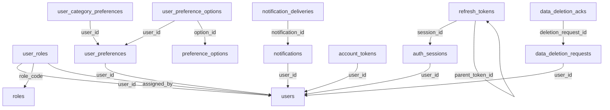

# Database Identity Service

Identity sở hữu danh tính, tài khoản, phân quyền nền tảng, preference, consent và thông báo theo user. Các preference nhiều giá trị được tách bảng; budget/companion/indoor-outdoor là profile 1–1. Email/password/token không được phát lên event bus công khai.

Database: `identity_db`; schema nội bộ: `identity`. Baseline có 14 bảng nghiệp vụ/read model và 4 bảng kỹ thuật local. Implementation P01 V5 bổ sung 2 operational tables `auth_rate_limits` (hash bucket/window/attempts) và `account_mail_jobs` (AES-GCM encrypted token mail/retry), tổng runtime 20 bảng; DDL/versioned evidence tại `backend/services/identity-service/src/main/resources/db/migration/`, không sửa baseline đã migrate. [DDL đầy đủ](sql/identity.sql) là đặc tả chi tiết cột, PK, FK, CHECK, UNIQUE, index; chưa chạy trên database. [Quy ước chung](../03-database-conventions.md).

## Sơ đồ khóa ngoại nội bộ

Mũi tên từ bảng con tới bảng được tham chiếu. External UUID không tạo cạnh FK. Các invariant liên hàng vẫn phải kiểm tra trong application như mô tả bên dưới.

## Quan hệ và invariant nghiệp vụ

1. Đăng ký user + role USER + profile mặc định + event trong một transaction. USER được seed; BUSINESS chỉ gán theo quy trình admin/business đã xác nhận. API public tuyệt đối không nhận role ADMIN từ request.
2. password_hash dùng thuật toán password hashing phù hợp, có salt/work factor; token reset/verify/refresh chỉ lưu hash. Login có rate limit và không lộ email tồn tại qua response khác biệt.
3. Refresh khóa token row: token chưa consumed/revoked, session còn hạn và user ACTIVE; consume token cũ + sinh token con cùng transaction. Reuse token đã consumed phải revoke toàn bộ session family. parent_token_id phải cùng session qua kiểm tra service.
4. Logout revoke session; access token ngắn hạn vẫn có thể còn hiệu lực đến expiry nếu chỉ verify JWT. Chốt TTL tối đa 5–15 phút; tác vụ nhạy cảm kiểm revocation/status và lỗi khi không xác minh được. Không tuyên bố logout vô hiệu hóa lập tức mọi JWT offline.
5. Các cập nhật preference/options/category tăng cùng profile.version và phát full snapshot sau commit. CUSTOM budget yêu cầu min/max theo request schema; khi có numeric bounds thì recommendation dùng bounds, nếu chỉ LOW/MID/HIGH dùng bảng cấu hình scoring versioned.
6. notifications dedup theo user+source event+type; IN_APP tạo trong cùng transaction inbox, email retry riêng. payload theo template allowlist và link đến đối tượng, không nhét toàn bộ hồ sơ hoặc trip.
7. Deletion workflow tạo request và 6 ack PENDING, revoke session ngay; hoàn thành khi tất cả service ack. Không hard-delete users trong baseline; thay email/display_name/hash bằng giá trị tombstone không thể đăng nhập theo policy để giữ audit/FK nội bộ.

## API và quyền thực thi

- POST /api/v1/auth/register, /login, /refresh, /logout; verify-email, forgot-password, reset-password.
- GET/PATCH /api/v1/me; PUT /api/v1/me/password; GET/PUT /api/v1/me/preferences; GET/DELETE /api/v1/me/sessions/{id}.
- GET /api/v1/me/notifications; PATCH /api/v1/me/notifications/{id}/read; POST /api/v1/me/deletion-requests.
- GET /api/v1/admin/users; PATCH /api/v1/admin/users/{id}/status; PUT /api/v1/admin/users/{id}/roles; admin không tự nâng quyền qua endpoint profile.
- GET /.well-known/jwks.json; internal user-status/preferences batch và deletion request status có workload scope.

## Từ điển từng bảng

Ký hiệu: NULL = được bỏ trống; bắt buộc = NOT NULL hoặc PK. Mặc định, FK và CHECK giữ nguyên SQL để tránh diễn giải sai. External UUID xem chú thích DDL và ownership phía trên; không tạo FK tới service khác.

### identity.users

Nguồn gốc user, email canonical; deleted_at nhất quán với status.

| Cột | Kiểu | Nullability | Mặc định / khóa / ràng buộc |
|---|---|---|---|
| `user_id` | `uuid` | Bắt buộc | `PRIMARY KEY` |
| `email` | `varchar(320)` | Bắt buộc | `NOT NULL UNIQUE` |
| `password_hash` | `text` | Bắt buộc | `NOT NULL` |
| `display_name` | `varchar(120)` | Bắt buộc | `NOT NULL` |
| `avatar_object_key` | `text` | NULL | — |
| `status` | `varchar(20)` | Bắt buộc | `NOT NULL DEFAULT 'PENDING'` |
| `email_verified_at` | `timestamptz` | NULL | — |
| `locale` | `varchar(16)` | Bắt buộc | `NOT NULL DEFAULT 'vi-VN'` |
| `version` | `bigint` | Bắt buộc | `NOT NULL DEFAULT 1 CHECK (version > 0)` |
| `created_at` | `timestamptz` | Bắt buộc | `NOT NULL DEFAULT now()` |
| `updated_at` | `timestamptz` | Bắt buộc | `NOT NULL DEFAULT now()` |
| `deleted_at` | `timestamptz` | NULL | — |

Ràng buộc cấp bảng:

- `CHECK (email = lower(btrim(email)))`
- `CHECK (status IN ('PENDING','ACTIVE','SUSPENDED','DELETED'))`
- `CHECK ((status = 'DELETED') = (deleted_at IS NOT NULL))`

### identity.roles

Danh mục ba role nền tảng. GUEST không phải role database.

| Cột | Kiểu | Nullability | Mặc định / khóa / ràng buộc |
|---|---|---|---|
| `role_code` | `varchar(30)` | Bắt buộc | `PRIMARY KEY` |
| `name` | `varchar(100)` | Bắt buộc | `NOT NULL` |

Ràng buộc cấp bảng:

- `CHECK (role_code IN ('USER','BUSINESS','ADMIN'))`

### identity.user_roles

Bảng quan hệ nội bộ, bảo toàn toàn vẹn bằng PK/FK bên dưới.

| Cột | Kiểu | Nullability | Mặc định / khóa / ràng buộc |
|---|---|---|---|
| `user_id` | `uuid` | Bắt buộc | `NOT NULL REFERENCES identity.users(user_id) ON DELETE CASCADE` |
| `role_code` | `varchar(30)` | Bắt buộc | `NOT NULL REFERENCES identity.roles(role_code)` |
| `assigned_at` | `timestamptz` | Bắt buộc | `NOT NULL DEFAULT now()` |
| `assigned_by` | `uuid` | NULL | `REFERENCES identity.users(user_id)` |

Ràng buộc cấp bảng:

- `PRIMARY KEY (user_id, role_code)`

### identity.user_preferences

PK user_id thay preference_id thừa; consent mặc định false.

| Cột | Kiểu | Nullability | Mặc định / khóa / ràng buộc |
|---|---|---|---|
| `user_id` | `uuid` | Bắt buộc | `PRIMARY KEY REFERENCES identity.users(user_id) ON DELETE CASCADE` |
| `budget_level` | `varchar(12)` | NULL | — |
| `budget_min` | `numeric(14,2)` | NULL | — |
| `budget_max` | `numeric(14,2)` | NULL | — |
| `currency` | `char(3)` | Bắt buộc | `NOT NULL DEFAULT 'VND'` |
| `companion_type` | `varchar(20)` | NULL | — |
| `indoor_outdoor` | `varchar(12)` | NULL | — |
| `personalization_enabled` | `boolean` | Bắt buộc | `NOT NULL DEFAULT false` |
| `consent_version` | `bigint` | Bắt buộc | `NOT NULL DEFAULT 1 CHECK (consent_version > 0)` |
| `consent_updated_at` | `timestamptz` | Bắt buộc | `NOT NULL DEFAULT now()` |
| `version` | `bigint` | Bắt buộc | `NOT NULL DEFAULT 1 CHECK (version > 0)` |
| `updated_at` | `timestamptz` | Bắt buộc | `NOT NULL DEFAULT now()` |

Ràng buộc cấp bảng:

- `CHECK (budget_level IN ('LOW','MID','HIGH','CUSTOM'))`
- `CHECK (budget_min IS NULL OR budget_min >= 0)`
- `CHECK (budget_max IS NULL OR budget_max >= 0)`
- `CHECK (budget_min IS NULL OR budget_max IS NULL OR budget_min <= budget_max)`
- `CHECK (currency ~ '^[A-Z]{3}$')`
- `CHECK (companion_type IN ('SOLO','COUPLE','FAMILY','FRIENDS','GROUP'))`
- `CHECK (indoor_outdoor IN ('INDOOR','OUTDOOR','BOTH'))`

### identity.preference_options

Danh mục mã sở thích có thể mở rộng mà không sửa schema.

| Cột | Kiểu | Nullability | Mặc định / khóa / ràng buộc |
|---|---|---|---|
| `option_id` | `uuid` | Bắt buộc | `PRIMARY KEY` |
| `kind` | `varchar(24)` | Bắt buộc | `NOT NULL CHECK (kind IN ('TRAVEL_STYLE','FOOD_PREFERENCE'))` |
| `code` | `varchar(64)` | Bắt buộc | `NOT NULL` |
| `label_vi` | `varchar(160)` | Bắt buộc | `NOT NULL` |
| `active` | `boolean` | Bắt buộc | `NOT NULL DEFAULT true` |

Ràng buộc cấp bảng:

- `UNIQUE (kind, code)`

### identity.user_preference_options

Mỗi option chỉ chọn một lần/user.

| Cột | Kiểu | Nullability | Mặc định / khóa / ràng buộc |
|---|---|---|---|
| `user_id` | `uuid` | Bắt buộc | `NOT NULL REFERENCES identity.user_preferences(user_id) ON DELETE CASCADE` |
| `option_id` | `uuid` | Bắt buộc | `NOT NULL REFERENCES identity.preference_options(option_id)` |

Ràng buộc cấp bảng:

- `PRIMARY KEY (user_id, option_id)`

### identity.user_category_preferences

Category ID thuộc Catalog; kiểm tra active qua API và đồng bộ invalidation.

| Cột | Kiểu | Nullability | Mặc định / khóa / ràng buộc |
|---|---|---|---|
| `user_id` | `uuid` | Bắt buộc | `NOT NULL REFERENCES identity.user_preferences(user_id) ON DELETE CASCADE` |
| `category_id` | `uuid` | Bắt buộc | `NOT NULL` |
| `weight` | `numeric(5,4)` | Bắt buộc | `NOT NULL DEFAULT 1 CHECK (weight BETWEEN 0 AND 1)` |

Ràng buộc cấp bảng:

- `PRIMARY KEY (user_id, category_id)`

### identity.auth_sessions

Session family dùng cho logout/revoke toàn bộ refresh chain.

| Cột | Kiểu | Nullability | Mặc định / khóa / ràng buộc |
|---|---|---|---|
| `session_id` | `uuid` | Bắt buộc | `PRIMARY KEY` |
| `user_id` | `uuid` | Bắt buộc | `NOT NULL REFERENCES identity.users(user_id) ON DELETE CASCADE` |
| `created_at` | `timestamptz` | Bắt buộc | `NOT NULL DEFAULT now()` |
| `expires_at` | `timestamptz` | Bắt buộc | `NOT NULL` |
| `revoked_at` | `timestamptz` | NULL | — |
| `device_label` | `varchar(160)` | NULL | — |

Ràng buộc cấp bảng:

- `CHECK (expires_at > created_at)`

### identity.refresh_tokens

Lưu lịch sử hash token để phát hiện reuse.

| Cột | Kiểu | Nullability | Mặc định / khóa / ràng buộc |
|---|---|---|---|
| `token_id` | `uuid` | Bắt buộc | `PRIMARY KEY` |
| `session_id` | `uuid` | Bắt buộc | `NOT NULL REFERENCES identity.auth_sessions(session_id) ON DELETE CASCADE` |
| `token_hash` | `text` | Bắt buộc | `NOT NULL UNIQUE` |
| `parent_token_id` | `uuid` | NULL | `REFERENCES identity.refresh_tokens(token_id)` |
| `issued_at` | `timestamptz` | Bắt buộc | `NOT NULL DEFAULT now()` |
| `expires_at` | `timestamptz` | Bắt buộc | `NOT NULL` |
| `consumed_at` | `timestamptz` | NULL | — |
| `revoked_at` | `timestamptz` | NULL | — |

Ràng buộc cấp bảng:

- `CHECK (expires_at > issued_at)`
- `UNIQUE (parent_token_id)`

### identity.account_tokens

Token dùng một lần; hết hạn không được consume.

| Cột | Kiểu | Nullability | Mặc định / khóa / ràng buộc |
|---|---|---|---|
| `token_id` | `uuid` | Bắt buộc | `PRIMARY KEY` |
| `user_id` | `uuid` | Bắt buộc | `NOT NULL REFERENCES identity.users(user_id) ON DELETE CASCADE` |
| `purpose` | `varchar(20)` | Bắt buộc | `NOT NULL CHECK (purpose IN ('VERIFY_EMAIL','RESET_PASSWORD'))` |
| `token_hash` | `text` | Bắt buộc | `NOT NULL UNIQUE` |
| `created_at` | `timestamptz` | Bắt buộc | `NOT NULL DEFAULT now()` |
| `expires_at` | `timestamptz` | Bắt buộc | `NOT NULL` |
| `consumed_at` | `timestamptz` | NULL | — |

Ràng buộc cấp bảng:

- `CHECK (expires_at > created_at)`

### identity.notifications

Inbox theo user, không phải entity nghiệp vụ của các service khác.

| Cột | Kiểu | Nullability | Mặc định / khóa / ràng buộc |
|---|---|---|---|
| `notification_id` | `uuid` | Bắt buộc | `PRIMARY KEY` |
| `user_id` | `uuid` | Bắt buộc | `NOT NULL REFERENCES identity.users(user_id) ON DELETE CASCADE` |
| `source_event_id` | `uuid` | Bắt buộc | `NOT NULL` |
| `notification_type` | `varchar(64)` | Bắt buộc | `NOT NULL` |
| `payload` | `jsonb` | Bắt buộc | `NOT NULL` |
| `created_at` | `timestamptz` | Bắt buộc | `NOT NULL DEFAULT now()` |
| `read_at` | `timestamptz` | NULL | — |

Ràng buộc cấp bảng:

- `UNIQUE (user_id, source_event_id, notification_type)`

### identity.notification_deliveries

Delivery email/in-app tách khỏi trạng thái đã đọc.

| Cột | Kiểu | Nullability | Mặc định / khóa / ràng buộc |
|---|---|---|---|
| `delivery_id` | `uuid` | Bắt buộc | `PRIMARY KEY` |
| `notification_id` | `uuid` | Bắt buộc | `NOT NULL REFERENCES identity.notifications(notification_id) ON DELETE CASCADE` |
| `channel` | `varchar(12)` | Bắt buộc | `NOT NULL CHECK (channel IN ('EMAIL','IN_APP'))` |
| `status` | `varchar(12)` | Bắt buộc | `NOT NULL DEFAULT 'PENDING' CHECK (status IN ('PENDING','SENT','FAILED'))` |
| `attempts` | `integer` | Bắt buộc | `NOT NULL DEFAULT 0 CHECK (attempts >= 0)` |
| `next_attempt_at` | `timestamptz` | Bắt buộc | `NOT NULL DEFAULT now()` |
| `sent_at` | `timestamptz` | NULL | — |
| `provider_message_id` | `text` | NULL | — |

Ràng buộc cấp bảng:

- `UNIQUE (notification_id, channel)`

### identity.data_deletion_requests

Điều phối yêu cầu xóa, theo dõi chính sách và sự cố.

| Cột | Kiểu | Nullability | Mặc định / khóa / ràng buộc |
|---|---|---|---|
| `deletion_request_id` | `uuid` | Bắt buộc | `PRIMARY KEY` |
| `user_id` | `uuid` | Bắt buộc | `NOT NULL REFERENCES identity.users(user_id)` |
| `policy_version` | `varchar(40)` | Bắt buộc | `NOT NULL` |
| `status` | `varchar(16)` | Bắt buộc | `NOT NULL DEFAULT 'PENDING' CHECK (status IN ('PENDING','PROCESSING','COMPLETED','FAILED'))` |
| `requested_at` | `timestamptz` | Bắt buộc | `NOT NULL DEFAULT now()` |
| `completed_at` | `timestamptz` | NULL | — |
| `error_summary` | `text` | NULL | — |

### identity.data_deletion_acks

Một kết quả/service/request, kể cả Identity.

| Cột | Kiểu | Nullability | Mặc định / khóa / ràng buộc |
|---|---|---|---|
| `deletion_request_id` | `uuid` | Bắt buộc | `NOT NULL REFERENCES identity.data_deletion_requests(deletion_request_id)` |
| `service_name` | `varchar(20)` | Bắt buộc | `NOT NULL CHECK (service_name IN ('identity','catalog','community','trip','intelligence','ingestion'))` |
| `status` | `varchar(16)` | Bắt buộc | `NOT NULL CHECK (status IN ('PENDING','COMPLETED','FAILED'))` |
| `artifact_result` | `jsonb` | Bắt buộc | `NOT NULL DEFAULT '{}'` |
| `updated_at` | `timestamptz` | Bắt buộc | `NOT NULL DEFAULT now()` |

Ràng buộc cấp bảng:

- `PRIMARY KEY (deletion_request_id, service_name)`

## Index và khóa bổ sung

- `CREATE INDEX users_status_created_idx ON identity.users(status, created_at, user_id);`
- `CREATE INDEX user_roles_role_idx ON identity.user_roles(role_code, user_id);`
- `CREATE INDEX sessions_user_idx ON identity.auth_sessions(user_id, expires_at);`
- `CREATE INDEX refresh_session_idx ON identity.refresh_tokens(session_id);`
- `CREATE INDEX account_tokens_user_idx ON identity.account_tokens(user_id, purpose);`
- `CREATE INDEX notifications_user_idx ON identity.notifications(user_id, created_at DESC, notification_id);`
- `CREATE INDEX notification_retry_idx ON identity.notification_deliveries(next_attempt_at) WHERE status = 'PENDING';`
- `CREATE UNIQUE INDEX one_live_deletion_request_idx ON identity.data_deletion_requests(user_id) WHERE status IN ('PENDING','PROCESSING');`

## Kiểm nhận dữ liệu

- Migration tạo đủ bảng/index/FK trên database riêng; account runtime không đọc DB service khác.
- Bộ test ở phase của service phải cover ràng buộc trong SQL lẫn invariant liên hàng/phân quyền bên trên.
- Source mapping và reconcile: xem [42 bảng nguồn](../02-source-mapping.md) và [migration](../05-migration-cutover.md).
- Các bảng outbox/inbox/audit/idempotency được định nghĩa trong DDL; dispatch, retention, retry và permission phải được triển khai ở P01 và tích hợp vào từng mutation.
