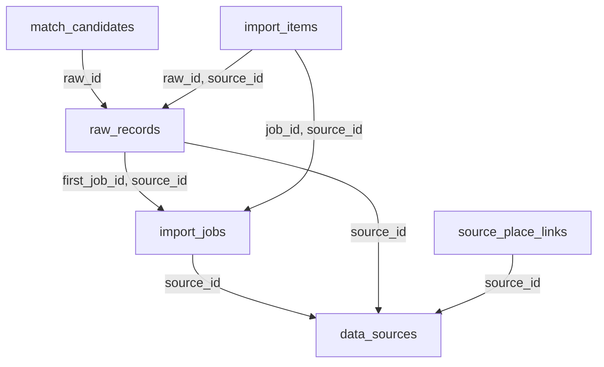

# Database Ingestion Service

Ingestion sở hữu dữ liệu nguồn và quy trình import. Source→Place mapping là nguồn gốc provenance; Catalog mới có quyền quyết định dữ liệu canonical. Tách raw bất biến khỏi trạng thái xử lý theo từng job giúp retry và incremental sync có thể truy vết.

Database: `ingestion_db`; schema nội bộ: `ingestion`. Có 6 bảng nghiệp vụ/read model và 4 bảng kỹ thuật local. [DDL đầy đủ](sql/ingestion.sql) là đặc tả chi tiết cột, PK, FK, CHECK, UNIQUE, index; chưa chạy trên database. [Quy ước chung](../03-database-conventions.md).

## Sơ đồ khóa ngoại nội bộ

Mũi tên từ bảng con tới bảng được tham chiếu. External UUID không tạo cạnh FK. Các invariant liên hàng vẫn phải kiểm tra trong application như mô tả bên dưới.

## Quan hệ và invariant nghiệp vụ

1. Nguồn DISABLED/REVOKED hoặc allow_storage=false không được lưu raw. Kiểm policy cả trước fetch và trước persist; secret chỉ giữ reference. Schedule/refresh_policy có JSON Schema rõ, host allowlist và timeout/size limit cho connector.
2. Một job QUEUED/RUNNING mỗi source để tránh cursor race. idempotency_key unique/source, cursor_after chỉ được công bố thành checkpoint khi các kết quả cần thiết đã ack. Job PARTIAL giữ watermark đến phần an toàn và danh sách item cần retry, không skip record thất bại.
3. Raw hash tính trên canonicalized payload đã normalize field order bỏ volatile metadata theo connector version; unique source/external/hash. Raw đã lưu không bị overwrite khi normalize rule thay đổi; REPLAY tạo import_items/job mới trên cùng raw.
4. So khớp external ID đã có link trước, sau đó name/address/geo candidates. Threshold auto-link cần hiệu chuẩn với dữ liệu được gán nhãn, chưa hardcode giá trị tự nhận là đúng. Candidate mơ hồ NEEDS_REVIEW, reviewer chọn match/create.
5. CREATE dùng proposed_place_id cố định từ import_item, command_id cố định qua retry. UPDATE có expected_catalog_version; version mismatch→reconcile/review, không overwrite mù. Duplicate/skip không publish update mới.
6. Catalog ack mới cập nhật source_place_links.last_hash/version; counts theo job tính từ import_items terminal status để replay không tăng gấp đôi. last_sync_at chỉ đổi khi checkpoint an toàn được xác nhận.
7. Import toàn nguồn không mặc định archive place không còn thấy. Nguồn mất record có thể do lỗi quyền/pagination; cần tombstone rõ hoặc policy xác minh trước gửi Catalog command. Dữ liệu admin/business đã duyệt có ưu tiên hơn raw mới.
8. Revocation license phát event, chặn job và train; owner các bản sao rà provenance và thực hiện purge/quarantine theo policy. Không coi checkbox allow_training là xác nhận pháp lý về quyền nguồn.

## API và quyền thực thi

- Admin CRUD /api/v1/admin/data-sources; PATCH policy/status; POST /data-sources/{id}/import-jobs.
- GET /api/v1/admin/import-jobs/{id}; GET items/errors/candidates; POST retry/cancel; decision match/create/reject.
- GET /internal/v1/sources/{id}/policy; POST /internal/v1/sources/policies/batch; source link lookup phục vụ provenance có auth.
- Worker connector và normalization chỉ có credential nguồn theo scope; import commands gửi qua broker/outbox, không truy cập Catalog DB.

## Từ điển từng bảng

Ký hiệu: NULL = được bỏ trống; bắt buộc = NOT NULL hoặc PK. Mặc định, FK và CHECK giữ nguyên SQL để tránh diễn giải sai. External UUID xem chú thích DDL và ownership phía trên; không tạo FK tới service khác.

### ingestion.data_sources

Registry nguồn và quyền storage/training phiên bản hóa.

| Cột | Kiểu | Nullability | Mặc định / khóa / ràng buộc |
|---|---|---|---|
| `source_id` | `uuid` | Bắt buộc | `PRIMARY KEY` |
| `code` | `varchar(64)` | Bắt buộc | `NOT NULL UNIQUE` |
| `name` | `varchar(160)` | Bắt buộc | `NOT NULL` |
| `source_type` | `varchar(20)` | Bắt buộc | `NOT NULL CHECK (source_type IN ('API','FILE','MANUAL','PARTNER'))` |
| `license_terms` | `text` | Bắt buộc | `NOT NULL` |
| `license_version` | `varchar(80)` | Bắt buộc | `NOT NULL` |
| `allow_storage` | `boolean` | Bắt buộc | `NOT NULL DEFAULT false` |
| `allow_training` | `boolean` | Bắt buộc | `NOT NULL DEFAULT false` |
| `refresh_policy` | `jsonb` | Bắt buộc | `NOT NULL DEFAULT '{}'` |
| `credential_secret_ref` | `text` | NULL | — |
| `last_sync_at` | `timestamptz` | NULL | — |
| `status` | `varchar(16)` | Bắt buộc | `NOT NULL DEFAULT 'DISABLED' CHECK (status IN ('ACTIVE','DISABLED','REVOKED'))` |
| `version` | `bigint` | Bắt buộc | `NOT NULL DEFAULT 1 CHECK (version > 0)` |
| `updated_at` | `timestamptz` | Bắt buộc | `NOT NULL DEFAULT now()` |

### ingestion.import_jobs

Job-level lifecycle/cursor, counters derive từ items.

| Cột | Kiểu | Nullability | Mặc định / khóa / ràng buộc |
|---|---|---|---|
| `job_id` | `uuid` | Bắt buộc | `PRIMARY KEY` |
| `source_id` | `uuid` | Bắt buộc | `NOT NULL REFERENCES ingestion.data_sources(source_id)` |
| `idempotency_key` | `varchar(120)` | Bắt buộc | `NOT NULL` |
| `mode` | `varchar(16)` | Bắt buộc | `NOT NULL CHECK (mode IN ('FULL','INCREMENTAL','REPLAY'))` |
| `status` | `varchar(16)` | Bắt buộc | `NOT NULL DEFAULT 'QUEUED' CHECK (status IN ('QUEUED','RUNNING','SUCCEEDED','PARTIAL','FAILED','CANCELLED'))` |
| `cursor_before` | `jsonb` | NULL | — |
| `cursor_after` | `jsonb` | NULL | — |
| `requested_by` | `uuid` | NULL | — |
| `created_at` | `timestamptz` | Bắt buộc | `NOT NULL DEFAULT now()` |
| `started_at` | `timestamptz` | NULL | — |
| `ended_at` | `timestamptz` | NULL | — |
| `error_summary` | `text` | NULL | — |

Ràng buộc cấp bảng:

- `UNIQUE (source_id, idempotency_key)`
- `UNIQUE (job_id, source_id)`
- `CHECK (ended_at IS NULL OR (started_at IS NOT NULL AND ended_at >= started_at))`

### ingestion.raw_records

Bản raw theo content hash để reproducibility.

| Cột | Kiểu | Nullability | Mặc định / khóa / ràng buộc |
|---|---|---|---|
| `raw_id` | `uuid` | Bắt buộc | `PRIMARY KEY` |
| `source_id` | `uuid` | Bắt buộc | `NOT NULL REFERENCES ingestion.data_sources(source_id)` |
| `external_id` | `varchar(240)` | Bắt buộc | `NOT NULL` |
| `first_job_id` | `uuid` | Bắt buộc | `NOT NULL` |
| `payload` | `jsonb` | Bắt buộc | `NOT NULL` |
| `source_updated_at` | `timestamptz` | NULL | — |
| `content_hash` | `varchar(64)` | Bắt buộc | `NOT NULL` |
| `first_seen_at` | `timestamptz` | Bắt buộc | `NOT NULL DEFAULT now()` |
| `last_seen_at` | `timestamptz` | Bắt buộc | `NOT NULL DEFAULT now()` |
| `schema_version` | `integer` | Bắt buộc | `NOT NULL DEFAULT 1 CHECK (schema_version > 0)` |

Ràng buộc cấp bảng:

- `UNIQUE (source_id, external_id, content_hash)`
- `UNIQUE (raw_id, source_id)`
- `FOREIGN KEY (first_job_id, source_id) REFERENCES ingestion.import_jobs(job_id, source_id)`

### ingestion.source_place_links

Mapping đã được Catalog xác nhận.

| Cột | Kiểu | Nullability | Mặc định / khóa / ràng buộc |
|---|---|---|---|
| `link_id` | `uuid` | Bắt buộc | `PRIMARY KEY` |
| `source_id` | `uuid` | Bắt buộc | `NOT NULL REFERENCES ingestion.data_sources(source_id)` |
| `external_id` | `varchar(240)` | Bắt buộc | `NOT NULL` |
| `place_id` | `uuid` | Bắt buộc | `NOT NULL` |
| `last_hash` | `varchar(64)` | Bắt buộc | `NOT NULL` |
| `last_source_updated_at` | `timestamptz` | NULL | — |
| `catalog_version` | `bigint` | Bắt buộc | `NOT NULL CHECK (catalog_version > 0)` |
| `confidence` | `numeric(5,4)` | Bắt buộc | `NOT NULL CHECK (confidence BETWEEN 0 AND 1)` |
| `last_seen_at` | `timestamptz` | Bắt buộc | `NOT NULL DEFAULT now()` |

Ràng buộc cấp bảng:

- `UNIQUE (source_id, external_id)`

### ingestion.match_candidates

Candidate match có evidence và reviewer.

| Cột | Kiểu | Nullability | Mặc định / khóa / ràng buộc |
|---|---|---|---|
| `candidate_id` | `uuid` | Bắt buộc | `PRIMARY KEY` |
| `raw_id` | `uuid` | Bắt buộc | `NOT NULL REFERENCES ingestion.raw_records(raw_id)` |
| `place_id` | `uuid` | Bắt buộc | `NOT NULL` |
| `score` | `numeric(5,4)` | Bắt buộc | `NOT NULL CHECK (score BETWEEN 0 AND 1)` |
| `evidence` | `jsonb` | Bắt buộc | `NOT NULL` |
| `decision` | `varchar(16)` | Bắt buộc | `NOT NULL DEFAULT 'PENDING' CHECK (decision IN ('PENDING','ACCEPTED','REJECTED'))` |
| `reviewed_by` | `uuid` | NULL | — |
| `reviewed_at` | `timestamptz` | NULL | — |

Ràng buộc cấp bảng:

- `UNIQUE (raw_id, place_id)`

### ingestion.import_items

Trạng thái xử lý từng raw/job và command dedup bền vững.

| Cột | Kiểu | Nullability | Mặc định / khóa / ràng buộc |
|---|---|---|---|
| `import_item_id` | `uuid` | Bắt buộc | `PRIMARY KEY` |
| `job_id` | `uuid` | Bắt buộc | `NOT NULL` |
| `source_id` | `uuid` | Bắt buộc | `NOT NULL` |
| `raw_id` | `uuid` | Bắt buộc | `NOT NULL` |
| `command_id` | `uuid` | Bắt buộc | `NOT NULL UNIQUE` |
| `operation` | `varchar(16)` | Bắt buộc | `NOT NULL CHECK (operation IN ('CREATE','UPDATE','LINK','SKIP'))` |
| `status` | `varchar(20)` | Bắt buộc | `NOT NULL DEFAULT 'PENDING' CHECK (status IN ('PENDING','NEEDS_REVIEW','SENT','APPLIED','DUPLICATE','SKIPPED','FAILED'))` |
| `proposed_place_id` | `uuid` | NULL | — |
| `normalized_payload` | `jsonb` | Bắt buộc | `NOT NULL` |
| `expected_catalog_version` | `bigint` | NULL | — |
| `attempts` | `integer` | Bắt buộc | `NOT NULL DEFAULT 0 CHECK (attempts >= 0)` |
| `next_attempt_at` | `timestamptz` | Bắt buộc | `NOT NULL DEFAULT now()` |
| `error_code` | `varchar(64)` | NULL | — |
| `error_detail` | `text` | NULL | — |
| `resulting_place_id` | `uuid` | NULL | — |
| `resulting_catalog_version` | `bigint` | NULL | — |
| `created_at` | `timestamptz` | Bắt buộc | `NOT NULL DEFAULT now()` |
| `updated_at` | `timestamptz` | Bắt buộc | `NOT NULL DEFAULT now()` |

Ràng buộc cấp bảng:

- `UNIQUE (job_id, raw_id)`
- `FOREIGN KEY (job_id, source_id) REFERENCES ingestion.import_jobs(job_id, source_id)`
- `FOREIGN KEY (raw_id, source_id) REFERENCES ingestion.raw_records(raw_id, source_id)`

## Index và khóa bổ sung

- `CREATE UNIQUE INDEX one_active_job_source_idx ON ingestion.import_jobs(source_id) WHERE status IN ('QUEUED','RUNNING');`
- `CREATE INDEX import_job_history_idx ON ingestion.import_jobs(source_id, created_at DESC);`
- `CREATE INDEX raw_source_seen_idx ON ingestion.raw_records(source_id, last_seen_at);`
- `CREATE INDEX source_link_place_idx ON ingestion.source_place_links(place_id);`
- `CREATE UNIQUE INDEX one_accepted_match_idx ON ingestion.match_candidates(raw_id) WHERE decision = 'ACCEPTED';`
- `CREATE INDEX match_review_idx ON ingestion.match_candidates(decision, raw_id);`
- `CREATE INDEX import_retry_idx ON ingestion.import_items(next_attempt_at, import_item_id) WHERE status IN ('PENDING','SENT','FAILED');`
- `CREATE INDEX import_status_idx ON ingestion.import_items(job_id, status);`

## Kiểm nhận dữ liệu

- Migration tạo đủ bảng/index/FK trên database riêng; account runtime không đọc DB service khác.
- Bộ test ở phase của service phải cover ràng buộc trong SQL lẫn invariant liên hàng/phân quyền bên trên.
- Source mapping và reconcile: xem [42 bảng nguồn](../02-source-mapping.md) và [migration](../05-migration-cutover.md).
- Các bảng outbox/inbox/audit/idempotency được định nghĩa trong DDL; dispatch, retention, retry và permission phải được triển khai ở P01 và tích hợp vào từng mutation.
