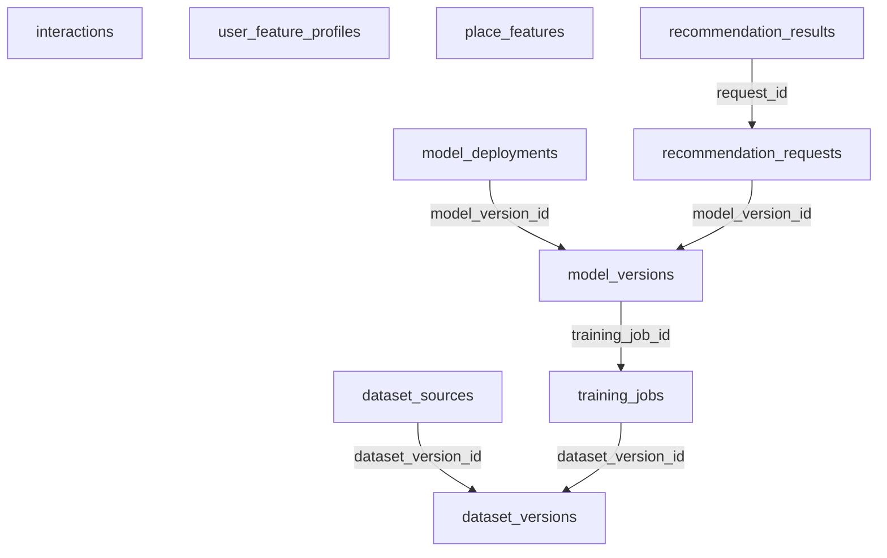

# Database Intelligence Service

Intelligence chạy Basic Recommendation trước, ML sau. PostgreSQL lưu interaction, metadata và lineage; feature JSON là projection có version có thể rebuild. Có thể dùng Redis cho cache; vector store không bắt buộc cho scoring cơ bản.

Database: `intelligence_db`; schema nội bộ: `intelligence`. Có 10 bảng nghiệp vụ/read model và 4 bảng kỹ thuật local. [DDL đầy đủ](sql/intelligence.sql) là đặc tả chi tiết cột, PK, FK, CHECK, UNIQUE, index; chưa chạy trên database. [Quy ước chung](../03-database-conventions.md).

## Sơ đồ khóa ngoại nội bộ

Mũi tên từ bảng con tới bảng được tham chiếu. External UUID không tạo cạnh FK. Các invariant liên hàng vẫn phải kiểm tra trong application như mô tả bên dưới.

## Quan hệ và invariant nghiệp vụ

1. Chỉ SEARCH/PLACE_VIEW nhận từ client; favorite/review/trip từ server events. Dedup event_id; kiểm allowlisted event_type, timestamps, payload size, rate limit. user_id lấy từ JWT nếu có; session là analytics pseudonym; context không lưu token/email/free text nhạy cảm.
2. Có consent hiện hành mới dùng user profile/history cho cá nhân hóa hoặc dataset cá nhân. Nếu không có consent, dùng request criteria + public catalog/rating; lịch sử định danh không được ghi để train. Explicit criteria dùng cho phiên xử lý không được coi là consent lưu dài hạn.
3. Baseline scoring config v1 đề xuất: category=0.30, preference=0.25, rating=0.20, distance=0.15, budget=0.10. Chuẩn hóa từng thành phần [0,1], chỉ dùng trọng số thành phần có dữ liệu và chia lại cho tổng trọng số có hiệu lực; tất cả thiếu→thứ tự phổ biến ổn định + place_id.
4. Candidate trước scoring phải PUBLISHED, thuộc category/khu vực/loại theo filter cứng và thỏa strict budget nếu bật. Giá chưa biết không qua strict budget; currency không tương thích cần báo lỗi/filter riêng. Hard constraint không được bù bằng điểm preference cao.
5. Rating score có smoothing để 1 review 5 sao không áp đảo hàng trăm review; prior và m là config cần đánh giá, không phải fact nghiệp vụ. Distance là khoảng cách địa lý có đơn vị và radius; routing tối ưu thuộc ngoài baseline.
6. Response Top N có request_id, algorithm_version, score breakdown, data_as_of, fallback_reason và thiếu dữ liệu; tie-break place_id. Candidate validation cuối ở Catalog loại hidden/archive mới nhất. Không hứa Top N luôn đủ nếu ít ứng viên hợp lệ.
7. features JSON có schema version và field allowlist, không biến thành kho raw không kiểm soát. catalog_version và rating_version cập nhật độc lập. Out-of-order snapshot không làm quay lùi feature.
8. Dataset lưu snapshot immutable có checksum, criteria, feature schema, nguồn/license và consent cutoff. Mọi source xuất hiện phải có allow_training=true còn hiệu lực lúc build và trước train; nguồn thủ công cũng được đăng ký provenance. Dataset thiếu lineage bị từ chối.
9. Train lưu code revision, seed, params, metrics và log artifact. Chia train/validation/test theo thời gian hoặc user thích hợp để tránh leakage; so với Basic baseline. Deploy model validated qua transaction khóa use_case + unique active index, rollback về model cũ còn hợp lệ.
10. Model timeout/load/checksum/schema/license/consent failure→BASIC/FALLBACK có reason. Không gọi model sync cho ghi Catalog/Trip. Recommendation chỉ đưa gợi ý; Trip user chủ động thêm mới.
11. Opt-out/deletion phải vô hiệu feature và purge interaction có định danh, chặn dataset build mới; lineage xác định dataset/model cần revoke/retrain theo policy. DLQ job hoặc artifact orphan có lịch cleanup và audit.

## API và quyền thực thi

- POST /api/v1/recommendations với criteria, budget/currency, category, location/radius, topN; user_id không cho client override.
- POST /api/v1/interactions/batch chỉ SEARCH/PLACE_VIEW; event_id từ client để retry; max batch cấu hình và lỗi từng record.
- GET /api/v1/me/interactions nếu bật lịch sử UI, auth owner, cursor; DELETE history có workflow consent tương ứng.
- Admin POST /api/v1/admin/datasets, /training-jobs; GET jobs/models/metrics; POST /models/{id}/validate, /deploy, /rollback.
- Internal rebuild feature snapshot và source policy handlers có workload scope; không expose raw dataset URL công khai.

## Từ điển từng bảng

Ký hiệu: NULL = được bỏ trống; bắt buộc = NOT NULL hoặc PK. Mặc định, FK và CHECK giữ nguyên SQL để tránh diễn giải sai. External UUID xem chú thích DDL và ownership phía trên; không tạo FK tới service khác.

### intelligence.interactions

Analytics event append-only, destination nullable, ID lớn và dedup UUID.

| Cột | Kiểu | Nullability | Mặc định / khóa / ràng buộc |
|---|---|---|---|
| `interaction_id` | `bigint` | Bắt buộc | `GENERATED ALWAYS AS IDENTITY PRIMARY KEY` |
| `event_id` | `uuid` | Bắt buộc | `NOT NULL UNIQUE` |
| `user_id` | `uuid` | NULL | — |
| `place_id` | `uuid` | NULL | — |
| `destination_id` | `uuid` | NULL | — |
| `event_type` | `varchar(24)` | Bắt buộc | `NOT NULL CHECK (event_type IN ('SEARCH','PLACE_VIEW','FAVORITE_ADDED','FAVORITE_REMOVED','REVIEW_CREATED','TRIP_ITEM_ADDED'))` |
| `session_id` | `uuid` | Bắt buộc | `NOT NULL` |
| `consent_version` | `bigint` | NULL | — |
| `context` | `jsonb` | Bắt buộc | `NOT NULL DEFAULT '{}'` |
| `occurred_at` | `timestamptz` | Bắt buộc | `NOT NULL` |
| `received_at` | `timestamptz` | Bắt buộc | `NOT NULL DEFAULT now()` |

Ràng buộc cấp bảng:

- `CHECK (event_type = 'SEARCH' OR place_id IS NOT NULL)`

### intelligence.user_feature_profiles

Preference read model, consent và source_version.

| Cột | Kiểu | Nullability | Mặc định / khóa / ràng buộc |
|---|---|---|---|
| `user_id` | `uuid` | Bắt buộc | `PRIMARY KEY` |
| `preferences` | `jsonb` | Bắt buộc | `NOT NULL` |
| `personalization_enabled` | `boolean` | Bắt buộc | `NOT NULL DEFAULT false` |
| `consent_version` | `bigint` | Bắt buộc | `NOT NULL CHECK (consent_version > 0)` |
| `source_version` | `bigint` | Bắt buộc | `NOT NULL CHECK (source_version > 0)` |
| `feature_version` | `bigint` | Bắt buộc | `NOT NULL DEFAULT 1 CHECK (feature_version > 0)` |
| `as_of` | `timestamptz` | Bắt buộc | `NOT NULL` |

### intelligence.place_features

Read model Catalog + Community với hai luồng version độc lập.

| Cột | Kiểu | Nullability | Mặc định / khóa / ràng buộc |
|---|---|---|---|
| `place_id` | `uuid` | Bắt buộc | `PRIMARY KEY` |
| `catalog_version` | `bigint` | Bắt buộc | `NOT NULL CHECK (catalog_version > 0)` |
| `rating_version` | `bigint` | Bắt buộc | `NOT NULL DEFAULT 0 CHECK (rating_version >= 0)` |
| `status` | `varchar(16)` | Bắt buộc | `NOT NULL CHECK (status IN ('DRAFT','PUBLISHED','HIDDEN','ARCHIVED'))` |
| `features` | `jsonb` | Bắt buộc | `NOT NULL` |
| `content_hash` | `varchar(64)` | Bắt buộc | `NOT NULL` |
| `as_of` | `timestamptz` | Bắt buộc | `NOT NULL` |

### intelligence.recommendation_requests

Metadata lần gợi ý, input được redact và algorithm version.

| Cột | Kiểu | Nullability | Mặc định / khóa / ràng buộc |
|---|---|---|---|
| `request_id` | `uuid` | Bắt buộc | `PRIMARY KEY` |
| `user_id` | `uuid` | NULL | — |
| `session_id` | `uuid` | Bắt buộc | `NOT NULL` |
| `mode` | `varchar(12)` | Bắt buộc | `NOT NULL CHECK (mode IN ('BASIC','MODEL','FALLBACK'))` |
| `algorithm_version` | `varchar(80)` | Bắt buộc | `NOT NULL` |
| `model_version_id` | `uuid` | NULL | — |
| `criteria` | `jsonb` | Bắt buộc | `NOT NULL` |
| `top_n` | `smallint` | Bắt buộc | `NOT NULL CHECK (top_n BETWEEN 1 AND 100)` |
| `latency_ms` | `integer` | NULL | `CHECK (latency_ms IS NULL OR latency_ms >= 0)` |
| `fallback_reason` | `varchar(100)` | NULL | — |
| `created_at` | `timestamptz` | Bắt buộc | `NOT NULL DEFAULT now()` |

### intelligence.recommendation_results

Rank/score/explanation theo request; không duplicate place.

| Cột | Kiểu | Nullability | Mặc định / khóa / ràng buộc |
|---|---|---|---|
| `request_id` | `uuid` | Bắt buộc | `NOT NULL REFERENCES intelligence.recommendation_requests(request_id) ON DELETE CASCADE` |
| `place_id` | `uuid` | Bắt buộc | `NOT NULL` |
| `rank` | `smallint` | Bắt buộc | `NOT NULL CHECK (rank > 0)` |
| `score` | `numeric(10,6)` | Bắt buộc | `NOT NULL` |
| `explanation` | `jsonb` | Bắt buộc | `NOT NULL` |
| `catalog_version` | `bigint` | Bắt buộc | `NOT NULL CHECK (catalog_version > 0)` |

Ràng buộc cấp bảng:

- `PRIMARY KEY (request_id, place_id)`
- `UNIQUE (request_id, rank)`

### intelligence.dataset_versions

Dataset snapshot artifact có checksum và trạng thái.

| Cột | Kiểu | Nullability | Mặc định / khóa / ràng buộc |
|---|---|---|---|
| `dataset_version_id` | `uuid` | Bắt buộc | `PRIMARY KEY` |
| `name` | `varchar(120)` | Bắt buộc | `NOT NULL` |
| `criteria` | `jsonb` | Bắt buộc | `NOT NULL` |
| `feature_schema_version` | `varchar(40)` | Bắt buộc | `NOT NULL` |
| `row_count` | `bigint` | Bắt buộc | `NOT NULL CHECK (row_count >= 0)` |
| `artifact_object_key` | `text` | Bắt buộc | `NOT NULL` |
| `checksum` | `varchar(64)` | Bắt buộc | `NOT NULL` |
| `status` | `varchar(16)` | Bắt buộc | `NOT NULL DEFAULT 'READY' CHECK (status IN ('READY','REVOKED','DELETED'))` |
| `created_at` | `timestamptz` | Bắt buộc | `NOT NULL DEFAULT now()` |
| `created_by` | `uuid` | NULL | — |

### intelligence.dataset_sources

Lineage nguồn/version/license snapshot.

| Cột | Kiểu | Nullability | Mặc định / khóa / ràng buộc |
|---|---|---|---|
| `dataset_version_id` | `uuid` | Bắt buộc | `NOT NULL REFERENCES intelligence.dataset_versions(dataset_version_id)` |
| `source_id` | `uuid` | Bắt buộc | `NOT NULL` |
| `source_version` | `bigint` | Bắt buộc | `NOT NULL CHECK (source_version > 0)` |
| `license_version` | `varchar(80)` | Bắt buộc | `NOT NULL` |
| `allow_training_snapshot` | `boolean` | Bắt buộc | `NOT NULL CHECK (allow_training_snapshot)` |

Ràng buộc cấp bảng:

- `PRIMARY KEY (dataset_version_id, source_id)`

### intelligence.training_jobs

Vòng đời training có code/seed/params tái lập.

| Cột | Kiểu | Nullability | Mặc định / khóa / ràng buộc |
|---|---|---|---|
| `training_job_id` | `uuid` | Bắt buộc | `PRIMARY KEY` |
| `dataset_version_id` | `uuid` | Bắt buộc | `NOT NULL REFERENCES intelligence.dataset_versions(dataset_version_id)` |
| `algorithm` | `varchar(80)` | Bắt buộc | `NOT NULL` |
| `params` | `jsonb` | Bắt buộc | `NOT NULL` |
| `code_revision` | `varchar(80)` | Bắt buộc | `NOT NULL` |
| `random_seed` | `bigint` | Bắt buộc | `NOT NULL` |
| `status` | `varchar(16)` | Bắt buộc | `NOT NULL DEFAULT 'QUEUED' CHECK (status IN ('QUEUED','RUNNING','SUCCEEDED','FAILED','CANCELLED'))` |
| `logs_object_key` | `text` | NULL | — |
| `started_at` | `timestamptz` | NULL | — |
| `ended_at` | `timestamptz` | NULL | — |
| `created_at` | `timestamptz` | Bắt buộc | `NOT NULL DEFAULT now()` |

Ràng buộc cấp bảng:

- `CHECK (ended_at IS NULL OR (started_at IS NOT NULL AND ended_at >= started_at))`

### intelligence.model_versions

Model candidate/validated/revoked; không lưu active boolean dễ xung đột.

| Cột | Kiểu | Nullability | Mặc định / khóa / ràng buộc |
|---|---|---|---|
| `model_version_id` | `uuid` | Bắt buộc | `PRIMARY KEY` |
| `training_job_id` | `uuid` | Bắt buộc | `NOT NULL REFERENCES intelligence.training_jobs(training_job_id)` |
| `model_name` | `varchar(100)` | Bắt buộc | `NOT NULL` |
| `version_no` | `integer` | Bắt buộc | `NOT NULL CHECK (version_no > 0)` |
| `artifact_object_key` | `text` | Bắt buộc | `NOT NULL` |
| `checksum` | `varchar(64)` | Bắt buộc | `NOT NULL` |
| `metrics` | `jsonb` | Bắt buộc | `NOT NULL` |
| `feature_schema_version` | `varchar(40)` | Bắt buộc | `NOT NULL` |
| `status` | `varchar(16)` | Bắt buộc | `NOT NULL DEFAULT 'CANDIDATE' CHECK (status IN ('CANDIDATE','VALIDATED','REJECTED','REVOKED'))` |
| `created_at` | `timestamptz` | Bắt buộc | `NOT NULL DEFAULT now()` |

Ràng buộc cấp bảng:

- `UNIQUE (model_name, version_no)`

### intelligence.model_deployments

Lịch sử activation theo use_case, một active model.

| Cột | Kiểu | Nullability | Mặc định / khóa / ràng buộc |
|---|---|---|---|
| `deployment_id` | `uuid` | Bắt buộc | `PRIMARY KEY` |
| `use_case` | `varchar(64)` | Bắt buộc | `NOT NULL` |
| `model_version_id` | `uuid` | Bắt buộc | `NOT NULL REFERENCES intelligence.model_versions(model_version_id)` |
| `activated_by` | `uuid` | Bắt buộc | `NOT NULL` |
| `activated_at` | `timestamptz` | Bắt buộc | `NOT NULL DEFAULT now()` |
| `deactivated_at` | `timestamptz` | NULL | — |
| `reason` | `text` | Bắt buộc | `NOT NULL` |

Ràng buộc cấp bảng:

- `CHECK (deactivated_at IS NULL OR deactivated_at >= activated_at)`

## Index và khóa bổ sung

- `ALTER TABLE intelligence.recommendation_requests ADD CONSTRAINT recommendation_model_fk FOREIGN KEY (model_version_id) REFERENCES intelligence.model_versions(model_version_id);`
- `CREATE INDEX interaction_user_time_idx ON intelligence.interactions(user_id, occurred_at DESC);`
- `CREATE INDEX interaction_place_time_idx ON intelligence.interactions(place_id, occurred_at DESC);`
- `CREATE INDEX interaction_time_brin_idx ON intelligence.interactions USING brin(occurred_at);`
- `CREATE INDEX place_feature_status_idx ON intelligence.place_features(status, place_id);`
- `CREATE INDEX recommendation_history_idx ON intelligence.recommendation_requests(user_id, created_at DESC);`
- `CREATE INDEX dataset_source_idx ON intelligence.dataset_sources(source_id, dataset_version_id);`
- `CREATE INDEX training_dataset_idx ON intelligence.training_jobs(dataset_version_id, created_at DESC);`
- `CREATE INDEX model_training_idx ON intelligence.model_versions(training_job_id);`
- `CREATE UNIQUE INDEX one_active_model_idx ON intelligence.model_deployments(use_case) WHERE deactivated_at IS NULL;`
- `CREATE INDEX model_deployment_history_idx ON intelligence.model_deployments(model_version_id, activated_at DESC);`

## Kiểm nhận dữ liệu

- Migration tạo đủ bảng/index/FK trên database riêng; account runtime không đọc DB service khác.
- Bộ test ở phase của service phải cover ràng buộc trong SQL lẫn invariant liên hàng/phân quyền bên trên.
- Source mapping và reconcile: xem [42 bảng nguồn](../02-source-mapping.md) và [migration](../05-migration-cutover.md).
- Các bảng outbox/inbox/audit/idempotency được định nghĩa trong DDL; dispatch, retention, retry và permission phải được triển khai ở P01 và tích hợp vào từng mutation.
