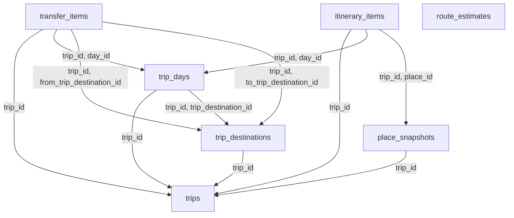

# Database Trip Service

Trip sở hữu lịch trình cá nhân. Cấu trúc giữ nguyên trip nhiều destination và nhiều ngày; composite FK ngăn gắn day/transfer/item từ trip khác. Snapshot giữ khả năng đọc lịch trình khi Catalog thay đổi hoặc tạm lỗi.

Database: `trip_db`; schema nội bộ: `trip`. Có 7 bảng nghiệp vụ/read model và 4 bảng kỹ thuật local. [DDL đầy đủ](sql/trip.sql) là đặc tả chi tiết cột, PK, FK, CHECK, UNIQUE, index; chưa chạy trên database. [Quy ước chung](../03-database-conventions.md).

## Sơ đồ khóa ngoại nội bộ

Mũi tên từ bảng con tới bảng được tham chiếu. External UUID không tạo cạnh FK. Các invariant liên hàng vẫn phải kiểm tra trong application như mô tả bên dưới.

## Quan hệ và invariant nghiệp vụ

1. Owner user_id lấy từ JWT. Mỗi thao tác add/remove/reorder/note tăng trips.version. Kiểm quyền ở service trước đọc/sửa item, không chỉ kiểm tripId trên URL.
2. Start/end có cả hai và end>=start. Ngày phải trong khoảng trip, day_no=local_date-start_date+1 theo policy không ngày trùng. Khi đổi khoảng ngày, giữ parent row lock và reject nếu còn day/item ngoài khoảng, hoặc thực hiện thao tác move/delete rõ ràng được user xác nhận.
3. trip_destination là segment; một destination có thể được ghé lại với segment ID khác. day.trip_destination_id nullable khi user chưa gán khu vực; khi gán phải cùng trip. planned_days là mục tiêu người dùng, số ngày thực tế tính từ trip_days.
4. Item place phải có snapshot trong cùng trip. Người dùng có thể ghé lại cùng place nhiều lần bằng item ID khác. Starts_at có thể null khi chưa lên giờ; nếu có thì local date theo day.timezone phải đúng ngày (visit qua đêm cho phép nhưng kiểm overlap riêng).
5. Reorder khóa trip + kiểm version, defer unique(day_id,sort_order), cập nhật toàn bộ tập vị trí trong một transaction; tập item IDs phải đầy đủ, không duplicate, không chứa item trip khác. Source recommendation không cho phép tự sửa locked item.
6. estimated_cost dùng currency của trip, chỉ chấp nhận tính toán từ giá tương thích currency; UI ghi rõ một người hay tổng theo people_count. Tổng chi phí tính từ item, không lưu cột tổng dễ lệch. Vượt budget là warning ở bản cơ bản, không tự xóa item.
7. Snapshot refresh do user yêu cầu ở DRAFT/PLANNED; COMPLETED không tự đổi theo event Catalog. Hidden/archive chỉ đánh dấu unavailable_at. Giờ mở cửa/route là tư vấn, cần hiển thị freshness; không hứa chắc chắn mở cửa nếu dữ liệu thiếu.
8. route_key hash ordered waypoints + transport mode + provider + departure time bucket + schema version. Provider unavailable trả fallback đường chim bay có label, không gắn duration đường bộ suy đoán. Route cache retention phải theo điều khoản provider.

## API và quyền thực thi

- CRUD /api/v1/me/trips; GET/PATCH/DELETE /api/v1/trips/{id}; PUT state và version.
- POST/PATCH/DELETE /api/v1/trips/{id}/destinations; POST /trips/{id}/days; PATCH/DELETE /trips/{id}/days/{dayId}.
- POST/PATCH/DELETE /api/v1/trips/{id}/days/{dayId}/items; PUT /trips/{id}/days/{dayId}/items/order; PATCH notes/locked.
- CRUD /api/v1/trips/{id}/transfers; POST /trips/{id}/route-estimates; POST /trips/{id}/snapshots/refresh.
- Mọi response private có Cache-Control thích hợp, không cache public theo URL thiếu user.

## Từ điển từng bảng

Ký hiệu: NULL = được bỏ trống; bắt buộc = NOT NULL hoặc PK. Mặc định, FK và CHECK giữ nguyên SQL để tránh diễn giải sai. External UUID xem chú thích DDL và ownership phía trên; không tạo FK tới service khác.

### trip.trips

Aggregate root và version concurrency.

| Cột | Kiểu | Nullability | Mặc định / khóa / ràng buộc |
|---|---|---|---|
| `trip_id` | `uuid` | Bắt buộc | `PRIMARY KEY` |
| `user_id` | `uuid` | Bắt buộc | `NOT NULL` |
| `title` | `varchar(200)` | Bắt buộc | `NOT NULL` |
| `start_date` | `date` | Bắt buộc | `NOT NULL` |
| `end_date` | `date` | Bắt buộc | `NOT NULL` |
| `timezone` | `varchar(64)` | Bắt buộc | `NOT NULL DEFAULT 'Asia/Ho_Chi_Minh'` |
| `budget` | `numeric(14,2)` | NULL | `CHECK (budget IS NULL OR budget >= 0)` |
| `currency` | `char(3)` | Bắt buộc | `NOT NULL DEFAULT 'VND' CHECK (currency ~ '^[A-Z]{3}$')` |
| `people_count` | `integer` | Bắt buộc | `NOT NULL DEFAULT 1 CHECK (people_count > 0)` |
| `status` | `varchar(16)` | Bắt buộc | `NOT NULL DEFAULT 'DRAFT' CHECK (status IN ('DRAFT','PLANNED','COMPLETED','CANCELLED'))` |
| `version` | `bigint` | Bắt buộc | `NOT NULL DEFAULT 1 CHECK (version > 0)` |
| `created_at` | `timestamptz` | Bắt buộc | `NOT NULL DEFAULT now()` |
| `updated_at` | `timestamptz` | Bắt buộc | `NOT NULL DEFAULT now()` |
| `deleted_at` | `timestamptz` | NULL | — |

Ràng buộc cấp bảng:

- `CHECK (end_date >= start_date)`

### trip.trip_destinations

Segment destination được đánh thứ tự.

| Cột | Kiểu | Nullability | Mặc định / khóa / ràng buộc |
|---|---|---|---|
| `trip_destination_id` | `uuid` | Bắt buộc | `PRIMARY KEY` |
| `trip_id` | `uuid` | Bắt buộc | `NOT NULL REFERENCES trip.trips(trip_id) ON DELETE CASCADE` |
| `destination_id` | `uuid` | Bắt buộc | `NOT NULL` |
| `destination_name_snapshot` | `varchar(200)` | Bắt buộc | `NOT NULL` |
| `source_version` | `bigint` | Bắt buộc | `NOT NULL CHECK (source_version > 0)` |
| `sequence_no` | `integer` | Bắt buộc | `NOT NULL CHECK (sequence_no >= 0)` |
| `planned_days` | `integer` | NULL | `CHECK (planned_days IS NULL OR planned_days > 0)` |
| `note` | `text` | NULL | — |

Ràng buộc cấp bảng:

- `UNIQUE (trip_id, trip_destination_id)`
- `UNIQUE (trip_id, sequence_no) DEFERRABLE INITIALLY IMMEDIATE`

### trip.trip_days

Ngày gắn vào trip và segment optional.

| Cột | Kiểu | Nullability | Mặc định / khóa / ràng buộc |
|---|---|---|---|
| `day_id` | `uuid` | Bắt buộc | `PRIMARY KEY` |
| `trip_id` | `uuid` | Bắt buộc | `NOT NULL REFERENCES trip.trips(trip_id) ON DELETE CASCADE` |
| `trip_destination_id` | `uuid` | NULL | — |
| `local_date` | `date` | Bắt buộc | `NOT NULL` |
| `day_no` | `integer` | Bắt buộc | `NOT NULL CHECK (day_no > 0)` |
| `timezone` | `varchar(64)` | Bắt buộc | `NOT NULL DEFAULT 'Asia/Ho_Chi_Minh'` |
| `note` | `text` | NULL | — |

Ràng buộc cấp bảng:

- `UNIQUE (trip_id, day_id)`
- `UNIQUE (trip_id, local_date) DEFERRABLE INITIALLY IMMEDIATE`
- `UNIQUE (trip_id, day_no) DEFERRABLE INITIALLY IMMEDIATE`
- `FOREIGN KEY (trip_id, trip_destination_id) REFERENCES trip.trip_destinations(trip_id, trip_destination_id)`

### trip.place_snapshots

Snapshot per-trip/place là denormalization có chủ đích.

| Cột | Kiểu | Nullability | Mặc định / khóa / ràng buộc |
|---|---|---|---|
| `trip_id` | `uuid` | Bắt buộc | `NOT NULL REFERENCES trip.trips(trip_id) ON DELETE CASCADE` |
| `place_id` | `uuid` | Bắt buộc | `NOT NULL` |
| `name` | `varchar(240)` | Bắt buộc | `NOT NULL` |
| `address` | `text` | Bắt buộc | `NOT NULL` |
| `latitude` | `numeric(9,6)` | Bắt buộc | `NOT NULL CHECK (latitude BETWEEN -90 AND 90)` |
| `longitude` | `numeric(9,6)` | Bắt buộc | `NOT NULL CHECK (longitude BETWEEN -180 AND 180)` |
| `timezone` | `varchar(64)` | Bắt buộc | `NOT NULL` |
| `opening_hours_snapshot` | `jsonb` | Bắt buộc | `NOT NULL DEFAULT '[]'` |
| `source_version` | `bigint` | Bắt buộc | `NOT NULL CHECK (source_version > 0)` |
| `captured_at` | `timestamptz` | Bắt buộc | `NOT NULL DEFAULT now()` |
| `unavailable_at` | `timestamptz` | NULL | — |

Ràng buộc cấp bảng:

- `PRIMARY KEY (trip_id, place_id)`

### trip.itinerary_items

Lượt ghé thăm, duration, note, locked và nguồn gợi ý.

| Cột | Kiểu | Nullability | Mặc định / khóa / ràng buộc |
|---|---|---|---|
| `item_id` | `uuid` | Bắt buộc | `PRIMARY KEY` |
| `trip_id` | `uuid` | Bắt buộc | `NOT NULL REFERENCES trip.trips(trip_id) ON DELETE CASCADE` |
| `day_id` | `uuid` | Bắt buộc | `NOT NULL` |
| `place_id` | `uuid` | Bắt buộc | `NOT NULL` |
| `starts_at` | `timestamptz` | NULL | — |
| `duration_min` | `integer` | Bắt buộc | `NOT NULL CHECK (duration_min > 0)` |
| `sort_order` | `integer` | Bắt buộc | `NOT NULL CHECK (sort_order >= 0)` |
| `note` | `text` | NULL | — |
| `estimated_cost` | `numeric(14,2)` | NULL | `CHECK (estimated_cost IS NULL OR estimated_cost >= 0)` |
| `source` | `varchar(16)` | Bắt buộc | `NOT NULL DEFAULT 'MANUAL' CHECK (source IN ('MANUAL','BASIC_RECO','MODEL'))` |
| `recommendation_request_id` | `uuid` | NULL | — |
| `locked` | `boolean` | Bắt buộc | `NOT NULL DEFAULT false` |
| `created_at` | `timestamptz` | Bắt buộc | `NOT NULL DEFAULT now()` |

Ràng buộc cấp bảng:

- `FOREIGN KEY (trip_id, day_id) REFERENCES trip.trip_days(trip_id, day_id) ON DELETE CASCADE`
- `FOREIGN KEY (trip_id, place_id) REFERENCES trip.place_snapshots(trip_id, place_id)`
- `UNIQUE (day_id, sort_order) DEFERRABLE INITIALLY IMMEDIATE`

### trip.transfer_items

Chuyển giữa hai segment cùng trip, có thể gắn một ngày.

| Cột | Kiểu | Nullability | Mặc định / khóa / ràng buộc |
|---|---|---|---|
| `transfer_id` | `uuid` | Bắt buộc | `PRIMARY KEY` |
| `trip_id` | `uuid` | Bắt buộc | `NOT NULL REFERENCES trip.trips(trip_id) ON DELETE CASCADE` |
| `day_id` | `uuid` | NULL | — |
| `from_trip_destination_id` | `uuid` | Bắt buộc | `NOT NULL` |
| `to_trip_destination_id` | `uuid` | Bắt buộc | `NOT NULL` |
| `starts_at` | `timestamptz` | NULL | — |
| `ends_at` | `timestamptz` | NULL | — |
| `travel_time_min` | `integer` | NULL | `CHECK (travel_time_min IS NULL OR travel_time_min >= 0)` |
| `distance_m` | `integer` | NULL | `CHECK (distance_m IS NULL OR distance_m >= 0)` |
| `transport_mode` | `varchar(20)` | Bắt buộc | `NOT NULL CHECK (transport_mode IN ('WALK','DRIVE','BICYCLE','TRANSIT','FLIGHT','OTHER'))` |
| `route_meta` | `jsonb` | Bắt buộc | `NOT NULL DEFAULT '{}'` |
| `note` | `text` | NULL | — |

Ràng buộc cấp bảng:

- `FOREIGN KEY (trip_id, day_id) REFERENCES trip.trip_days(trip_id, day_id)`
- `FOREIGN KEY (trip_id, from_trip_destination_id) REFERENCES trip.trip_destinations(trip_id, trip_destination_id)`
- `FOREIGN KEY (trip_id, to_trip_destination_id) REFERENCES trip.trip_destinations(trip_id, trip_destination_id)`
- `CHECK (from_trip_destination_id <> to_trip_destination_id)`
- `CHECK (ends_at IS NULL OR (starts_at IS NOT NULL AND ends_at >= starts_at))`

### trip.route_estimates

Cache provider, không phải nguồn dữ liệu giao thông chuẩn.

| Cột | Kiểu | Nullability | Mặc định / khóa / ràng buộc |
|---|---|---|---|
| `route_key` | `varchar(64)` | Bắt buộc | `PRIMARY KEY` |
| `provider` | `varchar(40)` | Bắt buộc | `NOT NULL` |
| `transport_mode` | `varchar(20)` | Bắt buộc | `NOT NULL` |
| `distance_m` | `integer` | Bắt buộc | `NOT NULL CHECK (distance_m >= 0)` |
| `duration_sec` | `integer` | Bắt buộc | `NOT NULL CHECK (duration_sec >= 0)` |
| `route_payload` | `jsonb` | Bắt buộc | `NOT NULL` |
| `fetched_at` | `timestamptz` | Bắt buộc | `NOT NULL DEFAULT now()` |
| `expires_at` | `timestamptz` | Bắt buộc | `NOT NULL` |

Ràng buộc cấp bảng:

- `CHECK (expires_at > fetched_at)`

## Index và khóa bổ sung

- `CREATE INDEX trip_owner_idx ON trip.trips(user_id, updated_at DESC, trip_id) WHERE deleted_at IS NULL;`
- `CREATE INDEX trip_destination_ref_idx ON trip.trip_destinations(destination_id);`
- `CREATE INDEX day_destination_idx ON trip.trip_days(trip_id, trip_destination_id);`
- `CREATE INDEX itinerary_trip_place_idx ON trip.itinerary_items(trip_id, place_id);`
- `CREATE INDEX snapshot_place_idx ON trip.place_snapshots(place_id);`
- `CREATE INDEX transfer_trip_idx ON trip.transfer_items(trip_id, starts_at);`
- `CREATE INDEX route_expiry_idx ON trip.route_estimates(expires_at);`

## Kiểm nhận dữ liệu

- Migration tạo đủ bảng/index/FK trên database riêng; account runtime không đọc DB service khác.
- Bộ test ở phase của service phải cover ràng buộc trong SQL lẫn invariant liên hàng/phân quyền bên trên.
- Source mapping và reconcile: xem [42 bảng nguồn](../02-source-mapping.md) và [migration](../05-migration-cutover.md).
- Các bảng outbox/inbox/audit/idempotency được định nghĩa trong DDL; dispatch, retention, retry và permission phải được triển khai ở P01 và tích hợp vào từng mutation.
