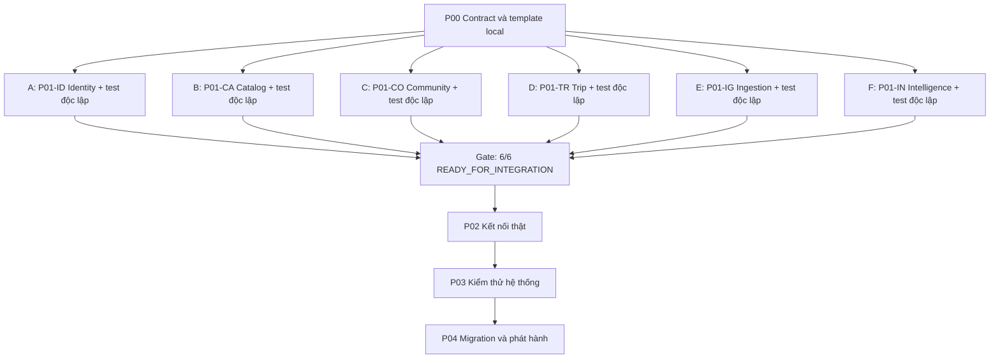

# Lộ trình phát triển song song rồi kết nối

> **Quyết định P00 hiện hành:** hai người N1/N2 phụ trách sáu gói độc lập theo capacity, có frontend và triển khai mới. Recommendation Basic phải hoàn thiện/kiểm thử trước khi bắt đầu ML; sau đó hoàn thiện ML pipeline trong P01 trước gate cuối, kiểm chất lượng dữ liệu thật ở P03. Các đoạn cũ nói phát triển Basic/ML đồng thời không còn áp dụng. Xem [P00-DECISIONS.md](../P00-DECISIONS.md) và [phân công](../06-work-assignment.md).

Trạng thái (20/10/2026): **P00 READY_FOR_REVIEW (chưa đóng gate); P01 code hoàn tất trên `main`, người dùng chấp nhận 11/10/2026, chờ chữ ký reviewer; P02 PARTIAL 12/15 task; P03–P04 NOT_STARTED**. Chi tiết: [progress](../../PROGRESS.md). Gate P00 chờ N1/N2 nhận gói/phê duyệt và freeze revision, xem [manifest](../../backend/platform/P00_HANDOFF.md). Điều chỉnh ngày 08/10/2026. P00–P04 là các cổng điều phối chung. Sau P00, sáu nhóm P01-ID/CA/CO/TR/IG/IN phát triển chức năng của mình song song; từng nhóm tự kiểm thử với database và dependency stub trước khi bàn giao. Không nhóm nào phải chờ service khác hoàn thành mới bắt đầu nghiệp vụ.

| Phase | Công việc | Người làm | Điều kiện và đầu ra |
|---|---|---|---|
| [P00 Chuẩn bị chung](P00-scope-architecture.md) | Chốt scope, contract v1, fixture, template local | Sáu owner + điều phối | Input đủ để mỗi người chạy độc lập |
| [P01 Hoàn thiện và kiểm thử chức năng](P01-services/README.md) | Sáu nhóm cùng phát triển trên DB thật riêng; kiểm thử nghiệp vụ, contract, security và lỗi phụ thuộc bằng stub/harness | A/B/C/D/E/F | Chỉ cần P00; mỗi nhóm đạt READY_FOR_INTEGRATION với test evidence, toàn bộ 6/6 mới mở gate kết nối |
| [P02 Kết nối](P02-service-integration.md) | Gateway/auth thật, HTTP, broker và các luồng liên service | Owner hai đầu + điều phối | Chỉ bắt đầu sau gate 6/6 P01; các luồng độc lập có thể nối song song |
| [P03 Kiểm thử hệ thống](P03-system-verification.md) | Frontend thật, E2E/security/fault/load/restore | Sáu owner + kiểm nhận | P02 xong, không còn stub giữa sáu service |
| [P04 Phát hành](P04-migration-release.md) | Triển khai mới hoặc migration/cutover | Điều phối + domain owners | P03 đạt gate và có rollback |

## Giao việc cho từng người hoặc nhóm

| Owner/nhóm đề xuất | Gói độc lập | Mã task | Folder dự kiến |
|---|---|---|---|
| A | [Identity](P01-services/identity.md) | P01-ID-* | `backend/services/identity-service/**` |
| B | [Catalog](P01-services/catalog.md) | P01-CA-* | `backend/services/catalog-service/**` |
| C | [Community](P01-services/community.md) | P01-CO-* | `backend/services/community-service/**` |
| D | [Trip](P01-services/trip.md) | P01-TR-* | `backend/services/trip-service/**` |
| E | [Ingestion](P01-services/ingestion.md) | P01-IG-* | `backend/services/ingestion-service/**` |
| F | [Intelligence, Basic và pipeline ML](P01-services/intelligence.md) | P01-IN-* | `backend/services/intelligence-service/**` |

A–F là chỗ điền tên owner hoặc nhóm. Mỗi nhóm có thể gồm nhiều người phụ trách các chức năng khác nhau; xem [cách chia việc trong nhóm](../06-work-assignment.md). Ít người hơn có thể nhận nhiều gói theo capacity. Không giả định sáu nhóm hoàn thành cùng ngày. Catalog/Intelligence có scope rộng hơn nên có thể tăng người phụ trách chức năng và kiểm thử.

## Nguyên tắc

- P01 dùng implementation thật của chính service và DB thật riêng. Chỉ dependency ngoài service được giả lập bằng stub/fixture đúng contract.
- HTTP adapter và event handler phải viết xong, kiểm với stub/harness; không để tới P02 mới viết nghiệp vụ hoặc dùng kết quả hardcode để giả hoàn thành.
- READY_FOR_INTEGRATION khác CONNECTED và SYSTEM_VERIFIED. Owner và reviewer xác nhận bằng evidence.
- Contract/schema/fixture v1 thống nhất ở P00. Sửa contract có review producer và consumer; không cần kết nối runtime để review.
- M1–M4 là checklist nội bộ của từng nhóm, không phải các phase toàn dự án để sáu nhóm lần lượt chờ nhau. Nhóm kiểm thử chức năng ngay khi triển khai M2, kiểm thử contract/adapter ở M3, rồi xác nhận lại toàn bộ tại M4.
- Hoàn thành sớm thì bổ sung test/docs hoặc review; chưa tự nối service thật trước gate 6/6. Sau gate, các cặp service có thể tiến hành kết nối song song theo dependency thực tế ở P02.
- ML pipeline được hoàn thiện trên dataset fixture hợp lệ trước kết nối; chất lượng model trên dữ liệu thực kiểm nhận riêng ở P03.
- Task có owner, estimate sau refinement, dependency, evidence và blocker. Chưa gán lịch khi chưa có capacity.

[Bảng phân công và bàn giao](../06-work-assignment.md) · [Mục lục](../README.md)

## Hướng dẫn hoàn thành từng phase

Đọc hướng dẫn phase để phân công và xác nhận đầu ra, sau đó dùng checklist chi tiết trong file được liên kết để thực hiện. P00 đã có implementation/evidence local, trạng thái hiện hành xem [checklist tiến độ](../../PROGRESS.md). Các phase P01–P04 vẫn chưa triển khai; checkbox yêu cầu không tự chứng minh hoàn thành.

### P00 — Chuẩn bị để mọi nhóm có thể bắt đầu

**Đầu vào:** kiến trúc sáu service, mapping F01–F11, database, API/events và phạm vi phát hành.

1. Điều phối điền owner/reviewer A–F, chia chức năng cho thành viên, chỉ định người quản lý file dùng chung. Chốt phần Basic/ML, frontend, provider và nhánh triển khai mới hoặc migration.
2. Các nhóm đồng thời soạn contract của service mình, ví dụ request/response/event và danh sách dependency. Producer và consumer đối chiếu ID, quyền, lỗi, version, retry và dữ liệu mẫu trước khi chốt revision v1.
3. Platform chuẩn bị template build/local/CI; nhóm chức năng chuẩn bị fixture và ca kiểm thử; frontend chuẩn bị API client/màn với stub. Các việc này chạy cùng lúc, phần dùng contract chờ revision tương ứng được chốt.
4. Mỗi nhóm chạy template với DB riêng, test JWKS và stub/harness của đối tác; ghi hướng dẫn khởi động và lệnh kiểm tra có thể lặp lại.
5. Điều phối cùng các owner kiểm [gate P00](P00-scope-architecture.md), lưu revision đầu vào và quyết định còn thiếu.

**Hoàn thành khi:** cả sáu nhóm có cùng contract/fixture revision, chạy local độc lập được và có owner cho mọi quyết định ảnh hưởng scope. Đầu ra gồm contract v1, fixture, template và bảng phân công; khi đó mở P01 cho cả sáu nhóm.

> **Chú thích:** contract là thỏa thuận API/event, fixture là dữ liệu mẫu, stub là chương trình đóng vai đối tác. P00 chỉ cần đủ nền tảng để bắt đầu; việc hoàn thiện deployment chung tiếp tục trong luồng platform.

### P01 — Nhiều người phát triển và kiểm thử chức năng song song

**Đầu vào:** gói P00 đã được bàn giao. A–F đồng thời nhận [sáu gói service](P01-services/README.md); mỗi nhóm dùng database riêng và stub cho các service còn lại.

1. Owner chia checklist của service thành các gói chức năng có người thực hiện, người review, file ownership, input/output và ca kiểm thử. Ví dụ Catalog chia geo/search, place/offering, business/media và handlers; Intelligence chia Basic/history và pipeline ML.
2. Thành viên dựng migration/local runtime cho phần mình theo M1; triển khai nghiệp vụ M2 và adapter/event M3 ngay khi interface nội bộ đã chốt. QA chuẩn bị fixture/test cùng lúc; frontend dựng màn theo contract. M1–M3 có thể chồng lấp theo dependency từng task.
3. Mỗi chức năng phải được kiểm bằng API/handler thật và DB service thật: luồng thành công, dữ liệu sai, phân quyền, version/concurrency, retry/idempotency và lỗi đối tác. Dùng [ma trận kiểm thử](P01-services/README.md) và các ca riêng trong từng gói.
4. Ghép các chức năng **trong cùng service**, chạy regression toàn service tại M4. Reviewer tái hiện bằng hướng dẫn local và kiểm source/image, migration, contract revision cùng báo cáo test.
5. Nhóm đạt yêu cầu ghi `READY_FOR_INTEGRATION` và nộp [manifest bàn giao](../06-work-assignment.md). Điều phối đối chiếu đủ 6/6 trên các revision tương thích trước khi mở P02.

**Hoàn thành khi:** sáu service có nghiệp vụ, adapters/handlers và test độc lập đạt; không còn chức năng placeholder trong scope; mỗi manifest có owner và reviewer xác nhận. Nhóm hoàn thành sớm có thể hỗ trợ review/test cho nhóm khác theo file ownership.

> **Chú thích:** ghép module trong một service được thực hiện ngay trong P01. Kết nối runtime giữa các service diễn ra tại P02. Test bằng stub chứng minh service tuân contract; trace và dữ liệu thật ở P02 mới chứng minh hai service làm việc cùng nhau. Pipeline ML có thể kiểm trên fixture, còn chất lượng model thực thuộc P03.

### P02 — Kết nối các chức năng đã kiểm thử

**Đầu vào:** 6/6 manifest `READY_FOR_INTEGRATION`, revision tương thích và danh sách adapter cần đổi cấu hình.

1. Platform dựng môi trường integration với sáu DB/credential, broker, Gateway, storage, secrets và quan sát hệ thống; từng owner áp dụng migration và image đã bàn giao.
2. Identity cùng các owner nối issuer/JWKS, auth/scopes và Gateway. Sau khi nền tảng này sẵn sàng, chia các cặp owner thực hiện [P02-03 đến P02-09](P02-service-integration.md) theo dependency thực tế.
3. Chạy song song các liên kết Catalog reads, Community–Catalog và Ingestion–Catalog; nối inputs của Intelligence theo từng nguồn. Recommendation–Trip được nghiệm thu khi đọc Catalog và inputs cần thiết đã hoạt động. Notification/deletion kiểm từng consumer trước khi kiểm toàn bộ ack.
4. Thay endpoint/transport/credentials của stub bằng đối tác thật. Chạy lại ca kiểm nhận với ID/token/event thật, bootstrap snapshot + delta, kiểm retry/duplicate/out-of-order và crash sau commit.
5. Frontend chuyển từ API stub sang Gateway; owner hai đầu ghi trace ID, trạng thái/row/version trước–sau và kết quả của mỗi liên kết. Sai contract thì sửa ở owner, cập nhật revision và chạy lại các kiểm tra bị ảnh hưởng.

**Hoàn thành khi:** mọi luồng bắt buộc của [gate P02](P02-service-integration.md) chạy thật, không còn stub giữa sáu service, frontend smoke đạt và từng service được ghi `CONNECTED` với bằng chứng. Đầu ra gồm cấu hình triển khai, route/topic matrix, traces và báo cáo kết nối.

> **Chú thích:** số task P02 dùng để theo dõi; các luồng độc lập có thể làm đồng thời. Provider ngoài hệ thống như email/map còn sandbox phải được ghi rõ. Cùng khởi động thành công chưa đủ để đánh dấu đã kết nối.

### P03 — Kiểm thử toàn hệ thống sau kết nối

**Đầu vào:** môi trường P02 đã kết nối, manifest `CONNECTED`, scope và mục tiêu SLO/RPO/RTO đã chốt.

1. Chốt release candidate gồm image/config/schema/contract revision để các báo cáo cùng mô tả một bản. Gán owner cho mỗi nhóm kiểm thử và liên kết ca kiểm với F01–F11.
2. Phân công đồng thời: nhóm nghiệp vụ/QA chạy E2E và UI; owner các service kiểm authorization và contract; platform cùng owner kiểm lỗi broker/retry, tải và backup/restore; Intelligence kiểm dữ liệu và model thực nếu thuộc scope.
3. Dùng môi trường hoặc khung chạy riêng cho load, outage và restore để các bài kiểm không phá dữ liệu của nhau. Ghi dataset, cấu hình, kết quả đo, trace và lỗi theo mức độ.
4. Giao lỗi về đúng owner, sửa và chạy lại ca lỗi cùng regression bị ảnh hưởng. Nếu thay revision, cập nhật manifest và bằng chứng liên quan của release candidate.
5. Đối chiếu [gate P03](P03-system-verification.md), phạm vi UI, provider và mô hình trước khi xác nhận `SYSTEM_VERIFIED`.

**Hoàn thành khi:** các luồng trong scope đạt, không còn lỗi critical/high về phân quyền hoặc mất dữ liệu, có số đo tải/restore/reconciliation đạt mục tiêu đã chốt và runbook vận hành. Model chưa đạt quality gate giữ `QUALITY_PENDING`; chỉ phát hành Basic nếu scope/quyết định phát hành cho phép.

> **Chú thích:** P01 kiểm chức năng trong từng service; P03 kiểm hành vi cả hệ thống. SLO, RPO và RTO lần lượt là mục tiêu dịch vụ, mức mất dữ liệu tối đa và thời gian phục hồi; số đề xuất trong tài liệu cần được xác nhận bằng phép đo.

### P04 — Migration, triển khai và bàn giao

**Đầu vào:** release candidate `SYSTEM_VERIFIED`, runbook, backup/rollback và owner vận hành.

1. Điều phối xác nhận nhánh A triển khai mới hoặc nhánh B có monolith thực. Mỗi owner chuẩn bị migration/Flyway, dữ liệu seed hoặc mapping/backfill của domain; platform chuẩn bị deployment và giám sát song song.
2. Với nhánh B, hoàn thành đối chiếu dữ liệu/checkpoint/quarantine và rehearsal theo [migration-cutover](../05-migration-cutover.md). Với nhánh A, ghi rõ các mục chuyển dữ liệu cũ không áp dụng và lý do.
3. Diễn tập staging và rollback bao gồm write mới; chốt go/no-go cùng người phụ trách. Triển khai theo [checklist P04](P04-migration-release.md), kiểm soát một writer/domain và traffic theo checkpoint.
4. Các owner chạy smoke user/admin/business/recommendation/trip/map, theo dõi error/queue lag/p95 và stability window đã chốt. Nếu fail thì thực hiện rollback/forward-fix đúng runbook.
5. Bàn giao release log, versions, báo cáo đối chiếu, backup schedule, cảnh báo, quyền truy cập và backlog; cập nhật trạng thái `RELEASED` khi đủ gate.

**Hoàn thành khi:** smoke và chỉ tiêu vận hành đạt, dữ liệu trong scope được đối chiếu hoặc quarantine có hướng xử lý, rollback đã diễn tập và có người tiếp nhận vận hành.

> **Chú thích:** chuẩn bị theo domain có thể làm đồng thời; đổi writer và traffic phải theo kế hoạch cutover đã thống nhất. Với nhánh A, đánh dấu `N/A` có lý do cho yêu cầu monolith; không ghi chúng là đã chạy pass.

## Cách đọc mã task cũ và mới

P00–P04 trong bảng đầu trang là lộ trình điều phối hiện hành. Các file dưới đây giữ cấu trúc, phạm vi và checklist nghiệp vụ cũ để tra cứu; chúng được thực hiện trong các gói tương ứng, không tạo thêm giai đoạn chờ nhau.

| Tài liệu/checklist giữ lại | Thực hiện trong kế hoạch hiện hành | Chú thích |
|---|---|---|
| [P01 Platform](P01-platform-foundation.md) | Template ở P00, nền tảng từng service cùng P01, cấu hình kết nối ở P02 | Không chờ dựng cả sáu app mới bắt đầu domain |
| [P02 Identity](P02-identity.md) | P01-ID | Kiểm chức năng bằng Catalog/ack fixtures trước khi nối thật |
| [P03 Catalog](P03-catalog.md) | P01-CA | Rating/import/contribution handlers hoàn thành bằng fixture |
| [P04 Community](P04-community.md) | P01-CO | Test state machine/rating độc lập; nối Catalog tại P02 |
| [P05 Trip](P05-trip.md) | P01-TR | Snapshot/map/recommendation adapter kiểm bằng stub |
| [P06 Ingestion](P06-ingestion.md) | P01-IG | Import/ack/retry kiểm độc lập với Catalog stub |
| [P07 Basic](P07-intelligence-basic.md) và [P08 ML](P08-intelligence-ml.md) | Hai luồng trong P01-IN | Pipeline chạy với fixture; quality thực thuộc P03 |
| [P09 Kiểm thử hệ thống](P09-integration-hardening.md) | P03 | Giữ các yêu cầu E2E/security/fault/load/restore |
| [P10 Migration/release](P10-migration-release.md) | P04 | Giữ các yêu cầu cutover/rollback/bàn giao |

> **Chú thích:** khi tạo task mới, dùng mã hiện hành như `P01-CA-08`. Khi dẫn checklist cũ, ghi cả tên file và mã task để tránh nhầm `P02-01` của Identity với `P02-01` của kết nối. Mỗi yêu cầu được quản lý một lần; checklist cũ là tham chiếu phạm vi. Ca cần đối tác thật được nghiệm thu tại P02/P03, còn phần chức năng thuộc service phải pass độc lập trước gate P01.
