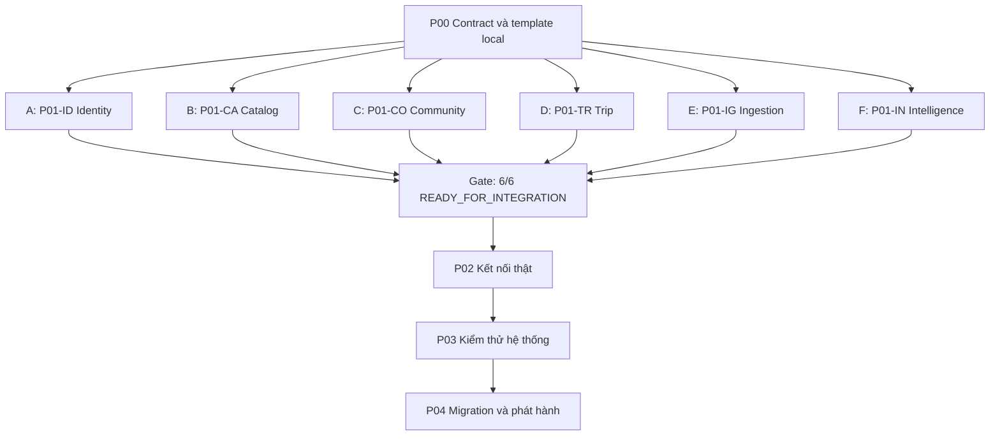

# Lộ trình phát triển song song rồi kết nối

Trạng thái: **Chưa triển khai**. Điều chỉnh ngày 08/10/2026. Mã P00–P04 là phase chung mới; P01-ID/CA/CO/TR/IG/IN là các gói chạy song song, không phải thứ tự chờ nhau.

| Phase | Công việc | Người làm | Điều kiện và đầu ra |
|---|---|---|---|
| [P00 Chuẩn bị chung](P00-scope-architecture.md) | Chốt scope, contract v1, fixture, template local | Sáu owner + điều phối | Input đủ để mỗi người chạy độc lập |
| [P01 Hoàn thiện service](P01-services/README.md) | Sáu service phát triển cùng lúc, DB thật riêng và đối tác stub | A/B/C/D/E/F | Chỉ cần P00; cả sáu đạt READY_FOR_INTEGRATION |
| [P02 Kết nối](P02-service-integration.md) | Gateway/auth thật, HTTP, broker, luồng liên service | Owner hai đầu + điều phối | Chỉ bắt đầu sau gate 6/6 của P01 |
| [P03 Kiểm thử hệ thống](P03-system-verification.md) | Frontend thật, E2E/security/fault/load/restore | Sáu owner + kiểm nhận | P02 xong, không còn stub giữa sáu service |
| [P04 Phát hành](P04-migration-release.md) | Triển khai mới hoặc migration/cutover | Điều phối + domain owners | P03 đạt gate và có rollback |

## Giao việc cho từng người

| Cá nhân đề xuất | Gói độc lập | Mã task | Folder dự kiến |
|---|---|---|---|
| A | [Identity](P01-services/identity.md) | P01-ID-* | `backend/services/identity-service/**` |
| B | [Catalog](P01-services/catalog.md) | P01-CA-* | `backend/services/catalog-service/**` |
| C | [Community](P01-services/community.md) | P01-CO-* | `backend/services/community-service/**` |
| D | [Trip](P01-services/trip.md) | P01-TR-* | `backend/services/trip-service/**` |
| E | [Ingestion](P01-services/ingestion.md) | P01-IG-* | `backend/services/ingestion-service/**` |
| F | [Intelligence, Basic và pipeline ML](P01-services/intelligence.md) | P01-IN-* | `backend/services/intelligence-service/**` |

A–F là chỗ điền tên thật. Ít người hơn có thể nhận nhiều gói nhưng các gói vẫn không chờ runtime của nhau. Không giả định sáu người hoàn thành cùng ngày. Catalog/Intelligence có scope rộng hơn; thêm người hỗ trợ dưới một owner nếu cần.

## Nguyên tắc

- P01 dùng implementation thật của chính service và DB thật riêng. Chỉ dependency ngoài service được giả lập bằng stub/fixture đúng contract.
- HTTP adapter và event handler phải viết xong, kiểm với stub/harness; không để tới P02 mới viết nghiệp vụ hoặc dùng kết quả hardcode để giả hoàn thành.
- READY_FOR_INTEGRATION khác CONNECTED và SYSTEM_VERIFIED. Owner và reviewer xác nhận bằng evidence.
- Contract/schema/fixture v1 thống nhất ở P00. Sửa contract có review producer và consumer; không cần kết nối runtime để review.
- Mỗi gói có M1 database/local → M2 nghiệp vụ → M3 biên giao tiếp → M4 nghiệm thu. Sáu người chạy các mốc này song song.
- Hoàn thành sớm thì bổ sung test/docs hoặc review; chưa tự nối service thật trước gate 6/6.
- ML pipeline được hoàn thiện trên dataset fixture hợp lệ trước kết nối; chất lượng model trên dữ liệu thực kiểm nhận riêng ở P03.
- Task có owner, estimate sau refinement, dependency, evidence và blocker. Chưa gán lịch khi chưa có capacity.

[Bảng phân công và bàn giao](../06-work-assignment.md) · [Mục lục](../README.md)
